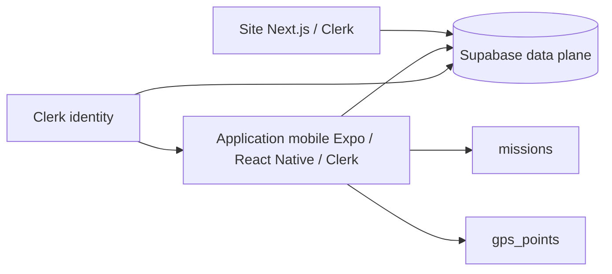

# Application mobile — CleanMyMap

Application mobile Expo/React Native dédiée au suivi GPS des missions terrain.

Elle est issue de l'ancien `companion-app`, terme conservé uniquement pour
l'historique. L'identité de publication V1 est `CleanMyMap`, avec le projet
Expo/EAS `clean-my-map` et les identifiants natifs `fr.cleanmymap.app`. Elle
appartient au même produit et au même
monorepo que `apps/web` ; elle n'est ni une copie ni un projet indépendant.

## Statut

**CURRENT / ACTIVE DEVELOPMENT — NOT_PRODUCTION_READY.**

Les lots 1, 2A et 2B de l'ADR-004 ont raccordé l'identité Clerk, les RLS
`missions`/`gps_points` et la finalisation propriétaire de distance. L'application
mobile est officiellement rouverte par le lot M0 pour reprendre son
développement. La baseline conserve un frontend volontairement réduit et
réutilise les surfaces web existantes lorsque cela suffit. La V1 fonctionnelle
couvre le GPS avec carte et tracé, la reprise/offline, la finalisation serveur,
le contact d'urgence et les trois parcours Agir natifs : participation,
création/publication d'une action et signalement terrain.
L'application reste non prête pour la production tant
que le background headless, les appareils réels et les services de distribution
ne sont pas validés.

Références :

- [Architecture GPS companion](./architecture_gps_companion.md)

```txt
documentation/architecture/adr/ADR-004-companion-identity.md
documentation/architecture/adr/ADR-006-supabase-migrations-source-of-truth.md
```

Cette section et les suivantes décrivent l'architecture et les contrats
actuels du checkout. La section [preuve historique de release mobile](#history--état-de-release-mobile--preuves-au-11-octobre-2026)
est une preuve datée d'un artefact passé : elle ne constitue pas une preuve de
release actuelle, de disponibilité store, de rotation des credentials ou de
fonctionnement des parcours non exécutés.

## Périmètre V1

La V1 mobile s'adresse aux bénévoles terrain et reste volontairement réduite
pour être stabilisée et publiée rapidement. Le site web reste la surface
complète du produit et continue d'évoluer indépendamment ; l'application mobile
ne cherche pas à reproduire toutes ses pages ou capacités.

La V1 fonctionnelle inclut :

- le mode activité GPS live avec carte, restauration du tracé et suivi temps réel ;
- les contacts d'urgence ;
- `Rejoindre une action` avec recherche, détail, inscription future, annulation,
  invitations, suivi et rattachement post-action soumis à validation.
- `Créer une action` avec reprise locale et serveur, les quatre sections
  `Essentiel`, `Terrain`, `Équipe et logistique`, `Vérifier et publier`, puis
  les espaces opérationnels `Préparer` / `Jour J` exposés par l'API canonique.
- `Signaler un déchet` avec `spot` / `clean_place`, position actuelle ou
  manuelle, catégories, observations, photos facultatives, reprise média et
  `Mes observations` (`new`, `validated`, `cleaned`).

Les autres capacités réutilisent au maximum les contrats, données et services
existants du backend commun. La V1 ne crée ni package `shared` générique, ni
second modèle métier, ni gamification parallèle côté mobile.

## Shell mobile V1

Le shell expose une seule barre de navigation permanente en bas de l'écran avec
trois destinations persistantes : `Agir`, `Carte` et `Compte`. Les icônes sont
Lucide React Native, l'état sélectionné est exposé aux technologies
d'assistance et la `SafeAreaView` conserve l'accessibilité de la barre sur les
appareils à encoche ou à barre système. Le registre
`MOBILE_DESTINATION_REGISTRY` contient également `Accueil`, `Réseau` et
`Apprendre` comme destinations planifiées, sans les afficher tant que leurs
parcours natifs ne sont pas réellement implémentés. Il n'y a jamais plus de
cinq destinations primaires sans accès secondaire explicite.

`Agir` présente quatre choix dans des sous-vues navigables :

- `Démarrer une action` vérifie une seule fois les permissions GPS avant de créer
  une mission `pending` owner-scoped avec le `sub` Clerk, puis réutilise
  `startTracking` pour afficher la mission active. Si le démarrage GPS échoue,
  la mission créée est annulée et l'écran actif n'est pas affiché. La mission
  active restaure les `gps_points` owner-scoped, fusionne son tracé UX local et
  reprend le suivi foreground au retour au premier plan et relance le replay du
  buffer local dès que la session Clerk est disponible. Ce suivi ne réécrit pas
  les points ni les métriques dans Supabase. `mission_actions` reste hors
  runtime ; une activité GPS peut seulement être reliée à une action éligible
  via `createLinkedMission` et sa réconciliation serveur ;
- `Rejoindre une action` est natif et passe par la frontière HTTP mobile
  `/api/mobile/actions` ;
- `Organiser une action` réutilise les validations Actions côté serveur. Le
  brouillon local est une aide de reprise ; une lecture AsyncStorage échouée
  bloque toute écriture locale jusqu'à une récupération explicite, et la
  publication n'est confirmée qu'après réponse serveur. Chaque brouillon
  conserve une clé de création stable, envoyée dans `Idempotency-Key` lors du
  POST `/api/actions` ; le serveur la rattache au créateur et à l'action via
  une unicité PostgreSQL et une RPC transactionnelle qui persiste aussi les
  organisateurs et inscriptions initiales. Une réponse perdue est donc
  rejouable sans succès prématuré ni doublon ; une migration absente bloque la
  création au lieu de réactiver un chemin non idempotent.
- `Signaler un déchet` écrit uniquement dans `trash_spotter_spots`, transmet les
  photos via les intents média canoniques et n'affiche jamais un statut avant
  confirmation serveur.

Les sous-vues Agir restent montées pendant les changements d'onglet afin de
préserver les saisies, les chargements et les brouillons. Le bouton de retour
revient à l'accueil Agir, puis le retour système revient à l'onglet Agir avant
de quitter le shell. Une mission active quitte ce shell pour conserver la carte
GPS plein écran et ses interfaces de finalisation.

La destination `Carte` ouvre `/actions/map` pour la consultation existante. Le
mobile n'implémente pas de deuxième messagerie. `Compte` est un hub à sections
(`Mon profil`, `Activité et notifications`, `Préférences`, `Rechercher`, `Aide
et feedback`, `À propos et informations légales`) et charge une projection
privée bornée depuis `/api/mobile/account` : identité Clerk, onboarding,
localisations préférées, rôle attribué/parcours actif, préférences, indicateurs
serveur, historique, invitations, missions GPS et actions organisées. Les
mutations de profil, parcours actif, nom affiché, activité et notifications
réutilisent les contrats web canoniques avec le Bearer Clerk. Les pages web
`/politique-confidentialite`, `/mentions-legales` et `/contact` restent les
surfaces canoniques pour les droits, le contact et la demande d'effacement.
Le compte permet aussi d'enregistrer un unique contact d'urgence dans le
SecureStore local.
Avant toute boîte de permission système, le mobile affiche une explication
native de la collecte des points, du suivi écran éteint, de leur transmission
avec la session Clerk et de la reprise locale hors ligne. Un refus interrompt
le démarrage et permet une nouvelle tentative ultérieure.
Les identifiants de mission active, index de buffer, points GPS en attente,
tracés foreground et réconciliations liées sont namespacés par identifiant
Clerk. Une session expirée ou un changement de compte ne peut donc pas lire ni
rejouer les données d'un autre compte ; les données du propriétaire restent
récupérables à sa reconnexion. Les anciennes clés locales sans owner connu sont
ignorées par conception. Chaque point reçoit aussi un `client_point_id` avant
l'envoi direct ; le même identifiant est conservé dans le buffer et lors du
rejeu, avec une unicité par mission côté PostgreSQL pour absorber une perte
d'acquittement sans doublon.
Dans `Compte > À propos et informations légales`, un utilisateur connecté peut
confirmer une demande de suppression. La route mobile authentifie le Bearer
Clerk, limite les abus et enregistre la demande dans `contact_requests` avec un
identifiant. `notificationStatus=failed` signifie que la demande existe mais
que la notification doit être reprise ; `deletionProcessed=false` reste affiché
tant qu'aucun traitement RGPD effectif n'est confirmé. Après désinstallation,
la même demande reste accessible depuis `/contact` sur le web.
Pendant une mission active, le bénévole peut confirmer l'ouverture d'un appel
vers ce contact ou vers le 112 via `tel:` ; aucune position n'est envoyée
automatiquement.

## Stack

```txt
Expo 57
React Native 0.86.3
TypeScript 6.0.3
expo-dev-client (development build)
expo-splash-screen
Clerk Expo SDK
Supabase client (data plane)
SecureStore
AsyncStorage
expo-location
expo-task-manager
```

Les mises à jour OTA via EAS Update sont explicitement désactivées pour cette
phase (`updates.enabled = false`). Leur activation devra faire l'objet d'une
décision de déploiement dédiée, avec validation de la stratégie de version et
de signature.

Le SDK Expo 57 est aligné sur React Native 0.86.3, React 19.2.3,
TypeScript 6.0.3 et AsyncStorage 2.2.0. `expo-doctor` doit rester à 21/21
contrôles passés. Le workspace racine force les mêmes versions React/RN pour
éviter qu'un peer du web ne réintroduise un doublon dans le binaire natif.

Les tests de contrat de la frontière Bearer couvrent les refus, l'expiration et
la sélection de l'identité côté serveur, mais ils ne constituent pas une preuve
d'un JWT Clerk réel accepté par un environnement distant. Cette preuve positive
reste une validation opérationnelle à exécuter avec une session Clerk et une
configuration autorisées avant toute déclaration de release.

Expo SDK 57 fournit le niveau Android compile/target API 36 et
`expo-build-properties` le fixe explicitement dans la configuration de build.
La configuration SDK/Android a été confrontée au premier APK `preview`
signé ; cette preuve n'établit pas encore la conformité des parcours
natifs, de l'authentification complète ou de la publication store.

## Candidate de build EAS

`eas.json` porte trois profils bornés :

- `development` : development client et distribution interne ;
- `preview` : distribution interne, avec APK Android pour le partage d'équipe ;
- `production` : artefact destiné aux stores (AAB Android par défaut).

Le versioning de départ est explicite et local : `version` `1.0.0`,
`android.versionCode` `1` et `ios.buildNumber` `1`. Toute nouvelle release doit
incrémenter les compteurs natifs selon les règles des stores ; aucun compteur
n'est auto-incrémenté ou stocké dans un service distant par cette configuration.
`eas.json` fixe explicitement `cli.appVersionSource` à `local`. Le projet EAS
existant du propriétaire `maxdie` est maintenant rattaché par son
`projectId` explicite dans `app.json` ; aucun deuxième projet ne doit être
créé.

Les identifiants de publication courants sont : slug `clean-my-map`, scheme
`companion`, package Android et bundle iOS `fr.cleanmymap.app`, et projet EAS
`580b0d1c-d5d3-4c42-9b58-4ee7724a6027`. Les anciens identifiants
`cleanmymap-companion` et `fr.cleanmymap.companion` restent documentés dans
l'ADR comme historique ; la disponibilité des anciens ou nouveaux identifiants
sur les stores n'est pas déduite du dépôt.

Les profils EAS doivent recevoir les valeurs réelles de
`EXPO_PUBLIC_SUPABASE_URL`, `EXPO_PUBLIC_SUPABASE_ANON_KEY` et
`EXPO_PUBLIC_CLERK_PUBLISHABLE_KEY` via l'environnement de build. La clé
`GOOGLE_MAPS_API_KEY` est également requise pour les tuiles Google Maps Android
d'un binaire standalone ; elle est volontairement absente du dépôt. Ces valeurs
ne sont pas des secrets serveur : aucune `service_role` ne doit être fournie à
l'application mobile.

La configuration native conserve uniquement le scheme `companion`, nécessaire
aux retours de l'authentification hébergée Clerk via le plugin Expo Clerk. Les
associations HTTPS Android/iOS et le parcours entrant `/mission/start` ne sont
pas déclarés dans la V1 : aucun routeur mobile ne consomme encore cette URL et
aucun fichier `assetlinks.json` ou `apple-app-site-association` n'est maintenu
pour elle. Les ponts vers les surfaces web restent des ouvertures sortantes
explicites et ne constituent pas du deep linking entrant.

La configuration de localisation est portée par le plugin `expo-location` :
foreground et background iOS, `ACCESS_BACKGROUND_LOCATION`,
`FOREGROUND_SERVICE` et `FOREGROUND_SERVICE_LOCATION` Android. Le mode
`fetch` iOS inutile au suivi GPS a été retiré. Les options Expo SDK 57 devenues
invalides (`newArchEnabled`, `android.edgeToEdgeEnabled` et la clé `splash`
legacy) ont été supprimées ou migrées vers `expo-splash-screen`.
`expo-image-picker` demande les photos mais bloque explicitement le microphone ;
`RECORD_AUDIO` ne fait pas partie des permissions résolues attendues.

## Installation et contrôles courants

Depuis la racine du monorepo :

```bash
npm install
npm run mobile:typecheck
npm run mobile:test
npm run mobile:security
npm run mobile:lint
npm run quality:mobile-coverage
npm start -w apps/mobile
```

Ces commandes vérifient le code et lancent le serveur Expo ; elles ne créent
pas de projet EAS et ne publient aucun artefact.

## Procédure de release reproductible

Les commandes suivantes s'exécutent depuis `apps/mobile` pour la configuration
Expo et depuis la racine pour les contrôles du workspace. Elles ne créent pas
de projet EAS et ne modifient pas les credentials :

```bash
cd apps/mobile
npx expo-doctor
npx expo config --json
npx expo prebuild --no-install --platform android
cd ../..
npm run mobile:typecheck
npm run mobile:test
npm run mobile:security
npm run mobile:lint
npm run quality:mobile-coverage
```

La sortie de `expo config --json` doit conserver `name=CleanMyMap`, le slug et
les identifiants natifs courants, `scheme=companion`, le target Android 36,
les cinq permissions GPS attendues, aucune association HTTPS entrante et aucun
`RECORD_AUDIO`. La présence de `GOOGLE_MAPS_API_KEY` dans l'environnement de
build est nécessaire pour injecter la clé Android Google Maps ; sa valeur ne
doit jamais être committée. Sur Windows, la génération/validation du projet
iOS nécessite macOS ou Linux ; `expo prebuild --platform ios` ne constitue pas
une preuve iOS depuis cet hôte.

Le projet EAS est maintenant rattaché par `app.json`. Après vérification des
variables publiques autorisées (`EXPO_PUBLIC_SUPABASE_URL`,
`EXPO_PUBLIC_SUPABASE_ANON_KEY`, `EXPO_PUBLIC_CLERK_PUBLISHABLE_KEY`,
`EXPO_PUBLIC_WEB_URL`, `EXPO_PUBLIC_WEB_APP_URL` et `GOOGLE_MAPS_API_KEY`), les
commandes de build sont :

```bash
cd apps/mobile
eas project:info
eas build --platform android --profile development
eas build --platform android --profile preview
eas build --platform android --profile production
eas build --platform ios --profile production
eas build:list --limit 10
```

Le profil `preview` produit l'APK Android interne demandé pour un premier test
installable. Le profil `production` produit l'AAB Android et l'archive iOS
signés uniquement si les credentials et autorisations sont réellement
disponibles. Ne lancer aucun de ces builds si le projet EAS, les variables ou
les credentials ne sont pas vérifiés ; ne soumettre aucun store depuis cette
procédure.

### Vérification physique obligatoire

Pour chaque artefact, conserver le lien EAS, l'identifiant du build, le SHA de
la candidate et les logs. Sur Android réel, vérifier installation, callback
Clerk, session persistante/changement de compte, refus puis reprise de
permission, suivi foreground/background, verrouillage, kill/relaunch, offline,
replay et finalisation serveur, carte/tracé, participation, création et
publication, signalement avec photo et déconnexion. Sur iOS réel ou runner
Apple adapté, reprendre les mêmes scénarios et contrôler les justifications
de localisation/photos, l'absence de microphone, les signatures et le retour
Clerk. Aucun contrôle statique, test Vitest ou écran Expo Web ne remplace ces
preuves.

## HISTORY — État de release mobile — preuves au 11 octobre 2026

Les éléments de cette section sont conservés pour la traçabilité de la
baseline. Ils sont datés, liés à un artefact et séparés du statut `CURRENT`
ci-dessus. Ils ne doivent pas être recopiés comme preuve d'une nouvelle release.

### Premier build Android

Le projet EAS `@maxdie/clean-my-map` (projectId
`580b0d1c-d5d3-4c42-9b58-4ee7724a6027`) a produit un APK
`preview` **signé et installable** :
[build `beef5909-cd36-4ce9-971e-d3930680ee79`](https://expo.dev/accounts/maxdie/projects/clean-my-map/builds/beef5909-cd36-4ce9-971e-d3930680ee79),
source `fff2ce58a55dc36df7c791e4884f0fd937151bd5`,
version `1.0.0 (1)`, statut `Succeeded`, durée 11 min 49 s.
L'APK transmis (97 560 669 octets) est une archive intègre ; le bundle
`assets/index.android.bundle` (5 579 248 octets, Hermes) est présent.
Il ne s'agit **pas** d'un AAB soumis à Google Play.

EAS a chargé six variables de l'environnement `preview` :
`EXPO_PUBLIC_CLERK_PUBLISHABLE_KEY`,
`EXPO_PUBLIC_SUPABASE_ANON_KEY`,
`EXPO_PUBLIC_SUPABASE_URL`,
`EXPO_PUBLIC_WEB_APP_URL`, `EXPO_PUBLIC_WEB_URL`,
`GOOGLE_MAPS_API_KEY`. Ce constat n'atteste pas leur valeur ni
les résultats des appels réseau.

### Diagnostic Android et incident Clerk

Sur appareil réel, ADB a confirmé la présence des deux packages
`fr.cleanmymap.companion` (historique) et `fr.cleanmymap.app` (EAS).
Le démarrage explicite de `fr.cleanmymap.app` a chargé Hermes et affiché
`ReactNativeJS: Running "main"` dans les logs. Un ancien message
`Unable to load script` ne démontre donc pas l'absence du bundle
dans ce nouvel APK.

La cause racine du chargement infini `CHARGEMENT...` a été prouvée
par `ClerkLog` : `code=native_api_disabled`, tandis que
`useAuth().isLoaded` restait faux. Après activation de **Native API**
dans l'instance Clerk **Production**, et enregistrement de l'application
Android `fr.cleanmymap.app`, le **même APK** a atteint l'écran
de connexion. La capture Clerk montrait le Frontend API
`clerk.cleanmymap.fr`, une empreinte SHA-256 et l'allowlist
`clerk://fr.cleanmymap.app.callback`. Le `scheme` Expo reste
`companion` ; leur compatibilité au retour de l'authentification
hébergée est **non testée**, et ne doit pas être inférée.

Pour reproduire le diagnostic sous PowerShell avec un Android branché
en USB et le débogage autorisé :

```powershell
$adb = "$env:LOCALAPPDATA\CleanMyMap-Tools\platform-tools\adb.exe"
& $adb devices
& $adb shell pm list packages | Select-String "cleanmymap"
& $adb logcat -c
& $adb shell am force-stop fr.cleanmymap.app
& $adb shell monkey -p fr.cleanmymap.app -c android.intent.category.LAUNCHER 1
Start-Sleep -Seconds 30
$appPid = (& $adb shell pidof fr.cleanmymap.app).Trim()
if ($appPid) {
  & $adb logcat -d -v threadtime --pid=$appPid |
    Select-String "ClerkLog|ReactNativeJS|native_api_disabled" -Context 2,3
} else {
  & $adb logcat -d -v threadtime |
    Select-String "AndroidRuntime|FATAL EXCEPTION|fr.cleanmymap.app" -Context 2,3
}
```

### Vérifications restantes et signature

| Contrôle | État |
|---|---|
| APK EAS `preview` signé, installé et lancé | **PASS** sur l'artefact daté |
| Clerk Native API Production et écran de connexion | **PASS** après correction distante |
| Hosted auth, retour navigateur, session et JWT accepté par les API/RLS | **NOT_RUN** |
| Tuiles Maps et restrictions Google Cloud effectives | **NOT_RUN** |
| Missions GPS, permissions, écran verrouillé, offline/replay, finalisation serveur | **NOT_RUN** |
| Participation, création d'action, signalement/photo, compte | **NOT_RUN** |
| iOS, publication stores, déclarations de confidentialité, MobSF | **NOT_RUN** |
| Couverture ratchetée | État historique : 36,13 % des lignes pour un seuil à 49,25 % ; aucun run imputable à cet APK |

Le premier keystore EAS `CleanMyMap-Android-Production` a été utilisé
pour signer l'APK, **mais ses mots de passe ont été exposés**.
Sa rotation n'est pas confirmée. Avant toute publication officielle,
renouveler la signature dans les conditions appropriées, puis actualiser
les empreintes : SHA-256 chez Clerk et SHA-1 pour les restrictions
Google Maps Android, en distinguant l'éventuel certificat Google Play
App Signing. Ne jamais publier de JKS, clé privée ou mot de passe.

Le projet Google Cloud `cleanmymap-prod-fr`, sa facturation liée,
Maps SDK for Android activé et la création de l'app Play Console ont
été déclarés, **pas audités comme fonctionnement ou publication**.
Une alerte de budget n'est pas une limite bloquante de facturation.
FCM V1 et le compte de service de soumission Google Play étaient absents
lors du build, sans bloquer ce premier APK autonome.

Les tests terrain d'auth, retour Clerk, cartes, GPS background,
verrouillage, offline, replay, données serveur et parcours natifs,
ainsi que l'audit sécurité MobSF et les procédures stores, restent
nécessaires. **Statut : `CURRENT / ACTIVE DEVELOPMENT —
NOT_PRODUCTION_READY`.** Aucune validation iOS, AAB ni publication
store n'est revendiquée.

## Pourquoi une app native ?

Le suivi GPS fiable en arrière-plan nécessite les APIs natives du système.

L'app utilise notamment :

- permissions de localisation ;
- tâche background ;
- notification persistante Android ;
- stockage local pour les points non synchronisés.

Le navigateur web ne doit pas être considéré comme équivalent pour ce besoin.

## Architecture actuelle



Le site et l'application mobile partagent le même produit, le même projet
Supabase, Clerk et les contrats métier nécessaires.

Le runtime mobile n'utilise pas `mission_actions`. Les photos de signalement
passent par les intents et le stockage signé du backend ; le mobile ne crée pas
une table ou un modèle média parallèle.

Les effets métier restent produits par le backend commun : les missions mobiles
réutilisent les projections web existantes pour la gamification, l'impact, les
statistiques et les autres dérivés. Le mobile ne calcule ni ne persiste une
projection parallèle.

## Identité Clerk

Le web et l'application mobile utilisent Clerk comme fournisseur d'identité
principal du produit.

Le LOT 1 de l'ADR-004 est accepté et implémenté : Clerk est l'unique identité
utilisateur de l'application mobile. L'interface utilise l'authentification hébergée
Clerk (Account Portal), avec les méthodes activées dans le compte Clerk.

Le `ClerkProvider` utilise le cache de token sécurisé Expo. Le client Supabase
reste uniquement un data plane : il utilise la clé publique anon pour le
transport et le token de session Clerk courant via `accessToken`. Supabase Auth
n'est pas le fournisseur d'identité de l'application mobile et aucune session
Supabase Auth n'est persistée ou observée.

Le chemin d'identité anonyme a été supprimé. Aucun JWT template legacy n'est
copié dans l'app et aucune clé `service_role` n'est embarquée.

Le contrat RLS lit le `sub` Clerk et le rapproche de `missions.volunteer_id`.
Il est porté par la migration additive du LOT 2A. L'application mobile ne doit
toujours pas être qualifiée de prête pour la production : le background headless
et l'usage opérationnel réel restent à valider. `mission_actions` et la photo
de mission restent hors runtime. Les preuves photo de signalement utilisent le
contrat média canonique. Le
renouvellement Clerk headless est maintenant câblé et couvert par des tests
automatisés ; il doit encore être confirmé sur development build.

Voir `ADR-004`.

## Finalisation de mission : contrat serveur invariant

Le mobile effectue le flush des points GPS, puis une seule mise à jour de la
mission vers `completed` avec `ended_at`. Un trigger `BEFORE UPDATE` serveur
calcule alors la distance Haversine et la durée dans `NEW`, puis la ligne
finalisée est renvoyée par le même `.select()`.

La fonction du trigger est `SECURITY INVOKER` avec `search_path = pg_catalog` :
la lecture des `gps_points` reste donc soumise aux RLS de l'appelant. Le
propriétaire Clerk peut finaliser sa mission ; un autre utilisateur et `anon`
ne peuvent pas atteindre cette mise à jour. Les grants mobiles restent limités
à `status`, `started_at` et `ended_at` ; `distance_m` et `duration_s` ne sont
jamais directement inscriptibles par le client. Le mobile ne calcule ni la
distance ni la durée lui-même.

Après une finalisation réussie, l'écran affiche directement la durée, la
distance et l'état de synchronisation renvoyés par le serveur, puis propose de
revenir à l'accueil. Un échec de synchronisation ou de finalisation conserve la
mission active et son suivi.

## Variables d'environnement

Créer :

```txt
apps/mobile/.env
```

à partir de :

```txt
apps/mobile/.env.example
```

Variables publiques attendues :

```txt
EXPO_PUBLIC_SUPABASE_URL
EXPO_PUBLIC_SUPABASE_ANON_KEY
EXPO_PUBLIC_CLERK_PUBLISHABLE_KEY
# Base du site utilisée par les ponts web du shell mobile
EXPO_PUBLIC_WEB_URL
EXPO_PUBLIC_WEB_APP_URL
GOOGLE_MAPS_API_KEY
```

Ne jamais ajouter :

```txt
SUPABASE_SERVICE_ROLE_KEY
```

dans l'app mobile.

## GPS background

Expo Go ne suffit pas pour valider le suivi en arrière-plan.

Utiliser un development build :

```bash
npx expo run:android
```

ou sur macOS :

```bash
npx expo run:ios
```

Le TaskManager demande le token Clerk courant avant toute écriture Supabase.
Lorsqu'un réveil headless intervient après un kill ou une reprise réseau, le
singleton Clerk est initialisé avec le publishable key et le `tokenCache`
SecureStore, puis chargé avant la demande du token. Si aucun token valide n'est
disponible, aucune authentification alternative n'est tentée : les points sont
conservés dans le buffer local sécurisé et seront rejoués lors d'un réveil
ultérieur avec une session valide. Cette résilience automatisée ne remplace pas
la validation terrain ; `mission_actions` demeure hors runtime V1 et pourra être
réintroduit dans une évolution dédiée.

## Structure

```txt
apps/mobile/
├── App.tsx
├── index.ts
├── app.json
├── screens/
│   ├── mobile-shell.tsx
│   └── mobile-shell-contract.ts
├── lib/
│   ├── supabase.ts
│   ├── storage.ts
│   └── tracking-service.ts
├── tasks/
│   └── gps-task.ts
└── types/
    └── mission.ts
```

## Supabase

Ne pas exécuter manuellement le SQL du README dans le dashboard.

Les migrations sont versionnées dans le dépôt.

Workspace CLI actuel :

```txt
apps/web/supabase/
```

Les migrations sont maintenues uniquement dans `apps/web/supabase/`. Voir
`ADR-006` pour la décision de source de vérité.

## CURRENT — Baseline M0 et contrôles avant production

```txt
☑ Identité mobile alignée avec Clerk côté SDK et token provider (LOT 1)
☑ Intégration Clerk Third-Party Auth configurée et RLS missions validées (LOTS 2A/2B)
☑ Ownership des missions protégé par contrat
☑ RLS missions protégée par contrat
☑ RLS gps_points protégée par contrat
☑ `mission_actions` hors runtime V1 ; contrat serveur conservé pour les autres parcours
☑ Finalisation distance côté serveur ou RPC sûre (LOT 2B)
☑ Erreur de calcul de distance traitée
☑ Buffer offline conservé sans token Clerk et rejoué sans flush concurrent doublé
  ☑ Restauration mission active et du tracé après reprise/relaunch testée
  ☑ Fusion serveur/local sans doublons visibles testée
  ☑ Échec de flush/finalisation conservant la mission récupérable testé
  ☑ Écran mission terrain-first : carte dominante, état GPS/sync, métriques live indicatives
☑ Refus de permissions testé
☑ Cohérence identité Clerk → Supabase testée
☑ Cache de token Clerk dans SecureStore configuré (LOT 1)
☑ Renouvellement du token Clerk en background headless (câblage + tests automatisés)
□ Usage opérationnel web et validation production
```

## CURRENT — Validation locale disponible

La validation locale ne remplace pas la preuve Clerk Development, appareil
réel, Supabase autorisé, signature ou store. Les lignes cochées ci-dessus sont
des contrats/tests du dépôt ; les lignes non exécutées dans la preuve de
release historique restent `NOT_RUN`.

```bash
npm run mobile:typecheck
npm run mobile:test
npm run mobile:security
npm run mobile:lint
npm run quality:mobile-coverage
```

La baseline M0 couvre désormais par tests unitaires et contractuels :

- restauration d'une mission active ;
- stockage offline ;
- replay du buffer GPS, y compris le flush concurrent sérialisé ;
- refus des permissions GPS ;
- finalisation d'une mission et conservation après erreur ;
- erreurs Supabase ;
- propriété de mission via RLS ;
- cohérence identité Clerk → Supabase ;
- absence d'écriture client directe des métriques dérivées.

La synchronisation mobile est aussi couverte sur ses branches de reprise :

- les ajouts et suppressions de réconciliations sont sérialisés par propriétaire
  Clerk, et une reprise concurrente du même propriétaire est coalescée ;
- un changement de compte avant l'émission réseau ou pendant la résolution du
  client interrompt l'opération sans lire ni envoyer le namespace précédent ;
- un point GPS conserve le même `client_point_id` entre envoi direct, buffer,
  redémarrage et rejeu après perte d'acquittement ; les anciens points sans cet
  identifiant reçoivent une identité persistée avant leur première reprise ;
- la lecture du tracé conserve l'identité client des points historiques, tandis
  que les métriques `distance_m` et `duration_s` restent dérivées côté serveur.

Ces tests unitaires, le contrat SQL statique et les contrôles RLS ne remplacent
pas une exécution PostgreSQL à deux sessions. Tant que cette exécution n'est pas
disponible dans l'environnement autorisé, la preuve doit rester marquée
`DB_SEMANTICS_NOT_EXECUTED`.

Le contrat du shell protège aussi les trois destinations V1 et les ponts vers les
surfaces web existantes.
