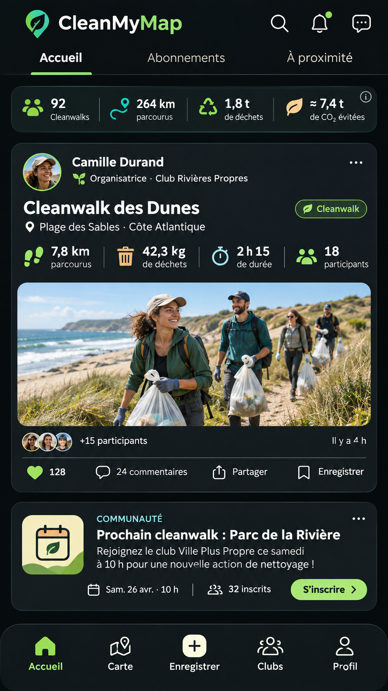

# 01 | Accueil et fil de cleanwalks

> Statut : **BENCHMARK / PLAN** (fiche UX). État mobile observé : `PLAN`. Famille visuelle : **Accueil**. Lien matrice : `A01-A10`.

## Objectif de la page

Faire découvrir l’activité de la communauté et donner envie d’agir.

## Référence Strava réelle

**Ce que montre réellement l’image :** Visuel « Share with friends » : carte d’activité, photo et actions sociales, dans une composition promotionnelle.

**Provenance :** visuel promotionnel public de la fiche [Google Play Strava](https://play.google.com/store/apps/details?id=com.strava), consulté le 3 novembre 2026. Il contient un aperçu authentique de Strava dans un habillage marketing, **pas nécessairement la capture de la page exacte**. Résolution source réduite : 166 × 296 px. Les captures restent la propriété de Strava ; droits de redistribution dans un dépôt Git public non vérifiés.

**Limite de correspondance :** la référence montre un principe graphique voisin. Les zones et interactions décrites ci-dessous sont des **propositions CleanMyMap**, pas une affirmation sur le pixel-perfect ni une preuve que Strava possède tous ces écrans.

## Modèle CleanMyMap existant

**Lecture du modèle :** composition exploratoire. Les nombres, noms, photos, badges, unités, trajets ou estimations représentés sont fictifs et ne doivent pas être codés comme données runtime, constantes métier ou règles scientifiques.

## Composition visuelle cible

| Ordre | Zone | Emprise indicative | Contenu et hiérarchie | Comportement à viser |
|---:|---|---|---|---|
| 1 | **Barre supérieure** | 6–9 % | Marque compacte, recherche, notifications et accès messages. Aucun compteur inventé. | Actions globales ouvertes sans perdre la position du flux. |
| 2 | **Navigation secondaire** | 5–6 % | Flux général, abonnements, à proximité lorsque ces filtres sont réellement disponibles. | La sélection doit être annoncée et persistée uniquement si le produit le prévoit. |
| 3 | **Synthèse personnelle** | 8–12 % | 1 à 3 KPI réellement disponibles, bornés à la largeur ; aucune estimation non documentée. | Cliquer pour afficher la source et la période. |
| 4 | **Fil social** | reste de l’écran | Cartes verticales : auteur, club, date, type, titre, média ou carte, 2–4 métriques qualifiées, réactions. | Place prioritaire à la première activité et à son action principale. |
| 5 | **Navigation persistante** | 8–10 % | Navigation mobile stable selon registre de destinations réellement choisi. | Ne pas introduire cinq onglets sans validation produit. |

**Grammaire visuelle** : fond sombre par défaut, cartes très contrastées, hiérarchie de typographie claire, 1 CTA primaire identifiable, composants tactiles confortables, Safe Area et clavier respectés. Couleurs par familles du site web : Agir émeraude, Carte ciel, Impact rouge/rose, Réseau rose/indigo, Accueil ambre/brun. La couleur des boutons encode leur priorité, pas le domaine. Ne pas reprendre l’orange de marque Strava.

## Parcours et gestes

1. Toucher une carte ouvre son détail et revenir conserve le scroll.
2. Afficher des cartes sans photo sans créer de trou.
3. Les actions sociales qui n’existent pas restent absentes ou explicitement PLAN.

## États visuels à concevoir

- Flux vide contextualisé
- chargement progressif
- erreur réseau et réessai
- contenu privé ou modéré masqué

## Frontières métier, sécurité et données

- Le contenu provient des publications autorisées, jamais de faux bilans.
- Les chiffres illustrés par un mockup ne sont pas un contrat scientifique.
- Respecter la source de vérité web, les permissions Clerk/Supabase et la confidentialité. Ne pas inventer de données ni d’API.
- Conserver les parcours mobiles CURRENT et les ponts web tant que les fonctionnalités futures ne sont pas réellement intégrées.

## Consignes pour Codex

- Lire la matrice Strava associée et confronter cette proposition à la version courante du shell mobile, des règles scoped et du design system canonique.
- Reproduire **le patron UX générique** (hiérarchie, densité, geste, rythme, zones), pas les ressources graphiques, logos, images propriétaires ou code de Strava.
- Ne développer que la responsabilité du lot autorisé : ce document ne déclenche pas une implémentation ni une migration.
- Lorsque la page sera développée, tester les états vide, erreur, chargement, permission et retour, puis comparer une capture d’émulateur avec la référence CleanMyMap approuvée.
- Si le mockup contredit un contrat web, une permission ou une donnée réelle, préserver le contrat et noter l’écart visuel.

## Sources pour vérifier le comportement Strava

- https://play.google.com/store/apps/details?id=com.strava
- https://support.strava.com/fr/articles/15401943-affichage-des-activites

## Références complémentaires trouvées le 3 novembre 2026

Voir le [catalogue de sources et limites](./REFERENCES_STRAVA_COMPLEMENTAIRES_2026.md). Références ciblées : **S02, S11**. Les sources non illustrées ne prouvent pas la composition exacte de l’écran.
