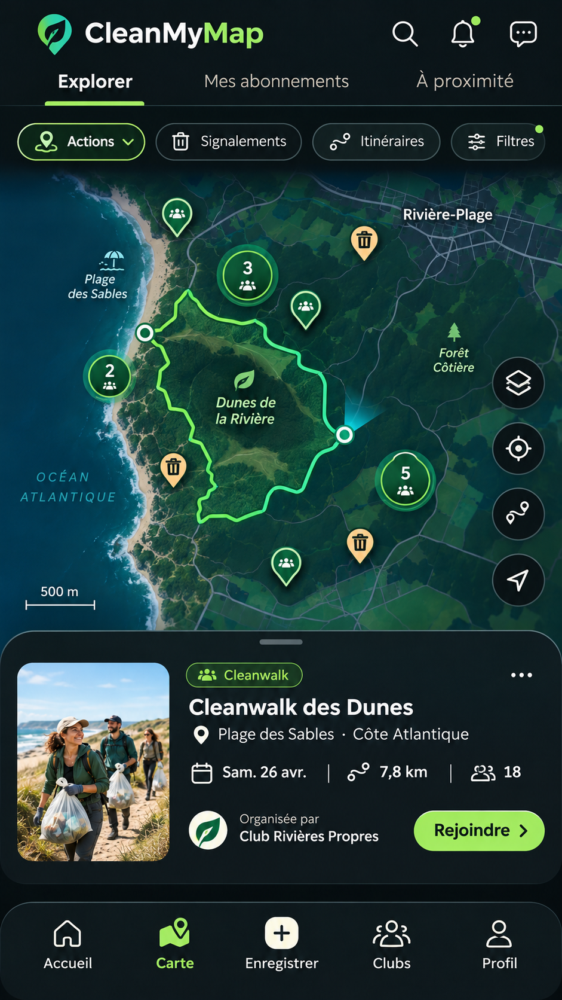

# 02 | Carte et exploration territoriale

> Statut : **BENCHMARK / PLAN** (fiche UX). État mobile observé : `PONT WEB / PLAN`. Famille visuelle : **Cartographie**. Lien matrice : `D01-D15`.

## Objectif de la page

Trouver une action, un signalement ou un itinéraire depuis une carte dominante.

## Référence Strava réelle

**Référence visuelle locale (non versionnée) :** consulter [l'emplacement et la provenance](./REFERENCES_STRAVA.md#captures-locales-non-versionnees) ; la source officielle et la limite de correspondance sont indiquées ci-dessous.

**Ce que montre réellement l’image :** Visuel « Discover new routes » : carte, parcours et carte contextuelle, dans une composition promotionnelle.

**Provenance :** visuel promotionnel public de la fiche [Google Play Strava](https://play.google.com/store/apps/details?id=com.strava), consulté le 3 novembre 2026. Il contient un aperçu authentique de Strava dans un habillage marketing, **pas nécessairement la capture de la page exacte**. Résolution source réduite : 166 × 296 px. Les captures restent la propriété de Strava ; droits de redistribution dans un dépôt Git public non vérifiés.

**Limite de correspondance :** la référence montre un principe graphique voisin. Les zones et interactions décrites ci-dessous sont des **propositions CleanMyMap**, pas une affirmation sur le pixel-perfect ni une preuve que Strava possède tous ces écrans.

## Modèle CleanMyMap existant

**Lecture du modèle :** composition exploratoire. Les nombres, noms, photos, badges, unités, trajets ou estimations représentés sont fictifs et ne doivent pas être codés comme données runtime, constantes métier ou règles scientifiques.

## Composition visuelle cible

| Ordre | Zone | Emprise indicative | Contenu et hiérarchie | Comportement à viser |
|---:|---|---|---|---|
| 1 | **Recherche et couches** | haut flottant | Barre de recherche; filtres Actions / Signalements / Itinéraires comme choix du produit, pas des filtres actifs fictifs. | Chips accessibles et état explicite. |
| 2 | **Fond de carte** | 65–80 % | Carte réellement interactive, marqueurs et légende sémantique. | Préserver l’espace pour les gestes pan / pinch / zoom. |
| 3 | **Commandes flottantes** | bord droit | Recentrage, couches et retour à la géolocalisation sans masquage de la carte. | Garder les contrôles hors zone système. |
| 4 | **Feuille de sélection** | bas, hauteur variable | Fiche courte sélectionnée : titre, statut, lieu, date, organisateur, CTA autorisé. | Bottom sheet repliée / intermédiaire / agrandie. |
| 5 | **Navigation mobile** | bas | Onglet Carte visible et retour contrôlé à la sélection précédente. | La carte native n’est pas CURRENT sur main. |

**Grammaire visuelle** : fond sombre par défaut, cartes très contrastées, hiérarchie de typographie claire, 1 CTA primaire identifiable, composants tactiles confortables, Safe Area et clavier respectés. Couleurs par familles du site web : Agir émeraude, Carte ciel, Impact rouge/rose, Réseau rose/indigo, Accueil ambre/brun. La couleur des boutons encode leur priorité, pas le domaine. Ne pas reprendre l’orange de marque Strava.

## Parcours et gestes

1. Sélectionner un pin puis fermer la feuille sans changer arbitrairement la zone.
2. Combiner filtres sans inventer de nouvelles couches ou nouvelles sources de données.
3. Ouvrir une action depuis la carte seulement si son accès est autorisé.

## États visuels à concevoir

- géolocalisation refusée
- aucun résultat
- mauvaise connexion
- carte non disponible
- cluster dense

## Frontières métier, sécurité et données

- Distinguer géométrie prévue, observation GPS, signalement et projection.
- Utiliser les contrats géospatiaux web; aucune carte synthétique présentée comme réelle.
- Respecter la source de vérité web, les permissions Clerk/Supabase et la confidentialité. Ne pas inventer de données ni d’API.
- Conserver les parcours mobiles CURRENT et les ponts web tant que les fonctionnalités futures ne sont pas réellement intégrées.

## Consignes pour Codex

- Lire la matrice Strava associée et confronter cette proposition à la version courante du shell mobile, des règles scoped et du design system canonique.
- Reproduire **le patron UX générique** (hiérarchie, densité, geste, rythme, zones), pas les ressources graphiques, logos, images propriétaires ou code de Strava.
- Ne développer que la responsabilité du lot autorisé : ce document ne déclenche pas une implémentation ni une migration.
- Lorsque la page sera développée, tester les états vide, erreur, chargement, permission et retour, puis comparer une capture d’émulateur avec la référence CleanMyMap approuvée.
- Si le mockup contredit un contrat web, une permission ou une donnée réelle, préserver le contrat et noter l’écart visuel.

## Sources pour vérifier le comportement Strava

- https://play.google.com/store/apps/details?id=com.strava
- https://stories.strava.com/zh/articles/whats-new-on-strava-log-strength-your-way-find-routes-in-your-own-words-and-explore-offline-mode

## Références complémentaires trouvées le 3 novembre 2026

Voir le [catalogue de sources et limites](./REFERENCES_STRAVA_COMPLEMENTAIRES_2026.md). Références ciblées : **S02, S03, S04, S05**. Les sources non illustrées ne prouvent pas la composition exacte de l’écran.
