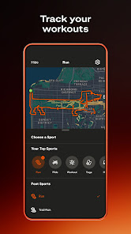
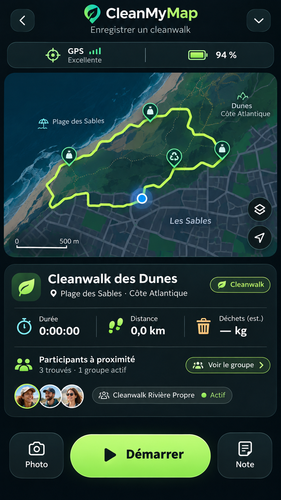

# 03 | Enregistrement GPS et mission active

> Statut : **BENCHMARK / PLAN** (fiche UX). État mobile observé : `CURRENT PARTIEL`. Famille visuelle : **Agir**. Lien matrice : `B01-B12`.

## Objectif de la page

Démarrer, suivre et arrêter une mission sur le terrain avec le minimum d’étapes.

## Référence Strava réelle

**Ce que montre réellement l’image :** Visuel « Track your workouts » : carte de suivi et contrôles d’enregistrement, dans une composition promotionnelle.

**Provenance :** visuel promotionnel public de la fiche [Google Play Strava](https://play.google.com/store/apps/details?id=com.strava), consulté le 3 novembre 2026. Il contient un aperçu authentique de Strava dans un habillage marketing, **pas nécessairement la capture de la page exacte**. Résolution source réduite : 166 × 296 px. Les captures restent la propriété de Strava ; droits de redistribution dans un dépôt Git public non vérifiés.

**Limite de correspondance :** la référence montre un principe graphique voisin. Les zones et interactions décrites ci-dessous sont des **propositions CleanMyMap**, pas une affirmation sur le pixel-perfect ni une preuve que Strava possède tous ces écrans.

## Modèle CleanMyMap existant

**Lecture du modèle :** composition exploratoire. Les nombres, noms, photos, badges, unités, trajets ou estimations représentés sont fictifs et ne doivent pas être codés comme données runtime, constantes métier ou règles scientifiques.

## Composition visuelle cible

| Ordre | Zone | Emprise indicative | Contenu et hiérarchie | Comportement à viser |
|---:|---|---|---|---|
| 1 | **En-tête de mission** | 8 % | Retour contrôlé, état GPS, qualité de localisation, réseau et statut de synchronisation si connus. | Les permission prompts sont déclenchés au moment pertinent. |
| 2 | **Zone carte / chiffres** | 45–60 % | Carte interactive et trace réelle ; bascule vers statistiques à forte lisibilité. | Garder le contrôle principal accessible au pouce. |
| 3 | **Métriques en direct** | 15–22 % | Temps, distance et état de suivi, avec unités et distinction brut/finalisé. | Actualisation légère, lisible en extérieur. |
| 4 | **Barre d’action** | 12–18 % | CTA Démarrer puis Pause / Reprendre / Terminer selon l’état effectif. | Confirmation avant arrêt destructif. |
| 5 | **Sécurité et reprise** | contextuel | Contact d’urgence et reprise après interruption ; informations compactes. | Ne pas exposer de localisation privée par défaut. |

**Grammaire visuelle** : fond sombre par défaut, cartes très contrastées, hiérarchie de typographie claire, 1 CTA primaire identifiable, composants tactiles confortables, Safe Area et clavier respectés. Couleurs par familles du site web : Agir émeraude, Carte ciel, Impact rouge/rose, Réseau rose/indigo, Accueil ambre/brun. La couleur des boutons encode leur priorité, pas le domaine. Ne pas reprendre l’orange de marque Strava.

## Parcours et gestes

1. Transition démarrage -> en cours -> pause -> reprise -> finalisation.
2. Navigation en conservant l’état de mission et les points locaux.
3. En cas d’échec de transmission, montrer la différence entre local et confirmé serveur.

## États visuels à concevoir

- permissions refusées
- GPS dégradé
- perte réseau
- reprise après fermeture
- mission déjà active
- finalisation en attente

## Frontières métier, sécurité et données

- La distance finale est calculée côté serveur selon les contrats existants.
- Le mockup montrant des participants proches est seulement illustratif et ne prouve pas de fonction de localisation sociale.
- Respecter la source de vérité web, les permissions Clerk/Supabase et la confidentialité. Ne pas inventer de données ni d’API.
- Conserver les parcours mobiles CURRENT et les ponts web tant que les fonctionnalités futures ne sont pas réellement intégrées.

## Consignes pour Codex

- Lire la matrice Strava associée et confronter cette proposition à la version courante du shell mobile, des règles scoped et du design system canonique.
- Reproduire **le patron UX générique** (hiérarchie, densité, geste, rythme, zones), pas les ressources graphiques, logos, images propriétaires ou code de Strava.
- Ne développer que la responsabilité du lot autorisé : ce document ne déclenche pas une implémentation ni une migration.
- Lorsque la page sera développée, tester les états vide, erreur, chargement, permission et retour, puis comparer une capture d’émulateur avec la référence CleanMyMap approuvée.
- Si le mockup contredit un contrat web, une permission ou une donnée réelle, préserver le contrat et noter l’écart visuel.

## Sources pour vérifier le comportement Strava

- https://play.google.com/store/apps/details?id=com.strava
- https://support.strava.com/fr/articles/15402137-comment-enregistrer-une-activite-sur-strava

## Références complémentaires trouvées le 3 novembre 2026

Voir le [catalogue de sources et limites](./REFERENCES_STRAVA_COMPLEMENTAIRES_2026.md). Références ciblées : **S02, S17**. Les sources non illustrées ne prouvent pas la composition exacte de l’écran.
