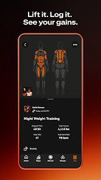

# 04 | Fin de mission et saisie du bilan

> Statut : **BENCHMARK / PLAN** (fiche UX). État mobile observé : `PLAN`. Famille visuelle : **Agir**. Lien matrice : `B10-B11,C04-C10`.

## Objectif de la page

Relier clairement une session GPS terminée à son statut et à son éventuel bilan de collecte.

## Référence Strava réelle

**Ce que montre réellement l’image :** Visuel « Lift it. Log it. See your gains. » : détail de session et métriques, dans une composition promotionnelle.

**Provenance :** visuel promotionnel public de la fiche [Google Play Strava](https://play.google.com/store/apps/details?id=com.strava), consulté le 3 novembre 2026. Il contient un aperçu authentique de Strava dans un habillage marketing, **pas nécessairement la capture de la page exacte**. Résolution source réduite : 166 × 296 px. Les captures restent la propriété de Strava ; droits de redistribution dans un dépôt Git public non vérifiés.

**Limite de correspondance :** la référence montre un principe graphique voisin. Les zones et interactions décrites ci-dessous sont des **propositions CleanMyMap**, pas une affirmation sur le pixel-perfect ni une preuve que Strava possède tous ces écrans.

## Composition visuelle cible

| Ordre | Zone | Emprise indicative | Contenu et hiérarchie | Comportement à viser |
|---:|---|---|---|---|
| 1 | **Résumé de fin** | haut | Titre, date, durée et distance synchronisée ou en attente ; distinction de statut. | Ne pas afficher un bilan validé automatiquement. |
| 2 | **Carte / parcours** | quart supérieur | Trace GPS enregistrée lorsque disponible et son origine. | La carte n’est pas une preuve suffisante du ramassage. |
| 3 | **Saisie conditionnelle** | zone centrale | Blocs de bilan uniquement après stabilisation du contrat web : participants présents, déchets déclarés, photos et observations. | Aucun champ métier fictif contraignant dans cette documentation. |
| 4 | **Validation et actions** | bas | Enregistrer/reprendre, consulter le statut, quitter. | Affichage du succès après confirmation serveur uniquement. |

**Grammaire visuelle** : fond sombre par défaut, cartes très contrastées, hiérarchie de typographie claire, 1 CTA primaire identifiable, composants tactiles confortables, Safe Area et clavier respectés. Couleurs par familles du site web : Agir émeraude, Carte ciel, Impact rouge/rose, Réseau rose/indigo, Accueil ambre/brun. La couleur des boutons encode leur priorité, pas le domaine. Ne pas reprendre l’orange de marque Strava.

## Parcours et gestes

1. Quitter puis revenir sans perdre un brouillon lorsqu’il est réellement supporté.
2. Distinguer fin de mission, déclaration de bilan et validation scientifique.

## États visuels à concevoir

- mission non synchronisée
- bilan non disponible
- brouillon
- soumission en cours
- preuve non admissible

## Frontières métier, sécurité et données

- Aucune formule carbone ou masse prédéfinie.
- Ne jamais convertir des champs inconnus en zéro ni inventer des critères de validation.
- Respecter la source de vérité web, les permissions Clerk/Supabase et la confidentialité. Ne pas inventer de données ni d’API.
- Conserver les parcours mobiles CURRENT et les ponts web tant que les fonctionnalités futures ne sont pas réellement intégrées.

## Consignes pour Codex

- Lire la matrice Strava associée et confronter cette proposition à la version courante du shell mobile, des règles scoped et du design system canonique.
- Reproduire **le patron UX générique** (hiérarchie, densité, geste, rythme, zones), pas les ressources graphiques, logos, images propriétaires ou code de Strava.
- Ne développer que la responsabilité du lot autorisé : ce document ne déclenche pas une implémentation ni une migration.
- Lorsque la page sera développée, tester les états vide, erreur, chargement, permission et retour, puis comparer une capture d’émulateur avec la référence CleanMyMap approuvée.
- Si le mockup contredit un contrat web, une permission ou une donnée réelle, préserver le contrat et noter l’écart visuel.

## Sources pour vérifier le comportement Strava

- https://play.google.com/store/apps/details?id=com.strava
- https://support.strava.com/fr/articles/15402137-comment-enregistrer-une-activite-sur-strava

## Références complémentaires trouvées le 3 novembre 2026

Voir le [catalogue de sources et limites](./REFERENCES_STRAVA_COMPLEMENTAIRES_2026.md). Références ciblées : **S16, S17**. Les sources non illustrées ne prouvent pas la composition exacte de l’écran.
