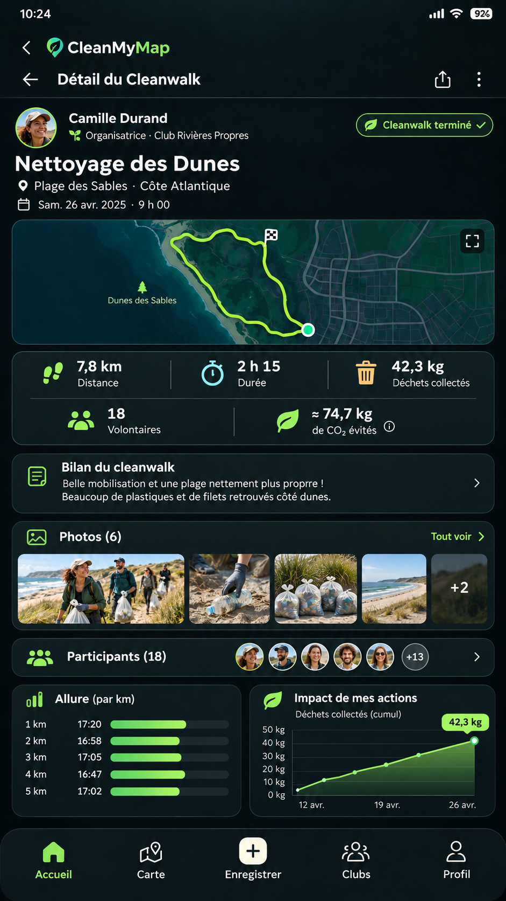

# 05 | Détail d’une cleanwalk achevée

> Statut : **BENCHMARK / PLAN** (fiche UX). État mobile observé : `PARTIEL / PLAN`. Famille visuelle : **Impact**. Lien matrice : `C01-C10`.

## Objectif de la page

Consulter le déroulé et les résultats admissibles d’une action passée.

## Référence Strava réelle

**Référence visuelle locale (non versionnée) :** consulter [l'emplacement et la provenance](./REFERENCES_STRAVA.md#captures-locales-non-versionnees) ; la source officielle et la limite de correspondance sont indiquées ci-dessous.

**Ce que montre réellement l’image :** Visuel « Sync with your devices » : carte d’activité et statistiques, dans une composition promotionnelle.

**Provenance :** visuel promotionnel public de la fiche [Google Play Strava](https://play.google.com/store/apps/details?id=com.strava), consulté le 3 novembre 2026. Il contient un aperçu authentique de Strava dans un habillage marketing, **pas nécessairement la capture de la page exacte**. Résolution source réduite : 166 × 296 px. Les captures restent la propriété de Strava ; droits de redistribution dans un dépôt Git public non vérifiés.

**Limite de correspondance :** la référence montre un principe graphique voisin. Les zones et interactions décrites ci-dessous sont des **propositions CleanMyMap**, pas une affirmation sur le pixel-perfect ni une preuve que Strava possède tous ces écrans.

## Modèle CleanMyMap existant

**Lecture du modèle :** composition exploratoire. Les nombres, noms, photos, badges, unités, trajets ou estimations représentés sont fictifs et ne doivent pas être codés comme données runtime, constantes métier ou règles scientifiques.

## Composition visuelle cible

| Ordre | Zone | Emprise indicative | Contenu et hiérarchie | Comportement à viser |
|---:|---|---|---|---|
| 1 | **Header et identité** | haut | Organisateur, statut, titre, date/lieu, partager lorsque public. | Respecter propriétaire et visibilité. |
| 2 | **Carte et trace** | 20–35 % | Aperçu cartographique ou média de référence ; retour carte complète. | Distinction entre tracé réel, tracé prévu et périmètre. |
| 3 | **Métriques principales** | après carte | Jusqu’à quatre métriques disponibles : durée, distance, présents validés, déchets mesurés/déclarés. | Afficher unités, périodes et provenance. |
| 4 | **Bilan narratif et preuves** | suite | Notes, catégories, galerie photo et états de modération. | L’absence de photo n’empêche pas une page lisible. |
| 5 | **Participants et analyses** | fin | Avatars publics consentis et résumés pertinents, sans faux classements. | Sections secondaires repliables si longues. |

**Grammaire visuelle** : fond sombre par défaut, cartes très contrastées, hiérarchie de typographie claire, 1 CTA primaire identifiable, composants tactiles confortables, Safe Area et clavier respectés. Couleurs par familles du site web : Agir émeraude, Carte ciel, Impact rouge/rose, Réseau rose/indigo, Accueil ambre/brun. La couleur des boutons encode leur priorité, pas le domaine. Ne pas reprendre l’orange de marque Strava.

## Parcours et gestes

1. Carte et photos ouvrables
2. partage soumis au niveau de confidentialité
3. accès rapport existant lorsqu’autorisé

## États visuels à concevoir

- résultat partiel
- rapport en modération
- pas de trace
- pas de photo
- utilisateur non autorisé

## Frontières métier, sécurité et données

- Le CO2 affiché dans les anciennes maquettes est un exemple purement fictif, pas une mesure.
- N’utiliser que les indicateurs calculés par le backend canonique.
- Respecter la source de vérité web, les permissions Clerk/Supabase et la confidentialité. Ne pas inventer de données ni d’API.
- Conserver les parcours mobiles CURRENT et les ponts web tant que les fonctionnalités futures ne sont pas réellement intégrées.

## Consignes pour Codex

- Lire la matrice Strava associée et confronter cette proposition à la version courante du shell mobile, des règles scoped et du design system canonique.
- Reproduire **le patron UX générique** (hiérarchie, densité, geste, rythme, zones), pas les ressources graphiques, logos, images propriétaires ou code de Strava.
- Ne développer que la responsabilité du lot autorisé : ce document ne déclenche pas une implémentation ni une migration.
- Lorsque la page sera développée, tester les états vide, erreur, chargement, permission et retour, puis comparer une capture d’émulateur avec la référence CleanMyMap approuvée.
- Si le mockup contredit un contrat web, une permission ou une donnée réelle, préserver le contrat et noter l’écart visuel.

## Sources pour vérifier le comportement Strava

- https://play.google.com/store/apps/details?id=com.strava
- https://support.strava.com/fr/articles/15401943-affichage-des-activites

## Références complémentaires trouvées le 3 novembre 2026

Voir le [catalogue de sources et limites](./REFERENCES_STRAVA_COMPLEMENTAIRES_2026.md). Références ciblées : **S16, S15**. Les sources non illustrées ne prouvent pas la composition exacte de l’écran.
