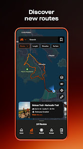

# 06 | Découvrir et rejoindre une action

> Statut : **BENCHMARK / PLAN** (fiche UX). État mobile observé : `CURRENT PARTIEL`. Famille visuelle : **Agir**. Lien matrice : `E01-E06`.

## Objectif de la page

Passer d’une découverte à une inscription confirmée, sans confusion de statut.

## Référence Strava réelle

**Ce que montre réellement l’image :** Visuel « Discover new routes » : carte, parcours et carte contextuelle, dans une composition promotionnelle.

**Provenance :** visuel promotionnel public de la fiche [Google Play Strava](https://play.google.com/store/apps/details?id=com.strava), consulté le 3 novembre 2026. Il contient un aperçu authentique de Strava dans un habillage marketing, **pas nécessairement la capture de la page exacte**. Résolution source réduite : 166 × 296 px. Les captures restent la propriété de Strava ; droits de redistribution dans un dépôt Git public non vérifiés.

**Limite de correspondance :** la référence montre un principe graphique voisin. Les zones et interactions décrites ci-dessous sont des **propositions CleanMyMap**, pas une affirmation sur le pixel-perfect ni une preuve que Strava possède tous ces écrans.

## Composition visuelle cible

| Ordre | Zone | Emprise indicative | Contenu et hiérarchie | Comportement à viser |
|---:|---|---|---|---|
| 1 | **Recherche / filtres** | haut | Titre de surface, proximité, date, statut et filtre de disponibilité uniquement existants. | Affichage liste en premier pour la recherche rapide. |
| 2 | **Liste d’actions** | milieu | Cards avec date, lieu, organisateur, statut, niveau d’inscription et aperçu de carte. | Titre et CTA lisibles sans ouvrir la fiche. |
| 3 | **Fiche d’action** | sous-page | Informations pratiques, rendez-vous, conditions et CTA inscription/annulation. | Les demandes en attente restent distinctes des inscriptions confirmées. |
| 4 | **Retour parcours** | bas / navigation | Retour à la liste avec filtres conservés. | Vérifier les demandes, invitations et annulations du runtime. |

**Grammaire visuelle** : fond sombre par défaut, cartes très contrastées, hiérarchie de typographie claire, 1 CTA primaire identifiable, composants tactiles confortables, Safe Area et clavier respectés. Couleurs par familles du site web : Agir émeraude, Carte ciel, Impact rouge/rose, Réseau rose/indigo, Accueil ambre/brun. La couleur des boutons encode leur priorité, pas le domaine. Ne pas reprendre l’orange de marque Strava.

## Parcours et gestes

1. Ouvrir détail depuis liste ou carte
2. rejoindre/annuler selon permission
3. retour après inscription sans faux succès

## États visuels à concevoir

- aucune action
- complet
- inscription en attente
- participation confirmée
- erreur de requête

## Frontières métier, sécurité et données

- Réutiliser strictement les intentions d’inscription et droits du serveur.
- Ne pas annoncer de disponibilité temps réel fictive.
- Respecter la source de vérité web, les permissions Clerk/Supabase et la confidentialité. Ne pas inventer de données ni d’API.
- Conserver les parcours mobiles CURRENT et les ponts web tant que les fonctionnalités futures ne sont pas réellement intégrées.

## Consignes pour Codex

- Lire la matrice Strava associée et confronter cette proposition à la version courante du shell mobile, des règles scoped et du design system canonique.
- Reproduire **le patron UX générique** (hiérarchie, densité, geste, rythme, zones), pas les ressources graphiques, logos, images propriétaires ou code de Strava.
- Ne développer que la responsabilité du lot autorisé : ce document ne déclenche pas une implémentation ni une migration.
- Lorsque la page sera développée, tester les états vide, erreur, chargement, permission et retour, puis comparer une capture d’émulateur avec la référence CleanMyMap approuvée.
- Si le mockup contredit un contrat web, une permission ou une donnée réelle, préserver le contrat et noter l’écart visuel.

## Sources pour vérifier le comportement Strava

- https://play.google.com/store/apps/details?id=com.strava
- https://support.strava.com/fr/articles/15401837-les-clubs-sur-l-appli-mobile

## Références complémentaires trouvées le 3 novembre 2026

Voir le [catalogue de sources et limites](./REFERENCES_STRAVA_COMPLEMENTAIRES_2026.md). Références ciblées : **S03, S04**. Les sources non illustrées ne prouvent pas la composition exacte de l’écran.
