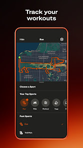

# 08 | Signaler un déchet

> Statut : **BENCHMARK / PLAN** (fiche UX). État mobile observé : `CURRENT PARTIEL`. Famille visuelle : **Agir**. Lien matrice : `D08-D11`.

## Objectif de la page

Créer un signalement terrain géolocalisé et photographié si nécessaire.

## Référence Strava réelle

**Ce que montre réellement l’image :** Visuel « Track your workouts » : carte de suivi et contrôles d’enregistrement, dans une composition promotionnelle.

**Provenance :** visuel promotionnel public de la fiche [Google Play Strava](https://play.google.com/store/apps/details?id=com.strava), consulté le 3 novembre 2026. Il contient un aperçu authentique de Strava dans un habillage marketing, **pas nécessairement la capture de la page exacte**. Résolution source réduite : 166 × 296 px. Les captures restent la propriété de Strava ; droits de redistribution dans un dépôt Git public non vérifiés.

**Limite de correspondance :** la référence montre un principe graphique voisin. Les zones et interactions décrites ci-dessous sont des **propositions CleanMyMap**, pas une affirmation sur le pixel-perfect ni une preuve que Strava possède tous ces écrans.

## Composition visuelle cible

| Ordre | Zone | Emprise indicative | Contenu et hiérarchie | Comportement à viser |
|---:|---|---|---|---|
| 1 | **Introduction courte** | haut | Titre clair, fonction de signalement et indication de géolocalisation. | Ne pas confondre signalement et participation GPS. |
| 2 | **Localisation / carte** | quart haut | Position détectée et contrôle manuel existant. | Coordonnées jamais inférées d’un texte. |
| 3 | **Catégorie et description** | centre | Type réel de signalement et informations utiles. | Garder les listes canoniques. |
| 4 | **Photos** | milieu bas | Galerie et ajout/suppression d’image selon workflow média actuel. | Confirmation de média distincte de celle du signalement. |
| 5 | **CTA et accusé serveur** | bas | Envoyer, statut de transmission et reprise si échec. | Pas de « signalement accepté » avant modération. |

**Grammaire visuelle** : fond sombre par défaut, cartes très contrastées, hiérarchie de typographie claire, 1 CTA primaire identifiable, composants tactiles confortables, Safe Area et clavier respectés. Couleurs par familles du site web : Agir émeraude, Carte ciel, Impact rouge/rose, Réseau rose/indigo, Accueil ambre/brun. La couleur des boutons encode leur priorité, pas le domaine. Ne pas reprendre l’orange de marque Strava.

## Parcours et gestes

1. Ajouter/retirer photo
2. modifier une position
3. publier puis voir statut propre

## États visuels à concevoir

- localisation refusée
- photo impossible
- upload partiel
- hors ligne
- signalement déjà envoyé

## Frontières métier, sécurité et données

- Strava fournit seulement un patron d’écran terrain, pas un parcours de signalement.
- Ne pas créer une nouvelle table ou une deuxième logique de preuve.
- Respecter la source de vérité web, les permissions Clerk/Supabase et la confidentialité. Ne pas inventer de données ni d’API.
- Conserver les parcours mobiles CURRENT et les ponts web tant que les fonctionnalités futures ne sont pas réellement intégrées.

## Consignes pour Codex

- Lire la matrice Strava associée et confronter cette proposition à la version courante du shell mobile, des règles scoped et du design system canonique.
- Reproduire **le patron UX générique** (hiérarchie, densité, geste, rythme, zones), pas les ressources graphiques, logos, images propriétaires ou code de Strava.
- Ne développer que la responsabilité du lot autorisé : ce document ne déclenche pas une implémentation ni une migration.
- Lorsque la page sera développée, tester les états vide, erreur, chargement, permission et retour, puis comparer une capture d’émulateur avec la référence CleanMyMap approuvée.
- Si le mockup contredit un contrat web, une permission ou une donnée réelle, préserver le contrat et noter l’écart visuel.

## Sources pour vérifier le comportement Strava

- https://play.google.com/store/apps/details?id=com.strava

## Références complémentaires trouvées le 3 novembre 2026

Voir le [catalogue de sources et limites](./REFERENCES_STRAVA_COMPLEMENTAIRES_2026.md). Références ciblées : **S08**. Les sources non illustrées ne prouvent pas la composition exacte de l’écran.
