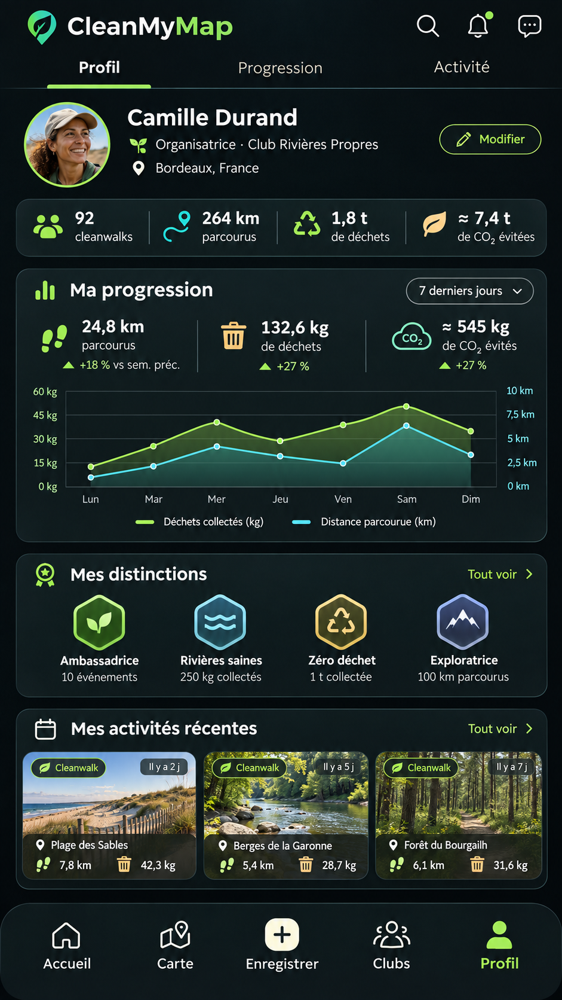

# 10 | Profil personnel

> Statut : **BENCHMARK / PLAN** (fiche UX). État mobile observé : `CURRENT PARTIEL`. Famille visuelle : **Profil**. Lien matrice : `G01-G12`.

## Objectif de la page

Valoriser la contribution de la personne et rendre ses paramètres facilement accessibles.

## Référence Strava réelle

**Référence visuelle locale (non versionnée) :** consulter [l'emplacement et la provenance](./REFERENCES_STRAVA.md#captures-locales-non-versionnees) ; la source officielle et la limite de correspondance sont indiquées ci-dessous.

**Ce que montre réellement l’image :** Visuel « Share with friends » : carte d’activité, photo et actions sociales, dans une composition promotionnelle.

**Provenance :** visuel promotionnel public de la fiche [Google Play Strava](https://play.google.com/store/apps/details?id=com.strava), consulté le 3 novembre 2026. Il contient un aperçu authentique de Strava dans un habillage marketing, **pas nécessairement la capture de la page exacte**. Résolution source réduite : 166 × 296 px. Les captures restent la propriété de Strava ; droits de redistribution dans un dépôt Git public non vérifiés.

**Limite de correspondance :** la référence montre un principe graphique voisin. Les zones et interactions décrites ci-dessous sont des **propositions CleanMyMap**, pas une affirmation sur le pixel-perfect ni une preuve que Strava possède tous ces écrans.

## Modèle CleanMyMap existant

**Lecture du modèle :** composition exploratoire. Les nombres, noms, photos, badges, unités, trajets ou estimations représentés sont fictifs et ne doivent pas être codés comme données runtime, constantes métier ou règles scientifiques.

## Composition visuelle cible

| Ordre | Zone | Emprise indicative | Contenu et hiérarchie | Comportement à viser |
|---:|---|---|---|---|
| 1 | **En-tête personnel** | haut | Avatar, nom, rôle public, ville si visibilité choisie, modifier. | Respecter pseudonyme, visibilité, consentement. |
| 2 | **Résumé d’activité** | sous header | Indicateurs globaux admis et accès aux détails. | Expliciter les règles de calcul. |
| 3 | **Sections personnelles** | milieu | Historique, progression, badges PLAN, actions organisées et participations. | Ne pas mélanger données privées et publiques. |
| 4 | **Accès au compte** | fin | Préférences, notifications, sécurité, déconnexion et droits des données. | Conserver les parcours CURRENT. |
| 5 | **Navigation** | bas | Onglet Compte actuel; Projet Profil futur. | Ne pas renommer une destination sans lot navigation. |

**Grammaire visuelle** : fond sombre par défaut, cartes très contrastées, hiérarchie de typographie claire, 1 CTA primaire identifiable, composants tactiles confortables, Safe Area et clavier respectés. Couleurs par familles du site web : Agir émeraude, Carte ciel, Impact rouge/rose, Réseau rose/indigo, Accueil ambre/brun. La couleur des boutons encode leur priorité, pas le domaine. Ne pas reprendre l’orange de marque Strava.

## Parcours et gestes

1. Modifier avatar/nom selon flux existant
2. consulter ses statistiques
3. ouvrir paramètres

## États visuels à concevoir

- nouveau profil
- profil avec historique
- profil privé
- chargement de compte

## Frontières métier, sécurité et données

- Matrice cible = UX ; navigation réelle = registre CURRENT.
- Le modèle CleanMyMap est illustratif, sans validation métier.
- Respecter la source de vérité web, les permissions Clerk/Supabase et la confidentialité. Ne pas inventer de données ni d’API.
- Conserver les parcours mobiles CURRENT et les ponts web tant que les fonctionnalités futures ne sont pas réellement intégrées.

## Consignes pour Codex

- Lire la matrice Strava associée et confronter cette proposition à la version courante du shell mobile, des règles scoped et du design system canonique.
- Reproduire **le patron UX générique** (hiérarchie, densité, geste, rythme, zones), pas les ressources graphiques, logos, images propriétaires ou code de Strava.
- Ne développer que la responsabilité du lot autorisé : ce document ne déclenche pas une implémentation ni une migration.
- Lorsque la page sera développée, tester les états vide, erreur, chargement, permission et retour, puis comparer une capture d’émulateur avec la référence CleanMyMap approuvée.
- Si le mockup contredit un contrat web, une permission ou une donnée réelle, préserver le contrat et noter l’écart visuel.

## Sources pour vérifier le comportement Strava

- https://play.google.com/store/apps/details?id=com.strava
- https://support.strava.com/fr/articles/15402175-votre-page-profil-strava

## Références complémentaires trouvées le 3 novembre 2026

Voir le [catalogue de sources et limites](./REFERENCES_STRAVA_COMPLEMENTAIRES_2026.md). Références ciblées : **S02, S06, S18**. Les sources non illustrées ne prouvent pas la composition exacte de l’écran.
