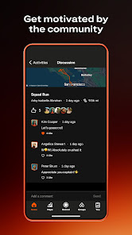

# 14 | Discussions et messagerie

> Statut : **BENCHMARK / PLAN** (fiche UX). État mobile observé : `PONT WEB / PLAN`. Famille visuelle : **Réseau**. Lien matrice : `F01-F12`.

## Objectif de la page

Retrouver les conversations communautaires et celles de chaque action.

## Référence Strava réelle

**Ce que montre réellement l’image :** Visuel « Get motivated by the community » : contenu social et communauté, dans une composition promotionnelle.

**Provenance :** visuel promotionnel public de la fiche [Google Play Strava](https://play.google.com/store/apps/details?id=com.strava), consulté le 3 novembre 2026. Il contient un aperçu authentique de Strava dans un habillage marketing, **pas nécessairement la capture de la page exacte**. Résolution source réduite : 166 × 296 px. Les captures restent la propriété de Strava ; droits de redistribution dans un dépôt Git public non vérifiés.

**Limite de correspondance :** la référence montre un principe graphique voisin. Les zones et interactions décrites ci-dessous sont des **propositions CleanMyMap**, pas une affirmation sur le pixel-perfect ni une preuve que Strava possède tous ces écrans.

## Composition visuelle cible

| Ordre | Zone | Emprise indicative | Contenu et hiérarchie | Comportement à viser |
|---:|---|---|---|---|
| 1 | **Liste de conversations** | haut écran | Avatar, nom, extrait, date, badges non lus si disponibles. | Protection des conversations privées. |
| 2 | **Canaux** | secondaire | Par action, collectif ou conversation directe selon contrat web. | Ne pas inventer de nouveaux scopes. |
| 3 | **Fil de messages** | principal | Bulles simples, chronologie, pièces jointes autorisées, états d’envoi. | Lisibilité et vitesse avant décor. |
| 4 | **Composer** | bas, avec clavier | Champ adaptable, ajout media, envoi. | Clavier et zone sûre ne doivent pas masquer le CTA. |
| 5 | **Navigation** | haut | Retour à la liste avec conversation et position préservées. | Notification -> conversation seulement après contrôle d’accès. |

**Grammaire visuelle** : fond sombre par défaut, cartes très contrastées, hiérarchie de typographie claire, 1 CTA primaire identifiable, composants tactiles confortables, Safe Area et clavier respectés. Couleurs par familles du site web : Agir émeraude, Carte ciel, Impact rouge/rose, Réseau rose/indigo, Accueil ambre/brun. La couleur des boutons encode leur priorité, pas le domaine. Ne pas reprendre l’orange de marque Strava.

## Parcours et gestes

1. taper pour ouvrir
2. charger messages plus anciens
3. replier clavier
4. échec/reprise envoi

## États visuels à concevoir

- aucune conversation
- message non envoyé
- fichier non autorisé
- conversation supprimée
- session expirée

## Frontières métier, sécurité et données

- Ne pas simuler « envoyé » sans retour serveur.
- Les conversations et droits proviennent du service web canonique.
- Respecter la source de vérité web, les permissions Clerk/Supabase et la confidentialité. Ne pas inventer de données ni d’API.
- Conserver les parcours mobiles CURRENT et les ponts web tant que les fonctionnalités futures ne sont pas réellement intégrées.

## Consignes pour Codex

- Lire la matrice Strava associée et confronter cette proposition à la version courante du shell mobile, des règles scoped et du design system canonique.
- Reproduire **le patron UX générique** (hiérarchie, densité, geste, rythme, zones), pas les ressources graphiques, logos, images propriétaires ou code de Strava.
- Ne développer que la responsabilité du lot autorisé : ce document ne déclenche pas une implémentation ni une migration.
- Lorsque la page sera développée, tester les états vide, erreur, chargement, permission et retour, puis comparer une capture d’émulateur avec la référence CleanMyMap approuvée.
- Si le mockup contredit un contrat web, une permission ou une donnée réelle, préserver le contrat et noter l’écart visuel.

## Sources pour vérifier le comportement Strava

- https://play.google.com/store/apps/details?id=com.strava
- https://stories.strava.com/articles/whats-new-on-strava-strava-connects-to-claude-new-running-events-and-races-and-club-messaging

## Références complémentaires trouvées le 3 novembre 2026

Voir le [catalogue de sources et limites](./REFERENCES_STRAVA_COMPLEMENTAIRES_2026.md). Références ciblées : **S01, S12**. Les sources non illustrées ne prouvent pas la composition exacte de l’écran.
