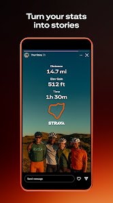

# 18 | Partage d’une cleanwalk

> Statut : **BENCHMARK / PLAN** (fiche UX). État mobile observé : `PLAN`. Famille visuelle : **Impact**. Lien matrice : `A08,C08`.

## Objectif de la page

Partager une contribution ou un bilan public sans exposer des informations sensibles.

## Référence Strava réelle

**Ce que montre réellement l’image :** Visuel « Turn your stats into stories » : carte de partage d’activité, dans une composition promotionnelle.

**Provenance :** visuel promotionnel public de la fiche [Google Play Strava](https://play.google.com/store/apps/details?id=com.strava), consulté le 3 novembre 2026. Il contient un aperçu authentique de Strava dans un habillage marketing, **pas nécessairement la capture de la page exacte**. Résolution source réduite : 166 × 296 px. Les captures restent la propriété de Strava ; droits de redistribution dans un dépôt Git public non vérifiés.

**Limite de correspondance :** la référence montre un principe graphique voisin. Les zones et interactions décrites ci-dessous sont des **propositions CleanMyMap**, pas une affirmation sur le pixel-perfect ni une preuve que Strava possède tous ces écrans.

## Composition visuelle cible

| Ordre | Zone | Emprise indicative | Contenu et hiérarchie | Comportement à viser |
|---:|---|---|---|---|
| 1 | **Sélection de contenu** | haut | Photo ou carte du parcours si partage autorisé. | Choisir les éléments réellement publics. |
| 2 | **Aperçu partage** | principal | Carte portrait originale CleanMyMap, titre, lieu public, données qualifiées. | Ne pas utiliser de marque Strava. |
| 3 | **Options de visibilité** | sous aperçu | Résumé des informations exposées, éventuelle anonymisation. | Le choix public/privé est explicite. |
| 4 | **Feuille native** | bas | Partage OS, copier lien lorsque disponible. | Ne pas capturer de localisation exacte privée. |

**Grammaire visuelle** : fond sombre par défaut, cartes très contrastées, hiérarchie de typographie claire, 1 CTA primaire identifiable, composants tactiles confortables, Safe Area et clavier respectés. Couleurs par familles du site web : Agir émeraude, Carte ciel, Impact rouge/rose, Réseau rose/indigo, Accueil ambre/brun. La couleur des boutons encode leur priorité, pas le domaine. Ne pas reprendre l’orange de marque Strava.

## Parcours et gestes

1. prévisualiser
2. modifier sélection de média
3. partager/copie lien
4. annuler sans perte

## États visuels à concevoir

- ressource privée
- aucune photo
- lien expiré
- partage refusé

## Frontières métier, sécurité et données

- Le rendu peut être stylisé, mais jamais inventer des chiffres pour embellir le visuel.
- Le produit réutilise les rapports PDF et liens de partage canoniques.
- Respecter la source de vérité web, les permissions Clerk/Supabase et la confidentialité. Ne pas inventer de données ni d’API.
- Conserver les parcours mobiles CURRENT et les ponts web tant que les fonctionnalités futures ne sont pas réellement intégrées.

## Consignes pour Codex

- Lire la matrice Strava associée et confronter cette proposition à la version courante du shell mobile, des règles scoped et du design system canonique.
- Reproduire **le patron UX générique** (hiérarchie, densité, geste, rythme, zones), pas les ressources graphiques, logos, images propriétaires ou code de Strava.
- Ne développer que la responsabilité du lot autorisé : ce document ne déclenche pas une implémentation ni une migration.
- Lorsque la page sera développée, tester les états vide, erreur, chargement, permission et retour, puis comparer une capture d’émulateur avec la référence CleanMyMap approuvée.
- Si le mockup contredit un contrat web, une permission ou une donnée réelle, préserver le contrat et noter l’écart visuel.

## Sources pour vérifier le comportement Strava

- https://play.google.com/store/apps/details?id=com.strava
- https://stories.strava.com/zh/articles/whats-new-on-strava-log-strength-your-way-find-routes-in-your-own-words-and-explore-offline-mode

## Références complémentaires trouvées le 3 novembre 2026

Voir le [catalogue de sources et limites](./REFERENCES_STRAVA_COMPLEMENTAIRES_2026.md). Références ciblées : **S15**. Les sources non illustrées ne prouvent pas la composition exacte de l’écran.
