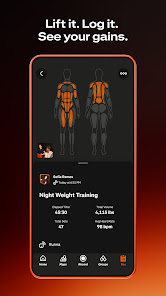

# 19 | Paramètres et confidentialité

> Statut : **BENCHMARK / PLAN** (fiche UX). État mobile observé : `CURRENT PARTIEL / PLAN`. Famille visuelle : **Profil**. Lien matrice : `H01-H09`.

## Objectif de la page

Proposer des réglages compréhensibles, sécurisés et cohérents avec le compte web.

## Référence Strava réelle

**Ce que montre réellement l’image :** Visuel « Lift it. Log it. See your gains. » : détail de session et métriques, dans une composition promotionnelle.

**Provenance :** visuel promotionnel public de la fiche [Google Play Strava](https://play.google.com/store/apps/details?id=com.strava), consulté le 3 novembre 2026. Il contient un aperçu authentique de Strava dans un habillage marketing, **pas nécessairement la capture de la page exacte**. Résolution source réduite : 166 × 296 px. Les captures restent la propriété de Strava ; droits de redistribution dans un dépôt Git public non vérifiés.

**Limite de correspondance :** la référence montre un principe graphique voisin. Les zones et interactions décrites ci-dessous sont des **propositions CleanMyMap**, pas une affirmation sur le pixel-perfect ni une preuve que Strava possède tous ces écrans.

## Composition visuelle cible

| Ordre | Zone | Emprise indicative | Contenu et hiérarchie | Comportement à viser |
|---:|---|---|---|---|
| 1 | **Header simple** | haut | Titre Paramètres, retour au profil et accès aide. | Ne pas reproduire un dashboard lourd. |
| 2 | **Sections groupées** | principal | Profil, notifications, confidentialité, localisation, sécurité et données. | Afficher uniquement les réglages effectivement gérés. |
| 3 | **Ligne de réglage** | par ligne | Icône secondaire, libellé explicite, état, chevron/toggle. | État serveur et état local clairement distincts. |
| 4 | **Suppression et export** | fin | Actions sensibles séparées avec confirmation appropriée. | Ne pas créer de suppression directe nouvelle. |
| 5 | **Thème** | préférences | Mode sombre par défaut si le produit le valide, option système et accessibilité. | Ce guide ne remplace pas les règles de thème web. |

**Grammaire visuelle** : fond sombre par défaut, cartes très contrastées, hiérarchie de typographie claire, 1 CTA primaire identifiable, composants tactiles confortables, Safe Area et clavier respectés. Couleurs par familles du site web : Agir émeraude, Carte ciel, Impact rouge/rose, Réseau rose/indigo, Accueil ambre/brun. La couleur des boutons encode leur priorité, pas le domaine. Ne pas reprendre l’orange de marque Strava.

## Parcours et gestes

1. modifier préférences
2. retour et sauvegarde
3. révocation et erreur

## États visuels à concevoir

- permissions OS refusées
- déconnexion
- erreur de sauvegarde
- préférence non gérée

## Frontières métier, sécurité et données

- Respecter Clerk, ownership, confidentialité et droits RGPD actuels.
- Ne pas supposer une session web transférée à l’ouverture du navigateur.
- Respecter la source de vérité web, les permissions Clerk/Supabase et la confidentialité. Ne pas inventer de données ni d’API.
- Conserver les parcours mobiles CURRENT et les ponts web tant que les fonctionnalités futures ne sont pas réellement intégrées.

## Consignes pour Codex

- Lire la matrice Strava associée et confronter cette proposition à la version courante du shell mobile, des règles scoped et du design system canonique.
- Reproduire **le patron UX générique** (hiérarchie, densité, geste, rythme, zones), pas les ressources graphiques, logos, images propriétaires ou code de Strava.
- Ne développer que la responsabilité du lot autorisé : ce document ne déclenche pas une implémentation ni une migration.
- Lorsque la page sera développée, tester les états vide, erreur, chargement, permission et retour, puis comparer une capture d’émulateur avec la référence CleanMyMap approuvée.
- Si le mockup contredit un contrat web, une permission ou une donnée réelle, préserver le contrat et noter l’écart visuel.

## Sources pour vérifier le comportement Strava

- https://support.strava.com/fr/articles/15402004-parametres-de-l-application-android
- https://play.google.com/store/apps/details?id=com.strava

## Références complémentaires trouvées le 3 novembre 2026

Voir le [catalogue de sources et limites](./REFERENCES_STRAVA_COMPLEMENTAIRES_2026.md). Références ciblées : **S09, S10, S14**. Les sources non illustrées ne prouvent pas la composition exacte de l’écran.
