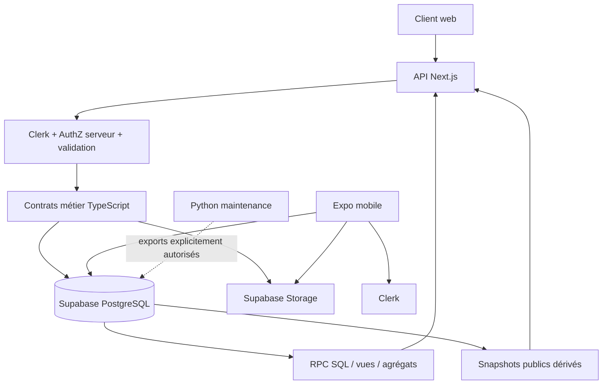
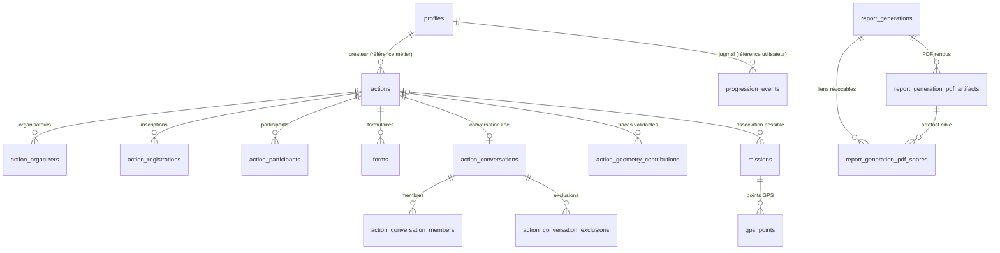

# Gouvernance des données et contrats

> **Type :** source `CURRENT` des sources de vérité, contrats métier et frontières de données.
> **Périmètre :** synthèse fonctionnelle et technique ; ce document n'est ni un export DDL ni un ERD SQL exhaustif.
> Les colonnes, contraintes et clés étrangères exactes restent gouvernées par les migrations et le code propriétaire.

## 1. Vue logique et flux



Clerk est la source principale de l'identité. Supabase stocke les enregistrements métier, les profils projetés, les relations, les métadonnées et les objets nécessaires au produit. Le client mobile n'est pas une frontière de confiance privilégiée.

### Sources de vérité et choix du stockage

Les migrations versionnées sous `apps/web/supabase/migrations/` décrivent le
schéma attendu. La base Supabase distante est un état runtime distinct : la
présence d'une migration dans Git ne prouve pas son application. Les contrats
TypeScript, notamment `apps/web/src/lib/actions/data-contract.ts`, doivent
rester alignés sur le schéma et les règles métier ; une façade publique étroite
ne doit pas réexporter les types de sous-domaines par commodité.

Le stockage suit la durée de vie et la valeur de la donnée : le contenu durable
reste versionné dans Git, les préférences et brouillons non critiques peuvent
rester locaux, les données métier et les agrégats persistés appartiennent à
Supabase, et les fichiers réutilisables relèvent de Storage avec les seules
métadonnées nécessaires en base. Un cache, une ISR, un snapshot ou une
projection publique est toujours recalculable et ne devient pas une seconde
source de vérité.

`public.public_surface_snapshots` est l'owner des snapshots publics dérivés.
Une génération plus ancienne ne remplace jamais une ligne plus récente ; une
écriture concurrente refusée est suivie d'une relecture persistée, jamais du
retour trompeur d'un résultat local non écrit. Les mocks de concurrence couvrent
l'ordre et le contrat applicatif, mais ne prouvent pas à eux seuls l'atomicité
PostgreSQL entre instances.

La projection publique des profils est limitée à `id`, `display_name`,
`handle` et `avatar_url` dans `public.public_profiles`. Les métadonnées de
profil, rôles, localisation, consentement leaderboard, referral et projection
Clerk restent owner-scoped ou côté serveur. Le consentement public du
leaderboard est `profiles.leaderboard_public_opt_in`, faux par défaut, et ne
peut pas être fourni comme autorité par le navigateur. Les mutations de
préférences partent de Clerk par mise à jour ciblée ; elles préservent les
clés sans rapport et ne déclarent la synchronisation terminée qu'après la
projection Supabase relue.

## 2. Familles de tables observées dans le code ou la documentation

| Famille | Tables / ressources identifiées | Responsabilité | Règle d'accès |
|---|---|---|---|
| Identité produit | `profiles` | Profil, identifiant Clerk, rôles et préférences | Profil ciblé et AuthZ explicite |
| Actions | `public.actions`, `action_organizers`, `action_registrations`, `action_participants`, `forms` | Action, organisation, inscription, participation et qualification | Ressource + owner/organisateur/participant + état |
| Médias / entraînement | `training_examples`, Supabase Storage | Provenance média, pièces liées aux actions | Accès selon action et contrat Storage |
| Conversations d'action | `action_conversations`, `action_conversation_members`, `action_conversation_exclusions`, `action_share_contact_requests` | Échanges et audiences associées à l'action | Membres, exclusions, acteur et capacité |
| Observations carte | `public.trash_spotter_spots` | Signalement (`spot`) et lieu propre (`clean_place`) | Projection publique filtrée, mutation autorisée |
| Géométrie contributive | `action_geometry_contributions` | Provenance d'une trace GPS/GPX et qualification géométrique | Frontière de validation et lecture bornée |
| GPS mobile | `missions`, `gps_points` | Missions terrain et points de localisation | Propriétaire Clerk, RLS, finalisation serveur |
| Progression | `progression_profiles`, `progression_events`, `user_badge_totals` | Progression persistée, journal et agrégats | Profil concerné / projection leaderboard autorisée |
| Communauté | `community_events`, `event_rsvps`, `app_notifications` | Événements, inscriptions et notifications | Utilisateur ou audience autorisée |
| Apprentissage | `quiz_type_progress`, `quiz_srs`, `checklist_progress` | Progressions et checklists | Utilisateur et objet ciblés |
| Restitution | `public_surface_snapshots`, `report_generations`, `report_generation_pdf_artifacts`, `report_generation_pdf_shares`, Storage `reports` | Snapshots calculés, artefacts PDF historiques et liens expirables révocables | Accès propriétaire aux gestions de partage ; lien bearer limité à un PDF |

**Étiquettes legacy :** `user_points` et `points_ledger` relèvent des chemins `COMPATIBILITY / LEGACY`, non de nouveaux owners de progression. Cette liste est une **carte des domaines**, pas un inventaire intégral du schéma physique.

## 3. Relations conceptuelles



**Attention :** les traits « référence métier » et les cardinalités schématiques ne certifient pas des `FOREIGN KEY` physiques. Les contraintes SQL exactes, nullabilités et suppressions en cascade doivent être lues dans `apps/web/supabase/migrations/` et confrontées au schéma réellement appliqué. Certaines références d'identité sont textuelles et certains liens facultatifs.

### Relations physiques explicitement repérées

- `gps_points.mission_id` référence `missions.id` avec suppression en cascade dans la migration initiale de suivi GPS.
- Une migration ultérieure ajoute `missions.action_id` en lien nullable à `actions.id` avec `ON DELETE SET NULL`.
- Les membres de conversation référencent `action_conversations.id` dans la migration dédiée.
- `report_generation_pdf_shares.generation_id` référence `report_generations.id` et `artifact_id` référence `report_generation_pdf_artifacts.id`, avec suppression en cascade dans la migration `20261018000002_report_generation_pdf_shares.sql`. Le token est conservé uniquement sous hash SHA-256, avec expiration et révocation. Une policy et des grants limitent la table à `service_role` ; les handlers authentifiés contrôlent le propriétaire.

Ne pas généraliser ces exemples au reste du schéma sans inspection de la dernière migration qui affecte chaque table.

### Contrats métier conservés des versions antérieures

Les statuts d'action actuellement consommés sont `pending`, `approved` et
`rejected` ; `validated` n'est pas un alias à réintroduire sans évolution
coordonnée du schéma, des types, des routes, de l'UI et des tests.

La phase distingue durablement `action_registrations` (inscription future) de
`action_participants` (participation finale). Seules les participations
`confirmed` alimentent les statistiques, badges, progression et quotes-parts.
Le créateur ou l'organisateur d'une action n'est pas automatiquement un
participant terrain ; tout rattachement post-action suit le workflow canonique.

Pour la carte, `trash_spotter_spots` est la source runtime des nouveaux
signalements `spot` et `clean_place`. `public.spots` est une archive legacy
read-only destinée à disparaître après preuve de migration et de provenance,
pas une source concurrente. La migration
`20260825000000_migrate_legacy_spots_to_trash_spotter.sql` conserve les lignes
historiques et leur correspondance sans suppression physique ni conversion
silencieuse de `waste_type`.

Les données de mesure gardent la distinction `NULL`/`NA`/zéro explicite. Les
mesures de déchets et de mégots sont séparées, portent leur unité, leur méthode
et leur provenance ; une masse ou un volume ne devient pas un comptage sans
formule versionnée. Les mesures individuelles post-action appartiennent à la
ligne confirmée de `action_participants` via la migration
`20260926000001_action_participant_individual_impact.sql` et ne créent pas de
table métier parallèle. `duration_minutes` décrit l'action de dépollution,
tandis que `event_start_time`/`event_end_time` décrivent le créneau global ;
leurs dérivés restent indisponibles si les heures sont absentes ou incohérentes.

Toute ingestion externe passe par `apps/web/src/lib/actions/unified-source.ts`
avant la persistance canonique. Un acteur d'import est une provenance
technique, pas un organisateur métier par défaut. Le backup
`cleanmymap.action-backup` version 2 est une voie de restauration distincte de
l'import métier : il valide son payload avant écriture, conserve les identités
et refuse un format incomplet ou sans version.

### Contrats spécialisés conservés

Les détails d'interface restent dans leurs owners spécialisés ; la présente
synthèse fixe les invariants de données qui doivent rester vrais lorsqu'une
surface, un import ou un rapport les consomme.

#### Mesures de masse et compatibilité historique

`wasteKg` désigne la masse totale des déchets hors mégots. `null` signifie
« non mesuré », `0` signifie « zéro explicitement observé » et une valeur
positive est une mesure connue. Les quatre catégories canoniques
`recyclablesKg`, `glassKg`, `householdWasteKg` et `otherWasteKg` restent
facultatives : une catégorie absente n'est jamais imputée à zéro.

Les champs de masse contrôlés par le serveur utilisent la résolution canonique
de `0,1 kg`, exposée par
`apps/web/src/lib/waste/measurement.ts` via
`ACTION_WASTE_MASS_RESOLUTION_KG`. Une valeur hors grille est refusée, sans
arrondi silencieux. Pour une comparaison complète et explicitement mesurée,
chaque valeur `x` est comparée dans l'intervalle
`[max(0, x - résolution / 2), x + résolution / 2]` ; le total et la somme de
la ventilation sont cohérents lorsque leurs intervalles se recouvrent.

Les mesures historiques hors grille restent lisibles et inchangées. Lorsque
la résolution historique n'est pas démontrable, ou qu'une valeur n'est pas
alignée, la comparaison est `not_comparable` : elle ne réécrit ni la valeur,
ni son historique. La comparaison de résolution ne modélise pas l'incertitude
d'une balance ou d'une estimation visuelle. Les anciennes clés de ventilation
restent donc des lectures de compatibilité, jamais une seconde source de vérité.

#### Temporalité déclarée et valeur technique de compatibilité

`duration_minutes` décrit le temps d'action de dépollution ;
`event_start_time`/`event_end_time` décrivent le créneau global, incluant les
temps d'organisation. Les durées dérivées restent indisponibles si les heures
sont absentes ou incohérentes, et aucune durée de passage à minuit ou valeur
historique n'est reconstruite. Comme `actions.duration_minutes` reste
`NOT NULL DEFAULT 0`, `preparation_data.durationMinutesDeclared` distingue la
durée effectivement déclarée de la valeur technique de compatibilité `0`.
`estimatedDurationMinutes` dans les anciens `preparation_data` reste une
lecture de compatibilité uniquement.

Le contrat temporel détaillé et ses contrôles sont portés par
[`actions-new-README.md`](../pages_site/routes/02-agir/actions-new/actions-new-README.md)
et `apps/web/src/lib/actions/time-contract.ts`.

#### Résolution territoriale des formalités

Le moteur des formalités consomme la géographie canonique de l'action et ne
crée ni seconde géographie ni autorisation territoriale. Les règles déclarent
un scope `national`, `department`, `commune` ou `special_territory`. Les règles
applicables sont résolues par précision décroissante (commune ou territoire
spécialisé, département, national), puis par identifiant déterministe ; une
règle générale n'est retirée que si une relation `supersedesRuleIds` le
déclare. Des formalités compatibles peuvent donc coexister.

Le fallback national fournit un cadre officiel lorsque aucune règle locale
suffisamment précise ne s'applique, mais conserve `requirementStatus =
unknown` tant que l'obligation locale n'est pas démontrée. `unknown` signifie
« preuves insuffisantes pour conclure à required, recommended ou
not_required » ; ce n'est ni l'absence de formalité, ni une erreur technique.
La qualification, sa source officielle, son périmètre et sa date de
vérification restent rattachés au moteur
`apps/web/src/lib/actions/formalities-qualification.ts` et à
`formalities-rules.ts`. Le parcours produit correspondant est décrit dans
[`actions-new-README.md`](../pages_site/routes/02-agir/actions-new/actions-new-README.md).

#### Géométries observées et promotion

`ActionGeometrySource` est la provenance fine ; la projection de qualité ne
doit pas la remplacer par la taxonomie des mesures. `gps_tracking` et
`gpx_import` sont des observations lorsqu'elles proviennent respectivement de
`gps_points` persistés ou d'une trace GPX validée ; `manual` est une déclaration,
`reference` une emprise connue, et `routed`/`estimated_route` des
reconstructions ou estimations. Les observations valides priment les
reconstructions ultérieures.

Une promotion conserve la cible de planification séparément de la distance
observée et ajoute une contribution append-only et idempotente dans
`action_geometry_contributions`. Plusieurs traces deviennent une couverture
`MultiLineString` sans concaténation ni distance collective annoncée ; les
distances individuelles restent séparées. La confiance ne prouve jamais la
provenance. Une remédiation historique exige une preuve persistée ; à défaut,
la ligne reste inconnue et inchangée. La grammaire et les règles de promotion
sont détaillées dans
[`methodologie-carte-actions.md`](../product/methodologie-carte-actions.md)
et [`couverture-gps-multi-groupes.md`](../product/couverture-gps-multi-groupes.md).

## 4. Flux écriture et lecture Actions

```text
UI / entrée utilisateur
→ session / identité / validation de payload
→ capacité + rôle + scope/ownership + état d'action
→ contrat canonique Actions
→ PostgreSQL, éventuellement RPC transactionnelle
→ projection métier / réponse API
→ cache ou snapshot si dérivé
→ carte, dashboard, rapport ou historique
```

Pivots :

- `apps/web/src/lib/actions/data-contract.ts` : façade contractuelle publique étroite.
- `apps/web/src/lib/actions/unified-source.ts` : agrégation des sources autorisées.
- `apps/web/src/lib/actions/unified-source/load.ts` : chargements filtrés.
- `apps/web/src/lib/actions/store` : persistance et lecture Actions.
- `apps/web/src/app/api/` : frontières HTTP.

Le loader unifié peut traiter actions et signalements, selon ses options. Cela ne dispense pas d'appliquer statut, visibilité, date, zone, projection publique et bornes côté source lorsqu'elles sont nécessaires.

## 5. Calculs et agrégats côté base

Des RPC PostgreSQL existent déjà, notamment :

| Surface | Contrat observé | Fonction |
|---|---|---|
| Références de pollution | `action_pollution_score_references_v2()` | Agrégation de références globales/départementales sur des actions admissibles, avec `GROUP BY` SQL |
| Synthèse publique accueil | `load_public_landing_action_summary(date)` et variante incrémentale documentée | Synthèse d'actions, déjà calculée en SQL selon le contrat versionné |
| Snapshots | `public_surface_snapshots` | Projection persistée dérivée et reconstituable |
| Progression | `progression_profiles`, `progression_events`, `user_badge_totals` | Valeurs persistées et journal, pas de reconstruction globale automatique |

**Stratégie :** filtrer et agréger en PostgreSQL lorsque le contrat métier le permet. Conserver les transformations métier dépendant du parsing canonique côté propriétaire TypeScript tant que l'équivalence SQL n'est pas démontrée. Aucun nouvel entrepôt BigQuery ou moteur Spark n'est requis sans workload justifiant leur coût.

## 6. Contrat de données scientifiques

- Les mesures absentes restent `NULL`/`NA` ; un zéro doit être explicite.
- Conserver la différence entre `OBSERVED`, `DECLARED`, `DERIVED`, `ASSUMPTION`, `PROXY` et `NA`.
- Une valeur calculée doit référencer son facteur/méthode, l'unité et le type d'observation source.
- Les géométries portent une provenance : import GPS/GPX, saisie, estimation ou autre origine prévue.
- Une projection temporelle de pollution ne remplace pas une observation actuelle ; les tables d'actions et de signalements ne sont pas interchangeables.
- La cardinalité et la couverture d'un agrégat doivent être rapportées sans inventer des observations.

## 7. RLS, droits et sécurité

```text
Identité Clerk vérifiée
+ capacité réelle
+ rôle actif compatible (si requis)
+ relation canonique / ownership / scope
+ état métier autorisé
+ projection minimale
= opération autorisée
```

- Les RLS des missions et points GPS s'appuient sur le `sub` Clerk dans le JWT transmis à Supabase selon le contrat Third-Party Auth.
- Une session seule n'accorde pas l'accès à la ressource d'autrui.
- Les décisions administratives sensibles et les opérations multi-lignes doivent conserver la frontière serveur, leur atomicité/partialité déclarée et leur trace.
- `service_role` reste exclusivement côté serveur/CLI autorisé et ne crée pas automatiquement une capacité HTTP.
- Sélection de colonnes limitée, pas de lecture brute de données privées via une façade publique.

Pour `missions` et `gps_points`, l'ownership mobile rapproche `volunteer_id` du
claim Clerk `sub` non vide. La connaissance d'un `mission_id` ne suffit pas à
lire ou écrire une mission étrangère ; les grants mobiles restent bornés aux
colonnes prévues et les métriques dérivées ne sont pas injectées par le client.
La finalisation passe par l'UPDATE propriétaire vers `completed` et le trigger
serveur calcule `distance_m`/`duration_s`. Les limites de synchronisation
`mission_actions`, de réveil background headless et de validation sur appareil
réel restent explicitement hors production jusqu'à preuve.

### Liens de partage PDF historiques

La route `GET/POST /api/reports/generations/[id]/share` permet au propriétaire connecté de prévisualiser et créer les partages d'un PDF historique rendu. `DELETE /api/reports/generations/[id]/share/[shareId]` permet la révocation owner-scoped. `GET /api/reports/shared/[token]` sert uniquement le PDF ciblé lorsque le bearer token est valide, non expiré et non révoqué. Le PDF reste stocké dans un bucket privé ; le partage ne donne ni accès aux données d'action, ni JSON/CSV. Ne jamais exposer le token dans les logs ou dans une réponse de listing de partages.

La migration existe dans Git au SHA de référence ; son état d'application distant reste **non vérifié**.

## 8. Export, sauvegardes et intégrité

Le script `apps/web/scripts/export-actions-backup.mjs` assemble un format d'archive Actions version 2 (`action-backup-contract.mjs`), incluant actions, relations et conversations associées. L'export parcourt des pages et chunks ; **l'exhaustivité d'une relation à forte cardinalité doit être prouvée** et un export incomplet ne doit jamais être accepté comme une archive valide.

Les mutations de restauration sont distinctes des imports métier. Le restore doit préserver le contrat atomique déjà défini ; aucune opération destructive n'est lancée par une simple revue de schéma.

## 9. Validation du schéma

Avant toute modification :

1. Identifier le dernier DDL versionné de chaque table, RPC, policy ou trigger concerné.
2. Lire les types et consommateurs web/mobile/scripts.
3. Vérifier privilèges, `search_path`, RLS, grants, nullabilité, clés et statut des migrations.
4. Produire une migration forward-only dans `apps/web/supabase/migrations/`.
5. Tester statiquement **et** sur PostgreSQL de test isolé dès que l'invariant dépend de la sémantique DB.
6. Ne pas déclarer la migration appliquée en production sans preuve distante.
7. Mettre à jour `data-governance.md` seulement en cas de changement réel de contrat durable.

## 10. Références

- `documentation/architecture/data-governance.md`.
- `documentation/database/README.md`, `supabase-table-optimization-playbook.md`.
- `documentation/security/authz-authn-regles.md`.
- `documentation/architecture/adr/ADR-004-companion-identity.md` et `ADR-006-supabase-migrations-source-of-truth.md`.
- `documentation/product/SCIENTIFIC_PROTOCOL.md` pour les facteurs et méthodes scientifiques.
- `apps/web/supabase/migrations/`.
- `apps/mobile/README.md` et `architecture_gps_companion.md`.
- `apps/web/scripts/action-backup-contract.mjs` et `export-actions-backup.mjs`.
