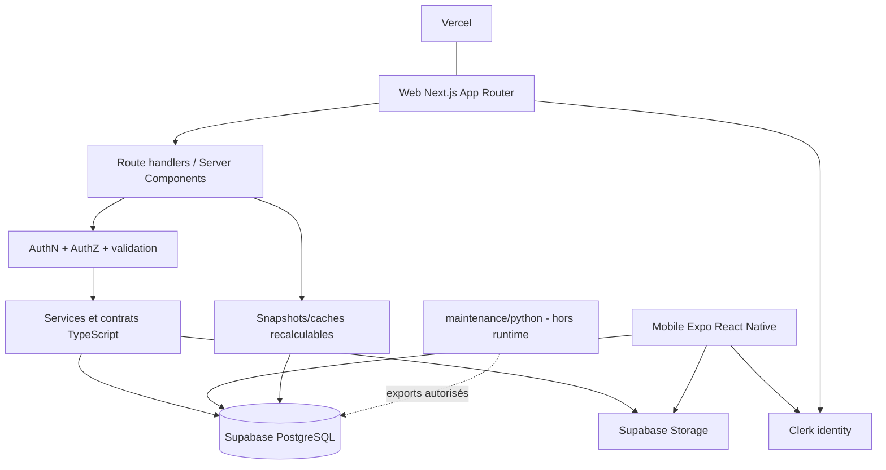
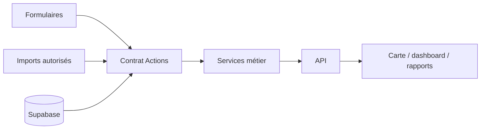

# Architecture globale — CleanMyMap

> **Type :** source `CURRENT` de l'architecture globale et des exigences
> techniques transversales. Les ADR et contrats spécialisés restent
> propriétaires de leurs décisions détaillées.

## 1. Architecture de référence

**CURRENT :** un produit, un monorepo et deux applications `apps/web` et `apps/mobile`. Le mobile réutilise le backend et l'identité et reste `NOT_PRODUCTION_READY`. Python est réservé à `maintenance/python/` ; il n'est pas une dépendance serveur web. Le monorepo ne contient pas actuellement de package `packages/` partagé canonique.

### Structure et frontières de confiance

Les pages, layouts et handlers vivent sous `apps/web/src/app/`, les primitives
UI sous `apps/web/src/components/` et le domaine, l'authentification, les
contrats et les services sous `apps/web/src/lib/`. Les composants client
restent minces ; aucune décision d'AuthZ sensible, aucun secret et aucune clé
`service_role` ne franchissent la frontière serveur/client. Les APIs valident
les entrées, contrôlent AuthN/AuthZ puis délèguent au propriétaire métier ; le
proxy ne remplace pas le contrôle du handler.

Les imports et migrations externes ne sont pas des sources de vérité
concurrentes. Les anciens imports Google Sheets ne doivent pas être réactivés
sans revalider le contrat courant. Les migrations éditables sont exclusivement
dans `apps/web/supabase/migrations/` et `npm run audit:supabase-migration-trees`
protège l'absence d'un second arbre.

## 2. Responsabilités techniques

| Couche | Owner | Invariant |
|---|---|---|
| UI web | `apps/web/src/app/`, `components/` | Interaction, rendu, accessibilité, pas de secret ni décision AuthZ autonome |
| API web | `apps/web/src/app/api/` | Validation, AuthN/AuthZ, contrat HTTP, gestion des erreurs |
| Domaine web | `apps/web/src/lib/` | Une source par règle métier, contrats Actions, impact, comptes et services |
| Mobile | `apps/mobile/` | Permissions natives, GPS/offline, identité Clerk, accès owner-scoped |
| Schéma SQL | `apps/web/supabase/migrations/` | Unique arbre append-only, types, RPC, grants et RLS cohérents |
| Data | Supabase PostgreSQL + Storage | Données persistantes et médias autorisés, pas de duplication de vérité |
| Exploitation | Vercel, CI, scripts existants | Surveiller quotas, latences et erreurs ; pas de mutation implicite |
| Maintenance scientifique | `maintenance/python/` | Pandas/scripts reproductibles, séparés du runtime |

## 3. Exigences non fonctionnelles

### TRD-01. Sécurité et permissions

- Clerk est le fournisseur d'identité principal ; ne pas ajouter de second système utilisateur sans ADR.
- Le handler sensible doit contrôler l'identité, la capacité, le rôle/scope et l'ownership **avant** l'accès aux données ou la mutation.
- Les identifiants fournis par le client ne prouvent jamais un droit (IDOR).
- RLS et grants Supabase restent des frontières complémentaires ; `service_role` n'est permis que dans un contexte serveur/CLI autorisé.
- Une API publique utilisant techniquement un client privilégié doit limiter sa projection ; le moyen d'accès ne rend pas automatiquement la route admin-only.
- Les changements SQL non triviaux documentent : `PURPOSE`, `CALLER`, `AUTHORIZATION_BOUNDARY`, `IDEMPOTENCY`, `ATOMICITY`, `FAILURE_BEHAVIOR`, `SEARCH_PATH` et `GRANTS`.

### TRD-02. Cohérence des données

- La base versionnée est décrite par les migrations. La base distante représente un état observé distinct : publier du SQL sur Git ne signifie pas l'avoir appliqué.
- Les domaines Actions et géométrie exposent leurs contrats via les modules canoniques. Ne pas recréer des calculateurs concurrents entre web, mobile, SQL et Python.
- Les valeurs `NULL` scientifiques ne deviennent pas zéro ; provenance, unités et version méthodologique doivent rester interprétables.
- Les caches et snapshots sont dérivés et invalidables, jamais propriétaires de la donnée métier.

### TRD-03. Performance et capacité

- Réduire la projection SQL, borner la cardinalité par utilisateur/action, période, zone, statut ou curseur.
- Appliquer les filtres SQL avant transfert. Préférer `COUNT`, `GROUP BY`, RPC ou vue stable lorsque seule une synthèse est demandée.
- Utiliser index seulement après preuve du prédicat et du plan ; éviter les suppressions d'index fondées uniquement sur un compteur `unused`.
- Tester explicitement pagination au-delà des limites effectives de Supabase, ordre stable, doublons et fin de flux.
- Éviter les scans au montage, recalculs identiques entre pages et export basé sur des résultats partiellement tronqués.
- Ne pas fixer de SLA inventé : établir les baselines de requêtes, latence, mémoire, volume transféré et taux d'échec avant optimisation.

### TRD-04. Concurrence et résilience

- Toute mutation multi-lignes déclare `ATOMIC` ou `PARTIAL_ALLOWED` avec reprise et comportement d'échec explicités.
- Les opérations répétables doivent être idempotentes ou protégées contre les doubles écritures.
- Snapshots publics : conserver les règles existantes de génération plus récente, relecture persistée et invalidation avec watermark ; ne pas supposer que la déduplication mémoire coordonne plusieurs instances Vercel.
- GPS mobile : préserver ownership, persistance hors ligne et finalisation côté serveur ; les métriques dérivées de mission ne sont pas éditées directement par le client.

### TRD-05. Confidentialité et observabilité

- Les journaux n'exposent ni secrets ni données personnelles inutiles.
- Mesures applicatives et données de suivi respectent le consentement et les politiques en vigueur.
- Les diagnostics distinguent erreurs logiques, erreurs d'environnement, CI, migration, déploiement et état observé en production.

## 4. Contrats HTTP et projections

- Les routes suivent le contrat propre au domaine, sans enveloppe uniforme inventée.
- Les lectures privées utilisent les guards adaptés et une stratégie de cache empêchant la contamination interutilisateur.
- Les réponses de carte ne sont pas des copies brutes des enregistrements : elles respectent la projection publique, le statut et la visibilité.
- Les exports et PDF précompilés sont servis avec vérification d'accès et URLs signées selon leur route ; un lien de Storage ne remplace pas l'autorisation métier.
- Le code actuel de partage PDF historique expose une capacité séparée : création/révocation owner-scoped d'un lien bearer expirant, token stocké sous forme de hash, PDF déjà rendu conservé dans Storage privé. Un lien valide donne accès seulement au PDF associé. Protéger contre l'indexation, les referrers et les mises en cache inappropriées ; vérifier l'expiration et la révocation au téléchargement. Une migration publiée ne vaut pas déploiement appliqué.
- Les erreurs doivent être explicites sans exposer les détails internes du fournisseur.

### Flux Actions et surfaces dérivées

Le contrat Actions et le module `unified-source.ts` restent les owners des
normalisations et des imports autorisés. Les cartes, dashboards, rapports,
PDF et snapshots sont des projections contrôlées ; ils ne créent pas un second
modèle métier. Un export ou une lecture paginée doit prouver son exhaustivité
avant d'être présenté comme un résultat complet.

### Services externes et coûts

Clerk, Supabase, Vercel et les services optionnels (messagerie, paiement,
observabilité, analytics ou rate limiting) sont des dépendances explicites et
bornées. L'absence d'un service optionnel ne doit pas casser le runtime sauf
si le contrat de la route le requiert. Les quotas, latences, mémoire et volume
transféré doivent être mesurés avant toute optimisation ou adoption d'une
nouvelle plateforme ; aucun SLA n'est inventé dans l'architecture.

## 5. Socle mobile

- Expo / React Native avec Clerk partagé ; lien Supabase via Third-Party Auth dans les limites prévues.
- Deux préoccupations distinctes : expérience terrain fiable et autorisation côté donnée/serveur.
- Le suivi GPS, les points, la finalisation de mission et la reprise offline restent compatibles avec les règles propriétaires et triggers du schéma.
- Ne pas déclarer l'application publiable avant la vérification réelle d'authentification, background headless, sécurité, appareils physiques et distribution.

## 6. Stack analytique et décisions de non-adoption

| Technologie | Décision actuelle | Critère de réexamen |
|---|---|---|
| PostgreSQL `GROUP BY`, RPC, vues | **Favoriser** pour calculs agrégés sur données persistantes | Revue des plans SQL, RLS, coûts et sémantique |
| Batching / chunking | **Favoriser** pour exports et opérations bornées | Pagination exhaustive, ordre stable et contrôle mémoire |
| Pandas | **Conserver** pour recherche/maintenance hors runtime | Source documentée, provenance, volumétrie et tests |
| `multiprocessing` Python | **Optionnel** pour CPU-bound offline | Profilage positif, mémoire et déterminisme acceptables |
| MongoDB | **Non requis** | Contrat de persistance distinct réellement démontré |
| Apache Spark | **Non requis** | Calcul distribué démontré au-delà d'une architecture simple |
| BigQuery | **Non requis** | Entrepôt analytique externe justifié, conformité et coûts chiffrés |

## 7. Validation d'une modification

### Architecture UI

Une page métier reste une surface d'action ou de lecture, pas une landing
decorative. `PageHeader`, les primitives `Cmm*`, les états asynchrones et les
contrats du dossier `documentation/design-system/` sont réutilisés avant toute
exception locale. Les composants cartographiques Leaflet sont chargés avec
SSR désactivé ; les APIs navigateur restent côté client et les secrets,
calculs métier stables et contrôles d'accès restent côté serveur.

Pour une lecture rapide d'un flux, commencer par les owners
`apps/web/src/lib/authz.ts`, `apps/web/src/proxy.ts`,
`apps/web/src/lib/auth/api-authorization-contract.ts`,
`apps/web/src/lib/actions/data-contract.ts`,
`apps/web/src/lib/actions/unified-source.ts`, puis les handlers concernés et
les migrations qui gouvernent la donnée. Cette liste d'entrée ne remplace pas
la lecture des callers et des tests du lot.

1. Identifier owner, callers, consommateurs, risques et contrats.
2. Écrire les invariants et scénarios négatifs avant intégration.
3. Exécuter les tests adaptés à la frontière : TypeScript, API, SQL/RLS isolés, web, mobile physique ou Python.
4. Comparer le comportement fonctionnel et, pour une optimisation, les mesures avant/après.
5. Conserver les preuves réelles ; une migration statique ne prouve pas le comportement PostgreSQL.
6. Mettre à jour les sources documentaires canoniques lorsqu'un contrat durable évolue.
7. Clore si la STOP CONDITION est atteinte, sans refonte périphérique.

## 8. Références

- `documentation/architecture/master-architecture.md`, `frontend-backend-boundaries.md` et la façade de compatibilité `system-overview.md`.
- `documentation/architecture/adr/ADR-001-clerk-auth.md`, `ADR-004-companion-identity.md`, `ADR-006-supabase-migrations-source-of-truth.md`.
- `documentation/security/authz-authn-regles.md`, `authorization-capabilities.md`.
- `documentation/architecture/data-governance.md`.
- `documentation/database/supabase-table-optimization-playbook.md`.
- `documentation/operations/platform-cost-governance.md`.
- `apps/mobile/README.md`, `documentation/development/TESTING.md`.
- `apps/web/supabase/migrations/20261018000002_report_generation_pdf_shares.sql` et `documentation/features/reports/report-pdf-themes-and-reuse.md`.
