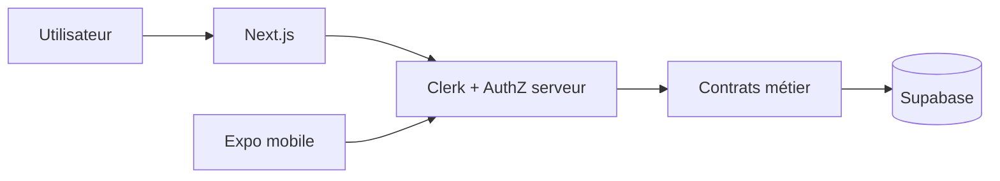

# Vue système — façade de compatibilité

> **Statut : `COMPATIBILITY`**

La vue runtime détaillée a été absorbée par
[`master-architecture.md`](./master-architecture.md), qui est désormais la
source `CURRENT` de l'architecture globale. Cette façade est conservée pour
les liens historiques et les contrôles documentaires ; elle ne porte aucune
doctrine concurrente.

Pour le détail, lire :

- [`master-architecture.md`](./master-architecture.md) — architecture,
  frontières, mobile et migrations ;
- [`frontend-backend-boundaries.md`](./frontend-backend-boundaries.md) —
  séparation UI/API/domaine/data ;
- [`data-governance.md`](./data-governance.md) — ownership, données, RLS et
  provenance ;
- [`../security/authz-authn-regles.md`](../security/authz-authn-regles.md) —
  autorisations effectives ;
- [`../../apps/mobile/README.md`](../../apps/mobile/README.md) — preuves et
  limites de validation mobile datées.

Les anciennes séquences et snapshots mobiles ne doivent pas être copiés ici.
Ils appartiennent à leur source actuelle ou à l'historique de session.
