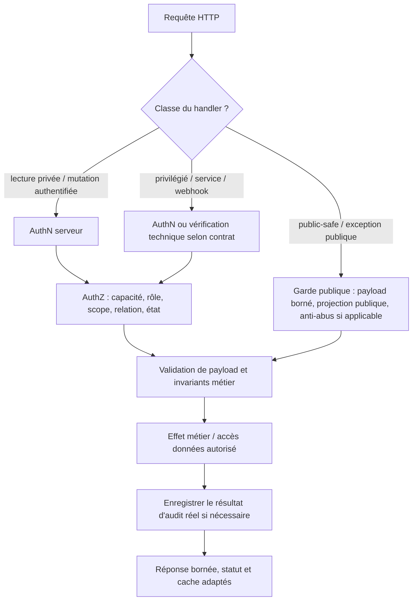

# API HTTP — standard transverse (`CURRENT`)

Ce contrat concerne les routes Next.js API de CleanMyMap. Les contrats par méthode, leurs consommateurs et la sécurité du domaine prévalent sur un diagramme générique. **Aucune enveloppe unique de succès** n'est imposée à toutes les API ; préserver le DTO exact de chaque route. L'ancienne fiche de vigilance API est absorbée ici pour éviter une logique de garde concurrente.

## Propriétaires

| Besoin | Owner |
|---|---|
| Inventaire de décisions AuthN/AuthZ par méthode | `apps/web/src/lib/auth/api-authorization-contract.ts` et fragments `api-authorization-contract.*.ts` |
| Vérification des méthodes et de leurs gardes | `apps/web/src/app/api/api-boundary.test.ts`, tests de handler concernés |
| Règles AuthN/AuthZ CURRENT | [`../security/authz-authn-regles.md`](../security/authz-authn-regles.md) |
| Modèle cible des capacités | [`../security/authorization-capabilities.md`](../security/authorization-capabilities.md) (`PLAN / TARGET`, pas permission effective) |
| Erreurs communes lorsqu'utilisées | `apps/web/src/lib/http/api-errors.ts` et `apps/web/src/lib/http/auth-responses.ts` |
| Entrées publiques et anti-abus | `apps/web/src/lib/security/validation.ts`, rate limit et BotID propres à la route |
| Journal des opérations privilégiées | `apps/web/src/lib/admin/audit/operation-audit.ts`, [`../security/admin-operation-audit.md`](../security/admin-operation-audit.md) |
| Modèle des données exposées | DTO du domaine, RLS, [`../architecture/data-governance.md`](../architecture/data-governance.md) |

## Décision à chaque méthode HTTP

Ce schéma décrit des **frontières logiques**, pas un ordre uniforme d'implémentation. Certaines routes publiques valident les données sans session ; les webhooks utilisent une signature ; les routes admin exigent une autorisation renforcée. Les contrôles de taille de corps, rate limit, identité et validation métier doivent être placés avant les effets concernés, selon la sécurité réelle du flux. Un audit peut tracer un refus ou un échec ; **aucun succès n'est enregistré avant l'effet confirmé**.

## Réponses et erreurs

- Utiliser le code HTTP fidèle au résultat (`2xx`, `4xx`, `5xx`) ; préserver les champs JSON actuellement consommés, la sémantique et les en-têtes pertinents.
- Lorsqu'une route utilise `api-errors.ts`, son erreur commune inclut notamment `error`, `kind`, `referenceCode`, `status`, avec des détails de validation optionnels. Le `status` dans le JSON n'est **pas** le code de réponse HTTP.
- Ne pas transformer un retour existant en `{ success, payload }` sans modifier explicitement les contrats de tous ses consommateurs.
- Ne pas exposer dans le corps, l'URL, les logs ou un audit public de secret, stack trace, token, PII injustifiée, payload externe brut ou détail technique dangereux.
- Préserver les réponses `429` et leurs champs spécifiques au flux ; ne pas supposer une enveloppe identique pour toutes les routes.

## Sécurité des données et opérations

1. Tout identifiant issu du client est une **adresse de ressource**, jamais une preuve d'ownership. Résoudre la ressource côté serveur, contrôler la relation, le scope, l'état et la projection de retour.
2. Les services `getSupabaseAdminClient()` ou `getSupabaseServerClient(true)` donnent un accès technique privilégié ; ils n'élargissent pas l'AuthZ de l'utilisateur HTTP. RLS et privilèges SQL restent vérifiés à leurs frontières réelles.
3. Un chemin Storage prévisible ne signe pas une pièce privée. Les exports agrégés excluent les identifiants individuels non nécessaires. Les mutations de compte n'écrivent que les champs explicitement admis par le schéma serveur.
4. Validation d'URL : parseur/allowlist selon le domaine, jamais un simple `startsWith` ; les expressions régulières sur entrées externes restent bornées.
5. Les formulaires publics peuvent nécessiter honeypot, timestamp, BotID, rate limit ou consentement selon la surface ; ne pas ajouter un garde qui exige une session sans base contractuelle.
6. Les mutations admin, modérations, imports et exports sensibles utilisent la journalisation prévue par leur contrat ; l'issue `success` appartient à un effet réellement confirmé.

## Preuves de modification

Lire le handler, la validation, le service, les DTO, les clients et les tests couvrant les cas autorisés **et interdits**. Le test d'inventaire statique d'API ne remplace pas des tests d'intégration AuthZ, RLS, Storage et de concurrence. Les commandes et niveaux de preuve appartiennent à [`TESTING.md`](./TESTING.md). Ne pas traiter une CI préexistante rouge comme une régression nouvelle sans comparaison du parent.
