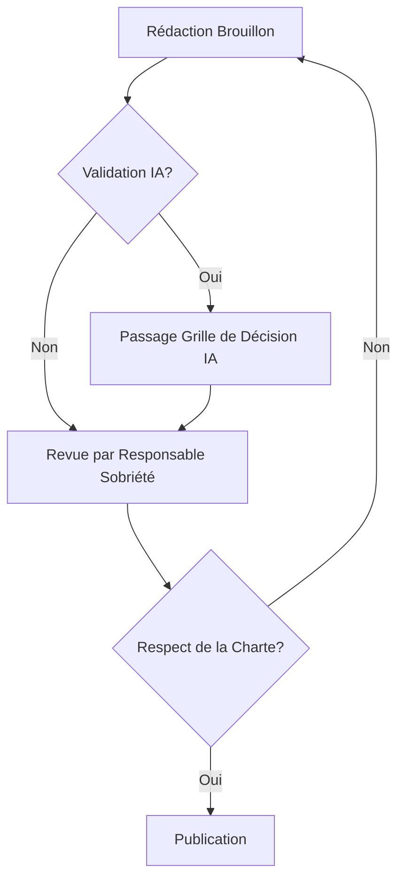

# Workflow de Validation des Contenus Environnementaux

> **PLAN / PROCESS :** ce processus décrit une revue humaine souhaitée, pas une validation institutionnelle déjà effectuée ni une garantie d'absence de greenwashing. Les mesures et limites restent gouvernées par [SCIENTIFIC_PROTOCOL.md](../product/SCIENTIFIC_PROTOCOL.md) et [data-governance.md](../architecture/data-governance.md).

Chaque communication doit distinguer mesure, estimation et hypothèse, avec provenance, périmètre, unité, période et incertitude.

## 1. Processus de Publication

## 2. Rôles et Responsabilités
- **Auteur** : Rédige le contenu en s'appuyant sur les données brutes (IUR).
- **Responsable Sobriété** : Vérifie l'exactitude des chiffres et la clarté des limites (incertitudes).
- **Validateur Institutionnel** : S'assure de l'alignement avec les valeurs du projet (DU).

## 3. Critères de Clarté (Audit G)
- **Fait vs Hypothèse** : Distinguer clairement ce qui est mesuré de ce qui est estimé.
- **Preuves** : Chaque chiffre doit être relié à sa mesure ou méthode environnementale documentée ; un rapport CI/CD ne prouve pas à lui seul l'impact écologique.
- **Accessibilité** : Utiliser un vocabulaire simple (ex: éviter les termes trop techniques comme "Hydration JS" sans explication).

## 4. Maintenance des Messages
Une revue trimestrielle est un objectif de processus ; elle n'est considérée exécutée qu'avec une date, un responsable réel et une preuve.
