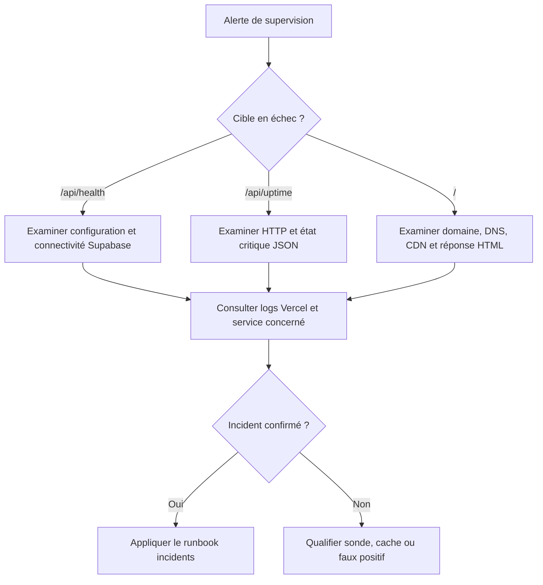

# Cloudflare, Sentry Uptime et UptimeRobot — supervision de CleanMyMap

> **Statut : CURRENT — procédure d'exploitation et configuration cible.**
> Les réglages des fournisseurs sont effectués dans leurs tableaux de bord ;
> leur présence dans ce document ne prouve pas qu'ils ont été appliqués.
> Référence fonctionnelle des endpoints : `apps/web/src/app/api/uptime/route.ts`
> et `apps/web/src/app/api/health/route.ts` sur `main`.

## Objectif

Superviser l'accessibilité publique de CleanMyMap et la connectivité de ses
services sans télécharger inutilement la page d'accueil à haute fréquence.
Cette politique applique le principe de soutenabilité préventive défini dans
[`platform-cost-governance.md`](./platform-cost-governance.md) : réduire le
coût fixe de supervision avant l'augmentation du trafic bénévole, sans perdre
la capacité de détecter les pannes importantes.

Les moniteurs externes ne sont pas des cron Vercel. Leurs requêtes peuvent
néanmoins consommer des `CDN Requests`, du `Fast Data Transfer` et, selon le
cache et la route, des ressources serveur ou Supabase.

## Rôles et limites des trois points de contrôle

| Endpoint | Ce qui est contrôlé | Limites |
|---|---|---|
| `GET /api/uptime` | Disponibilité HTTP et cohérence des configurations critiques (Supabase, Clerk) | Ne teste pas la connectivité Supabase. Peut répondre HTTP `200` avec `criticalStatus: "degraded"`, donc une alerte fondée uniquement sur le code HTTP ne voit pas tous les états dégradés. Cache CDN `s-maxage=120`, `stale-while-revalidate=300`. |
| `GET /api/health` | Configuration et connectivité Supabase via une lecture légère (`select id`, `limit(1)`, requête Supabase en HEAD) | Renvoie `503` en cas de dégradation. Cache CDN `s-maxage=60`, `stale-while-revalidate=120`. |
| `GET /` | Accueil public et réponse HTML | La disponibilité HTTP ne prouve pas l'hydratation ni le fonctionnement intégral de l'interface. |

Ne pas supprimer le contrôle de `/` au seul motif que `/api/uptime` répond :
ces sondes couvrent des pannes différentes. Ne pas multiplier les moniteurs
d'une même URL sans besoin documenté.

## Configuration rapportée et cadence théorique — 22 novembre 2026

Le bilan Codex du 22 novembre rapporte trois moniteurs actifs. Ces réglages
fournisseur sont **rapportés**, pas indépendamment revérifiés dans les tableaux
de bord pendant la mise à jour de ce runbook. Ce profil est rapporté comme
applicable sans abonnement payant ; aucune montée d'offre n'est recommandée.

| Fournisseur | URL et méthode rapportées | Intervalle rapporté | Requêtes théoriques / jour | Alerte / rôle |
|---|---|---:|---:|---|
| Sentry Uptime | `GET https://cleanmymap.fr/api/uptime` | 1 h | 24 | Alerte après 3 échecs consécutifs ; disponibilité HTTP/configuration |
| UptimeRobot | `HEAD https://cleanmymap.fr/api/health` | 12 h | 2 | Vérification de la route santé et potentiellement de Supabase |
| UptimeRobot | `HEAD https://cleanmymap.fr/` | 12 h | 2 | Accessibilité de l'accueil ; contrôle moins probant du HTML |
| **Total** | **3 moniteurs** |  | **28** | Calcul théorique, pas une mesure Vercel |

Le bilan annonce une baisse théorique de **216 à 28 sondes/jour**, soit environ
**87 %**. Ce calcul porte sur la fréquence nominale des moniteurs uniquement ;
il ne mesure ni les invocations de fonctions, ni le cache, ni les unités de
consommation, ni une économie réelle ou financière sur Vercel.

### Ce qui a été vérifié indépendamment

Le lockfile local fixe Next.js à `16.4.6`. Dans cette version, les Route
Handlers App Router qui n'exportent pas `HEAD` réutilisent leur gestionnaire
`GET` pour une requête `HEAD` ([implémentation Next.js 16.4.6](https://github.com/vercel/next.js/blob/v16.4.6/packages/next/src/server/route-modules/app-route/helpers/auto-implement-methods.ts)).
La route `/api/health` exporte uniquement `GET`; ce gestionnaire effectue une
lecture Supabase. Ainsi, `HEAD /api/health` peut exécuter cette lecture après
résolution de la route. La réponse HEAD ne transporte pas le corps de la
réponse, mais cela ne signifie pas que le gestionnaire GET n'a pas été exécuté.

Cette lecture de source et du lockfile ne prouve pas les réglages UptimeRobot
enregistrés, le résultat du dernier contrôle ni un cache HIT/MISS sur Vercel.
Les headers de cache de la route santé peuvent influer sur l'exécution réelle ;
le coût effectif doit être observé dans les données Vercel.

Pour `HEAD /`, le contrôle reste utile à l'accessibilité HTTP, mais il est moins
probant qu'un `GET` pour valider la présence et le contenu HTML complet. Il ne
vérifie pas l'hydratation client. Le nombre de sondes ne permet pas à lui seul
de conclure que les fonctions ou la génération de page ont été évitées.

### Délai de détection et alertes

Avec une sonde Sentry chaque heure et un seuil de 3 échecs consécutifs, une
alerte peut nécessiter environ **2 à 3 heures** après la panne, selon le moment
où elle survient dans le cycle, plus les délais de timeout et de notification.
Sur UptimeRobot, une vérification toutes les 12 heures peut laisser une panne
inconnue jusqu'à presque **12 heures** avant le prochain contrôle, puis ajouter
les délais de retries ou d'escalade configurés. Le seuil UptimeRobot n'étant pas
établi ici, ne pas promettre un délai plus court. Ces cadences sont un compromis
de coût avec une détection moins rapide ; conserver les alertes utiles et
connaître explicitement ce délai.

## Historique distinct — captures du 8 octobre 2026

Les captures du 8 octobre montrent un état antérieur et ne démontrent ni la
configuration courante ni l'application des réglages rapportés le 22 novembre.

| Fournisseur | URL observée en octobre | Intervalle observé |
|---|---|---:|
| Sentry Uptime | `https://cleanmymap.fr` | 1 minute |
| UptimeRobot | `cleanmymap.fr` | 5 minutes |
| UptimeRobot | `cleanmymap.fr/api/health` | 5 minutes |

Les captures d'octobre ne permettent pas de confirmer les méthodes HTTP
utilisées alors ; ne pas leur attribuer rétroactivement `GET` ou `HEAD`.

Le relevé Vercel transmis le 8 octobre indiquait pour `/` environ **883
requêtes en 12 heures**, **133 Mo sortants** et **150 Ko par réponse**. Ces
valeurs restent une observation historique de la page d'accueil ; elles ne
mesurent pas l'état post-configuration ni n'attribuent toutes les requêtes aux
moniteurs.

## Vérification des réglages et mesure Vercel

Pour vérifier la configuration réelle, ouvrir les tableaux de bord Sentry et
UptimeRobot et confirmer URL, méthode, cadence, état actif, seuils et
destinataires d'alerte. Observer un contrôle réussi par moniteur. Ce contrôle
indépendant est nécessaire avant de qualifier le profil de configuration
effective.

Pour évaluer les coûts Vercel, comparer deux fenêtres équivalentes de **12 à
24 heures** avant/après, couvrant des jours et des volumes de trafic
comparables. Relever séparément pour `/`, `/api/uptime`, `/api/health` et les
fonctions associées :

- **Active CPU** ;
- **Provisioned Memory** ;
- **Invocations** ;
- cache **HIT/MISS** (et revalidations si disponibles).

Inclure dates/heures des fenêtres et changements de trafic, déploiement ou
autres clients. La baisse théorique de 216 à 28 sondes/jour ne constitue pas le
résultat de cette comparaison. Ne déclarer une économie Vercel qu'à partir des
métriques mesurées, et distinguer baisse de sondes, baisse d'invocations et
baisse de consommation facturable.

## Procédure de vérification et diagnostic

- `/api/health` en HTTP `503` : examiner les variables de configuration et la
  connectivité Supabase avant de conclure à une indisponibilité générale.
- `/api/uptime` en HTTP `200` avec `criticalStatus: "degraded"` : une alerte
  fondée uniquement sur le code HTTP ne verra pas cet état.
- `/` inaccessible : vérifier domaine/DNS, TLS, déploiement Vercel, CDN et
  réponse HTML ; ne pas neutraliser le contrôle pour viser une économie non mesurée.

Voir [`runbook-monitoring-logs.md`](./runbook-monitoring-logs.md) et
[`incidents-frequents-et-reprise.md`](./incidents-frequents-et-reprise.md)
pour la qualification et la résolution des incidents. Caler les attentes
d'escalade sur le délai pouvant atteindre 12 heures des contrôles UptimeRobot.

## Checklist historique — cutover Cloudflare / Next.js

Cette partie conserve les opérations utiles en cas de **nouvelle bascule DNS**.
Elle ne définit pas les fréquences de surveillance courante, qui figurent dans
la section précédente.

### Prérequis

- Déploiement Vercel de production disponible et validé.
- Configuration de production critique présente (Clerk, Supabase, Sentry).
- Domaine principal identifié et validé.

### Étapes Cloudflare (DNS)

1. Confirmer la cible Vercel (CNAME/apex selon la configuration réelle).
2. Réduire temporairement le TTL DNS avant cutover si nécessaire.
3. Basculer l'entrée DNS principale vers la cible autorisée.
4. Vérifier la propagation depuis plusieurs résolveurs publics.
5. Vérifier HTTPS/TLS, les redirections et les réglages réellement gérés par
   Cloudflare ou Vercel selon le routage retenu.
6. Ne pas imposer de cache agressif sur les API ; conserver la stratégie de
   cache explicite des assets statiques Next.js.

### Vérification post-cutover

1. Tester manuellement l'accueil, les cartes et le parcours Clerk.
2. Vérifier les trois sondes ci-dessus et leurs alertes.
3. Lire les erreurs Sentry et les logs Vercel.
4. En cas d'incident confirmé, suivre le runbook de déploiement et la procédure
   de rollback autorisée ; ne pas basculer DNS ou déploiement uniquement parce
   qu'une sonde retourne un faux positif.
