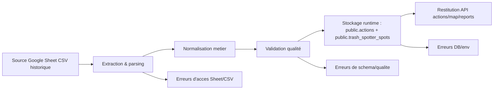
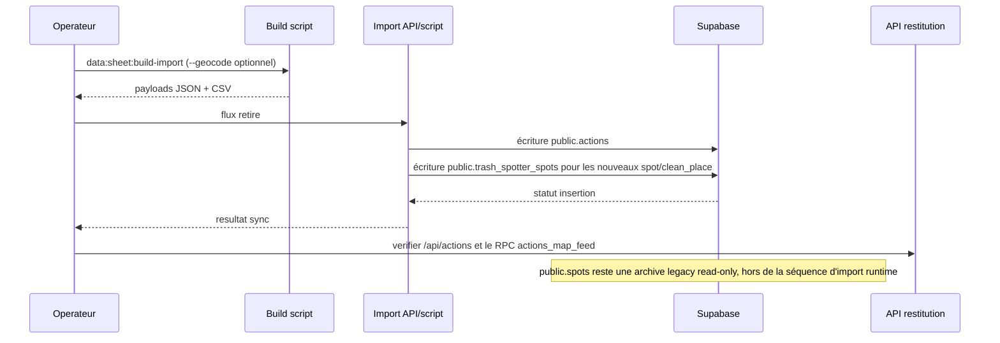
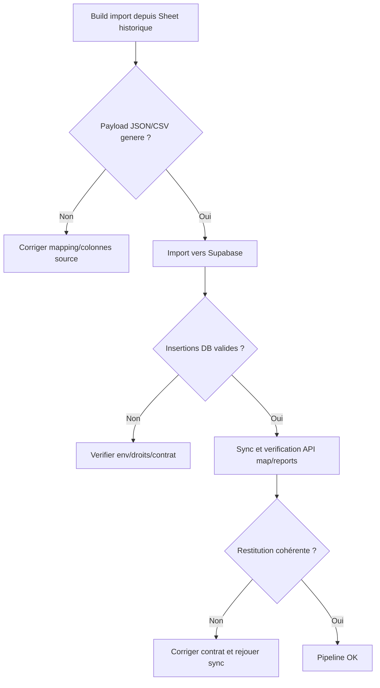
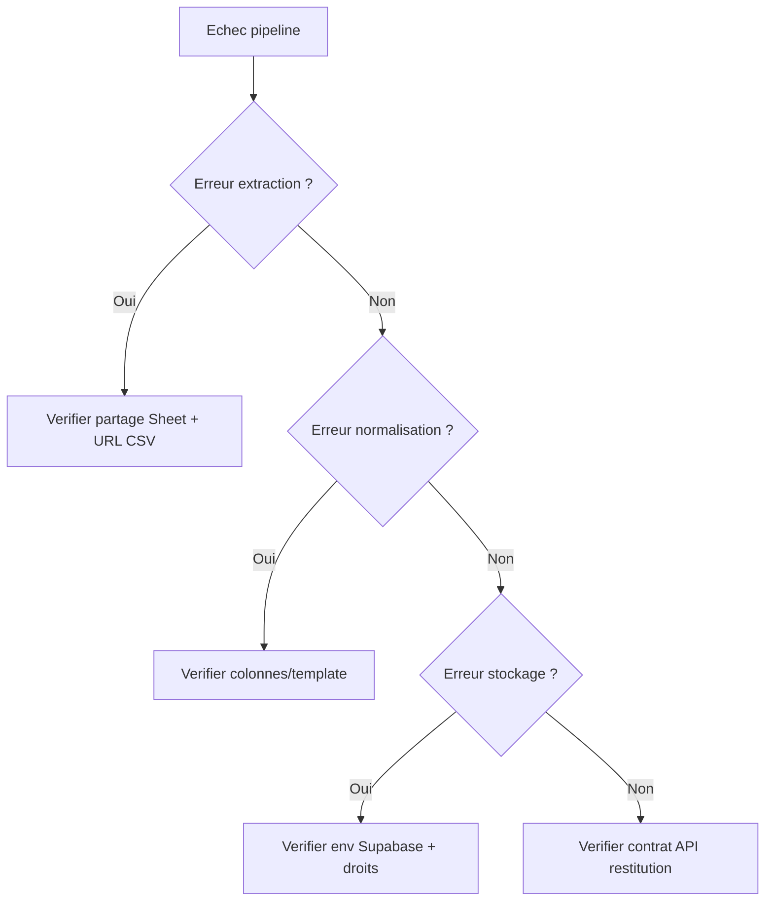

# Data pipeline import (visual-first)

## Diagramme global source -> normalisation -> stockage -> restitution

## Origines et statuts des sources

- **Terrain interne** : actions déclarées par citoyens ou collectifs, spots et
  statuts de nettoyage, événements communautaires et RSVP. Les parcours de
  restitution (carte, historique, rapports, pilotage) sont distincts des
  contrats d'écriture de ces entités.
- **Externe** : import historique Google Sheet administrateur ; météo et
  événements locaux éventuels servent de contexte, pas de preuves de ramassage.
- **Contrôles** : provenance de l'import traçable et qualité validée avant
  exploitation analytique. Le schéma de normalisation distingue action, spot,
  événement communautaire et progression, sans supposer un endpoint d'import
  commun à ces quatre familles.
- **Contenus éditoriaux ou institutionnels** : ils ne passent pas par l'import
  d'actions. Leur source, date, précision, niveau de preuve, responsable et revue
  relèvent de [la validation des contenus](../../architecture/content-validation.md)
  et de `apps/web/src/lib/content/content-validation.ts` ; les faits,
  estimations et recommandations restent séparés.

## Etapes avec entree/sortie/erreurs connues
| Etape | Entree | Sortie | Erreurs connues |
|---|---|---|---|
| Extraction & parsing | URL CSV Google Sheet, snapshots locaux | CSV brut local | Sheet non accessible, HTML au lieu de CSV, encodage invalide |
| Normalisation metier | CSV brut + mapping colonnes | Payload JSON admin + payload lieux propres | Colonnes manquantes, types invalides, association non reconnue |
| Validation qualite | Payload normalise | Payload validable importable | Geoloc manquante/incoherente, dates invalides, champs requis absents |
| Stockage Supabase | Payload valide + env Supabase | Lignes `public.actions` et `public.trash_spotter_spots` | `SUPABASE_SERVICE_ROLE_KEY` absente, échec insertion, conflit idempotence |
| Restitution API | Donnees stockees | `/api/actions`, RPC `actions_map_feed`, exports reports | Contrat data casse, mismatch champs, reponse partielle |

### Frontière des tables

- `public.actions` est la table canonique des actions.
- `public.trash_spotter_spots` est la cible unique de tout nouveau
  signalement `spot` ou `clean_place`.
- `public.spots` est une archive legacy read-only. Elle est hors du chemin
  d'import runtime : aucune nouvelle écriture, modération ou restitution
  runtime ne doit la cibler. Une lecture explicite reste réservée aux
  opérations de maintenance ou d'export historiques.

## Mapping historique des colonnes (illustratif)

Ce tableau conserve le repérage des anciennes colonnes Google Sheet ; **il ne
constitue pas un schéma exécutable**. Pour un import réel, les champs, valeurs
admises et transformations sont ceux du parseur et de l'API présents sur `main`,
notamment `apps/web/src/app/api/actions/import/route.ts`. Une colonne inconnue,
une valeur nulle, une valeur invalide ou une exclusion doit être tracée ; aucune
transformation implicite ne doit contourner les validations applicatives.

| Colonne source | Transformation | Champ produit |
|---|---|---|
| `action_date` | date ISO | `action_date` |
| `location_label` | trim + required | `location_label` |
| `latitude` + `longitude` | parse float + bornes | `geo.latitude` / `geo.longitude` |
| `association_name` | normalisation catalogue | `association_name` |
| `enterprise_name` | prefix `Entreprise -` | `enterprise_name` |
| `status` | mapping enum | `status` |
| `notes` | conserve + traces systeme | `notes` |

La normalisation des libellés organisation/zone, dates et coordonnées, les
anomalies de mesure et les doublons source doivent être explicités avant
confirmation. Les entrées partielles ou rejetées ne sont pas supprimées
silencieusement : journaliser leur cause et rendre l'exclusion auditable.
L'ancien schéma de nettoyage suggérait un statut par défaut pour les valeurs
inconnues : ce n'est **pas** une autorisation de forcer un statut non reconnu ;
le contrat Zod de l'import et la validation métier en vigueur prévalent.

## Normalisation et contrôle qualité avant écriture

- Entités conceptuelles : action, spot, événement communautaire et profil de
  progression. Date, localisation, statut et auteur ou source sont normalisés
  selon le contrat du type d'entité ; volumes et mesures restent qualifiés
  avant agrégation.
- La qualité distingue déclaration ou mesure, dérivation, estimation/proxy et
  absence de donnée. La source scientifique canonique détermine la portée des
  métriques, jamais un schéma illustratif d'import.

Les imports externes administrateur passent par `normalizeExternalActionImport` dans
`apps/web/src/lib/actions/unified-source.ts`, puis par `createAction`. Une insertion
directe dans `actions` n'est pas un chemin d'import valide : elle contourne les
organisateurs, la geometrie persistee et les metadonnees du contrat.

Le compte qui exécute `/api/actions/import` est un acteur technique d'ingestion
et d'audit. Il n'est pas ajouté automatiquement à `action_organizers`. La
relation organisateur n'est persistée que lorsqu'elle est fournie et résolue par
le contrat métier ; une source qui ne connaît pas l'organisateur conserve une
relation absente. `GRANTED_ROLE`, `publicMetadata.role`, `ACTIVE_ROLE` et les
fallbacks de création ne deviennent jamais des `organizerIds` de décision
AuthZ. Les fallbacks de création existants ne s'appliquent qu'au moment où une
relation explicite est effectivement persistée et ne sont pas des fallbacks de
lecture ou d'autorisation.

Le resume de qualite est versionne par
`apps/web/src/lib/actions/quality/data-quality.ts` et distingue :

- `measured` : valeur declaree ou relevee sur le terrain ;
- `derived` : valeur calculee a partir d'autres donnees, notamment l'impact ;
- `estimated` : valeur issue d'une estimation provisoire ou d'une geometrie estimee ;
- `missing` : valeur non disponible.

Les anomalies `invalid_date`, `invalid_measure`, `implausible_measure`,
`partial_coordinates`, `invalid_coordinates` et `missing_location_label` sont
bloquantes pour une confirmation d'import. `missing_coordinates` est une alerte :
l'action peut rester exploitable dans les listes et rapports, mais elle est exclue
de la couverture cartographique. La paire latitude/longitude est toujours evaluee
ensemble ; une seule coordonnee renseignee est donc explicitement `partial`.

La revue mensuelle est disponible via l'endpoint admin existant avec
`/api/reports/governance-monthly?quality=1&month=YYYY-MM`. Elle restitue les taux,
les anomalies par code, la couverture geographique, la provenance des mesures et
les alertes de seuil.

## Sequence d'execution recommandee


## Flowchart build -> import -> sync


## Commandes
```bash
npm --prefix apps/web run data:sheet:build-import
npm --prefix apps/web run data:sheet:build-import -- --geocode
```

La synchronisation directe Google Sheet -> Supabase est retiree.

## Variables critiques
- `NEXT_PUBLIC_SUPABASE_URL`
- `SUPABASE_SERVICE_ROLE_KEY`
- `CLEANMYMAP_SHEET_URL` (si override source)

## Decision tree de depannage

