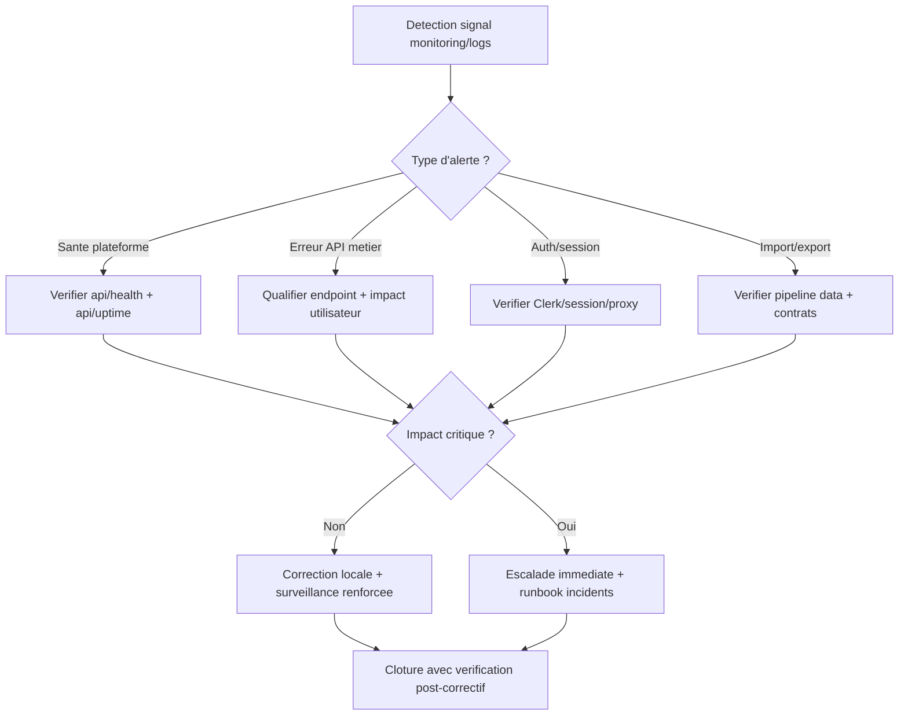

> **CURRENT pour la méthode, pas pour l'état des fournisseurs.** La liste des services et leurs configurations restent dans [services-stack.md](./services-stack.md) et [environment-configuration.md](./environment-configuration.md). Un log absent dans une fenêtre ne prouve ni une route inutilisée ni l'absence de trafic.
# Runbook monitoring logs

## Flowchart detection -> qualification -> escalade

## Signaux de supervision
- `GET /api/health`
- `GET /api/uptime`

## Logs a suivre
- erreurs API metier
- erreurs auth/session
- erreurs import/export

## Controle hebdomadaire recommande
- Verifier les 3 derniers incidents Sentry et qualifier les nouveaux digestes.
- Verifier les derniers runs GitHub Actions en echec ou annules.
- Verifier les derniers deploiements Vercel et les erreurs de build.
- Verifier les alertes Dependabot et les PR de mise a jour de dependances.
- N'agir que sur les signaux nouveaux ou persistants, puis consigner le resultat dans la session.

## Escalade
- Si incident critique: appliquer le runbook `incidents-frequents-et-reprise.md`.

## Qualification des services tiers

La présence d'une route, d'un SDK ou d'une clé déclarée ne démontre pas la configuration active de Stripe, Resend, Pinecone, Upstash, Clerk ou d'un autre service. Vérifier la route, le statut HTTP, l'environnement, le fournisseur et la fenêtre de logs, sans afficher les secrets ni envoyer de requêtes mutantes. Pour le coût et les limites de rate limiting, suivre [platform-cost-governance.md](./platform-cost-governance.md). Pour auth/admin/export, suivre [incidents-frequents-et-reprise.md](./incidents-frequents-et-reprise.md).
