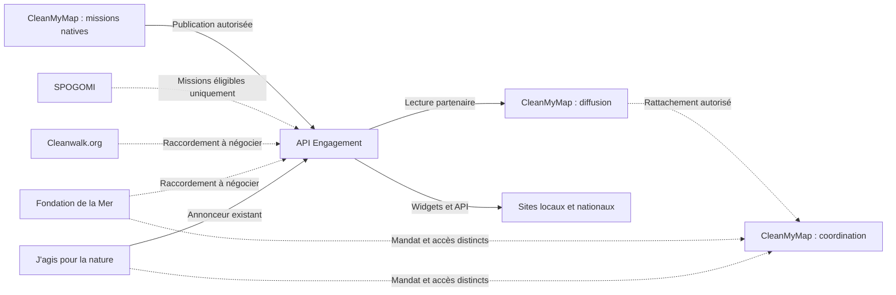

# Interopérabilité des collectes citoyennes avec API Engagement

**Statut : PLAN / PROPOSITION.** Aucun partenariat, accès, déploiement ou nouveau comportement CURRENT n'est affirmé par ce document.

**Révision : 26 novembre 2026.** Base de lecture Git : 19de2ffbca10ae3affe85d2e23b385c781791859.

**Owner documentaire :** stratégie transverse d'interopérabilité des collectes, diffusion nationale et accompagnement des associations. Le [plan de synchronisation opérationnelle](./synchronisation-actions-externes.md) reste propriétaire du moteur d'import, des pré-actions, du rapprochement et de la synchronisation privée des inscriptions. Le présent plan complète ce chantier, sans le remplacer ni autoriser son activation.

## 1. Vision et finalités

CleanMyMap doit faciliter une publication unique à la source et la circulation maîtrisée des annonces entre les outils existants, plutôt que demander aux associations de multiplier les saisies ou créer une plateforme généraliste concurrente.

Objectifs progressifs :

- Recevoir les missions de dépollution disponibles via API Engagement pour leur donner de la visibilité et identifier les organisations susceptibles d'utiliser CleanMyMap.
- Faciliter la publication des missions de dépollution natives de CleanMyMap sur les diffuseurs nationaux, si elles répondent aux conditions du service.
- Accompagner les plateformes spécialisées (Fondation de la Mer, Cleanwalk.org, organisateurs SPOGOMI et autres réseaux) dans leur propre raccordement à API Engagement ou dans un dispositif de publication déléguée expressément validé.
- Permettre aux associations parisiennes, puis à d'autres territoires, de présenter sur leurs sites un agenda à jour des missions pertinentes, sans héberger chacune un catalogue indépendant.
- Conserver la valeur spécifique de CleanMyMap : préparation, coordination locale, suivi de terrain, registre de présence et bilan d'impact. Une mission diffusée n'est pas une action réalisée.

Le pilote opérationnel concerne la Brigade Verte Paris. L'objectif initial n'est pas une synchronisation exhaustive de la France, mais une expérimentation bornée et réversible, suivie d'une ouverture aux autres structures volontaires. Un accès exploratoire à API Engagement reste utile même si le premier partenaire dispose finalement d'une intégration directe suffisante. L'utilisation quotidienne ne sera activée que si un besoin réel la justifie.

## 2. Faits établis, hypothèses et accès

| Élément | État au 26/11/2026 |
| --- | --- |
| API Engagement | Service public numérique de mutualisation des missions de bénévolat et volontariat. Un partenaire peut être annonceur, diffuseur ou les deux. [S1] |
| Diffusion API | Lecture JSON HTTPS via le point d'entrée /mission avec clé partenaire ; le périmètre disponible dépend du compte et de sa configuration. [S2, S3] |
| Mode test | La référence publique indique l'absence de sandbox dédiée ; les essais s'effectuent avec la clé de production. Un accès exploratoire restreint reste à négocier. [S3] |
| Annonceur | La méthode publique documentée repose sur un flux XML accessible sans connexion, relu toutes les trois heures, et le suivi des candidatures issues du réseau. [S4, S5] |
| Conditions XML | Les annonces doivent être propres au site annonceur ; les annonces d'autres plateformes, fermées ou expirées sont exclues. [S4] |
| Diffuseur | Redirection vers le site annonceur et mesure des impressions obligatoires ; le retour des refus/non-diffusions et leurs motifs fait également partie du contrat documenté pour les intégrations API. [S2, S6] |
| J'agis pour la nature | Intégration à API Engagement signalée par l'équipe du service ; inventaire réel des missions de dépollution, couverture de la Brigade Verte et accès direct à vérifier. |
| Fondation de la Mer | Le programme Un Geste pour la Mer présente une carte, un agenda et un réseau de structures. Son raccordement à API Engagement et ses capacités de flux sont non prouvés. [S8] |
| Cleanwalk.org | Plateforme candidate spécialisée ; interface d'échange, droits, couverture et statut API Engagement non prouvés. [S9] |
| SPOGOMI | Les éditions peuvent comprendre une compétition de collecte, distincte d'une mission de bénévolat. L'éligibilité des offres de bénévolat associées et les accords de publication sont à confirmer. [S10] |
| Accès CleanMyMap | Pas de clé, d'habilitation annonceur/diffuseur ni de convention opérationnelle démontrée dans ce plan. La structure porteuse, son référent et les conditions d'accès doivent être établis. |

La liste des plateformes annonceurs ne constitue pas un annuaire exhaustif des associations ni une preuve de présence de toutes leurs collectes. Une même organisation peut publier sur plusieurs plateformes et certaines missions peuvent être absentes, modérées, expirées ou complètes. Ne pas figer des nombres de partenaires ou de missions sans date, périmètre et preuve issue de l'API ou de statistiques officielles.

La possibilité d'une publication directe par API, plutôt que par flux XML, doit être confirmée avec l'équipe API Engagement et son contrat applicable avant tout choix d'implémentation. Aucun endpoint non vérifié ne doit être inventé.

## 3. Rôles et responsabilités

| Acteur | Responsabilité cible | Limite |
| --- | --- | --- |
| Association organisatrice | Créer ou confirmer sa collecte, choisir le canal de candidature et gérer les changements | Reste responsable de ses annonces et du terrain |
| Plateforme d'origine | Publier l'annonce et gérer les candidatures lorsqu'elle offre cette capacité | Ne perd pas son rôle lors d'un import |
| API Engagement | Mutualiser les missions admissibles, leur diffusion et les statistiques de diffusion | Ni registre d'émargement ni base canonique des actions CleanMyMap |
| CleanMyMap diffuseur | Présenter les missions de dépollution éligibles, attribuer leur origine, rediriger | Pas de modification des contenus ni de nouvelle inscription par défaut |
| CleanMyMap annonceur | Exposer les missions natives admissibles et mesurer les candidatures générées | Pas de republication d'annonces tierces sous son identité |
| CleanMyMap opérateur métier | Préparer les actions d'organisations volontaires, suivre et mesurer les opérations | Mandat spécifique par organisation ; aucune extension automatique de droits |
| Sites associatifs et collectivités | Relayer les missions choisies dans un agenda/widget | Conditions de diffusion et attribution à respecter |

### Flux proposés

Les flèches sont des flux fonctionnels cibles et non des interfaces activées. Le canal d'inscription reste celui désigné par l'annonce d'origine. Une mission déjà fournie par un annonceur ne repasse pas par le flux annonceur de CleanMyMap : cette séparation interdit les boucles de réimport et de republication.

## 4. Politique de diffusion et d'éligibilité

### 4.1 Entrée via API Engagement

Commencer par un inventaire en lecture seule, filtré sur Paris et l'Île-de-France, le domaine environnement et les activités réellement liées à la collecte de déchets. Confirmer les filtres, valeurs exactes (dont ramassage-dechets si disponible), schéma, quotas, pagination, périmètres partenaires et règles de feedback dans le contrat du compte. Ne pas supposer qu'une catégorie seule identifie toute collecte.

Conserver séparément :

- l'identifiant de mission API Engagement, l'identifiant annonceur et l'identifiant de mission source ;
- l'organisation d'accueil (identifiants RNA/SIRET vérifiés si disponibles), distincte de l'annonceur ;
- le lien de candidature fourni par le service, les mentions de provenance, les dates, le lieu et le statut ;
- la fraîcheur, la complétude du chargement et les raisons de non-diffusion.

Ne pas réécrire la description de la mission ; la normalisation interne et les filtres de recherche ne doivent pas modifier la substance du contenu diffusé. Neutraliser les contenus actifs dangereux sans inventer de texte. Respecter les restrictions de représentation et le lien de candidature tracké fourni par le service.

Distinguer **annonce externe affichable** (sans effet métier) et **pré-action privée d'une organisation mandatante** (création via le moteur existant). Aucun import de toutes les missions dans les actions natives. Une mission peut être générale, récurrente, multi-adresses ou sans horaire précis ; elle ne correspond pas nécessairement à une occurrence terrain. En l'absence de correspondance démontrée, ne pas créer de pré-action ni compléter artificiellement les champs manquants.

Les associations identifiées peuvent être contactées via leurs canaux professionnels/publics dans une démarche proportionnée et manuelle. Ne pas collecter automatiquement les données personnelles des bénévoles, créer de comptes ni constituer un annuaire de prospection nominatif à partir de l'API.

### 4.2 Sortie : missions propres à CleanMyMap

Utiliser une projection minimale du contenu public canonique de CleanMyMap, jamais une nouvelle source de vérité. Une mission ne devient exportable que si :

- elle est publiée, future ou encore ouverte, non annulée, et dispose d'un véritable parcours de candidature sur le site annonceur ;
- sa structure organisatrice est autorisée, identifiable et a approuvé cette diffusion ;
- il s'agit d'une mission de bénévolat admissible, et non d'un brouillon, d'une action privée, d'une collecte passée, d'une simple mesure ou d'une inscription sportive non qualifiée ;
- CleanMyMap possède les droits de diffusion du contenu et est autorisé à agir comme annonceur de cette mission ;
- aucun autre canal annonceur n'est déjà utilisé pour cette même offre, sauf règle explicite validée avec API Engagement.

Les identifiants d'export restent stables et sont dérivés des identités canoniques admissibles ; une modification conserve l'identité. Suivre le schéma fournisseur pour le titre, la description, le lien de candidature, le type, le domaine, la structure et les adresses. N'inventer ni capacité, ni date de fin, ni lieu. Retirer les offres fermées ou expirées du flux conformément au contrat fournisseur ; mesurer le délai réel de propagation et ne pas promettre d'annulation instantanée.

Les données publiques exportées n'incluent aucune présence, liste de bénévoles, identité de compte, trace GPS privée, rapport non publié, coordonnées personnelles ni secret. Le suivi des candidatures générées est distinct du registre de participation et de la gamification.

### 4.3 Plateformes tierces non encore raccordées

Priorité : permettre à chaque plateforme de devenir son propre annonceur, en l'aidant à qualifier son contenu, produire son flux, tester la conformité et configurer son attribution. L'opérateur garde son compte et ses droits ; CleanMyMap ne se présente pas comme propriétaire des annonces.

Une publication déléguée ou hébergée pour un partenaire reste une alternative uniquement après accord écrit de l'opérateur, de l'organisateur et validation explicite par API Engagement du modèle d'annonceur, de l'identité, du flux et de la candidature. Les CGU actuelles excluent l'agrégation/republication ordinaire de missions tierces dans le flux CleanMyMap. Même une autorisation de lecture ne lève pas cette restriction.

## 5. Intégrations à qualifier

| Source | Première étape | Cible conditionnelle |
| --- | --- | --- |
| J'agis pour la nature (FNH) | Tester la couverture via API Engagement et poursuivre la démarche directe avec la Brigade Verte | Diffusion via API Engagement ; synchronisation métier et, séparément, inscriptions uniquement par canal autorisé |
| Fondation de la Mer / Un Geste pour la Mer | Qualifier l'agenda, l'origine des annonces et les possibilités d'échange | Aide à un flux annonceur propre et/ou connecteur direct autorisé |
| Cleanwalk.org | Vérifier les fonctionnalités, opérateur, API/flux, conditions et besoins mutuels | Flux annonceur propre ou interopérabilité contractuelle ; aucun scraping présumé autorisé |
| SPOGOMI / Dream in Green France et organisateurs | Distinguer bénévolat d'organisation, collecte sportive et inscription des équipes | Publier les missions de bénévolat admissibles ; partager éventuellement les événements sportifs par un agenda distinct si autorisé |
| JeVeuxAider.gouv.fr | Inventorier les missions de dépollution disponibles et les structures | Diffusion avec lien d'origine ; pas de duplication de l'offre |
| CleanMyMap | Qualifier les actions natives publiques ouvertes à candidatures | Annonceur des seules offres propres admissibles |
| Associations parisiennes | Identifier les sites et leurs besoins, commencer par un partenaire volontaire | Widgets filtrés par territoire et/ou organisation ; publication unique par le canal convenu |

La couverture de toutes les collectes d'une plateforme est une cible de coopération, non une promesse : seules les annonces autorisées, admissibles et effectivement accessibles peuvent être diffusées. Les événements non éligibles à API Engagement peuvent relever d'un calendrier événementiel distinct si les droits sont établis.

### SPOGOMI et identité des actions

Respecter [le contrat SPOGOMI existant](../features/spogomi.md) : une édition parente possède une seule action environnementale canonique, même avec plusieurs divisions. Ne pas créer d'action supplémentaire par offre de bénévolat, équipe, division ou canal de recrutement. Les bénévoles d'organisation, les participants sportifs et leurs inscriptions restent des populations distinctes. Les résultats certifiés et la mesure de déchets ne sont pas des données d'annonce ni une preuve d'éligibilité au bénévolat. L'activation éventuelle se limite aux éditions et offres autorisées.

## 6. Architecture et garde-fous de la future intégration

### 6.1 Réutiliser le socle existant

Le dépôt contient déjà les points d'entrée serveur suivants (présence vérifiée sur le SHA de référence, pas preuve de fonctionnement) :

- apps/web/src/lib/actions/external-sync/engine.ts
- apps/web/src/lib/actions/external-sync/matching.ts
- apps/web/src/lib/actions/external-sync/store.ts
- apps/web/src/app/api/admin/external-sync/route.ts

Le [plan existant](./synchronisation-actions-externes.md) décrit le mandat, les états, le moteur, le cron, les droits administratifs et le registre privé. Avant implémentation, relire leurs contrats complets, les migrations, tests, consommateurs et statuts CURRENT sur le main du moment.

Décision proposée : étendre les owners existants pour les événements rattachables ; ne pas créer un deuxième moteur d'actions, un deuxième registre d'inscriptions ou un second ordonnanceur par plateforme. Les projections de diffusion et leur feedback peuvent constituer une responsabilité distincte si les contrats existants ne les couvrent pas. Aucune nouvelle table, route publique ou dépendance n'est prescrite sans analyse des owners et besoin démontré.

### 6.2 Identité et rapprochement

Un événement réel peut avoir plusieurs annonces, dont une référence directe et une référence API Engagement de la même source. Conserver leur filiation et leurs identifiants distincts. Le contrat d'identité/réservation du plan opérationnel s'applique avant toute création canonique.

Exemples de risques : même nom de collecte à des dates différentes ; une mission générale couvrant plusieurs occurrences ; deux plateformes annonçant la même occurrence ; plusieurs adresses ; mission modifiée ou retirée ; action native préexistante. Une correspondance ambiguë reste en revue, jamais fusionnée ou supprimée automatiquement. Conserver les références sources et leur lien de candidature applicable. La suppression d'une annonce ne supprime ni l'action ni son historique d'impact.

Interdire les boucles : source externe -> projection diffuseur -> flux annonceur CleanMyMap. Une action née d'un import reste exclue du flux sortant par défaut, y compris après une modification locale. Un changement d'origine ou de canal annonceur exige une décision explicite, les droits correspondants et une preuve de non-duplication.

### 6.3 Synchronisation et exploitation

Clé API côté serveur uniquement ; stockage des secrets selon le système existant. Bornes de pagination et de concurrence, délais réseau, reprise avec backoff, journal non nominatif, suivi de fraîcheur et d'échecs. Mutualiser un cycle de récupération ; ne pas appeler le fournisseur depuis chaque carte ou application mobile. Respecter les quotas convenus, pas d'activation permanente avant preuve du besoin.

En cas de flux incomplet, erreur ou indisponibilité, ne pas conclure que toutes les missions ont disparu. Retirer de la diffusion publique les missions effectivement expirées, fermées ou non fiables selon le contrat validé ; conserver l'historique métier légitime. Une annonce supprimée ne prouve pas qu'un événement a été annulé. Les pré-actions suivent le cycle de vie et les arbitrages du plan opérationnel.

Prévoir un interrupteur indépendant pour lecture, affichage, création métier et sortie annonceur. Les essais n'activent pas automatiquement les autres flux. Un échec du service national ne bloque pas la préparation ou le bilan local. Réutiliser le backend commun Web/mobile ; la V1 peut être Web uniquement côté présentation sans duplication de métier.

### 6.4 Mesure de diffusion et confidentialité

Implémenter le suivi d'impressions et le retour des missions non diffusées selon les obligations effectivement convenues avec le service. Les vues réelles ne sont ni des candidatures ni des présences. Ne pas fabriquer de statistiques lors des dry-runs, du préchargement ou des essais sur fixtures. Valider le mode de mesure des candidatures sortantes/entrantes selon les rôles et la documentation fournisseur.

Évaluer les traceurs, finalités, données et conditions de consentement avec le responsable de traitement et la politique de confidentialité du produit. L'éventuelle exemption de consentement n'est pas présumée. Les inscriptions privées relèvent du plan opérationnel et d'une autorisation et qualification RGPD distinctes ; ne jamais les déduire de statistiques d'API Engagement.

## 7. Diffusion sur les sites d'associations

Préférer le widget officiel API Engagement, lorsqu'il permet les filtres territoriaux, thématiques ou organisationnels souhaités et que le site partenaire accepte son intégration. Le widget préserve le parcours de candidature chez l'annonceur, réduit le coût de maintenance et évite de distribuer une clé API à des tiers. Vérifier les paramètres réellement disponibles et les obligations de chaque site hôte.

Si le widget officiel ne couvre pas un besoin concret (par exemple un agenda des propres actions d'une association, incluant les événements non éligibles), étudier un widget CleanMyMap reposant sur la projection publique existante. Ne pas réexposer en masse le catalogue API Engagement ni redistribuer son contenu à des tiers sans droits explicites. Une API locale de redistribution ou un flux ICS/JSON ne devient pertinent qu'après démonstration d'un besoin non couvert, validation des droits et attribution, bornage, fraîcheur et contrôle de la visibilité.

Le périmètre affiché est choisi avec le site hôte : ses propres actions, les collectes autour d'une commune, ou un réseau local volontaire. Aucune obligation pour les associations de changer leur site, leur outil de recrutement ou leur identité graphique.

## 8. Démarches partenaires et jalons

| Jalon | Résultat attendu | Dépendance / arrêt |
| --- | --- | --- |
| J0 : accès et inventaire | Identifier une structure porteuse (pistes : université ou association pilote), référent, responsabilités et conditions ; demander la liste des annonceurs, les capacités de filtrage et le cadre des essais | Pas de clé hors canal officiel ; pas de promesse de sandbox |
| J1 : preuve de lecture | Fixtures locales puis lecture bornée autorisée en production sans publication ni création métier ; inventaire des missions de dépollution, couverture du pilote et mapping | Pas d'activation permanente ni de tracking fictif ; si aucun accès, conserver un résultat simulé |
| J2 : diffusion pilote | Affichage des missions admissibles et lien de candidature d'origine ; feedback/impressions conformes et déduplication | Validation du partenaire API Engagement et des conditions de confidentialité |
| J3 : coordination | Rattachement ou pré-action de la Brigade Verte via le plan opérationnel, après mandat et validation des données | Ne pas rejouer le lot moteur déjà livré ; inscriptions privées indépendantes |
| J4 : annonceur | Test du flux des seules missions natives admissibles, contrôle de modération et réception ; gestion des fermetures et tracking des candidatures | Accord annonceur ; aucune annonce importée ou fictive |
| J5 : coopération | Accompagner les plateformes candidates vers leur raccordement propre, tester un agenda/widget avec un site associatif volontaire | Accords spécifiques ; extension conditionnée à l'intérêt observé |

L'ordre est une recommandation et non une priorité produit imposée : J3 peut avancer indépendamment de J2 avec un connecteur direct autorisé ; J4 et J5 ne bloquent pas l'expérimentation initiale. Ne pas construire toutes les intégrations en parallèle. Pour J0, les questions essentielles sont : droits du compte exploratoire, structure garante, périmètre réel des sources et associations, traitement des missions déjà diffusées, mode de feedback et de mesure, processus de raccordement d'un nouvel annonceur, faisabilité de la publication déléguée et critères d'éligibilité des offres liées à des événements sportifs.

Les contacts et négociations détaillés, conventions et identifiants privés restent dans les outils de pilotage autorisés, pas dans GitHub. Aucune démarche ou activation n'est effectuée par ce document.

## 9. Recette et critères de réception

| Scénario | Preuve attendue |
| --- | --- |
| Lecture limitée aux filtres autorisés | Inventaire paginé complet dans le périmètre choisi ; erreurs, exclusions et limites explicites |
| Mission externe affichée | Contenu fidèle, attribution, lien de candidature valide et tracking conforme |
| Mission non affichée | Motif et feedback conforme à la configuration partenaire |
| Deux canaux pour la même occurrence | Une action métier au maximum après preuve de correspondance ; aucune boucle de publication |
| Mission générale ou données temporelles incomplètes | Pas de création d'occurrence inventée |
| Source indisponible ou réponse partielle | Pas de suppression, de duplication ni de faux état certain |
| Mission native ouverte et autorisée | Une seule projection XML/contrat annonceur, stable et valide |
| Mission importée, privée, expirée ou sportive non qualifiée | Exclusion du flux annonceur, même après modification locale |
| Annulation ou fermeture native | Retrait du flux, propagation observée ; historique local préservé |
| Site associatif tiers | Affichage conforme aux droits, filtres, attribution, candidature et absence de secrets |
| Révocation ou incident | Arrêt indépendant du flux, pas d'écriture ni de nouvelle diffusion interdite |
| Données de bénévoles et résultats | Aucune fuite, création de compte ou présence fictive ; pas de confusion avec statistiques API |

Indicateurs proposés, à mesurer sans objectif chiffré inventé : nombre de missions éligibles uniques, part des plateformes et organisations couvertes, doublons/conflicts, délai publication -> visibilité, taux de liens valides, refus motivés, impressions, clics/candidatures attribuables, temps de double saisie évité et coût de fonctionnement. Définir le dénominateur de chaque mesure ; compter les événements uniques séparément des annonces et des candidatures. Aucune somme des présences estimées à partir des impressions.

**STOP CONDITION du pilote de diffusion :** un périmètre autorisé de missions réelles est lisible, affichable et correctement attribué, les obligations de diffusion/feedback sont vérifiées, aucun doublon métier ni effet interdit, et l'organisateur pilote confirme l'utilité. Si l'accès reste bloqué, documenter la preuve manquante et ne pas déclarer le pilote opérationnel.

**STOP CONDITION annonceur :** une mission native réelle admissible et autorisée est reçue par API Engagement, son retrait est observé, le tracking est conforme et les annonces importées sont démontrées exclues.

**STOP CONDITION coopération locale :** au moins un site volontaire affiche un agenda conforme via une solution approuvée, sans double saisie supplémentaire ni redistribution non autorisée. La généralisation reste une décision ultérieure.

Les validations runtime, tests de non-régression, couverture, RLS et preuves d'intégration devront accompagner les futurs lots au niveau de risque approprié. Ce document seul ne déclenche aucune modification du runtime.

## 10. Sources publiques et références

Consultation le 26/11/2026, documentation fournisseur susceptible d'évoluer :

- [S1] [API Engagement : rôles annonceur et diffuseur](https://doc.api-engagement.beta.gouv.fr/introduction/a-qui-sadresse-lapi-engagement) ; [fiche data.gouv.fr](https://www.data.gouv.fr/dataservices/api-engagement).
- [S2] [Diffuser des missions par API](https://doc.api-engagement.beta.gouv.fr/diffuser-des-missions/diffuser-des-missions-dengagement-sur-mon-site/diffuser-des-missions-par-api) ; [modèle de mission](https://doc.api-engagement.beta.gouv.fr/diffuser-des-missions/modele-de-donnees-dune-mission-dengagement).
- [S3] [Référence REST, URL et absence de mode test](https://doc.api-engagement.beta.gouv.fr/api-reference).
- [S4] [Création du flux XML](https://doc.api-engagement.beta.gouv.fr/annoncer-des-missions/creation-dun-flux-xml) ; [conditions XML](https://doc.api-engagement.beta.gouv.fr/annoncer-des-missions/creation-dun-flux-xml/conditions-dutilisation-du-flux-xml).
- [S5] [Suivi des candidatures annonceur](https://doc.api-engagement.beta.gouv.fr/annoncer-des-missions/tracking-des-candidatures).
- [S6] [Obligations diffuseur](https://doc.api-engagement.beta.gouv.fr/diffuser-des-missions/tracking-des-candidatures) ; [missions non diffusées](https://doc.api-engagement.beta.gouv.fr/diffuser-des-missions/tracking-des-candidatures/missions-non-diffusees-sur-mon-site).
- [S7] [Widget officiel](https://doc.api-engagement.beta.gouv.fr/diffuser-des-missions/diffuser-des-missions-dengagement-sur-mon-site/diffuser-des-missions-par-widget) ; [traitement des données utilisateurs](https://doc.api-engagement.beta.gouv.fr/ressources/traitement-des-donnees-utilisateurs).
- [S8] [Un Geste pour la Mer](https://www.fondationdelamer.org/nos-programmes/un-geste-pour-la-mer/) ; [J'agis pour la nature](https://www.jagispourlanature.org/).
- [S9] [Cleanwalk.org](https://www.cleanwalk.org/) : site identifié, documentation technique non établie.
- [S10] [SPOGOMI Casual, Dream in Green France](https://www.dreamingreenfrance.com/spogomi-casual/).
- [Devenir partenaire API Engagement](https://doc.api-engagement.beta.gouv.fr/introduction/comment-devenir-partenaire).

Les éléments de qualification et les liens doivent être revérifiés avant les lots d'activation. Le plan ne contient ni secret, ni correspondance privée, ni donnée nominative, ni accord présumé. Mettre à jour les contrats CURRENT concernés uniquement lorsque leurs comportements seront effectivement livrés et prouvés ; absorber les décisions durables dans leurs owners au terme du chantier.
