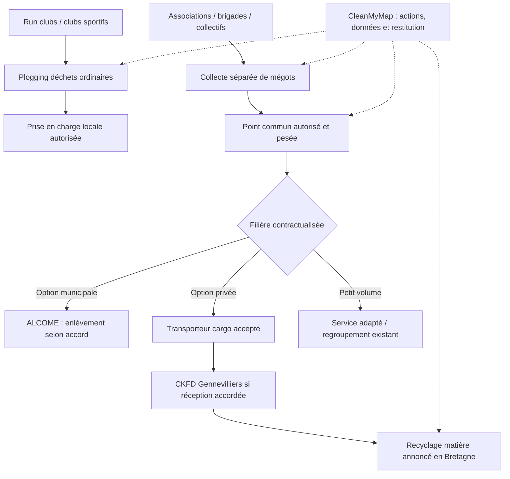

# Paris : plogging citoyen et filière mutualisée des mégots

**Statut : PLAN / PROPOSITION.** Cadrage au 25 novembre 2026. Aucun partenariat, financement, dépôt, autorisation de transport ou traitement n'est acquis. Le périmètre est Paris intra-muros (20 arrondissements, 17 mairies), avec une liaison logistique éventuelle vers Gennevilliers (92) et l'aval du traitement en Bretagne. Ce document est le plan opérationnel spécialisé de l'[ambition territoriale](../product/ambition-territoriale-paris.md). Il ne modifie pas la roadmap ni les contrats runtime. Les échanges privés, devis et accords restent dans le dossier privé de pilotage, sans publication de coordonnées personnelles ou de conditions commerciales confidentielles.

## 1. Deux actions indépendantes, un réseau commun

| | Plogging généraliste | Filière mégots |
|---|---|---|
| Public prioritaire | Run clubs, clubs FFA, étudiants, groupes informels | Associations de collecte, brigades, collectifs actifs |
| Finalité | Première expérience facile, récurrence, sensibilisation | Collecte séparée, conservation, massification, traitement documenté |
| Sortie | Déchets ordinaires vers une prise en charge locale autorisée ; tri si prévu | Lots de mégots vers un dépôt commun expressément autorisé puis un opérateur |
| Principal obstacle | Adhésion des responsables de clubs et mobilisation | Exutoire, conformité, stockage, coût fixe du transport |
| Apport CleanMyMap | Action partageable, carte, résultats, kit communication | Coordination, suivi de masse et provenance, rapprochement des lots et justificatifs |
| Non-objectif | Imposer le tri exhaustif ou le recyclage spécialisé à chaque footing | Acheter un vélo cargo, exploiter une déchèterie ou créer une activité de transport avant preuve |

Le plogging ne dépend pas de la filière mégots. Un club peut ramasser exclusivement les déchets courants, sans ramasser de mégots. Les déchets recyclables correctement séparés suivent les consignes locales ; les déchets mélangés non recyclables suivent l'exutoire résiduel convenu. Une petite quantité admissible peut rejoindre une corbeille si les consignes le permettent ; les sacs de collecte ne doivent pas être déposés automatiquement dans ou au pied des corbeilles. Organiser la remise à la DPE ou un autre exutoire convenu avant le départ. Ne jamais promettre que tous les déchets collectés sont recyclés. [S1-S3]

Les flèches de la filière spécialisée sont des scénarios, pas des trajets déjà établis. Si ALCOME organise l'enlèvement, ne pas facturer en parallèle un transport privé pour le même maillon sans nécessité démontrée.

## 2. Plogging : convaincre et fidéliser les run clubs

### Proposition au responsable de club

Le frein principal n'est pas la complexité technique du ramassage mais le temps du responsable, l'intérêt pour ses membres, la perturbation d'une séance et l'intérêt éditorial pour ses canaux sociaux. Proposer une première action clés en main, gratuite pour le club si un financement ou du matériel disponible le permet, sans abonnement, exclusivité, obligation de compte collectif ni engagement de répétition. Préserver le créneau, le rythme et l'identité du club. Un référent CleanMyMap aide à identifier une zone et l'exutoire, à préparer l'annonce et à produire le bilan ; le club reste responsable de l'encadrement sportif. L'organisateur de l'action et le responsable de l'évacuation doivent être identifiés avant publication.

Format A, recommandé pour réduire la friction : footing social habituel, puis 10 à 20 minutes facultatives de collecte à l'arrivée ; briefing 5 minutes et photo/bilan. Format B : 30 minutes de footing facile, 30 minutes de collecte, restitution ; prévoir une durée totale avec briefing. Format C : petits groupes alternant marche/course lente et arrêts sécurisés ; pas de ramassage en courant sur chaussée. Pas de compétition de poids ou de vitesse, ni d'incitation à manipuler un objet dangereux. Prévoir pinces, gants adaptés, sacs, une personne responsable des déchets, un itinéraire accessible et un repli météo. Signaler sans manipuler seringues, verre dangereux, batteries endommagées, produits inconnus et objets lourds ; respecter le gestionnaire du site.

### Offre de communication

- Avant : texte court prêt à relayer, visuel co-brandé uniquement avec accord, lien d'action, horaire, lieu, durée et consignes. Le club garde ses propres canaux (Instagram, groupe WhatsApp, Strava ou newsletter) ; aucune connexion ou publication automatisée présumée.
- Jour J : une photo de groupe volontaire, images de la zone avant/après lorsque comparables, pesée si balance disponible, collecte de retours. Ne pas exposer de personnes sans droit, particulièrement mineurs ; autoriser une participation sans photo.
- Après : bilan sous 48 h comme cible de service, non SLA acquis ; carte ou lien de l'action, participants présents, durée, masse réellement pesée si connue, destination annoncée avec son statut, story verticale et post réutilisable. Chaque chiffre indique sa provenance. Pas d'équivalence environnementale présentée comme un effet mesuré.
- Répétition : proposer une action trimestrielle seulement après retour positif du premier test ; laisser le club choisir format, périodicité et zone.

Exemple de prise de contact publique : « Nous proposons à votre club de tester une sortie running avec un court ramassage de déchets à l'arrivée. CleanMyMap aide à préparer le parcours, le matériel et l'évacuation, puis vous remet un bilan et des éléments de communication que vous pouvez partager à votre convenance. L'idée est de tester une seule séance sans modifier votre programme d'entraînement. Seriez-vous intéressés par une expérimentation ? » Ne pas promettre de matériel ou de prise en charge avant confirmation.

### Réseau de prospection

| Cible | Intérêt / première demande | Preuve ou source |
|---|---|---|
| Les Runners Laveurs | Retour d'expérience et co-animation d'une initiation | Fondation de la Mer et HelloAsso : activité plogging francilienne [S4] |
| adidas Runners Paris | Groupes territoriaux ; tester un seul groupe puis essaimer | Communauté officielle [S5], précédent plogging dans le guide municipal 2021 |
| Paname Run Club | Communauté sociale ; proposer un format de fin de sortie | Annuaire [S6], canal actuel à vérifier |
| Circle Run Club, Midnight Runners Paris, Barbès Runners, AXLR | Prospection nord/est et canal, formats sociaux | Annuaires [S6], lieux/créneaux à confirmer individuellement |
| Front Runners de Paris, AUP Running Club, PUC Running, Club Team Trail Paris | Diversité des publics et formats ; relais associatifs/sportifs | Annuaires [S6] ; pas de statut juridique déduit d'un nom |
| Culture Run, KIIN, Founders Running Club, Paris Run Club, Let's Run Paris | Prospection élargie centre et autres quartiers | Annuaires [S6] ; vérifier nom exact et activité actuelle |
| Clubs des marques HOKA, On et autres magasins de running | Animation ponctuelle, visibilité et financement matériel possible | Annuaires [S6] ; intérêt commercial non prouvé |
| LIFA / comité départemental d'athlétisme / FFA | Relais vers clubs licenciés, distinguer du réseau informel | Demander annuaire actuel, aucun accord |
| ASO / Marathon de Paris / Culligan | Retour d'expérience et piste d'activation sportive sponsorisée | Programme officiel 2026 annonçant un plogging [S7] ; réalisation et financement du pilote non démontrés |

Les annuaires tiers sont des pistes de découverte, non des inventaires exhaustifs ni des preuves d'activité actuelle ; pas de prospection automatisée massive. Vérifier le canal public du groupe, la ville, l'activité récente, le format et le responsable autorisé à accepter. Prioriser une vingtaine de contacts diversifiés, puis ajuster selon réponses et capacité humaine. Cibles indicatives : trois essais dans des groupes différents, au moins un souhait de répétition, puis élargissement par recommandations entre clubs. Ne pas assimiler une réponse positive à une action réalisée. Suivre contacts qualifiés, réponses, essais planifiés/réalisés, taux de répétition, participants, masse par action, coût humain, incidents et bilan diffusé avec accord ; aucune cible n'est une mesure.

## 3. Mégots : chaîne de responsabilité et exutoires

### A. Mutualisation municipale en priorité à instruire

La Ville a déclaré au Conseil de Paris de mai 2024 disposer d'un contrat avec ALCOME depuis 2022 [S8]. Cela ne prouve pas les clauses applicables en novembre 2026, l'existence d'un bac partagé ni l'éligibilité de la collecte citoyenne au sol. ALCOME annonce accompagner les collectivités pour la fin de vie des mégots massifiés à 100 kg [S9]. Il s'agit d'un seuil de lot à un point de collecte selon la convention, pas d'une obligation annuelle ni d'un droit direct des associations. Un contrat municipal publié par Corbeil-Essonnes en 2024 illustre une collecte des dispositifs de rue, un seuil de 100 kg, des contenants adaptés, des limites de contamination et d'humidité (5 % et 10 % dans cet exemple), ainsi que des conditions de refus [S10]. Ne pas transposer ces valeurs au contrat parisien ni aux déchets au sol sans confirmation.

Demander conjointement à la DPE/STPP et à ALCOME : convention en vigueur à Paris, nature des flux admis (cendriers versus mégots au sol), possibilité d'intégrer les lots associatifs à un stock municipal existant, seuil et conditionnement effectifs, point de regroupement, responsabilités, fréquence, financement, opérateur choisi, justificatif de réception et destination réelle. Si cette voie existe, elle peut éviter d'attendre 100 kg propres au réseau et éviter une tournée cargo indépendante. Si elle refuse les mégots au sol, activer B ou C.

### B. Regroupement parisien et livraison privée à Gennevilliers

CKFD décrit sur son site le regroupement de mégots à son entrepôt de Gennevilliers et leur expédition vers une filière bretonne [S11]. Ce n'est pas un point d'apport volontaire attesté. Demander à CKFD/MéGO! un accord de réception directe pour des lots associatifs, un interlocuteur, l'adresse de livraison confirmée, le prix par kg ou par contenant, le minimum de facturation, les contenants, l'humidité et les impuretés admissibles, le statut des mégots au sol, la pesée de réception, les horaires, les modalités de refus et la preuve du traitement final. Demander également si un contrat mutualisé avec plusieurs associations est possible et qui doit être le cocontractant. La déclaration de recyclage matière par l'opérateur n'est pas une preuve de traitement d'un lot précis.

Carton Plein Cyclo est la première piste de transport : branche de cyclologistique parisienne avec des salariés en insertion et une offre de collecte professionnelle [S12]. L'observatoire GRAFIE 2025 cite les mégots parmi les flux envisagés en sous-traitance [S13]. Cela ne confirme pas qu'un transport Paris-Gennevilliers soit aujourd'hui disponible pour ce flux. Demander devis pour 10, 25, 50 et 100 kg, charge utile par véhicule avec contenants, capacité et volume, tarification au passage/temps/km, tournée multi-arrêts, acceptation du déchet, assurances, chargement, accès au site et preuve de remise. Demander une comparaison entre un seul hub et plusieurs points ; éviter une collecte par association si elle est disproportionnée. Les transporteurs déjà contractés par l'exutoire sont une alternative, et une offre mixte vélo/camion peut être comparée sans prétendre à un transport intégralement décarboné.

### C. Offre petits volumes pour associations

Ne pas conditionner la première collecte à l'obtention de 100 kg. Négocier une offre pilote de 5 à 25 kg ou par fût selon les contraintes réelles, soit enlèvement mutualisé, soit dépôt sur rendez-vous, soit adossement à une tournée existante. Consulter CKFD/MéGO! et, si nécessaire, TchaoMegot (offre dédiée aux particuliers et solutions de collecte annoncées [S14]) ou un autre opérateur autorisé. Les tarifs et l'acceptation des flux au sol ne sont pas vérifiés. Demander un prix complet matériel + transport + traitement + éventuels frais de refus ; comparer à service équivalent. Une remise associative, un forfait bas ou une prise en charge sponsorisée sont des propositions à négocier, pas des prix de marché. Éviter une facturation minimale par petit groupe si un contrat commun économise réellement du coût. Ne pas mélanger les mégots avec des déchets ordinaires en vue du traitement spécialisé.

### D. Point de stockage commun

Option préférée à instruire : un bac dédié **dans un espace municipal autorisé**, idéalement en déchèterie ou dépôt technique, avec convention d'exploitation et enlèvement. Le règlement intérieur des déchèteries parisiennes (6 mars 2025, art. 7.3 et 7.4) prévoit la possibilité d'autorisation ponctuelle pour certaines associations à but non lucratif et des accès conventionnés [S15]. Les mégots ne figurent pas comme flux accepté dans la liste générale de la Ville [S16]. Une autorisation de vidage ponctuel ne vaut pas droit d'y installer ou d'exploiter un bac permanent, ni droit d'accès pour un collectif informel. Aucun dépôt ni transfert dans un conteneur municipal existant avant accord explicite du gestionnaire et de la filière.

Alternatives : dépôt technique de la DPE, site d'une régie, local logistique d'un opérateur, local associatif uniquement si adapté et autorisé. Ne pas choisir un local accueillant du public sans évaluation du stockage, de l'incendie et des conditions sanitaires. Éviter le stockage chez un bénévole, les bacs ouverts et la multiplication des hubs non nécessaires. Le site hôte doit pouvoir recevoir les contenants validés, contrôler les apports, conserver à l'abri des intempéries et du public, limiter les quantités et la durée, gérer incidents et refus, assurer enlèvement et fermeture. Le conditionnement des mégots complètement éteints, la compatibilité des contenants et la conduite à tenir en cas d'humidité, souillure ou échauffement sont à valider par l'opérateur ; pas de séchage improvisé, de lavage ou de mélange sur site. Définir qui possède et garde les lots et qui paie une reprise non conforme. Aucun point privé ne doit apparaître sur une carte publique sans accord.

Le classement du déchet, l'éventuelle réglementation de transport de marchandises dangereuses, les obligations de déclaration, de registre et de stockage sont à vérifier avec le prestataire et les autorités compétentes. L'article R.541-50 du code de l'environnement prévoit notamment des seuils de déclaration supérieurs à 100 kg par chargement de déchets dangereux et 500 kg de déchets non dangereux, avec exceptions [S17]. Ces seuils ne suffisent pas à qualifier le flux ni à garantir qu'une opération sous le seuil est autorisée. Ne pas confondre le seuil de massification ALCOME avec un seuil réglementaire de transport. Vérifier aussi responsabilité civile et régime du site avant engagement.

## 4. Couverture des vingt arrondissements

Maillage de prospection, **non carte de points de dépôt**. Les secteurs ci-dessous sont des groupes logistiques proposés, et non de nouvelles divisions administratives. Les 14 divisions DPE couvrant l'ensemble des arrondissements, leurs coordonnées et les questions de validation sont déjà documentées dans [le référentiel opérationnel](./CleanMyMap_Paris_verifications_manuelles_materiel_dechets.md). Utiliser les mairies, MVAC, conseils de quartier et [REQ](./referents-entretien-quartier-paris.md) comme relais et les services compétents pour les accords. Ne pas dupliquer leurs coordonnées. Le recensement municipal [S16] donne les équipements candidats suivants ; vérifier accès, flux, autorisation et disponibilité, jamais présumer un bac.

| Secteur proposé | Arrondissements couverts | Prospection terrain | Équipements municipaux à examiner (pas de dépôt mégots confirmé) |
|---|---|---|---|
| Centre | 1, 2, 3, 4 | Paris Centre, berges, groupes sociaux et commerçants | Relais vers Invalides-Fabert (7e) ou site conventionné ; aucun hub local présumé |
| Nord-centre | 9, 10 | Canal Saint-Martin, groupes de course, associations de quartier | Mini-déchèterie du Canal (10e), accès piéton et capacité limitante |
| Nord-ouest | 8, 17, 18 | Parc Monceau, Batignolles, Barbès, Montmartre, Chapelle | Jessaint et Porte de la Chapelle (18e) ; proximité potentielle de la liaison vers le 92 |
| Est | 11, 19, 20 | Brigade Verte, régies, Buttes-Chaumont, canal de l'Ourcq, quartiers Bagnolet/Lilas | Porte de Pantin (19e), Porte des Lilas (20e) ; priorité d'instruction |
| Sud-est | 5, 12, 13 | Universités, quais, Vincennes, groupes étudiants | Carnot (12e), Poterne des Peupliers et mini-déchèterie Vincent Auriol (13e) |
| Sud-ouest | 6, 14, 15 | Luxembourg, Montparnasse, parcs et clubs locaux | Hyacinthe Vincent (14e), Quai d'Issy et mini-déchèterie Pasteur (15e) |
| Ouest | 7, 16 | Invalides, quais, bois de Boulogne, clubs de proximité | Invalides-Fabert (7e), Quai d'Issy en alternative |

Le Syctom référence également Romainville et Saint-Ouen dans le réseau accessible selon conditions ; alternatives éventuelles, sans présumer l'acceptation associative ni le flux mégots. Les mini-déchèteries sont moins adaptées à la massification (accès piéton et capacité réduite). Les parcours situés dans les bois, parcs, berges, gares ou sites privés relèvent des gestionnaires compétents ; ne pas supposer que la DPE autorise tous ces usages.

**Déploiement recommandé :** commencer avec le 20e (ancrage associatif), proposer 11e et 19e comme extensions proches ; instruire en parallèle un site nord (18e/17e) si sa desserte de Gennevilliers est plus simple. Un seul hub suffit au premier pilote si autorisé ; un second n'est justifié que par les coûts de trajet ou l'accessibilité mesurés. Ne pas présumer une distance routière ou un temps de tournée ; le transporteur établit sa faisabilité, en tenant compte des voies cyclables, des accès, des charges et des créneaux. À terme, l'ensemble des 20 arrondissements doit pouvoir contribuer selon ses accords locaux, sans exiger un bac par arrondissement.

### Associations et groupes à solliciter pour les mégots

Brigade Verte Paris (activité et dispositif mégots décrits publiquement [S18]), Surfrider Paris (collectes spécifiques [S19]), Les Parques/Super Brigade Verte, collectifs repérés via les plateformes de bénévolat et cleanwalk.org, associations étudiantes (SONU Environment et autres), régies de quartier et groupes récurrents de propreté. World Cleanup Day France et Trash Spotter/Mégothon constituent des pistes de méthode, mobilisation et retours d'expérience. Ne pas compter un acteur comme groupe actif sans confirmation de son rythme, de sa capacité et de son engagement. Rechercher 10 groupes capables de collecter régulièrement, pas 10 logos. Les personnes morales et collectifs informels doivent avoir un organisateur responsable et un droit d'accès confirmé ; CleanMyMap n'est pas présumé association constituée. Le signataire du contrat, l'assurance et le porteur financier restent à définir.

## 5. Dimensionnement et économie

### Ordre de grandeur de la masse sèche

Référence scientifique : [protocole CleanMyMap](../product/SCIENTIFIC_PROTOCOL.md), proxy sec 0,22 g par mégot, version courante décrite dans ce document. Une masse calculée n'est pas une pesée et ne permet pas de certifier l'admission du lot. Le seuil de 100 kg concerne le poids réellement accepté. Ne pas utiliser le proxy humide pour augmenter artificiellement le rendement.

Formule : masse sèche estimée (kg/an) = groupes × sorties/groupe/an × présents/sortie × mégots/personne/sortie × 0,00022. Les hypothèses sont illustratives, non des rendements constatés. Une participation n'est pas une personne unique.

| Scénario | Groupes | Sorties/groupe/an | Participants/sortie | Mégots/personne | Mégots/an | Masse sèche estimée |
|---|---:|---:|---:|---:|---:|---:|
| Pilote ponctuel | 3 | 1 | 10 | 100 | 3 000 | 0,66 kg |
| Réseau prudent | 10 | 12 | 10 | 100 | 120 000 | 26,4 kg |
| Réseau actif | 10 | 12 | 20 | 100 | 240 000 | 52,8 kg |
| Dix groupes intensifs | 10 | 12 | 20 | 190 | 456 000 | 100,32 kg |
| Réseau élargi | 20 | 12 | 20 | 100 | 480 000 | 105,6 kg |

100 kg secs estimés correspondent à environ 454 545 mégots. Dix groupes doivent fournir en moyenne 10 kg/an chacun, soit environ 0,833 kg ou 3 788 mégots par groupe et par mois ; avec 20 participants mensuels, environ 190 par personne. À 100 mégots par personne et 20 personnes, une action produit 0,44 kg estimé ; il faut environ 228 actions au total (environ 23 par groupe/an pour dix groupes) pour approcher 100 kg. À 52,8 kg/an, accumuler 100 kg demanderait environ 23 mois dans un réseau seul, avant refus et variations : cela justifie de négocier l'intégration à une filière existante ou une offre petits volumes plutôt qu'un stockage prolongé. Ces hypothèses ne concernent pas le plogging généraliste, qui reste libre de ne pas collecter de mégots.

Mesurer sur les premières collectes : masse nette et tare, quantité comptée si connue, état (sec/humide), impuretés constatées, temps consacré, participants présents, masse acceptée à la remise et coût effectif. Conserver les lots sources ; les conversions suivent le protocole canonique, sans nouvelle formule runtime. Ne pas confondre volume de fût et capacité massique ; demander à l'opérateur son conditionnement. Comparer scénarios à masse acceptée équivalente.

### Modèle économique, sans tarifs inventés

Coût complet annuel = contenants + matériel + stockage + temps de coordination + transport + traitement + assurance/gestion + provision pour refus. Coût net restant = coût complet moins financements réellement acquis. Coût par kg = coût complet / kg acceptés (NA si masse inconnue ou nulle). Demander prix fixes et variables, TVA si applicable, fréquence minimale, durée d'engagement, location ou achat des fûts, éventuel coût de retour/refus. Pour illustrer seulement, un coût fixe hypothétique de 100 euros par enlèvement, hors tout autre coût, représente 10 euros/kg à 10 kg, 4 euros/kg à 25 kg, 2 euros/kg à 50 kg et 1 euro/kg à 100 kg. Ce n'est ni un devis ni un objectif tarifaire. Comparer ce coût à celui de la conservation supplémentaire et à la capacité autorisée. La fréquence optimale est une décision sous contraintes, pas forcément une collecte annuelle.

Financements à instruire : dispositif ALCOME via la collectivité, prise en charge municipale ou convention, mécénat matériel/logistique via acteurs sportifs non liés au tabac, soutien ESS/cyclologistique, fonds associatifs ou prix réduit négocié, participation volontaire des associations si modèle acceptable. Aucun budget acquis ; ne pas facturer deux fois une prestation financée. Le projet reste gratuit pour les participants au pilote selon ressources confirmées ; aucun modèle commercial ou statut juridique n'est créé par ce plan. Ne pas solliciter de financeur ni engager de dépense sans porteur autorisé. Comparer coût et durée de vie à l'achat d'un cargo seulement après mesure d'un besoin récurrent. La dimension insertion de Carton Plein est une valeur potentielle, non un emploi créé par CleanMyMap.

## 6. Chaîne de preuve et apport numérique

| Étape | Trace minimale proposée, hors plateforme au départ |
|---|---|
| Action | Identifiant de l'action, date, organisateur, zone, participants, méthode et mesures |
| Lot | Identifiant stable, source action(s), masse nette mesurée ou estimation séparée, état et tare |
| Apport au hub | Date, lot, masse acceptée, responsable du dépôt, écart et motif |
| Stock | Somme des masses entrantes moins sorties et pertes documentées ; écart explicite |
| Enlèvement | Lots ou identifiant de regroupement, masse, transporteur, date, destination autorisée |
| Réception et traitement | Justificatif de réception, masse acceptée/refusée, opérateur, mode et preuve de traitement réellement fournie |

Le registre du pilote peut rester manuel, accessible seulement aux acteurs habilités. Un lot issu de plusieurs actions garde sa provenance sans comptage répété lors des transferts. Si une masse n'est pas mesurée, indiquer NA pour la masse pesée ; aucune reconstruction artificielle de l'acceptation. Distinguer collecté, déposé, transporté, reçu et traité ; « recyclé » seulement quand un justificatif le démontre. Les écarts de masse peuvent provenir de l'humidité, des refus ou de mesures différentes ; documenter sans corriger arbitrairement. Le bilan distingue résultats d'action et résultats de filière, compte les participations et non des individus uniques sans déduplication licite. Ne pas exposer les trajets individuels, l'identité des bénévoles ou les sites privés sans autorisation. Respecter les contrats d'accès et de publication existants.

Réutiliser création et finalisation d'actions, cartes, mesures par lots, rapports et annuaire existants ; les contrats et propriétaires sont ceux de la [vision](../product/vision-et-objectifs.md), de la [méthodologie](../product/SCIENTIFIC_PROTOCOL.md) et de l'[index des pages](../pages_site/INDEX.md). Pas de nouvelle table, badge, rôle, API, application de transport, moteur de tournées, paiement ou crédit environnemental. Un éventuel suivi de filière informatisé suppose d'abord un usage terrain récurrent, des obligations définies, un owner identifié et une décision de roadmap distincte. Aucun partenariat prospectif ni lieu de stockage non autorisé n'est ajouté au graphe opérationnel. Mesurer la distance et le mode des trajets réellement réalisés ; aucune réduction de CO2e n'est démontrée sans scénario de référence, périmètre et facteurs sourcés (inclure l'aval vers la Bretagne si l'allégation concerne la filière).

## 7. Plan d'action et critères de décision

| Phase | Actions | Condition de passage |
|---|---|---|
| P0, instruction | Contacter DPE/STPP et ALCOME pour l'éligibilité et le site ; CKFD/MéGO! pour réception directe/petits volumes ; Carton Plein pour devis conditionnel ; trois clubs pour tester | Réponses écrites sur flux, responsables, prix et modalités ; exutoire ordinaire confirmé pour chaque plogging |
| P1, terrain | Trois ploggings indépendants ; observer rendement réel des collectes de mégots existantes ; un premier lot spécialisé seulement si exutoire et stockage approuvés | Bilan, avis responsables, absence d'incident non résolu et justificatif de réception pour le lot |
| P2, réseau | Prospecter jusqu'à dix groupes réguliers ; déterminer rythme réaliste et choisir une seule solution logistique financée | Masse mensuelle mesurée, accord de site, transport, traitement et financement ; coût et traçabilité acceptables |
| P3, extension | Étendre aux autres secteurs via mairies, DPE, groupes locaux et run clubs ; réviser le nombre de hubs selon données | Répétition, coûts maîtrisés, débouché durable, preuve de traitement et retour des partenaires |

Questions prioritaires à poser séparément : DPE/STPP (autorisation de bac, flux, garde, convention, budget et contrat ALCOME) ; ALCOME (éligibilité sol, seuil, opérateur, financement, preuve) ; CKFD/MéGO! (petits lots, spécifications, coût, preuve) ; Carton Plein (prise en charge, capacité, devis, conditions, preuve) ; associations (masse réelle mensuelle, fréquence, équipement, capacité de remise, budget) ; run clubs (format compatible, matériel, communication, responsable, répétition). Les coordonnées fonctionnelles publiques et formulaires des sources ci-dessous servent de premier canal. Les réponses nominatives, pièces contractuelles et devis sont à conserver en privé, avec date et statut.

**STOP CONDITION du cadrage :** deux filières distinctes, couverture géographique complète en prospection, variantes de traitement, hypothèses de masse et coût, responsabilités, sources, questions et critères de passage documentés. **STOP CONDITION du pilote spécialisé :** preuve écrite d'admission et de prise en charge, site autorisé, conditionnement validé, transport conforme et financé, réception et traitement traçables. Si l'une manque, ne pas accumuler de lots dans un lieu non autorisé ; poursuivre uniquement les actions ordinaires dont l'exutoire est confirmé. Aucun achat ni développement supplémentaire n'est requis par ce cadrage.

## 8. Sources et niveau de preuve

Consultation le 25 novembre 2026 ; sources institutionnelles ou professionnelles privilégiées. Les annuaires sportifs sont des pistes secondaires. Les PDF dont le texte a été consulté n'ont pas tous pu être rendus en captures ; les conditions exactes du contrat parisien et les devis restent à obtenir. Les activités décrites ne sont pas une preuve d'accord avec CleanMyMap.

- [S1] Ville de Paris, [Nettoyages participatifs](https://www.paris.fr/pages/nettoyages-participatifs-ensemble-rendons-paris-plus-propre-15425).
- [S2] Ville de Paris, [Bonnes pratiques de propreté](https://paris-v4.paris.fr/pages/agir-pour-la-proprete-de-ma-ville-2015), consignes relatives aux sacs et corbeilles.
- [S3] Ville de Paris, [Coordonnées des divisions de collecte](https://www.paris.fr/pages/la-collecte-44/).
- [S4] Fondation de la Mer, [Les Runners Laveurs](https://www.fondationdelamer.org/nos-programmes/un-geste-pour-la-mer/associations/les-runners-laveurs/) ; [HelloAsso](https://www.helloasso.com/associations/les-runners-laveurs).
- [S5] [Communauté adidas 10K Paris](https://www.adidas10kparis.fr/fr/se-preparer/communaute) ; [guide municipal 2021](https://cdn.paris.fr/paris/2021/12/01/bb21d28119bd89a6292ee9128cecd983.pdf), précédent historique.
- [S6] [Running Clubs Paris](https://www.runningclubsparis.fr/), [Run Club Collective](https://www.runclubcollective.com/cities/paris), [Local Run Clubs](https://localrunclubs.com/directory/france/paris), [RunningCrews](https://runningcrews.com/run-clubs/paris). Vérification directe des clubs nécessaire.
- [S7] ASO, [Marathon écoresponsable 2026](https://www.schneiderelectricparismarathon.com/fr/marathon-engage/recyclage) et [Run Experience](https://www.schneiderelectricparismarathon.com/fr/l-evenement/run-experience).
- [S8] Conseil de Paris, [débats de mai 2024, p. 274](https://cdn.paris.fr/paris/2024/08/08/bovp-debats-mai-2024-RG83.pdf) ; déclaration historique concernant le contrat depuis 2022.
- [S9] ALCOME, [FAQ](https://alcome.eco/faq-3/), [consultation 100 kg](https://alcome.eco/wp-content/uploads/2022/06/20220525-Alcome-Consultation-collecte-100kg-megots.pdf).
- [S10] Corbeil-Essonnes, [contrat ALCOME publié en décembre 2024](https://www.corbeil-essonnes.fr/wp-content/uploads/5.4-CONTRAT-ALCOME.pdf), art. 17.6-17.8 ; exemple distinct du contrat parisien.
- [S11] CKFD, [collecte et recyclage des mégots](https://www.ckfd.fr/recyclage-dechets/megot-de-cigarette) ; MéGO!, [contact](https://www.me-go.fr/contact/).
- [S12] Carton Plein, [services de cyclologistique](https://cartonplein.org/nos-services-cyclologistique/), [collecte de déchets](https://cartonplein.org/nos-services-cyclologistique/collecte-de-dechets-a-paris-et-en-proche-banlieue/) et [livraison](https://cartonplein.org/nos-services-cyclologistique/livraison-a-velo-paris/).
- [S13] GRAFIE, [observatoire des SIAE de l'économie circulaire IDF, 2025](https://www.grafie.org/system/files/2025-03/20250328%20MAJ%20Observatoire%20SIAE%20Economie%20Circulaire%20IDF%20FINAL.pdf), fiche Carton Plein Cyclo ; [rapport Carton Plein 2023](https://cartonplein.org/wp-content/uploads/2025/04/RA-2023-Carton-Plein.pdf).
- [S14] TchaoMegot, [offre particuliers](https://tchaomegot.com/particuliers/).
- [S15] Ville de Paris, [règlement intérieur des déchèteries du 6 mars 2025](https://cdn.paris.fr/eqpts-prod/2025/03/12/7a68271723ee41431448b43a614d417a.pdf), art. 7.3, 7.4 et 10.
- [S16] Ville de Paris, [liste des déchèteries et flux](https://www.paris.fr/pages/huit-decheteries-parisiennes-recyclent-vos-encombrants-17799), [Porte de Pantin](https://www.paris.fr/lieux/espace-tri-de-la-porte-de-pantin-decheterie-18537), [Porte des Lilas](https://www.paris.fr/lieux/espace-tri-de-la-porte-des-lilas-decheterie-1764), [Porte de la Chapelle](https://www.paris.fr/lieux/espace-tri-de-la-porte-de-la-chapelle-decheterie-1763).
- [S17] Légifrance, [Code de l'environnement R.541-50](https://www.legifrance.gouv.fr/codes/article_lc/LEGIARTI000046669839/2026-04-28).
- [S18] [Brigade Verte Paris](https://www.brigadeverteparis.fr/), [J'agis pour la nature](https://www.jagispourlanature.org/structure/brigade-verte-paris).
- [S19] Surfrider Paris, [nos actions](https://www.surfrider-paris.fr/nos-actions/).
