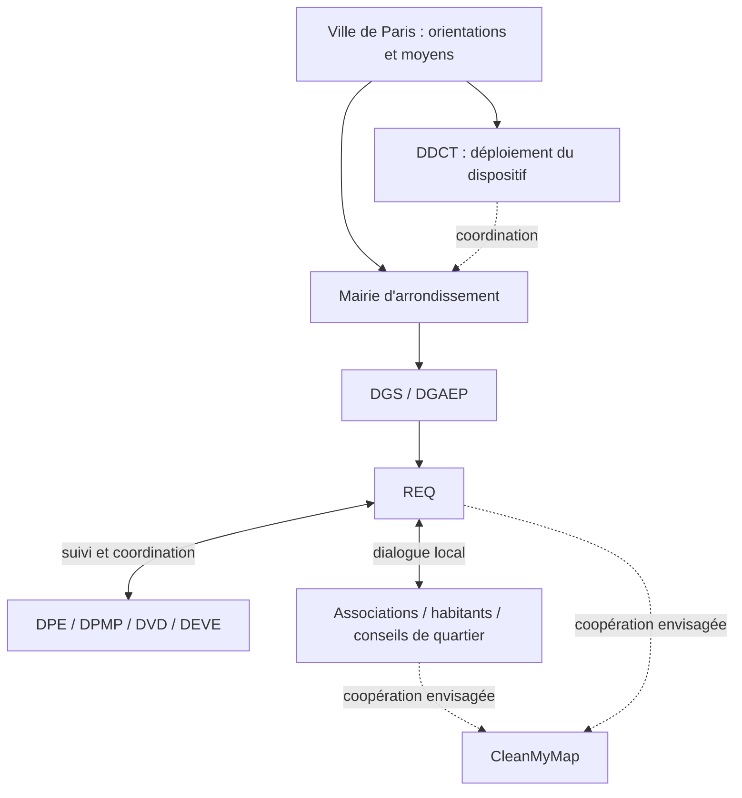

# Référents de l'entretien du quartier et coordination citoyenne à Paris

**Statut : PLAN.** Recherche institutionnelle actualisée le 24 novembre 2026. Les preuves sont datées et qualifiées individuellement. Les éléments relatifs à la Ville sont distincts de la cible produit CleanMyMap. Aucun mandat, partenariat municipal ni accès à un système de la Ville n'est acquis.

## 1. Objectif

Identifier et intégrer les interlocuteurs municipaux pertinents pour les collectes citoyennes, en complément de l'ambition territoriale parisienne de CleanMyMap. S'appuyer sur les dispositifs de proximité existants plutôt que créer une chaîne parallèle de coordination.

Le besoin exprimé par la Brigade Verte Paris porte notamment sur la liaison entre bénévoles, associations, mairies, services de propreté et police municipale, ainsi que sur le suivi des problèmes récurrents et l'accès aux moyens matériels. Ce témoignage justifie une expérimentation, mais ne démontre aucun engagement de la Ville.

## 2. Dispositif municipal établi

Le Pacte parisien de la proximité date de novembre 2021. L'acte 2 de la territorialisation, présenté dans la communication 2025 DDCT 39, prévoit un réseau de responsables de l'entretien du quartier. Le programme de recrutement emploie le titre de **référent de l'entretien du quartier (REQ)**.

- Première vague annoncée : 35 agents et 35 quartiers prioritaires, sans présumer que tous les postes sont pourvus.
- Cible annoncée : couverture des périmètres des 117 conseils de quartier en trois ans, à compter du lancement prévu en 2025.
- Déploiement des premiers REQ annoncé à partir de fin 2025 par la DDCT.
- Un agent peut être affecté à plusieurs quartiers. Il ne faut pas assimiler 117 territoires à 117 postes, ni supposer un REQ unique par arrondissement.
- Au moins une prise de fonction du nouveau dispositif est attestée en 2026 (8e). Effectif total en poste, affectations exhaustives, responsable opérationnel et calendrier effectif : non prouvés.

Sources : [S1], [S2].

### Missions

Les fiches de poste décrivent les responsabilités suivantes : observation de l'espace public, signalement des anomalies dans Dans Ma Rue, suivi de leur résolution par les services compétents, dialogue avec les riverains et acteurs locaux, participation aux marches exploratoires, aux interventions coordonnées et aux réunions territoriales. Le poste du 20e est un emploi permanent de catégorie C, sans encadrement d'équipe, avec présence quotidienne sur le terrain (environ 6 km de marche annoncés).

Les REQ suivent aussi les problèmes de voirie, de mobilier et d'espaces verts. Leur fonction n'est donc pas limitée aux déchets. Ils n'ont pas, par leur seule qualité de REQ, un pouvoir de verbalisation, de décision budgétaire ou de commandement des agents des autres directions.

Source : [S2].

## 3. Organisation institutionnelle

| Entité ou fonction | Responsabilité documentée ou place dans le dispositif |
| --- | --- |
| Exécutif municipal | Orientations stratégiques et allocation des moyens municipaux. |
| Secrétariat général | Appui à la coordination administrative centrale dans la territorialisation. |
| DDCT, Direction de la Démocratie, des Citoyens et des Territoires | Déploiement du programme REQ et coordination de l'action territoriale ; sous-direction de l'action territoriale identifiée dans les recrutements. Direction : Frédérique Lancestremère, selon l'organigramme du 9 septembre 2026 [S9]. |
| Mairie d'arrondissement | Pilotage local des politiques de proximité. |
| DGS, direction générale des services | Organisation administrative de la mairie. |
| DGAEP, direction générale adjointe chargée de l'espace public | Rattachement opérationnel et hiérarchique local des REQ. |
| REQ | Observation, signalement, suivi et liaison entre acteurs. |
| DPE, Direction de la Propreté et de l'Eau | Interventions de propreté et moyens techniques relevant de ses compétences. |
| DPMP, Direction de la Police Municipale et de la Prévention | Prévention, tranquillité et verbalisation dans son champ de compétence. |
| DVD et DEVE | Voirie, déplacements, espaces verts et environnement selon leurs compétences. |
| Conseils de quartier | Concertation de proximité ; ne constituent pas une autorité hiérarchique sur les REQ. |



Schéma fonctionnel simplifié : les services opérationnels conservent leur hiérarchie propre. Les deux dernières relations ne sont que des objectifs de coopération. Sources : [S1], [S2].

Le réseau des référents de quartier de la police municipale est un dispositif distinct, également prévu pour les 117 conseils de quartier. Un brigadier citoyen n'est ni REQ ni agent de police municipale. Aucun de ces intitulés ne crée automatiquement un rôle applicatif, une permission ou une habilitation CleanMyMap.

## 4. Référents et contacts professionnels

### 4.1. Affectations et indices par territoire

État de recherche au 24 novembre 2026. Une publication récente attestant une prise de poste n'est pas équivalente à une offre de recrutement. Les données historiques ne sont pas des affectations actuelles. La liste est non exhaustive.

| Territoire | Personne ou indice | Niveau de preuve et date |
| --- | --- | --- |
| 8e | Régine Merlin | Prise de fonction le 14 septembre 2026, attestée par le magazine municipal Paris Huit n°3, p. 21, publié en novembre 2026 [S8]. Périmètres précis et contact direct non établis. |
| 9e | Vincent Chetouani | Référent propreté de Pigalle-Martyrs, Anvers-Montholon et Faubourg Montmartre au 1er octobre 2024 [S10]. Affectation actuelle non prouvée ; ne pas le présenter comme titulaire du nouveau dispositif. |
| 10e | Habiba et Sébastien | Référents propreté de l'expérimentation cités en 2022 [S5]. Fonctions et périmètres actuels non prouvés. |
| 11e | Titulaire non identifié | Recrutement documenté en 2026 [S3]. |
| 12e et 14e | Titulaires non identifiés | Expérimentations anciennes signalées lors des recherches précédentes ; sources précises à retrouver avant publication. |
| 15e, 16e et 19e | Titulaires non identifiés | Pistes de recrutements 2026 évoquées lors des recherches précédentes, non reconfirmées lors de cette mise à jour ; ne pas intégrer comme affectations ni comme recrutements vérifiés. |
| 18e | Titulaires non identifiés | Recrutement documenté en 2026 [S4]. |
| 20e | Titulaires non identifiés | Offre V02400-14932, poste à pourvoir à partir du 18 février 2026 [S2]. Une date de disponibilité n'est pas une date de prise de fonction. |
| Autres arrondissements | Non identifiés | Aucun résultat probant disponible dans ce dossier ; ne pas conclure à l'absence de référent. |

Une nouvelle offre dans le 9e a également été évoquée lors des recherches précédentes, mais son lien officiel n'a pas été retrouvé lors de cette mise à jour. Ne pas en tirer de conclusion sur l'affectation de Vincent Chetouani.

### 4.2. Retours d'expérience concrets

Dans le 8e, Régine Merlin alterne visites de terrain et travail administratif. Le portrait municipal décrit la vérification des chantiers, du mobilier, de la chaussée et des trottoirs, le suivi des anomalies et les échanges avec les commerçants. Son agenda dépend du chef de service et elle traite aussi des demandes du cabinet de la mairie. Ce fonctionnement local ne démontre pas une organisation identique dans tous les arrondissements [S8]. Aucun canal professionnel nominatif direct n'a été identifié ; passer par la mairie du 8e.

Dans le 9e, le compte rendu du conseil de quartier du 1er octobre 2024 indique 586 signalements effectués par Vincent Chetouani sur 3 231 recensés depuis la réunion du 4 juin. Répartition : 310 graffitis ou affichages non autorisés, 129 objets abandonnés, 123 autres problèmes de propreté, 24 autres anomalies (solde arithmétique). Il était alors agent de la DPE ; le compte rendu identifie aussi une division propreté commune aux 9e et 10e à cette date. Ces chiffres historiques sont un exemple de suivi, pas des indicateurs CleanMyMap ni une mesure actuelle de performance du réseau [S10]. Des marches exploratoires associant propreté, police municipale et conseil de quartier y étaient envisagées.

### 4.3. Responsabilité centrale et contacts administratifs

| Personne ou service | Fonction ou lien documenté | Contact et usage recommandé |
| --- | --- | --- |
| Frédérique Lancestremère | Directrice de la DDCT selon l'organigramme municipal actualisé le 9 septembre 2026 [S9] | Solliciter la DDCT via le canal municipal. Ne pas lui attribuer personnellement la coordination quotidienne des REQ sans preuve. |
| Sous-direction de l'action territoriale, DDCT | Entité administrative identifiée dans les recrutements du réseau | Demander le responsable opérationnel et le canal fonctionnel du programme. |
| Julie Bastide | Contact récurrent des offres REQ des 20e, 11e et 18e [S2-S4] | coordonnée publiée dans les offres [S2-S4] ; premier point d'orientation. Fonction exacte et mandat de coordination non prouvés. |
| Nicolas Genaille | Contact de recrutement du 11e [S3] | coordonnée publiée dans la fiche [S3] ; demander l'équipe REQ du 11e. Ne pas présumer sa fonction actuelle sans confirmation. |
| Adrien Blot | Contact de recrutement du 18e [S4] | coordonnée publiée dans la fiche [S4] ; demander l'équipe REQ du 18e. Ne pas présumer sa fonction actuelle sans confirmation. |
| DGAEP / DGS du 20e | Encadrement local / pilotage administratif | Titulaires actuels non identifiés. Passer par la mairie du 20e. |
| Régine Merlin | REQ du 8e attestée en novembre 2026 [S8] | Demander une mise en relation via la mairie du 8e. |
| Vincent Chetouani | Référent propreté du 9e attesté en octobre 2024 [S10] | adresse fonctionnelle publiée dans le compte rendu [S10] ; adresse fonctionnelle publiée à cette date, validité actuelle non confirmée. |
| Équipe propreté du 10e | Expérimentation antérieure [S5] | Demander les référents actuels via la mairie du 10e ; privilégier un contact fonctionnel confirmé. |

Les contacts de recrutement ne sont ni les titulaires REQ ni des contacts grand public par défaut. Aucun courriel nominatif ne doit être déduit d'une convention de nommage. Les canaux directs sont à confirmer avant réutilisation.

### 4.4. Actualisation des anciens contacts du 20e

- **Marianne Jaouen** : une coordonnée directe publiée dans la fiche [S2] figure dans l'offre REQ du 20e [S2]. Un profil professionnel du même nom annonce une prise de fonction à Lorient Agglomération comme responsable de l'unité Exploitation Collecte [S11]. La correspondance d'identité et la date exacte de départ de Paris n'ont pas été suffisamment corroborées lors de cette mise à jour. Contact parisien potentiellement obsolète : ne plus le proposer en priorité, demander confirmation à la mairie. Ne pas présenter son départ comme certain sur cette seule base.
- **Pascale Martinetto** : ancienne DGS du 20e de 2023 à 2025 selon l'ADGS [S13], puis auditrice à Paris. L'arrêté ministériel du 16 juin 2026 confirme sa nomination comme DGS de l'université Claude Bernard Lyon 1 à compter du 22 juin 2026 [S12]. Ce n'est plus un contact administratif du 20e à privilégier.
- L'identité des successeurs à la DGS et à la DGAEP du 20e n'a pas été établie. Ne pas créer de fiche nominative fictive.

### 4.5. Démarches de contact prioritaires

1. Julie Bastide : demander le contact du coordinateur central, l'annuaire communicable, les secteurs et le nombre de REQ effectivement en poste.
2. Mairie du 20e : identifier les titulaires de la DGS, de la DGAEP et du ou des postes REQ ; demander une rencontre avec la Brigade Verte Paris et la DPE.
3. Mairie du 8e : demander une mise en relation avec Régine Merlin pour un retour d'expérience opérationnel.
4. Nicolas Genaille et Adrien Blot : vérifier les affectations des 11e et 18e et leurs canaux fonctionnels.
5. DDCT : demander le périmètre exact de la sous-direction responsable, le calendrier de déploiement, les modalités de réunion et de coordination inter-arrondissements, et les possibilités de coopération associative.

Demander des coordonnées professionnelles communicables, non un annuaire interne ni un accès aux systèmes municipaux. Aucun contact n'a été sollicité dans ce cadrage. Aucune réunion n'est acquise.

### 4.6. Message de prise de contact proposé

> Bonjour Madame Bastide,
>
> Je développe CleanMyMap, un projet étudiant open source consacré à la coordination et au suivi des collectes citoyennes de déchets. Dans le cadre de mes échanges avec la Brigade Verte Paris, nous nous intéressons au déploiement des référents de l'entretien du quartier. Pourriez-vous nous orienter vers les référents actuellement en poste dans le 20e, leurs responsables locaux et la personne chargée de coordonner le dispositif à l'échelle parisienne ? Nous souhaiterions comprendre les possibilités de coopération entre les référents, les associations et les services municipaux, et organiser un premier échange.
>
> Bien cordialement,
> Maxence Deroome
> https://cleanmymap.fr

## 5. Référentiel territorial et données géographiques

Le périmètre des conseils de quartier est la référence retenue par les fiches de poste. Il ne se confond pas avec les 80 quartiers administratifs parisiens. Les arrondissements géographiques, les mairies, les divisions techniques et les conseils de quartier représentent des objets différents, aux relations potentiellement multiples.

Le jeu de données `conseils-quartiers` de Paris Data [S6] constitue une source candidate pour les géométries et identifiants. Avant intégration cartographique, vérifier la licence, la fraîcheur, le schéma, les identifiants et l'exhaustivité. Ne pas considérer un polygone de conseil de quartier comme une preuve d'affectation d'un REQ. Les effectifs cibles de 2025 ne sont pas un inventaire runtime.

Ne pas importer une seconde copie du maillage des arrondissements. Réutiliser le propriétaire géographique existant. Pas d'import massif de géométries, de migration ni de développement d'une nouvelle carte dans le premier lot.

## 6. Ambition produit CleanMyMap

### Premier usage : annuaire opérationnel

L'annuaire doit expliquer les fonctions des interlocuteurs municipaux et permettre de trouver le canal professionnel adapté au territoire. Distinguer une institution, une unité administrative, une fonction et une personne. Référencer les REQ comme dispositif municipal, et non comme une nouvelle association ou un organisateur de cleanwalks.

Chaque information comporte une source, une date de vérification et un périmètre précis. Distinguer une offre de recrutement, un agent historiquement identifié, une affectation vérifiée et une coopération réellement engagée. Les coordonnées professionnelles de recrutement peuvent servir à la prospection interne ; ne pas les transformer en contacts directs des agents en poste ni les publier par défaut dans un annuaire grand public. Privilégier les canaux fonctionnels publics prévus pour les habitants.

### Usage ultérieur : coordination locale

Cible conditionnelle à la validation terrain et à l'accord des services :

- Associer un ou plusieurs quartiers à un référent, avec dates d'affectation, provenance et état de vérification.
- Permettre aux associations et brigadiers de retrouver les services compétents et les interlocuteurs disponibles.
- Mettre à disposition des bilans de collectes et observations longitudinales autorisés, avec liens vers les actions et rapports existants.
- Étudier les campagnes conjointes de propreté et de prévention, sans déléguer de pouvoir de police aux bénévoles.
- Faciliter la prospection de solutions de prêt de matériel et de regroupement des mégots, sans présumer l'existence d'un site autorisé ni d'un financement.

CleanMyMap reste complémentaire de Dans Ma Rue. Les signalements officiels, leur suivi administratif et les données personnelles de la Ville ne sont pas répliqués sans convention ni accès approprié. Une observation citoyenne n'est pas une preuve d'intervention municipale.

## 7. Intégration dans le dépôt

Lecture de `main` au SHA `4dbe9523ce883ea07bfb85503c2475b26093456f` lors du cadrage. Points d'entrée identifiés :

- `apps/web/src/lib/partners/paris-cleanwalk-network.ts` : types des acteurs, rôles, provenance, périmètres et contacts publics.
- `apps/web/src/lib/partners/paris-cleanwalk-network.data.ts` et `paris-cleanwalk-network.relations.ts` : registre et relations documentés dans le contrat du réseau.
- `apps/web/src/lib/partners/territory-network-catalog.ts` et son catalogue de données : sélection territoriale existante.
- `apps/web/src/lib/geo/paris-arrondissements.ts` : référentiel géographique existant.
- `documentation/features/paris-cleanwalk-network-3d.md` : contrat du réseau, distinction entre acteurs référencés et partenaires engagés.
- `documentation/product/README.md`, `vision-et-objectifs.md` et `roadmap-priorisee.md` : stratégie et priorités.

Le document `documentation/product/ambition-territoriale-paris.md`, fourni précédemment à l'utilisateur, n'était pas présent sur le main consulté. Le préserver s'il existe dans le checkout ou s'il a été fourni pour intégration. Ne pas créer une seconde vision territoriale concurrente.

Décision : enrichir d'abord les données éditoriales et leurs projections existantes. Le modèle détaillé d'affectation et la coordination opérationnelle restent PLAN tant que le socle territorial et les engagements ne sont pas démontrés. Pas de nouvelle table Supabase, rôle Clerk, route publique indépendante ou dépendance pour ce premier lot.

## 8. Prompt Codex : macro-lot initial

```text
Intégrer documentation/plans/referents-entretien-quartier-paris.md comme cadrage PLAN du dispositif REQ et enrichir les référentiels territoriaux existants.

Réutiliser l'Annuaire, paris-cleanwalk-network, le catalogue territorial et la géographie canonique pour documenter DDCT, DGAEP, REQ, services municipaux et conseils de quartier sans créer un annuaire parallèle.

Conserver les identifiants existants. Distinguer institution, unité, fonction, affectation et coopération. Référencer les sources officielles et leurs dates, distinguer 35 recrutements annoncés, cible de 117 périmètres et effectifs réellement connus. Ne créer aucun agent fictif, aucune affectation déduite, aucune relation opérationnelle non prouvée ni aucun partenariat CleanMyMap.

Présenter les missions des REQ et leurs liens institutionnels avec la mairie, la DPE, la DPMP, la DVD et la DEVE dans les projections existantes. Ne pas utiliser les arêtes d'opérations conjointes pour représenter une hiérarchie administrative ; privilégier une description sourcée si le contrat relationnel ne le permet pas.

Les contacts de recrutement restent des pistes professionnelles de prospection, non des titulaires REQ ni des contacts grand public par défaut. Appliquer la qualification de preuve de la section 4 : Régine Merlin est attestée au 14 septembre 2026 dans le 8e ; les référents des 9e et 10e sont historiques ; Frédérique Lancestremère dirige la DDCT mais le coordinateur opérationnel demeure inconnu ; Julie Bastide est une piste d'orientation. Ne pas réactiver les anciens contacts du 20e comme responsables actuels. Ne pas publier les noms ou coordonnées nominatives lorsque la finalité publique ne les justifie pas. N'introduire aucun traitement nominatif privé ni droit applicatif automatique.

Actualiser les documents canoniques du réseau et de la stratégie territoriale sans dupliquer le cadrage. Préserver les travaux locaux fournis par l'utilisateur. L'intégration des géométries fines, des affectations opérationnelles et des workflows de coopération reste conditionnelle ; aucune nouvelle migration ou fonctionnalité spéculative dans ce lot.

Tester unicité des acteurs, provenance, catégories, distinction entre cible et état courant, absence de fausses relations et absence de régression des projections existantes.

STOP CONDITION : dispositif REQ correctement documenté et identifiable dans les surfaces existantes, données et sources cohérentes, tests pertinents réussis, aucun engagement fictif. Publier conformément à AGENTS.md.
```

## 9. Sources publiques

Consultation le 24 novembre 2026. Les informations historiques sont datées dans le texte ; une date de consultation ne vaut pas preuve d'actualité de l'affectation.

- [S1] Ville de Paris, communication 2025 DDCT 39, acte 2 de la territorialisation, notamment p. 8 : https://cdn.paris.fr/paris/2025/01/23/2025-ddct-39-CrC0.pdf. Texte consulté ; rendu de la page PDF indisponible lors de la tentative de vérification visuelle.
- [S2] Ville de Paris, fiche de recrutement du 20e, référence V02400-14932 : https://travaillerpourparis.offres.paris.fr/13375/1/referents-referentes-de-l-entretien-du-quartier-20eme-arrondissements-f-h. Texte intégral consulté.
- [S3] Ville de Paris, offre REQ du 11e : https://travaillerpourparis.offres.paris.fr/15064/1/referent-referente-de-l-entretien-du-quartier-paris-11eme-f-h. Index officiel consulté ; page complète indisponible.
- [S4] Ville de Paris, offre REQ du 18e : https://travaillerpourparis.offres.paris.fr/15267/1/referents-referentes-de-l-entretien-du-quartier-paris-18eme-f-h. Index officiel consulté ; page complète indisponible.
- [S5] Mairie du 10e, retour d'expérience sur les référents propreté : https://mairie10.paris.fr/pages/une-premiere-referente-proprete-dans-les-quartiers-du-10e-21359. Index officiel consulté ; page complète indisponible.
- [S6] Paris Data, les conseils de quartier : https://opendata.paris.fr/explore/dataset/conseils-quartiers/.
- [S7] Paris Data, quartiers administratifs : https://opendata.paris.fr/explore/dataset/quartier_paris/.

- [S8] Paris Huit n°3, novembre 2026, p. 21, portrait de Régine Merlin : https://cdn.paris.fr/paris/2026/11/04/d21fbc997b6472a356e014e817bf3e5e.pdf. Texte intégral de la page consulté ; capture PDF indisponible (erreur de récupération).
- [S9] Ville de Paris, organigramme, mise à jour du 9 septembre 2026 : https://prod-v3.paris.fr/pages/organigramme-de-la-ville-de-paris-2380 ; corroboration par Paris Data : https://opendata.paris.fr/explore/dataset/liste-des-directions-de-la-ville-de-paris/api/. Confirme la direction de la DDCT, pas le nom du responsable opérationnel REQ.
- [S10] Mairie du 9e, compte rendu du conseil de quartier Pigalle-Martyrs du 1er octobre 2024, p. 1-2 : https://cdn.paris.fr/paris/2024/10/07/cr-2024-10-01-reunion-de-bureau-cq-pigalle-martyrs-3h99.pdf. Texte intégral consulté ; capture PDF indisponible (erreur de récupération).
- [S11] Profil professionnel public Marianne Jaouen : https://fr.linkedin.com/in/marianne-jaouen-3b7726281. Déclaration de prise de poste à Lorient Agglomération indexée ; source déclarative, identité à rapprocher avec prudence.
- [S12] Bulletin officiel de l'enseignement supérieur, arrêté du 16 juin 2026, référence ESRD2617100A : https://www.enseignementsup-recherche.gouv.fr/fr/bo/2026/Hebdo29/ESRD2617100A. Nomination de Pascale Martinetto à compter du 22 juin 2026 ; confirmation universitaire : https://www.univ-lyon1.fr/universite/organisation/direction-generale-des-services.
- [S13] ADGS, notice professionnelle du 22 juin 2026 : https://www.a-dgs.fr/n/Actualites/Nominations/Nouvelle-DGS-Universite-Lyon-1-Pascale-Martinetto-22-juin-2026-i4348.html. Historique de ses fonctions au 20e.

Aucune preuve de déploiement exhaustif, de convention avec CleanMyMap ou d'accès aux systèmes municipaux n'a été obtenue. Aucun code, test ni déploiement n'a été exécuté pour ce cadrage.
