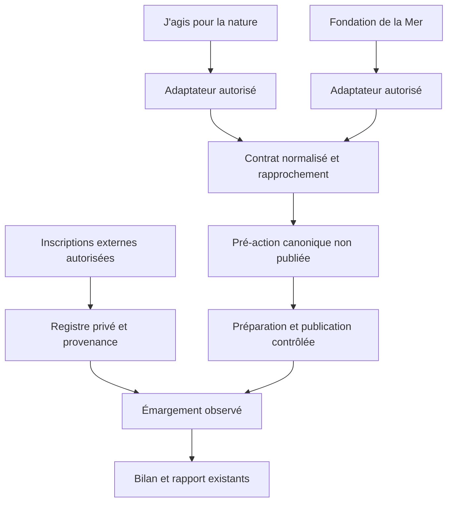

# Synchronisation automatique des actions externes

**Statut : `PLAN`**. Spécification de chantier, non preuve de fonctionnalité déployée.

**Date :** 24 novembre 2026. **Base de lecture :** `maxd4/CleanmyMap`, `main`, `4dbe9523ce883ea07bfb85503c2475b26093456f`.

**Extension distincte :** le [plan d'interopérabilité API Engagement](./interoperabilite-api-engagement.md) porte la stratégie de publication unique, la diffusion publique entrante, les accords diffuseurs et les agendas associatifs. Il ne modifie pas les invariants ni l'état d'activation du présent pilote.

## 1. Finalité et périmètre

Une association doit pouvoir publier chaque cleanwalk une seule fois sur le canal convenu, puis retrouver automatiquement dans CleanMyMap un formulaire de préparation prérempli, sans export/import de fichiers ni double saisie. CleanMyMap devient l'outil de préparation, de coordination, d'émargement et de bilan, sans se substituer aux plateformes de recrutement.

Pilote : Brigade Verte Paris, avec J'agis pour la nature (Fondation pour la Nature et l'Homme, FNH) et Fondation de la Mer (programme Un geste pour la Mer). L'autorisation de tester auprès de l'association est déclarée par le porteur de CleanMyMap. Elle ne prouve ni convention entre plateformes ni accès technique, ni autorisation de récupérer les données nominatives. Aucun autre acteur n'est présumé engagé.

**Orientation pilote révisée le 27 novembre 2026 :** privilégier JeVeuxAider.gouv.fr comme source unique proposée, avec relais via API Engagement vers les autres sites sous réserve de leurs accords. Voir le plan d'interopérabilité pour les jalons de diffusion. Cette orientation n'ajoute aucun fournisseur au runtime, ne change pas les connecteurs existants et ne confère aucun droit de création métier ou de lecture des inscriptions. La source effectivement retenue doit être validée avec l'association ; si un relais manque, ne pas imposer une publication supplémentaire.

La cible comporte deux flux distincts, progressifs :

1. Synchroniser les événements et créer automatiquement une pré-action privée, durable et modifiable. La commande manuelle « Synchroniser maintenant », réservée aux administrateurs, publie automatiquement les actions admissibles après création. L'organisateur conserve ses droits de préparation et de finalisation ; cette commande ne lui est pas accessible.
2. Synchroniser automatiquement les inscriptions et leurs changements, uniquement après validation du canal technique et du cadre juridique correspondant. Pas de workflow CSV/XLSX comme solution nominale.

Ce chantier ne crée pas un agrégateur national exhaustif, ne republie pas automatiquement sur les plateformes sources, ne modifie pas le parcours mobile natif et n'introduit ni CRM ni gestion de stocks. Le backend et les actions restent communs ; préserver les consommateurs mobiles existants. Une extension nationale et une diffusion sortante feront l'objet de décisions séparées.

## 2. Faits observés et limites des sources

| Source | Fait observé | Limite |
| --- | --- | --- |
| J'agis pour la nature | Fiche publique de la Brigade Verte Paris avec activités datées et liens vers les annonces. Les FAQ prévoient la gestion des participations. | API directe, webhook, export automatisé et accès privé non prouvés. CGU : extraction automatisée soumise à accord préalable exprès de la FNH. |
| Fondation de la Mer | Fiche Brigade Verte contenant dates, horaires, commune, type d'activité et liens vers les annonces. Des références distinctes peuvent correspondre à une même collecte. | Aucun flux officiellement autorisé ni API d'inscriptions identifié. Mentions légales restrictives sur reproduction/extraction. La présence d'un événement sur l'agenda ne prouve pas une inscription gérée par la Fondation. |
| API Engagement | API documentée de diffusion de missions accessibles aux partenaires diffuseurs ; modèle de mission et obligations de redirection/mesure de diffusion. | Couverture actuelle des actions de J'agis pour la nature ou de la Fondation de la Mer non prouvée ; ni accès aux listes nominatives ni droit de créer des inscriptions CleanMyMap induits. |

### Corpus de rapprochement

Les fiches publiques des deux plateformes montrent notamment les mêmes parcours du 12/09, 10/10 et 14/11/2026 dans le 20e arrondissement. Les libellés du 14/11 diffèrent entre plateformes malgré un parcours correspondant. La Fondation de la Mer liste également deux références pour l'opération du 11/04/2026, et des variantes d'annonce autour d'un parcours mairie/Pyrénées/Stendhal/Bagnolet. La similitude d'un parcours n'autorise pas à fusionner des dates différentes. Le corpus public consulté peut être issu de caches web de dates différentes : il ne prouve ni disponibilité actuelle ni état d'inscription.

Utiliser des fixtures synthétiques reprenant les structures et cas de correspondance de ces exemples, sans copier les textes protégés, les photos ni les informations personnelles. Les dates passées servent aux tests, pas à créer des actions réelles rétroactives.

## 3. Contrats existants à préserver

Points d'entrée observés sur le SHA de référence (adapter les consommateurs directs selon le checkout) :

| Owner | Responsabilité |
| --- | --- |
| `apps/web/src/lib/actions/create-submission.ts` | Orchestration création, résolution de l'identité et des organisateurs, effets de bord. Le flux existant peut déclencher la gamification. |
| `apps/web/src/lib/actions/persistence/create.ts` et `create-contract.ts` | Création atomique `create_action_with_relations`, idempotence, projection et `published_at = null` à la création. |
| `apps/web/src/lib/actions/action-creation-routes.ts` | Parcours canonique `/actions/new` et espaces préparation, jour J et bilan. |
| `apps/web/src/lib/actions/organizer-directory-registry.ts` | Résolution de la structure organisatrice. L'identifiant `association-brigade-verte-paris` existe dans le catalogue. |
| `apps/web/src/app/api/actions/import/route.ts` | Import administratif existant avec dry-run et confirmation. Ne pas réutiliser cette route comme un bypass ni confondre import historique et pré-action future. |
| `apps/web/src/lib/actions/permissions.ts` | Permissions par créateur, organisateur et capacités réelles. |
| `apps/web/src/lib/actions/participation/attendance-registry.ts` et `attendance-registry-http.ts` | Registre privé des identités opérationnelles et des présences observées. |
| `apps/web/src/app/api/actions/[actionId]/attendance-registry/route.ts` | Frontière serveur privée ; AuthN et contrôle de gestion de l'action. |
| `apps/web/src/lib/periodic/maintenance-job-registry.ts`, `maintenance-cron-contract.ts` | Dispatch périodique existant, planification quotidienne à 03:20 UTC au SHA lu. |

`actions` est la source canonique de l'action. `action_organizers` porte les relations organisationnelles. `action_registrations` porte les inscriptions liées à des comptes ; `action_participants` porte les participations finales liées à des comptes. `action_attendance_entries` porte les identités opérationnelles privées et les observations de présence ; leur statut initial est `unknown`. La présence, l'inscription, le compte et l'identité externe ne sont pas interchangeables.

La rétention du registre privé est de 90 jours après la fin de l'action selon `apps/web/supabase/migrations/20261123000002_private_action_attendance_retention.sql`. Toute extension de données nominatives doit respecter cette borne (ou une durée plus courte justifiée), y compris après révocation, annulation, suppression et réimport.

Tests repérés : `apps/web/src/app/api/cron/maintenance/route.test.ts`, `apps/web/src/components/actions/action-attendance-registry-panel.behavior.test.tsx`, `e2e/action-attendance-registry-concurrency.mjs`. Aucune exécution de test, migration ou observation de production n'a été réalisée pour cette spécification.

## 4. Architecture d'intégration

### 4.1 Accès aux sources et activation

Privilégier, par ordre de préférence : webhook signé officiel si disponible ; API ou flux contractuellement autorisé ; lecture périodique bornée de pages publiques uniquement avec accord explicite de l'opérateur et des ayants droit concernés. L'API Engagement est prioritaire pour la diffusion publique dans le scénario de publication unique, mais n'est pas un canal opérationnel autorisé par défaut. Toute création de pré-action à partir de ses données nécessite un accord distinct couvrant cette finalité et un mandat de l'organisateur. Une intégration directe autorisée reste possible pour la coordination, sans seconde publication. Ne pas utiliser ses données pour contourner une interdiction de la plateforme source. La FNH et la Fondation de la Mer sont deux opérateurs distincts.

En l'absence d'autorisation technique vérifiée, les deux connecteurs restent désactivés en production. Développer le contrat, le moteur et les adaptateurs de test à partir de fixtures synthétiques ; ne pas inventer d'endpoint. Si un opérateur propose un flux ou un schéma, l'adaptateur réel peut être intégré dans le même cadre après validation. À défaut, exposer l'état « accès source à autoriser », et documenter le blocage. Aucun scraping de compte authentifié, partage de mot de passe, réutilisation de cookies de session ou contournement de protections. Pas de robot actif en attendant une autorisation.

### 4.2 Abonnement à une source

Configuration serveur, par organisation et source : identité stable de la structure, identifiant/URL de référence approuvés, mode d'accès, état d'activation, preuve/référence et périmètre de l'autorisation, date de début de synchronisation, utilisateur propriétaire désigné, éventuels coorganisateurs explicitement approuvés et identités d'événements accessibles. Séparer l'autorisation de lecture publique de celle des inscriptions privées. Les références à des secrets restent côté serveur ; aucun secret dans les données publiques, la documentation, les logs ou Git.

N'utiliser ni l'ID éditorial ni le nom affiché comme habilitation. L'activation exige une relation vérifiée à un compte Clerk réel et habilité. La Brigade Verte peut être référencée sans abonnement actif. Le job technique ne devient pas un utilisateur humain, ne fabrique pas de consentement et n'usurpe pas l'identité d'un administrateur. Il ne peut écrire qu'en vertu du mandat explicite configuré, validé côté serveur à chaque exécution ; le retrait suspend toute nouvelle écriture, sans octroyer de droits résiduels. Si les relations existantes ne suffisent pas, introduire la relation d'abonnement minimale, sans anticiper toute l'architecture territoriale.

### 4.3 Contrat d'événement normalisé

Proposer un contrat commun contenant au minimum :

- identifiant fournisseur et identifiant stable de l'événement/occurrence (ou URL canonique stable si aucun ID officiel, avec limites explicites) ;
- identifiant de structure source et référence organisationnelle canonique ;
- titre, description seulement dans le périmètre de réutilisation autorisé, type d'événement ;
- début, fin si connue, fuseau IANA (`Europe/Paris` pour ce pilote), date locale ;
- rendez-vous, commune, adresse et coordonnées si fournies ou résolues de façon fiable ;
- informations de matériel, consignes, accessibilité et lien d'inscription si explicitement fournis ;
- état externe, révision/date de modification quand disponible, date de collecte, empreinte du contenu normalisé, provenance et état de fraîcheur.

Ne pas inférer une heure, une position GPS précise, un tracé de collecte, une capacité, une consigne de sécurité ou un nombre de participants. Un nom de rue ne constitue pas une géométrie observée. Utiliser les résolveurs géographiques canoniques ; distinguer géocodage, donnée source et mesure terrain. Un événement incomplet devient une proposition privée à compléter (non action publique) si les invariants du formulaire interdisent de le persister tel quel. Aucun faux champ obligatoire. Réutiliser un mécanisme de brouillon existant s'il est adéquat ; n'introduire une staging minimale que si nécessaire pour les entrées incomplètes ou conflictuelles.

### 4.4 Identité, rapprochement et transactions

Une action canonique peut avoir plusieurs références externes. Chaque référence `(fournisseur, identifiant stable de l'occurrence)` est unique et ne pointe que vers une seule action. Ne jamais utiliser le titre seul ni l'adresse seule comme clé.

1. Référence déjà liée : retrouver exactement l'action, comparer la révision/empreinte, ne rien écrire si inchangée.
2. Nouvelle référence : rechercher dans le même périmètre organisationnel les événements et actions existants, y compris ceux créés manuellement. Rapprochement automatique uniquement en cas de correspondance non ambiguë : même organisation explicitement résolue, même début local/instant avec heure connue, lieu de rendez-vous compatible et information concordante supplémentaire (parcours explicite ou référence croisée). Une référence croisée explicite et validée peut confirmer l'identité. L'heure ou le lieu absent, une divergence substantielle, plusieurs candidats ou une action manuelle potentiellement correspondante sans preuve suffisante imposent une revue. Ne pas utiliser un score flou comme preuve.
3. Aucun candidat plausible et événement futur admissible : créer automatiquement une pré-action non publiée avec les relations d'organisateur vérifiées. Si les champs indispensables sont absents, enregistrer une proposition privée sans publier.
4. Conflit : afficher les références à rapprocher et permettre un rattachement explicite par la personne habilitée. Ne pas fusionner ni supprimer une action existante avec ses participants, mesures ou rapports de manière automatique.

Assurer l'unicité en base, transaction, verrouillage stable (`identities` puis `references` sur l'ensemble des RPC de réservation, finalisation, liaison et suppression), vérification du propriétaire, du bail actif et du jeton de réservation (y compris après reprise sur `unique_violation`, avec rejet sans mutation d'un jeton identique expiré), et idempotence des écritures concurrentes et réessais (rejeu identique idempotent, réutilisation incompatible d'un même `operation_id` de suppression refusée sans mutation par `operation_conflict`). La création canonique et le rattachement doivent être atomiques ou résolubles par un état durable et une clé d'idempotence avant toute nouvelle création. Ne pas contourner `create_action_with_relations` ; faire évoluer sa frontière si nécessaire. Une relance après échec ne doit ni créer un doublon ni abandonner une action orpheline.

Preuves SQL associées (connecteurs toujours désactivés) : `apps/web/supabase/tests/external-action-sync-integrity.pgtap.sql` et `e2e/external-action-sync-concurrency.mjs` via `apps/web/supabase/migrations/20261126000002_harden_external_action_sync_invariants.sql`.

### 4.5 Propriété des champs et cycle de vie

Pour la cible de publication unique, la source de publication convenue avec l'organisateur fait référence pour les horaires et rendez-vous, si un canal opérationnel autorisé la rend accessible. Les autres annonces sont des relais ou des compléments autorisés, non des sources concurrentes prioritaires. Dans le scénario direct historique, J'agis pour la nature était la source préférée et Fondation de la Mer le complément ; ce contrat existant n'est pas modifié dans le runtime par ce plan. Une divergence n'est pas masquée par une préférence. Conserver l'instantané normalisé des valeurs précédemment synchronisées pour détecter une modification locale ; pas de stockage intégral de page HTML.

- Pré-action non publiée : mettre à jour les champs externes inchangés localement. Préserver les champs enrichis par l'organisateur. Conflit explicite si les deux ont modifié la même valeur ; garder la valeur locale tant que non arbitré.
- Pré-action publiée : modification significative (date, horaire, lieu, annulation) soumise à validation humaine via le mécanisme de changement/notification existant. Afficher rapidement une alerte de fiabilité à l'organisateur ; ne pas présenter une date contestée comme certaine. Pas de notification multiple ni de double réservation. Ne pas auto-publier la première version.
- Suppression, retrait, absence : une annulation explicite n'est pas une simple absence de page. En cas d'échec, réponse partielle, disparition ou 404, signaler l'état à vérifier et conserver la dernière version connue ; jamais supprimer automatiquement. Une annulation explicite déclenche une revue urgente ; fermer les inscriptions publiques CleanMyMap de l'action concernée si nécessaire via les mécanismes existants et empêcher les nouvelles inscriptions tant que le conflit d'annulation n'est pas levé. Si l'annulation d'un seul canal est constatée alors qu'un autre reste actif, ne pas conclure seul que l'action terrain est annulée. Respecter les transitions autorisées.
- Bilan en cours ou terminé : ne jamais modifier automatiquement les mesures, présences, géométrie observée, bilan ou rapports historiques. Ne pas recréer les actions anciennes, supprimées ou révoquées lors d'une synchronisation. Garder une référence minimale non nominative et un état de retrait lorsque nécessaire à l'idempotence.

La synchronisation ne constitue pas une preuve d'activité. La création, la publication automatique admissible et l'inscription externe n'émettent aucun effet de gamification, d'XP, de présence, d'impact, d'entraînement de modèles ou de notification publique injustifiée. Différer notamment `trackActionCreated` et `trackNewPlaceVisited` ; réutiliser la réconciliation canonique uniquement après finalisation admissible du bilan. Ne pas modifier les conventions globales `data_provenance`, les statuts Actions ou le moteur scientifique pour simuler un historique. Les actions importées suivent les mêmes contrôles de visibilité, de modération et de complétude que les actions natives.

## 5. Synchronisation des inscriptions : cible conditionnelle

Cette partie est indispensable à la cible finale, mais le pilote événementiel est indépendant. Aucun accès privé réel ni collecte nominative tant qu'un canal autorisé, la qualification RGPD (responsable/sous-traitant selon les finalités), les obligations d'information et le contrat éventuel de l'article 28 ne sont pas établis. Ne pas présumer qu'une autorisation de l'association couvre les autres opérateurs ou tous les participants.

Préférer API ou webhook officiel d'inscription avec scope restreint aux événements autorisés, identifiant opaque stable par inscription et état source explicite. Si l'opérateur ne gère pas les inscriptions, marquer le flux comme non applicable. Si aucun accès automatisé autorisé n'existe, le flux reste indisponible : pas d'aspiration de sessions privées, d'email personnel ou d'annuaire des membres pour contourner le blocage.

Contrat cible : relation privée de l'inscription externe avec l'occurrence source et une identité opérationnelle de l'action ; conserver source, référence opaque, statut externe, révision et fraîcheur. Maintenir les inscriptions externes distinctes des inscriptions natives Clerk. Réutiliser le registre existant pour les inscrits admissibles/confirmés côté source, avec provenance d'inscription externe et `attendance_status = unknown`. Ne pas créer un compte ni un `user_id` synthétique. Une candidature en attente ou sur liste d'attente ne devient pas un inscrit confirmé. Les annulations externes mettent à jour la participation prévue, sans effacer une observation terrain déjà enregistrée ; un nouvel état de présence exige une décision humaine.

Importer uniquement le libellé d'identité utile à l'émargement et l'identifiant opaque nécessaires à la synchronisation. Pas d'email, téléphone, adresse, naissance, santé, commentaire libre ou donnée de mineur non indispensable. Pas de notification, sollicitation commerciale ou newsletter automatique. Pour un rapprochement entre sources ou avec un compte CleanMyMap, proposer une validation privée explicite ; aucun lien automatique par nom/email et aucune somme des effectifs bruts. Conserver le workflow existant de claim/liaison de présence et ses contrôles. Une identité non rapprochée ne donne pas de droit de compte ou d'XP. Un état incomplet doit être affiché comme tel.

RLS et grants restrictifs, lecture/écriture privée avec contrôle de relation, `private, no-store`, validation transactionnelle, minimisation des logs et exports. Rétention maximale 90 jours après fin d'action selon le contrat actuel (plus courte si nécessaire) ; étendre la purge et les mécanismes RGPD existants aux références nominatives et audits correspondants. Ne jamais réintroduire les données purgées via le job. Tests avec personnes fictives uniquement jusqu'à activation du cadre réel.

## 6. Exploitation et interface

### Planification

Réutiliser `/api/cron/maintenance`, son authentification et son registre de jobs. Le cron prépare les pré-actions et ne publie pas. La commande « Synchroniser maintenant » est exclusivement administrative, limitée en débit, consomme le même moteur puis publie automatiquement les formulaires admissibles. La suppression d'une action synchronisée et l'inscription de son tombstone sont également exclusivement administratives et auditées ; ce tombstone bloque toute recréation par une source ultérieure. Pas de promesse d'instantanéité : le prochain passage suit la publication externe, sa validation éventuelle par l'opérateur et la disponibilité du flux. Cible plus rapide par webhook si proposé et autorisé ; sinon cadence accrue seulement après mesure des besoins, coût et limites de service. Ne pas ajouter un cron par association ou par site.

Limiter la fenêtre aux événements futurs après activation (première découverte : événements futurs déjà publiés autorisés, en dry-run avant activation), pagination bornée avec indication de complétude, concurrence limitée, délais réseau, backoff, reprise, ETag/Last-Modified si supportés, et checkpoints atomiques. Protection SSRF : URLs et hôtes approuvés côté serveur, HTTPS, contrôle des redirections et interdiction des adresses privées/locales, limites de taille ; pas de HTML non nettoyé. Les erreurs d'une source n'empêchent pas l'autre de fonctionner. Aucune absence déduite d'une lecture tronquée ou dégradée.

### Interface privée

Réutiliser le Dashboard/Pilotage et la reprise d'action `/actions/new`. Permettre au référent autorisé de voir : intégrations, sources actives ou bloquées, dernière synchronisation réussie, résultats (créées, mises à jour, inchangées, conflits), action à reprendre et différences de champs à résoudre. Pour une action complète synchronisée, le formulaire est déjà créé ; un clic l'ouvre, sans étape d'import. Pour une entrée incomplète, compléter uniquement les champs nécessaires. Une source peut être désactivée, sans effacer les actions et obligations existantes.

Sur le formulaire, afficher « Synchronisée depuis » et liens source, fraîcheur, champs à compléter et arbitrages. Sur une action publiée, indiquer le canal d'inscription de référence selon les conditions de diffusion. Ne pas ouvrir une seconde inscription publique par défaut si la plateforme d'origine reste gestionnaire ; la collecte de contacts sur CleanMyMap n'est pas nécessaire au pilote. Ne jamais exposer d'identifiants personnels, de comptes tiers ou de détails privés dans les projections publiques.

## 7. Lots d'intégration et preuves attendues

### Lot A : socle et création automatique

Implémenter abonnement borné et révocable, normalisation des événements, réservation durable de l'identité source avant création canonique, rapprochement, création automatique de pré-actions, reprise après interruption, conflits, actualisation des champs et traitement des annulations. Le cron prépare les pré-actions ; seule la commande administrative les publie automatiquement si elles sont admissibles. La suppression administrative persistée empêche toute recréation. Réutiliser les owners listés. Tests sur adaptateurs synthétiques représentant les deux sources ; aucun endpoint réel fictif. Le moteur doit fonctionner de bout en bout dans la lane de test même si aucun accès opérateur n'est disponible.

**État Lot A (26 novembre 2026) :** moteur complet (`apps/web/src/lib/actions/external-sync/engine.ts`, `engine-handlers.ts`, `matching.ts`, `store.ts`, `url-guard.ts`), migrations `20261126000005`–`20261126000011` (`20261126000010` appliquée sur Supabase ; `20261126000011` forward-only pour statuts exacts de `submit_external_action_sync_review`), reprise explicite d'annulation en cas d'échec de fermeture des inscriptions, propagation de la version optimiste `updated_at` vers `publishPreAction`, job cron `external-action-sync` dans `maintenance-job-registry.ts` (préparation privée uniquement) et route admin `POST/GET /api/admin/external-sync` livrés avec connecteurs réels désactivés. Preuves PostgreSQL `45868814266` et `45875162611` FAIL sur `external-action-sync-engine-state.pgtap.sql` (`engine_state_results` puis fixtures `organizer_type='individual'` et `formalitiesWorkflow` manquant), corrigées et enrichies (38 assertions pgTAP) ; couverture `external-sync/**` mesurée (`54,43 %` statements, `46,8 %` branches, `52,7 %` functions, `57,84 %` lines) ; sémantique PostgreSQL/RLS locale non exécutée (`DB_SEMANTICS_NOT_EXECUTED`, `CLI_AUTH: BLOCKED`, lane CI éphémère dédiée et convergence `20261126000011` requises après push).

### Lot B : activation des sources autorisées

Conditionnel à l'obtention d'au moins un accès officiel ou accord documenté : ajouter l'adaptateur réel selon le canal fourni, exécuter une lecture bornée et un dry-run sans écriture, vérifier les mappings et les correspondances avec la Brigade Verte, puis activer uniquement le périmètre validé après décision du porteur. Les sources opérationnelles autorisées doivent pouvoir être raccordées au même moteur, indépendamment de leur disponibilité. Les deux adaptateurs directs existants restent conservés et désactivés ; une éventuelle nouvelle source exige une qualification du contrat et des preuves, pas un branchement automatique du catalogue de diffusion. Aucun test ne doit publier en production une action fictive. Si les accès manquent, le lot reste bloqué et ne justifie ni scraping ni création d'un import manuel alternatif.

### Lot C : inscriptions automatiques

Conditionnel à l'accès technique et juridique privé autorisé. Implémenter le contrat de la section 5, sur les mêmes références d'action, avec rapprochements explicites, annulations, rétention, émargement et tests. Ne pas considérer ce lot livré par la seule présence d'un adaptateur fictif.

### Matrice minimale de validation

| Scénario | Résultat exigé |
| --- | --- |
| Nouvelle annonce complète découverte par cron | Une seule pré-action privée, récupérable dans le formulaire existant, sans publication ni effet de gamification. |
| Commande administrative de synchronisation | Crée puis publie automatiquement les formulaires admissibles ; aucune gamification avant finalisation admissible. |
| Commande manuelle par un organisateur non-admin | Refusée côté serveur, sans écriture. |
| Suppression administrative suivie d'une source ou d'une révision nouvelle | Tombstone audité conservé ; aucune recréation ou rattachement à une action native étrangère. |
| Même annonce répétée, relance après erreur, jobs concurrents | Une seule action et un lien externe unique ; aucun effet doublé. |
| Deux annonces du même événement, deux sources, titres différents | Une seule action si identité établie, deux références ; sinon revue. |
| Deux événements distincts le même jour ou parcours récurrent | Aucune fusion abusive. |
| Action manuelle préexistante | Rattachement sûr ou revue ; pas de doublon silencieux. |
| Horaire absent, date contradictoire, texte invalide | Proposition à compléter ou conflit ; aucun champ inventé. |
| Édition locale suivie d'une révision source | Valeur locale préservée ; arbitrage si conflit. |
| Annulation explicite versus source indisponible/partielle | Traitements distincts ; aucune suppression ou fausse finalisation. |
| Événement passé | Pas de création automatique rétroactive. |
| Abonnement désactivé, mandat révoqué ou ID d'organisation tiers | Refus d'écriture, aucune fuite. |
| URL hostile, redirection, réponse volumineuse, HTML hostile | Rejet/neutralisation et traitement borné. |
| Inscription externe confirmée (lot C) | Identité privée, présence inconnue, pas de compte ou d'XP. |
| Annulation externe, doublon de personne, présence déjà marquée | État distinct, revue du doublon, observation préservée. |
| Rétention expirée et relance d'import (lot C) | Purge effective, aucune résurrection nominative. |

Tests unitaires de mapping et rapprochement, tests de routes et comportements Web, E2E de reprise du formulaire, preuves PostgreSQL/RLS et concurrence dans la lane éphémère canonique, contrôles documentaires et consommateurs partagés. Préserver les snapshots publics, exports, notifications, rapports, registre et gamification. Distinguer résultat exécuté, test statique, simulation et preuve réelle. Si la DB n'est pas exécutée, déclarer `DB_SEMANTICS_NOT_EXECUTED` selon le contrat projet.

## 8. Conditions d'arrêt

**Lot A terminé :** avec deux sources simulées et un organisateur de test explicitement habilité, le cron prépare et la commande administrative crée/reprend puis publie automatiquement une action unique admissible ; reprise après expiration de verrou, réessai concurrent, changement d'identité de parcours/date, tombstone, modification et conflit sont démontrés en PostgreSQL/RLS. La gamification n'intervient qu'après finalisation admissible. Aucun accès externe non autorisé. Les docs distinguent moteur livré et intégrations inactives.

**Lot B terminé :** les sources effectivement autorisées sont validées sur des données d'événements réels, sans écriture non voulue ; la Brigade Verte retrouve une nouvelle pré-action automatiquement. Le statut des autres sources est indiqué. En l'absence d'accès autorisé, ne pas déclarer la synchronisation réelle opérationnelle.

**Lot C terminé :** une inscription externe autorisée et sa modification/annulation alimentent le registre privé de l'action correspondante sans ressaisie, sans présence fictive et sans duplication ; droits, purge et intégrité démontrés.

Indicateurs de pilote : délai réel entre publication et création, taux de champs préremplis, doublons résiduels, conflits à traiter, temps de saisie évité, fréquence des erreurs et couverture des inscriptions. Ne fixer aucun gain chiffré ni SLA non mesuré. Validation humaine avec la Brigade Verte avant généralisation.

## 9. Intégration documentaire

Cette spécification est un `PLAN` dans `documentation/plans/`. Référencer le chantier depuis `documentation/product/roadmap-priorisee.md` et les index pertinents sans modifier l'ordre des autres chantiers P0. Mettre à jour au fil des livraisons les owners `documentation/features/group-action.md`, documentation d'Actions, sécurité, gouvernance des données, exploitation et parcours concernés. Une fois le chantier clos, absorber les décisions durables dans les contrats canoniques et historiser le plan conformément à `documentation/AGENTS.md`. Ne pas déclarer un accord, une activation ou un traitement de données privé non démontré comme `CURRENT`.

## 10. Sources et démarches externes

Sources publiques consultées le 24/11/2026 :

- J'agis pour la nature : [fiche Brigade Verte](https://www.jagispourlanature.org/structure/brigade-verte-paris), [FAQ animateur](https://www.jagispourlanature.org/faq/espace-animateur), [CGU](https://www.jagispourlanature.org/conditions-generales-dutilisation), [contact](https://www.jagispourlanature.org/contactez-nous).
- Fondation de la Mer : [fiche Brigade Verte](https://www.fondationdelamer.org/nos-programmes/un-geste-pour-la-mer/associations/birgade-verte/), [agenda](https://www.fondationdelamer.org/agenda/), [mentions légales et contact](https://www.fondationdelamer.org/mentions-legales/).
- API Engagement : [documentation](https://doc.api-engagement.beta.gouv.fr/), [diffusion API](https://doc.api-engagement.beta.gouv.fr/diffuser-des-missions/diffuser-des-missions-dengagement-sur-mon-site/diffuser-des-missions-par-api), [modèle de mission](https://doc.api-engagement.beta.gouv.fr/diffuser-des-missions/modele-de-donnees-dune-mission-dengagement), [tracking de diffusion](https://doc.api-engagement.beta.gouv.fr/diffuser-des-missions/tracking-des-candidatures), [fiche data.gouv.fr et contact](https://www.data.gouv.fr/dataservices/api-engagement).
- CNIL : [article 28 RGPD](https://www.cnil.fr/fr/reglement-europeen-protection-donnees/chapitre4), [bonnes pratiques responsable/sous-traitant](https://www.cnil.fr/fr/responsable-de-traitement-et-sous-traitant-6-bonnes-pratiques-pour-respecter-les-donnees).

Démarches du porteur : solliciter J’agis pour la nature via sa [page officielle de contact](https://www.jagispourlanature.org/contactez-nous) et la Fondation de la Mer via ses [mentions légales et coordonnées officielles](https://www.fondationdelamer.org/mentions-legales/) pour demander un accès documenté limité aux activités de la Brigade Verte, les droits de réutilisation, les identifiants et les notifications de changement ; demander séparément les capacités d’accès aux inscriptions, leur périmètre et les conditions juridiques. Pour API Engagement, suivre la stratégie de publication unique et les conditions d'accès diffuseur du [plan d'interopérabilité](./interoperabilite-api-engagement.md) ; négocier séparément les droits de réutilisation opérationnelle, sans assimiler la diffusion publique à cette autorisation. Les contacts sont publiés, les accords ne sont pas acquis. Aucun envoi de message n’est effectué par cette spécification.
