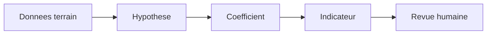

# Protocole scientifique

Ce document definit la methode de calcul des indicateurs utilises par CleanMyMap.
Les indicateurs sont des proxys de lecture et de pilotage, pas une mesure scientifique absolue.

Les sources de contexte sur les rendements de collectes, les groupes et les
conditions de terrain sont regroupées dans l'[annexe de recherche non
normative](./ANNEXE_RECHERCHE_RENDEMENT_CLEANWALKS.md). Cette annexe conserve
les résultats publiés, les ratios calculés et leurs limites ; elle ne définit
aucun coefficient runtime, benchmark de production ou objectif de collecte.

## Comptabilité environnementale CleanMyMap

Le vocabulaire de statut est strictement limité à `OBSERVED`, `DERIVED`,
`DECLARED`, `ASSUMPTION`, `PROXY` et `NA`. Une activité observée ou dérivée ne
devient pas un impact physique sans mesure ou facteur audité : elle est alors
affichée comme activité + `NA`.

La période projet va de mi-février à septembre 2026. La fenêtre auditée des
services va du 18 mars au 18 septembre 2026; l'usage des services antérieur au
18 mars est `UNKNOWN / NOT AUDITED`.

Le modèle central utilise 35 Md token-équivalent (`DECLARED + ASSUMPTION`) et
retient comme proxys 10,5 MWh, 3,675 tCO2e électrique et 47,5 m³ d'eau
indirecte (affichés ≈10 MWh, ≈3,7 tCO2e et ≈45 m³). L'ACV partielle est de
4,8 tCO2e (affichée ≈5 tCO2e, `ASSUMPTION + PROXY`). L'usage exact ChatGPT
hors Codex, l'énergie/CO2e/eau des quelque 130 images et les impacts physiques
des services SaaS restent `NA` faute d'audit exploitable. Aucun token n'est
reconstruit à partir d'heures, et aucune valeur `NA` n'est convertie en zéro.

## Schema de travail

## Principes

- chaque coefficient doit avoir une source ou une justification explicite ;
- les formules doivent rester simples, reproductibles et auditable ;
- une hypothese doit etre marquee comme hypothese ;
- un changement de coefficient doit etre trace dans la documentation technique partagee ;
- les indicateurs doivent aider a comparer des actions, pas a pretendre mesurer tout l'impact environnemental du monde.

## Indicateurs retenus

### Convention de lecture des proxys terrain

Les valeurs de terrain (masse de déchets, nombre de mégots, unités de
bénévoles et durée) sont des observations ou des déclarations seulement
lorsqu'elles sont effectivement renseignées et conservées. Une valeur absente
reste inconnue (`NA`) : elle ne devient pas `0` par conversion numérique. Un
zéro explicite reste en revanche une mesure ou une déclaration nulle.
Lorsqu'une métrique est un ratio, un zéro observé au numérateur et au
dénominateur ne constitue pas un ratio nul : le résultat reste indéfini (`NA`)
sans ajout d'un epsilon ou d'une constante de remplacement.

Les résultats ci-dessous sont des valeurs dérivées à partir de ces données et
de facteurs de configuration. Ils sont qualifiés de `PROXY` : ils donnent un
ordre de grandeur reproductible et une équivalence pédagogique, mais ne
constituent pas une mesure instrumentale de l'eau, des émissions évitées ou de
la surface effectivement nettoyée.

### Eau potentiellement préservée (proxy)

Observation : nombre de mégots retirés, séparé des mesures de masse et de
volume. Le runtime ne mesure pas directement la qualité de l'eau ni un volume
traité. Le facteur `500 L/mégot` est une hypothèse de risque hydrique et sa
validation empirique comme effet causal propre à chaque action n'est pas
établie dans le dépôt.

Formule runtime :

`eau_L = nombre_megots x facteur_eau_L_par_megot`

Le facteur par défaut est `500 L/mégot`. Les conversions en piscines
(`2 500 000 L`) ou en années de consommation (`55 000 L/an/personne`) sont des
équivalences pédagogiques et ne signifient pas qu'un volume équivalent d'eau a
été dépollué ou économisé.

### CO2e potentiellement évité (proxy)

Observation : masse de déchets retenue en kilogrammes. Le CO2e n'est pas
mesuré directement sur le terrain. Le facteur `1,2 kgCO2e/kg` est un proxy
moyen de mix de déchets ; sa validation empirique comme quantité effectivement
évitée par chaque collecte n'est pas établie dans le dépôt.

Formule runtime :

`CO2e_kg = masse_dechets_kg x facteur_CO2e_kg_par_kg`

Les kilomètres voiture et parts de trajet calculés à partir du CO2e sont des
équivalences pédagogiques. Ils ne constituent ni un bilan carbone complet ni
une preuve qu'une émission a réellement été évitée.

### Surface opérationnelle couverte (proxy)

Observations : masse de déchets en kilogrammes, unités de bénévoles et durée
en minutes. Si une donnée requise est inconnue, le proxy de surface est
indisponible. La surface obtenue est une approximation opérationnelle, pas une
mesure géométrique de la zone effectivement nettoyée. Les coefficients sont
configurables et leur validation empirique générale n'est pas établie dans le
dépôt.

Formule runtime canonique :

`surface_m2 = masse_dechets_kg x facteur_surface_m2_par_kg + unités_bénévoles x durée_min x facteur_surface_m2_par_unité_bénévole_minute`

Les facteurs par défaut sont `2,5 m2/kg` et `0,12 m2/(unité bénévole x
minute)`. La formule historique `15 x masse_kg + 2 x durée_min` est conservée
uniquement comme référence historique non applicable : elle n'est ni exécutée
par le runtime actuel ni une formule à utiliser pour de nouveaux résultats.

### Version et configuration des proxys

La version méthodologique par défaut est `impact-proxy-2026.04-v1`, exposée par
`impact-proxy-config.ts` et attachée aux résultats qui utilisent ces facteurs.
Les valeurs par défaut sont :

| Facteur | Valeur par défaut | Unité |
| --- | ---: | --- |
| Eau par mégot | 500 | L/mégot |
| CO2e par masse | 1,2 | kgCO2e/kg |
| Surface par masse | 2,5 | m2/kg |
| Surface par unité bénévole et minute | 0,12 | m2/(unité bénévole x minute) |

Les surcharges d'environnement reconnues sont `IMPACT_PROXY_VERSION`,
`IMPACT_PROXY_WATER_LITERS_PER_CIGARETTE_BUTT`,
`IMPACT_PROXY_CO2_KG_PER_WASTE_KG`,
`IMPACT_PROXY_SURFACE_M2_PER_WASTE_KG` et
`IMPACT_PROXY_SURFACE_M2_PER_VOLUNTEER_MINUTE`. Une valeur absente, non finie,
négative ou supérieure à `1 000 000` reprend le défaut correspondant ; `0`
reste une valeur de configuration valide. La version est utilisée telle
quelle après trim, avec retour à la version par défaut si elle est vide.

Ces surcharges modifient la méthode exécutée au démarrage du runtime et doivent
donc être conservées avec la preuve et le contexte de génération. Elles ne
transforment pas une hypothèse en observation et ne permettent pas à elles
seules d'affirmer un impact physique réel.

### Score de pollution

Le score sert a comparer des zones entre elles et a prioriser des actions.

Sur la carte d'actions, ce score reste un score historique constaté avant l'action. Il ne doit pas être présenté comme une mesure actuelle ni être augmenté par un malus temporel additif. La carte applique une projection non linéaire de re-pollution documentée dans [`methodologie-carte-actions.md`](./methodologie-carte-actions.md), sans modifier le score historique.

Formule de travail :

Pour chaque mesure renseignée, chaque composante est normalisée par le nombre
de bénévoles selon le dénominateur historique sûr `max(1, volunteersCount)` :

`intensite_dechets = masse_dechets_kg / nombre_benevoles`

`intensite_megots = nombre_megots / nombre_benevoles`

Chaque intensité est rapportée à la référence maximale de sa composante puis
bornée entre 0 et 100. Le score historique est le maximum des composantes
disponibles ; une métrique absente n'est pas assimilée à zéro et, si aucune
composante n'est exploitable, le score est indisponible.

La population de référence correspond au contrat de la carte versionné avant
`77e72b0b` : actions `approved`. La frontière publique actuelle conserve en
plus `moderation_visibility = 'visible'`, conformément au contrat de sécurité
des surfaces publiques ; cette restriction est contemporaine et ne doit pas
être présentée comme une règle scientifique pré-77. Aucun filtre supplémentaire
sur `duration_minutes`, `action_phase` ou `action_date` n'est autorisé dans la
population de référence. Le scorer TypeScript reste une fonction de calcul et
ne filtre pas `actionType`, `status`, `actionPhase` ou `durationMinutes`.

La recherche menée dans le dépôt ne trouve aucune décision canonique autorisant
une normalisation par bénévole-heure ; cette formule n'est donc pas consacrée.
La migration append-only
`20260913000009_restore_pre77_pollution_reference_population.sql` aligne la
RPC V2 globale et départementale sur cette population, sans modifier la
formule par bénévole ni supprimer les références départementales.

## Rendement des cleanwalks — recherche non normative

Le contrat `CURRENT` des unités opérationnelles reste
`effective-volunteer-units-v1` :
`A + 0,50 E + 0,50 R`, pour les déchets comme pour les mégots. Le simulateur
privé A/B/C documenté dans
[`methodologie-carte-actions.md`](./methodologie-carte-actions.md) est une
capacité de recherche déterministe. Il ne remplace ni les indicateurs publiés,
ni `participantsCount`/`volunteersCount`, ni les mesures de terrain, et il
n'est pas exposé par une route ou une persistance.

Les modèles B (`0,60` enfant et `0,80` retraité pour les déchets ; `0,40` et
`0,50` pour les mégots) et C (`0,45` enfant pour les déchets ; adultes
explicitement affectés aux mégots) sont des hypothèses non calibrées.
Le contexte métier persistant reste distinct de la configuration scientifique :
il utilise `citizen`, `company` ou `school`, sans catégorie familiale séparée.
Une finalisation valide active automatiquement `school` uniquement lorsque
`3 * childrenCount > 2 * volunteersCount`; l’égalité reste `citizen`. Un choix
explicite autorisé prime sur cette règle et la provenance est conservée. Cette
classification ne constitue ni une preuve d’organisation scolaire ni une
preuve pédagogique, et ne déclenche pas à elle seule une récompense.

La configuration ordinaire, familiale ou scolaire du simulateur doit être déclarée. Le modèle C
est non applicable en présence de retraités et ne déduit jamais les collecteurs
de mégots de la seule présence des adultes. Les coefficients historiques
`0,60/0,70` et `0,25/0,40` restent conservés séparément dans la méthodologie :
leur présence documentaire n'en fait pas une validation scientifique.

Dans ce module de recherche, la provenance des affectations de mégots est
également validée : `OBSERVED` exige un entier fini de `0` à `A` sans
`hypothesis`, `HYPOTHESIS / ALL_ADULTS` exige exactement `A`, et
`HYPOTHESIS / EXPLICIT` autorise un sous-ensemble explicite. Une affectation
incohérente est marquée `INVALID_INPUT` avec un motif déterministe ; aucune
capacité ni projection de mégots n'est calculée depuis cette affectation. Une
affectation absente reste indisponible et un zéro explicite valide reste zéro.
La sensibilité des coefficients retraités réutilise par ailleurs le statut
d'applicabilité du simulateur principal : elle ne produit aucune valeur pour
un modèle `NOT_APPLICABLE` ou une composition `INVALID_INPUT`.

La distinction de preuve est obligatoire :

| Objet | Lecture | Unité / règle |
| --- | --- | --- |
| personnes présentes | `OBSERVED` ou `DECLARED` | nombre réel, conservé séparément des unités |
| unités `CURRENT` | `DERIVED` / `PROXY` | formule versionnée, inchangée par la recherche |
| unités A/B/C | `ASSUMPTION` / `PROXY` | capacité relative hypothétique, non performance individuelle |
| quantité collectée | `OBSERVED` ou `DECLARED` | kg hors mégots et mégots comptés séparément |
| rendement horaire fourni | `DECLARED` ou `OBSERVED` | kg par unité opérationnelle et heure, ou mégots par unité et heure |
| projection | `DERIVED` / `PROXY` | seulement avec taux et durée effectifs explicitement fournis |
| donnée absente | `NA` | jamais convertie en zéro |

Les projections suivent `Q_D = R_D × T_eff × U_D` en kilogrammes et
`Q_M = R_M × T_eff × U_M` en mégots. Aucune moyenne de
`action_collection_reference_averages_v1()` ne sert de rendement adulte par
heure. Il n'existe pas de conversion entre kg et nombre d'objets. Les
coefficients enfant ne sont pas automatiquement applicables aux très jeunes
enfants, aux participants passifs ou aux enfants simplement présents. Le
statut de retraité ne mesure ni capacité physique ni productivité individuelle.
La collecte des mégots par des mineurs doit respecter l'âge, la sécurité, les
équipements et les tâches réellement affectées; une participation à l'action
ne signifie pas une manipulation de mégots.

Les mécanismes de supervision, familiarité, équipements, répartition spatiale,
disponibilité initiale des déchets et saturation restent non quantifiés. Une
ville, la taille du groupe, la proximité familiale, la discussion, l'âge exact
ou le statut de retraité ne fournissent aucun facteur automatique.

### Références contextuelles de collecte — `contextual-effective-units-v1`

Le formulaire peut afficher une référence descriptive par contexte métier,
uniquement lorsque `action_context` est connu : `citizen`, `company` ou
`school`. Les familles restent dans `citizen` et les actions d’entreprise ne
sont jamais mélangées aux actions citoyennes. La référence est une moyenne
arithmétique de ratios par action individuelle, et non un ratio de sommes :

`M_D(C) = moyenne(waste_kg / U_D)` et `M_M(C) = moyenne(cigarette_butts / U_M)`.

Pour `citizen` et `company`, `U_D = U_M = A + 0,50 E + 0,50 R`. Pour `school`,
`U_D = A + 0,45 E` et `U_M = A`. Une action scolaire avec des retraités est
exclue de cette référence faute d'hypothèse documentée ; avec zéro adulte,
son ratio mégots est `NA`, tandis que son ratio déchets peut rester calculable.
Les personnes physiques et les unités opérationnelles estimées restent deux
mesures distinctes. Les zéros déclarés sont valides, les valeurs absentes sont
exclues métrique par métrique et le nombre de sources est exposé séparément.
L'interface affiche `Référence insuffisante` sous deux sources pour la métrique
concernée. Cette règle est descriptive, non calibrée et ne modifie ni le score
cartographique, ni la collecte brute, ni la RPC globale historique
`action_collection_reference_averages_v1()`.

La composition connue est stockée dans `children_count`, `adult_count` et
`retired_count`, avec cohérence atomique avec `volunteers_count`. Les actions
historiques ambiguës restent `NULL` ; l'ancien `[cmm-meta]` n'est utilisé que
pour la compatibilité de lecture et un backfill complet et vérifiable. Aucune
valeur adulte n'est déduite du seul total.

Une revue de contexte supplémentaire est : Cook, E., Cano, N. S. de S. L. et
Velis, C. A. (2024), « Informal recycling sector contribution to plastic
pollution mitigation: A systematic scoping review and quantitative analysis of
prevalence and productivity », *Resources, Conservation and Recycling*, 206,
107588, [doi:10.1016/j.resconrec.2024.107588](https://doi.org/10.1016/j.resconrec.2024.107588).
Elle rapporte seulement trois observations comparables situant la collecte
d'enfants autour de la moitié aux deux tiers de celle d'adultes dans le secteur
du recyclage informel. Ce contexte est différent d'une cleanwalk bénévole;
les auteurs soulignent les limites de méthode et de généralisabilité. Cette
revue ne valide donc aucune valeur `0,60`, `0,45` ou `0,80` de CleanMyMap.

## Préparation d'une future calibration

Une étude pilote devrait recueillir, pour chaque session, les participants
réellement présents et leur composition connue, la configuration, la durée
totale et effective, l'affectation des tâches déchets/mégots, la masse réelle
hors mégots, le nombre réel de mégots, l'équipement, les encadrants et la
supervision observée, le type et l'emprise du secteur, la disponibilité initiale
mesurée, les nettoyages antérieurs connus et des répétitions sur plusieurs
sites. Les secteurs devraient être comparables, la durée homogène et les
conditions observées; l'analyse devrait expliciter sélection, saturation,
répartition spatiale et autres biais.

Ce protocole ne demande aucun nouveau champ persistant dans le formulaire
actuel, aucune donnée de santé ou profil individuel sensible, aucun âge précis
de mineur et aucune attribution de performance individuelle selon l'âge ou le
statut de retraité. Les données manquantes restent inconnues. Une éventuelle
adoption runtime exigerait des échantillons comparables, une analyse des biais,
une version de méthode nouvelle et une décision scientifique documentée.

## Gouvernance

- revoir les coefficients a intervalle fixe ;
- documenter la source de chaque changement ;
- garder une trace des hypothèses dans un seul endroit ;
- refuser toute presentation qui ferait croire a une precision artificielle.

### Fiabilité et auditabilité des indicateurs

- effectuer périodiquement une revue des métriques et de leurs coefficients ;
- réaliser des contrôles de cohérence entre les données déclaratives, les
  preuves disponibles et les indicateurs consolidés ;
- distinguer explicitement les sources terrain, numériques, mesurées, dérivées
  et proxy avant toute interprétation ;
- conserver des exports auditables (notamment CSV ou JSON) des métriques
  consolidées ;
- tracer les coefficients, hypothèses, changements et anomalies qui influencent
  un indicateur ou une alerte d'intégrité.

Le runtime calcule actuellement `dataIntegrityPriority` à partir de
`anomaliesCount`. Ce protocole ne définit donc pas de seuil implémenté de
« 10 tonnes pour un individu ».

### Empreinte numérique et électricité

Le moteur d'empreinte numérique conserve la séparation entre valeur mesurée, valeur dérivée et proxy. La conversion électrique ne s'effectue que dans le sens `kWh réel × facteur électrique`; en l'absence de kWh, l'interface utilise le libellé `équivalent électrique estimé` et conserve le CO₂e proxy sans reconstruire de kWh par division. Une donnée absente reste `à compléter`.

Le facteur par défaut configurable est `0,35 kgCO₂e/kWh` pour des serveurs majoritairement américains, avec [EPA eGRID](https://www.epa.gov/egrid) et [EIA](https://www.eia.gov/tools/faqs/faq.php?id=74&t=11) comme références de cadrage. Il doit être remplacé par un facteur régional lorsque la localisation électrique réelle est connue. La ventilation du refroidissement reste prudente: environ 7 % dans certains hyperscalers efficaces à plus de 30 % dans des installations moins efficaces selon [IEA Energy and AI](https://www.iea.org/reports/energy-and-ai/energy-demand-from-ai). Les serveurs accélérés principalement associés à l'IA sont décrits comme un moteur de croissance, sans attribuer de part IA inconnue à CleanMyMap.

## Lecture correcte

Le protocole n'a pas pour but de sur-vendre l'impact. Il sert a rendre l'impact comparable, discutable et ameliorable.

## Attribution individuelle post-action

Les participations finales proviennent exclusivement de `action_participants`.
Une mesure individuelle saisie par l'organisateur autorisé de l'action ou par
un administrateur reste une observation brute attachée à la participation :
masse de déchets hors mégots, condition et méthode ; nombre de mégots et/ou
masse, condition et provenance. Une mesure `NULL` n'est pas un zéro, et une
valeur dérivée ne remplace jamais la valeur brute.

Le moteur d'estimation photo du formulaire `/actions/new` est conservé pour
les itérations futures mais désactivé tant que sa maturité et sa validation ne
sont pas suffisantes. Une photo de bilan reste une pièce documentaire et ne
produit actuellement aucune masse, confiance ou intervalle affiché dans la
saisie ; les comparaisons visuelles déchets et mégots restent des repères
comparatifs fondés sur `action_collection_reference_averages_v1()`, séparés des
mesures déclarées et du score cartographique. Cette RPC calcule, pour chaque
métrique, la moyenne arithmétique des ratios par participant sur les actions
approuvées, publiques, terminées et datées, sans remplacer les valeurs
absentes par zéro. Chaque métrique conserve son propre nombre d'actions
sources ; l'interface masque la comparaison en dessous de deux sources. Le
dénominateur reste le nombre réel de participants :
`effective-volunteer-units-v1` n'est pas mélangé à cette population historique.
Les pictogrammes et la flèche indiquent un écart descriptif à la moyenne, pas
une performance environnementale démontrée.

La quote-part additive est conservatrice : les participations confirmées
mesurées utilisent leur mesure exacte ; les confirmés non mesurés se partagent
uniquement `totalAction - somme(mesures exactes)`. Si le total collectif est
inconnu, les mesures connues restent disponibles et les autres valeurs sont
`NA`. Un dépassement du total connu est une incohérence, sans reliquat négatif,
et bloque l'éligibilité à de nouveaux crédits Mohs pour la métrique concernée.

Pour la gamification uniquement, la masse brute de déchets reçoit l'hypothèse
versionnée `impact-terrain-2026-waste-moisture-v1` : `sec = 1,0`, `humide =
0,7`, `mouille = 0,4`. L'équivalent sec est donc `masse_brute × facteur` ; il
ne modifie ni la masse collective ni les rapports. Les mégots réutilisent le
moteur canonique `2500 mégots/kg`, avec les mêmes facteurs d'état ; un nombre
compté explicitement est prioritaire sur toute conversion de masse.

Le total physique de présence reste séparé de cette attribution :
`participantsCount = childrenCount + adultCount + retiredCount` inclut les
enfants pour les statistiques de participation. Il ne constitue jamais le
dénominateur d'une quote-part personnelle. Celui-ci compte uniquement les
comptes `action_participants` confirmés, une ligne confirmée représentant une
unité d'attribution ; les enfants accompagnants, `volunteersCount`,
`effectiveVolunteerUnits`, `adultCount` et `retiredCount` en sont exclus. La
contribution d'un enfant est comprise dans celle du compte accompagnateur.
