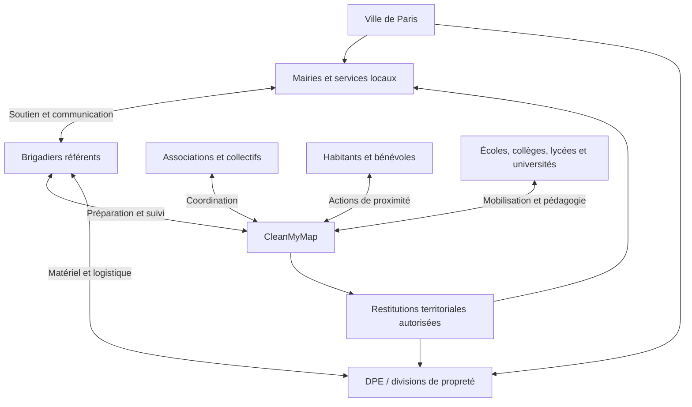

# Ambition territoriale de CleanMyMap : Paris, capitale éco-citoyenne

> **Statut : `PLAN / TARGET`**
>
> **Nature :** vision stratégique de long terme et proposition d'expérimentation territoriale.
>
> **Date de rédaction :** 24 novembre 2026.
>
> Ce document ne constitue ni un partenariat signé, ni un mandat municipal, ni une spécification d'implémentation, ni une modification de la roadmap canonique. Les partenaires cités sont des interlocuteurs potentiels, sauf preuve distincte d'un engagement effectif.

## 1. Ambition

À terme, contribuer à faire de Paris une capitale éco-citoyenne exemplaire grâce à un réseau pérenne de brigades citoyennes de proximité, soutenues par les collectivités et reliées par une infrastructure numérique commune : CleanMyMap.

Le principe territorial proposé est simple :

**Un arrondissement = un ou deux brigadiers référents, soutenus par leur mairie, les services municipaux de propreté et un réseau local d'habitants, d'associations et d'établissements d'enseignement.**

Il ne s'agit pas uniquement de multiplier les ramassages de déchets, mais de construire une capacité locale permanente de mobilisation, de sensibilisation, d'organisation et de connaissance de la pollution diffuse.

Cette ambition rejoint celle publiquement exprimée par la [Brigade Verte Paris](https://www.jagispourlanature.org/structure/brigade-verte-paris), qui souhaite étendre son initiative à l'ensemble de la capitale. CleanMyMap propose d'en faciliter la dimension numérique, sans s'approprier l'initiative associative, son identité ou sa gouvernance.

### Objectifs de long terme

- Permettre à chaque habitant de trouver une action de proximité et d'y contribuer régulièrement.
- Faciliter la coordination des collectifs existants plutôt que créer des structures concurrentes.
- Associer les établissements scolaires, les écodélégués, les étudiants, les familles et les acteurs de quartier.
- Simplifier le soutien matériel, logistique et communicationnel des institutions.
- Constituer une mémoire territoriale documentée des actions et des observations.
- Orienter progressivement la sensibilisation et la prévention vers les types de déchets et les secteurs récurrents.
- Construire un modèle reproductible dans d'autres communes, sans dépendance structurelle à Paris.

## 2. Positionnement de CleanMyMap

CleanMyMap a vocation à être **l'infrastructure numérique de coordination des acteurs de la dépollution citoyenne**, et non une nouvelle brigade de ramassage ni un service municipal de substitution.

La plateforme relie la boucle existante :

```text
Observer → préparer → mobiliser → agir → documenter → restituer → coordonner la suite
```

Elle permettrait aux organisations de conserver leur identité, leurs bénévoles, leur autonomie et leurs méthodes, tout en utilisant des outils communs pour les tâches qui gagnent à être mutualisées.

Principes non négociables :

- Complémentarité avec le service public de propreté, sans transfert de ses obligations vers les bénévoles.
- Respect de l'autonomie et de la visibilité des associations existantes.
- Accès citoyen non exclusif ; aucune obligation d'utiliser CleanMyMap pour participer à la vie locale.
- Prévention des déchets et sensibilisation autant que collecte.
- Données traçables, résultats interprétables et protection de la vie privée.
- Aucune revendication de partenariat, de label municipal ou de résultat non démontré.

## 3. Organisation territoriale cible

Paris comporte 20 arrondissements géographiques et 17 mairies depuis le regroupement des quatre premiers arrondissements au sein de Paris Centre en 2020 ([source municipale](https://www.paris.fr/pages/connaissez-vous-vraiment-votre-mairie-d-arrondissement-30097)). Le maillage citoyen peut donc conserver 20 territoires, tandis que les relations institutionnelles suivent les 17 mairies et les divisions de propreté réellement compétentes.

Le scénario de long terme représente 20 à 40 référents citoyens, avec adaptation aux besoins, à la population, à la superficie et à l'activité associative de chaque territoire. Ce nombre est une cible organisationnelle, pas un effectif acquis. Plusieurs collectifs peuvent coexister dans un même arrondissement ; le référent facilite leur coopération, sans monopole ni autorité sur eux.



### Répartition des responsabilités envisagée

| Acteur | Responsabilité cible | Limite |
|---|---|---|
| Brigadier référent | Animer le réseau, organiser ou relayer les actions, accueillir les bénévoles et transmettre les besoins | Pas de pouvoir de police, de collecte municipale obligatoire ni d'accès privilégié implicite aux données |
| Association ou collectif | Porter et encadrer ses propres actions, assurer les obligations liées à son organisation | Autonomie conservée ; pas de rattachement forcé |
| Mairie d'arrondissement | Désigner un interlocuteur, faciliter les relations locales, relayer les événements et étudier les soutiens possibles | Engagement et moyens à négocier avec les services compétents |
| Direction de la Propreté et de l'Eau (DPE), Service technique de la propreté de Paris (STPP) et divisions locales | Définir les consignes, faciliter le matériel et convenir de la prise en charge des déchets | Pas d'engagement présumé sur des volumes, horaires ou ressources |
| Ville de Paris | Faciliter la cohérence interterritoriale et, si l'expérimentation le justifie, soutenir l'essaimage | Aucun mandat ou convention acquis |
| Établissements scolaires et universitaires | Mobiliser et encadrer leurs publics, intégrer la prévention aux projets pédagogiques | Responsabilité éducative, autorisations et protection des mineurs |
| CleanMyMap | Fournir les outils numériques, accompagner leur prise en main et produire des restitutions selon les droits et méthodes applicables | Ne se substitue ni à l'organisateur ni aux services publics |

Le terme « brigadier » décrit ici une mission humaine de coordination. Il ne constitue pas un nouveau rôle d'autorisation applicatif. Les droits d'un coordinateur et les relations organisateur/coorganisateur restent régis par les [contrats de sécurité](../security/authz-authn-regles.md).

## 4. Contribution concrète du site web

Le socle existant est décrit dans la [vision produit](./vision-et-objectifs.md), les [parcours](./parcours-utilisateurs.md) et l'[index des pages](../pages_site/INDEX.md). La disponibilité effective et les droits de chaque capacité restent déterminés par le runtime. Le tableau suivant décrit leur mobilisation envisagée, pas une certification de fonctionnement sur le terrain.

| Étape | Usage des outils documentés | Apport pour le territoire |
|---|---|---|
| Repérer | Carte des actions (`/actions/map`), signalements (`/signalement`) et observations disponibles | Comprendre les secteurs déjà parcourus et les besoins documentés |
| Préparer | Création d'action (`/actions/new`), itinéraire, météo, informations pratiques | Réduire le temps de préparation et faciliter les consignes |
| Mobiliser | Rejoindre une action (`/sections/rejoindre-une-action`), liens publics, discussions | Donner un point d'entrée commun aux bénévoles et aux relais municipaux |
| Coordonner | Messagerie (`/sections/messagerie`), organisation et pilotage des actions autorisées (`/pilotage`) | Répartir les tâches et transmettre les informations utiles |
| Sensibiliser | Ressources d'apprentissage et espace école (`/learn/ecole`) | Préparer les participants et compléter la collecte par la prévention |
| Documenter | Finalisation des actions, mesures, géométries et provenance | Conserver un historique exploitable et attribuable |
| Restituer | Rapports (`/reports`), PDF partageables selon leur contrat, projections publiques autorisées | Fournir aux partenaires des bilans compréhensibles et réutilisables |
| Pérenniser | Historique, discussions et mécanismes existants de continuité d'engagement | Faciliter la récurrence et la transmission entre organisateurs |

### Exemple de cycle mensuel

1. Le brigadier et les acteurs locaux repèrent des besoins sur la base de visites, d'observations et de l'historique disponible.
2. L'organisateur prépare une action : périmètre, durée, point de rendez-vous, capacité, accessibilité, consignes et matériel.
3. Il confirme avec la division de propreté les modalités de remise du matériel et d'évacuation des sacs, hors plateforme si nécessaire.
4. Il publie l'action et transmet son lien aux associations, à la mairie, aux établissements et aux habitants. Chaque relais conserve ses canaux habituels.
5. Le jour de l'action, l'organisateur encadre les participants et applique les consignes convenues.
6. Après l'action, il documente les résultats effectivement connus, les limites de la mesure et les éventuels besoins de suivi.
7. Un bilan autorisé est transmis aux partenaires. Les acteurs décident ensemble de la suite : nouvelle collecte, sensibilisation ciblée, demande municipale ou action de prévention.

Au stade pilote, la coordination institutionnelle peut rester réalisée par courriel, téléphone et réunions. Une intégration numérique n'est justifiée que si un besoin récurrent et un interlocuteur habilité sont identifiés.

## 5. Écosystème parisien et collaborations envisagées

Les acteurs ci-dessous sont identifiés à partir de leurs activités publiquement décrites. La collaboration proposée est une hypothèse ; l'accord, la disponibilité, les moyens et les conditions d'intervention restent à établir. Aucun logo ni nom ne doit être utilisé pour suggérer un soutien officiel non acquis.

### 5.1. Noyau prioritaire pour le pilote

| Interlocuteur | Raison de le solliciter | Proposition concrète |
|---|---|---|
| [Brigade Verte Paris](https://www.brigadeverteparis.fr/) | Initiative née dans le 20e, étendue au 11e ; ambition d'essaimage et de sensibilisation | Co-construire le modèle de brigadier et tester le site sur des actions existantes ; recueillir les besoins plutôt qu'imposer un outil |
| [Mairie du 20e](https://mairie20.paris.fr/) | Premier territoire proposé en raison de l'ancrage de la Brigade Verte | Identifier un interlocuteur propreté, vie associative ou participation citoyenne et un relais communication |
| [DPE / STPP](https://www.paris.fr/pages/la-proprete-239/) et division locale | Compétence opérationnelle de propreté | Convenir des consignes, des déchets acceptés, du matériel disponible et de la récupération des sacs |
| [MVAC](https://www.paris.fr/pages/les-maisons-de-la-vie-associative-et-citoyenne-5388/) et conseils de quartier | Réseaux locaux d'habitants et d'associations | Présenter le pilote, rechercher des référents et des relais, faciliter les rencontres |
| [Régie Paris 20](https://regieparis20.org/) et autres régies locales pertinentes | Ancrage de quartier, propreté et insertion | Examiner les complémentarités locales sans concurrencer leurs prestations professionnelles |
| SONU Environment / [Sorbonne Université](https://www.sorbonne-universite.fr/) | Mobilisation étudiante et démarche universitaire | Proposer des participations et une évaluation du dispositif ; aucune collaboration scientifique présumée |

La Ville propose déjà un [dispositif de nettoyage participatif](https://ws-paris-v4.paris.fr/pages/nettoyages-participatifs-ensemble-rendons-paris-plus-propre-15425) permettant notamment de se rapprocher du service de propreté pour faciliter l'évacuation des déchets et demander des sacs ou des gants. Le pilote doit utiliser ces mécanismes existants, sous réserve de confirmation locale, avant d'envisager de nouveaux workflows.

### 5.2. Extension du réseau

| Interlocuteur | Contribution potentielle |
|---|---|
| [Mairie du 11e](https://mairie11.paris.fr/) | Deuxième territoire pilote possible, en lien avec le réseau de la Brigade Verte |
| [Les Parques / Super Brigade Verte](https://www.jeveuxaider.gouv.fr/organisations/12121-les-parques) | Retours d'expérience sur les collectes de proximité et la mobilisation intergénérationnelle ; extension vers les territoires où l'association intervient |
| [Surfrider Paris](https://www.surfrider-paris.fr/nos-actions/) | Collectes, caractérisation des déchets, pédagogie et articulation avec les méthodes existantes |
| [PikPik Environnement](https://pikpik.org/) | Animation et accompagnement pédagogique des habitants, écoles et collectivités |
| [Zero Waste Paris](https://zerowasteparis.fr/) | Prévention des déchets, réduction à la source et sensibilisation des acteurs locaux |
| [Cleanwalk.org](https://www.cleanwalk.org/) | Examiner la complémentarité des agendas, liens et données, sans duplication ni import non autorisé |
| [Volontaires de Paris](https://www.paris.fr/pages/volontaires-de-paris-engagez-vous-6922) | Mobilisation de citoyens engagés, selon les modalités du dispositif |
| [Maison étudiante](https://maison-etudiante.paris/) | Mise en relation avec les associations et porteurs de projets étudiants |
| [Académie du Climat](https://www.paris.fr/dossiers/l-academie-du-climat-44), rectorat et établissements | Mobilisation des écodélégués, accompagnement pédagogique et liens avec l'enseignement supérieur |
| Autres mairies, associations de quartier, universités, jardins partagés, bailleurs et commerçants volontaires | Relais de proximité, lieux de rencontre et soutien logistique convenu au cas par cas |
| Ville de Paris / services de participation, jeunesse, vie associative et communication | Coordination de l'essaimage et éventuelle diffusion à l'échelle municipale après preuve pilote |

Les plateformes partenaires doivent conserver leurs propres identifiants, données et conditions d'usage. Une coopération par liens publics ou calendrier partagé est préférable à une synchronisation complexe tant que celle-ci n'a pas de valeur démontrée.

### 5.3. Filière citoyenne des mégots et plogging : expérimentation à instruire

**Statut : PLAN.** Cette piste ne constitue ni une filière en service, ni une convention signée, ni un nouveau parcours applicatif. Elle complète le pilote territorial du 20e ; le 19e et les clubs de course constituent des pistes d'extension.

#### Chaîne cible et conditions

| Maillon | Acteur ou solution à instruire | Preuve indispensable avant engagement |
|---|---|---|
| Collecte | Brigade Verte, associations, habitants et run clubs | Organisateur, encadrement, sécurité, matériel, méthode de mesure et destination convenus |
| Regroupement | Régie, local associatif ou municipal volontaire | Accord écrit du responsable, conditions d'admission, stockage, contenants, responsabilités, durée et enlèvement |
| Transport | [Carton Plein Cyclo](https://cartonplein.org/nos-services-cyclologistique/) | Acceptation explicite du flux, devis, couverture géographique et conformité du transport |
| Massification et traitement | [CKFD](https://www.ckfd.fr/recyclage-dechets/megot-de-cigarette) / MéGO! ou autre filière acceptée | Acceptation des mégots au sol, quantité et qualité exigées, prix, preuve de réception et traitement final |
| Soutien | DPE, [ALCOME](https://alcome.eco/nos-soutiens/), financeurs sportifs à prospecter | Convention et affectation explicites ; aucune aide présumée |

Carton Plein décrit une offre professionnelle de collecte à vélo ; son rapport 2023 (p. 23) et l'observatoire GRAFIE 2025 (p. 18) citent les mégots. Sa filiale d'insertion est une solution à consulter, pas un prestataire acquis. CKFD annonce la massification à Gennevilliers avant transfert en Bretagne ; l'entrepôt n'est pas un point d'apport public attesté. Le cahier des charges ALCOME de 2022 visait les mégots des cendriers de rue et précisait des exigences de qualité et de transport ; le seuil de 100 kg annoncé pour les collectivités sous contrat ne garantit pas l'acceptation des collectes au sol. Vérifier le régime de déchets applicable, notamment les obligations de stockage, conditionnement, traçabilité et transport avec les opérateurs ; le [code de l'environnement, article R. 541-50](https://www.legifrance.gouv.fr/codes/article_lc/LEGIARTI000046669839), ne constitue pas à lui seul une autorisation de transport.

#### Mobilisation sportive

Privilégier une expérimentation courte avec trois clubs volontaires, un organisateur de terrain et un exutoire convenu. Format indicatif : 30 min de footing, puis 30 min de collecte et une restitution de groupe. Les [Runners Laveurs](https://www.fondationdelamer.org/nos-programmes/un-geste-pour-la-mer/associations/les-runners-laveurs/) organisent des ploggings franciliens. Des précédents existent chez Adidas Runners Paris (guide municipal 2021) et dans le [programme Marathon de Paris 2026](https://www.schneiderelectricparismarathon.com/fr/marathon-engage/recyclage) avec Culligan. Adidas Runners, Paname Run Club, LIFA, ASO et les annuaires sportifs constituent des pistes de prospection, sans engagement ni financement démontré. Ne créer aucun lien de partenariat à partir de cette liste.

#### Ordres de grandeur et conditions économiques

Scénario illustratif, non prévisionnel : 20 clubs × 20 participants × 12 sorties × 100 mégots/participant = 480 000 mégots, 240 actions et 4 800 participations (non des personnes uniques). Avec le proxy sec canonique de 0,22 g/mégot dans le moteur d'impact, cela représente 105,6 kg estimés. Trois clubs aux mêmes hypothèses donnent 72 000 mégots et 15,84 kg estimés. Une conversion n'est pas une pesée admissible. Les seuils de filière dépendent de la masse réellement acceptée, du flux et des conditions convenues. Tester les rendements réels et la faisabilité de mutualiser avec des flux existants, plutôt que stocker jusqu'à un objectif théorique. Aucun achat de vélo cargo ni recrutement avant devis, comparaison des options et preuve d'utilité.

Comparer coût total par kg effectivement accepté, coût de stockage, transport et traitement, délai de prise en charge, taux de refus, preuve de destination, temps humain et émissions sur un périmètre explicite (y compris l'aval routier). Ne pas présenter une collecte à vélo comme une filière intégralement décarbonée ou recyclée. Le bénévolat ne doit pas se substituer aux emplois d'insertion ou aux missions municipales.

#### Périmètre numérique

Réutiliser d'abord les actions, la cartographie et la mesure des lots existantes. Conserver les identifiants d'action et de lot, les quantités mesurées/estimées et leurs preuves ; ne pas compter à nouveau un lot à chaque transfert. Les preuves de réception et traitement sont distinctes de la collecte. Aucun moteur de tournées, module de stockage, paiement, crédit plastique ni nouvelle table avant validation du pilote et identification de l'owner métier. Les lieux de regroupement privés restent hors carte publique sans autorisation. Dans les visualiseurs, seuls les acteurs et offres sourcés sont ajoutables ; aucun trajet, point de dépôt ou partenariat prospectif n'est une donnée opérationnelle. Afficher les limites dans les fiches existantes, sans filtre supplémentaire.

Sources complémentaires : [rapport Carton Plein 2023](https://cartonplein.org/wp-content/uploads/2025/04/RA-2023-Carton-Plein.pdf), [observatoire GRAFIE 2025](https://www.grafie.org/system/files/2025-03/20250328%20MAJ%20Observatoire%20SIAE%20Economie%20Circulaire%20IDF%20FINAL.pdf), [consultation ALCOME 2022](https://alcome.eco/wp-content/uploads/2022/06/20220525-Alcome-Consultation-collecte-100kg-megots.pdf), [FAQ ALCOME](https://alcome.eco/faq-3/), [guide municipal 2021](https://cdn.paris.fr/paris/2021/12/01/bb21d28119bd89a6292ee9128cecd983.pdf). Sources consultées le 25/11/2026 ; texte des PDF accessible, captures indisponibles.

## 6. Données municipales : complémentarité avec DansMaRue

DansMaRue est le service municipal de signalement des anomalies de l'espace public. CleanMyMap n'a pas vocation à le remplacer ni à présenter une action citoyenne comme une intervention municipale validée.

Une piste de travail consiste à exploiter les données de [Paris Data : Dans Ma Rue](https://opendata.paris.fr/explore/dataset/dans-ma-rue/information/) et son [historique](https://opendata.paris.fr/explore/dataset/dans-ma-rue-historique-anomalies-signalees/information/) pour étudier les récurrences et orienter la préparation d'actions.

**Limite majeure :** la fiche publique indique une diffusion à J-3 mois. Ces observations ne permettent donc pas de déterminer la présence actuelle d'un déchet, son statut de traitement ou l'opportunité immédiate d'une collecte. L'absence de signalement ne signifie pas absence de pollution.

Avant toute intégration :

- vérifier licence, conditions d'attribution, schéma, couverture, fraîcheur réelle et modalités d'accès ;
- identifier les catégories adaptées à la collecte bénévole, sans inclure les risques ou anomalies relevant des services professionnels ;
- distinguer explicitement signalements municipaux historiques, observations citoyennes, actions réalisées et projections de re-pollution ;
- conserver la provenance, la date d'observation et la date d'import ;
- éviter le double comptage, les rapprochements abusifs et la réidentification ;
- vérifier sur le terrain les besoins avant de programmer une intervention.

L'option initiale recommandée est une analyse historique ponctuelle. Un calque ou un flux automatisé ne devient pertinent qu'après preuve d'utilité et de conformité. Aucun accès à un flux municipal privé ou temps réel n'est présumé.

### Intelligence territoriale dans l'Annuaire : orientation produit

**Statut : PLAN / TARGET.** Direction produit retenue le 25 novembre 2026. Les comportements disponibles restent décrits par les [contrats du réseau des cleanwalks](../features/paris-cleanwalk-network-3d.md) et des [services publics](../features/organisation-services-publics-proprete.md). Cette orientation ne modifie pas les priorités globales de la roadmap.

#### Finalité et frontières

L'Annuaire aide à comprendre les collaborations, identifier les responsabilités et trouver un interlocuteur compétent. Le réseau répond à « qui agit avec qui ? », l'organisation institutionnelle à « qui est responsable de quoi ? ». L'orientation « Qui contacter ? » répond à un besoin concret à partir du référentiel institutionnel. Les similarités thématiques du graphe SVG ne représentent ni collaborations ni mandats. Ne pas fusionner les modèles relationnels, les propriétaires des données, les rôles applicatifs ou les identités par ressemblance de nom.

#### Expérience cible : simplicité avant exhaustivité

- Conserver deux onglets dans l'Annuaire ; aucune page, navigation principale, base graphique ou service dédié supplémentaire.
- Réseau : recherche directe par nom, deux filtres visibles (type d'acteur et arrondissement), autres filtres existants dans un seul détail secondaire. La recherche sélectionne un acteur sans supprimer ses voisins. Le territoire documenté reste explicite. Ne pas ajouter de facettes temporelles, de comparaison d'acteurs ni de modes de lecture supplémentaires par défaut.
- Séparer aperçu court et fiche persistante. Donner priorité au nom, à la compétence, au contact public et aux relations utiles, puis aux sources et détails. L'interface sur téléphone doit rester lisible sans manipuler la caméra. Le repli HTML donne accès aux mêmes informations.
- Organisation : choisir la ville, l'arrondissement et un besoin à la fois. Réutiliser les huit parcours existants, sans choix d'arrondissement concurrent. Présenter les interlocuteurs, les conditions et les actions possibles avant l'arbre complet. Les filtres de recherche administrative restent dans l'exploration. L'arbre et la navigation par niveaux réutilisent le même état ; pas de quatre visualiseurs spécialisés.
- Réutiliser les composants et préférences de présentation. Ne pas remplacer les textes longs par une multiplication de badges, panneaux, réglages ou conditions.

#### Vérité des représentations

Les couleurs représentent des familles, les traits des types et états de relations ; l'épaisseur n'indique une fréquence que lorsqu'elle est documentée. Un rayon uniforme évite le classement implicite ; les positions par famille restent stables pendant le filtrage et ne sont pas géographiques. Aucun score d'influence, classement des partenaires, relation prédite ni présomption d'absence de collaboration à partir d'un lien absent. Les opérations programmées et réalisées restent distinctes. Une opération collective est une entité identifiable avec participants et rôles ; ne pas multiplier des partenariats bilatéraux par inférence.

Les identités communes reposent uniquement sur les références explicites existantes. La navigation entre onglets ouvre la structure correspondante sans modifier les registres ni attribuer une contribution d'une direction à ses unités filles. Les données privées restent exclues. Les contacts, capacités matérielles, financements, accords et compétences non prouvés restent qualifiés comme tels.

#### Limites, financement et qualité des preuves

**Décision produit du 25 novembre 2026, PLAN jusqu'à intégration.** Le réseau et l'organisation institutionnelle doivent permettre de lire les limites documentées d'une structure sans la noter ni la classer. Le même contenu public est réutilisé par identité explicite, jamais par nom, proximité dans un graphe, hiérarchie ou affiliation. Une fiche sans élément sourcé ne reçoit pas un label rassurant ni une suspicion par défaut.

L'interface conserve deux onglets et les filtres existants. Les chiffres, sources et limites sont des détails de la fiche sélectionnée, sans nouveau tableau de bord, score de confiance ou filtre de controverse. Un élément porte une catégorie, sa portée (structure, opération, territoire, période), une source publique datée et un statut : fait documenté, critique attribuée, ou information non établie dans les sources consultées. Les déclarations d'organisateurs, offres commerciales, sources publiques et positions critiques restent distinguées.

Un financement REP, un mécénat financier, une contribution matérielle, un soutien technique et un partenariat sont des relations distinctes. Les montants d'une association, d'une édition nationale, d'une collectivité ou d'une antenne ne se transfèrent pas entre elles. Une critique de greenwashing ou de conflit d'intérêts doit identifier l'auteur, la date, la source et la portée ; elle n'est ni une qualification judiciaire ni une culpabilité par association. Les bénéficiaires d'un financeur controversé ne reçoivent pas automatiquement ses critiques. Aucun contact privé, allégation non sourcée ou conclusion sur l'intention d'une personne.

Pour les mégots, séparer comptage, masse, collecte, admission, transport, recyclage matière, valorisation énergétique et élimination. Une offre commerciale, un taux déclaré ou un certificat de collecte ne vaut pas preuve du traitement d'un lot, d'un impact évité, d'un audit indépendant ou d'un crédit reconnu. Ne pas multiplier un nombre de mégots par un volume d'eau présenté comme impact mesuré. Les chiffres nationaux et régionaux ne permettent pas de reconstituer un total parisien. Les déclarations non confirmées et les résultats partiels restent explicitement qualifiés. Les acteurs et opérateurs hors Paris ne sont présentés dans ce territoire que pour un rôle régional, national lié à Paris ou de traitement aval documenté, sans inventer d'adresse, desserte ou implantation.

La connaissance durable est tenue dans les owners de l'annuaire et leurs contrats spécialisés, sans CRM public ni nouvelle base. Le premier enrichissement porte sur le Mégothon, son collectif, ses financeurs documentés et les filières de mégots, puis sur les autres acteurs du réseau. La revue éditoriale s'applique aussi à CleanMyMap lui-même. Elle restitue les comptes et rapports publiés, les politiques déclarées d'indépendance, les financements et leurs limites, ainsi que les réponses publiques aux critiques lorsqu'elles existent. La couverture d'une fiche ne vaut pas audit exhaustif ; ne pas produire une critique artificielle pour une personne, un métier ou une unité administrative. Une controverse sur une installation est circonscrite à son site et sa période. Une proposition utilisateur ou un signalement ouvre une revue éditoriale, pas une publication automatique. En cas de nouvelle preuve contradictoire ou de réponse publique d'une structure, conserver la portée et la provenance, actualiser l'élément ou le retirer s'il n'est plus défendable.

#### Séquencement et extensions

1. Stabiliser le réseau, l'organigramme et le suivi privé déjà engagés.
2. Livrer recherche, filtres resserrés, repères stables, fiches sourcées, orientation partagée, navigation entre identités établies et validations responsive.
3. Après réception, étudier les liens partageables et une projection par opération depuis les identifiants existants, si leur utilité est démontrée.
4. Relier ensuite l'orientation au parcours existant de préparation d'une cleanwalk, en convergeant avec les formalités et contacts déjà maintenus ; ne pas créer de second assistant, CRM public ou workflow de réservation.
5. Historique territorial, export de fiches et extension hors Paris restent des pistes ultérieures. Chaque ville exige son référentiel sourcé ; pas de réplication des structures parisiennes.

Mesurer le temps pour trouver un interlocuteur, la réussite de tâches de recherche, la compréhension des preuves, la lisibilité mobile, la fraîcheur des sources et la charge de rendu. Les seuils restent à établir à partir d'une baseline, sans objectifs chiffrés inventés. Aucun nouveau suivi nominatif ni collecte de données privées n'est requis.

## 7. Évolutions fonctionnelles conditionnelles

Ce tableau présente des hypothèses de besoins, pas des tâches Codex autorisées ni un nouvel ordre de priorité global. La [roadmap canonique](./roadmap-priorisee.md) conserve l'autorité : validation du parcours et des rapports P0 avant extension des programmes territoriaux P1.

| Capacité cible | Valeur recherchée | Condition avant développement |
|---|---|---|
| Vue publique filtrée par territoire | Retrouver les prochaines actions, l'historique et les référents ayant accepté d'être visibles | Démontrer que les filtres, la carte et l'agenda existants ne suffisent pas |
| Identification des référents et relations territoriales | Faciliter le contact et la continuité locale | Mandat ou relation vérifiée, consentement, durée et révocation ; aucun rôle implicite |
| Bilan périodique territorial | Comparer activité et couverture sur une période, documenter le soutien nécessaire | Besoin réel d'un partenaire, données admissibles et méthode de sélection explicite |
| Communication locale récurrente | Faciliter les relais par la mairie, les établissements et les associations | Tester d'abord les liens publics, canaux municipaux et mécanismes de continuité existants |
| Suivi logistique partagé | Clarifier besoins de matériel et récupération des déchets | Processus accepté par la DPE, responsabilités et gains documentés |
| Calque historique municipal | Enrichir la connaissance territoriale | Audit de données et utilité démontrée ; absence de confusion avec l'état courant |

### Invariants d'architecture et de gouvernance

- Aucun fork Paris, application distincte, second référentiel d'identité ou moteur d'impact concurrent.
- Préférer les filtres et extensions des owners existants aux nouvelles pages, tables ou services.
- Un territoire géographique, une structure, un rôle utilisateur et un périmètre d'autorisation sont distincts. L'affichage d'un territoire ne donne aucun droit privé sur ses ressources.
- Les agrégats territoriaux reposent sur une règle canonique de sélection et de déduplication. Les interventions traversant plusieurs arrondissements nécessitent une convention d'attribution explicite avant agrégation ; ne pas les compter plusieurs fois dans un total parisien.
- Le web constitue le support initial du pilote ; le mobile reste soumis à sa roadmap, à ses validations physiques et à ses conditions de distribution.
- Les décisions techniques ultérieures suivent la gouvernance du dépôt, les contrats de données, de sécurité et les preuves requises.

## 8. Expérimentation recommandée

### Phase A : découverte et préparation

Proposer une rencontre avec la Brigade Verte Paris et un interlocuteur de la mairie du 20e. Comprendre leur fonctionnement actuel, leurs outils, les difficultés rencontrées, les exigences de sécurité et les modalités du soutien municipal. Identifier une action déjà programmée plutôt que créer artificiellement un événement pour tester le logiciel.

Définir ensemble : un organisateur responsable, un contact propreté, les canaux de communication, les autorisations et assurances nécessaires, le périmètre des données, les restitutions attendues et un état initial permettant de comparer les pratiques.

### Phase B : pilote de trois mois dans le 20e

Hypothèse de travail : trois actions successives, à raison d'une par mois, avec la possibilité d'ajuster la cadence aux disponibilités du partenaire.

Utiliser le site pour la préparation, la publication, les inscriptions lorsqu'elles sont pertinentes, le suivi des résultats et la restitution. Conserver les outils habituels lorsque la plateforme ne couvre pas encore un besoin. Recueillir les difficultés réelles, les retours d'usage et les temps de préparation et de bilan.

Livrables : liens vers les actions admissibles, résultats documentés, synthèse des retours des organisateurs, bilan de fin de pilote et liste bornée des besoins non couverts.

### Phase C : réplication et extension progressive

Si les partenaires souhaitent poursuivre, tester le même modèle dans le 11e ou un autre arrondissement volontaire. Vérifier sa transférabilité avec un second organisateur, sans dépendance excessive au fondateur de CleanMyMap.

À partir de plusieurs expériences documentées, proposer à la Ville une démarche d'essaimage : guide de démarrage, responsabilités, formation des référents, soutien matériel et communication, modalités de partage des bilans et gouvernance commune. L'élargissement à 20 arrondissements reste conditionnel aux accords, moyens et preuves d'adoption.

### Conditions de passage à l'échelle

- Le parcours de préparation et de restitution fonctionne réellement sur les actions pilotes, sans perte de données ni défaut critique de sécurité.
- Les organisateurs confirment l'utilité de la plateforme et souhaitent la réutiliser.
- Au moins un interlocuteur institutionnel juge les restitutions ou la coordination utiles, avec retour documenté.
- Le dispositif de terrain est sûr et la prise en charge des déchets est convenue.
- La charge humaine et technique est soutenable et les responsabilités clairement attribuées.
- Les résultats ne dépendent pas uniquement de la présence du fondateur ; une transmission ou une réplication est testée avant un déploiement large.

En cas d'échec, identifier les causes, corriger uniquement les blocages démontrés ou interrompre l'extension. Le nombre de fonctionnalités livrées ne constitue pas un critère de succès du pilote.

## 9. Mesure de réussite

Les indicateurs du programme doivent être définis avec les partenaires. Aucune cible de performance ne peut être présentée comme acquise. Les seuils d'amélioration seront déterminés après établissement d'une baseline comparable.

| Dimension | Indicateur proposé | Interprétation et limite |
|---|---|---|
| Maillage | Territoires avec au moins un référent actif vérifié / 20 | Un compte créé ne prouve pas l'activité locale |
| Régularité | Actions effectivement réalisées par territoire et par mois | Distinguer actions programmées, annulées et réalisées |
| Mobilisation | Participations réelles, et participants uniques si mesurables légitimement | Une participation n'est pas une personne unique |
| Continuité | Part des participants identifiables revenant sur une période définie | Dénominateur et couverture explicites ; ne pas identifier les mineurs pour calculer ce KPI |
| Utilité numérique | Temps de préparation et de restitution, retours organisateurs | Comparer des actions comparables et inclure les tâches hors plateforme |
| Qualité | Part des actions disposant de mesures et d'une provenance suffisante | Les données inconnues restent `NA` |
| Collecte | Masse de déchets, nombre de mégots, durée et participants documentés | Une hausse des volumes peut refléter une pollution plus forte ou un effort accru |
| Prévention | Densité de déchets sur des parcours répétés, avec effort et protocole comparables | Ne permet pas seule d'attribuer causalement une amélioration au programme |
| Coopération | Soutiens effectivement fournis, retours et renouvellements de partenaires | Un contact ou une réunion ne vaut pas partenariat |
| Soutenabilité | Charge humaine, coûts techniques et matériels, incidents | Vérifier que la progression du réseau reste compatible avec les moyens |

La mesure scientifique reste régie par le [protocole scientifique](./SCIENTIFIC_PROTOCOL.md) et la [méthodologie de la carte](./methodologie-carte-actions.md). Les équivalences eau, CO2e ou surface opérationnelle demeurent des proxys ; elles ne prouvent pas une dépollution physique de l'eau, des émissions évitées ou une amélioration causale de l'état des rues.

### Scénarios de mobilisation à maturité

Illustration purement arithmétique, avec 20 arrondissements couverts, 12 mois complets et 20 présences moyennes par action. Les brigadiers coordonnent les actions ; leur nombre ne multiplie pas automatiquement le nombre de collectes.

| Fréquence par arrondissement | Actions mensuelles à Paris | Actions annuelles | Participations annuelles |
|---|---:|---:|---:|
| 1 action/mois | 20 | 240 | 4 800 |
| 2 actions/mois | 40 | 480 | 9 600 |
| 4 actions/mois | 80 | 960 | 19 200 |

Formules : `actions_annuelles = 20 × fréquence_mensuelle × 12` ; `participations_annuelles = actions_annuelles × présences_moyennes`.

Ces scénarios ne sont ni des prévisions, ni des objectifs contractuels, ni des estimations de déchets retirés. Ils supposent une couverture intégrale et ne corrigent pas les annulations, la saisonnalité ou les écarts de mobilisation.

## 10. Sécurité, prévention et pérennité

| Risque | Réponse proposée |
|---|---|
| Substitution au service public ou concurrence associative | Définir le périmètre complémentaire et préserver les initiatives existantes |
| Blessure, déchets dangereux, circulation | Consignes de la DPE et de l'organisateur ; ne pas manipuler aiguilles, produits inconnus, déchets dangereux ou objets présentant un risque ; les signaler via le canal compétent |
| Collectes scolaires | Encadrement par les adultes habilités, autorisations adaptées et absence de publication de données identifiantes de mineurs sans base appropriée |
| Épuisement des référents | Binômes, relève, partage des tâches et rythme adapté ; éviter une obligation de disponibilité permanente |
| Données biaisées ou obsolètes | Provenance, temporalité, protocole commun et limites visibles |
| Accès territorial excessif | Relations vérifiées, moindre privilège, droits révocables et projections minimales |
| Faible adoption | Tester les outils existants, accompagner les premiers utilisateurs et éviter le développement spéculatif |
| Financement insuffisant | Chiffrer les besoins humains, matériels et numériques ; définir un portage juridiquement admissible avant engagement financier |

Le modèle vise la continuité de l'engagement et la prévention, pas une compétition entre arrondissements fondée sur les kilogrammes ramassés. Une diminution des déchets à effort comparable peut être un résultat souhaitable. Il faut également éviter que la participation citoyenne devienne une condition d'accès à un service public.

Le financement du dispositif, les prestations éventuelles, les conventions, assurances et soutiens matériels doivent être étudiés avec les acteurs habilités. Le statut juridique et les hypothèses économiques relèvent du [business model](./business-model.md) et de la documentation juridique ; ce plan ne fixe ni budget, ni tarif, ni financement acquis.

## 11. Conclusion stratégique

L'ambition n'est pas de rendre CleanMyMap indispensable par dépendance technique, mais de le rendre utile par la coopération : des acteurs locaux autonomes, un service public pleinement responsable de ses missions, des habitants mieux informés et une connaissance collective plus fiable.

Le premier succès recherché est modeste et concret : une brigade existante qui choisit de réutiliser la plateforme pour organiser ses actions, et un interlocuteur municipal qui trouve une valeur réelle dans la coordination ou les bilans produits. L'essaimage vers une capitale éco-citoyenne se construit ensuite sur ces preuves.

## 12. Sources et articulation documentaire

Sources internes relues sur `main` (référence de consultation : [`4dbe9523ce883ea07bfb85503c2475b26093456f`](https://github.com/maxd4/CleanmyMap/commit/4dbe9523ce883ea07bfb85503c2475b26093456f)) :

- [Vision et objectifs](./vision-et-objectifs.md) : positionnement, publics et exigences.
- [Roadmap priorisée](./roadmap-priorisee.md) : séquencement et conditions d'arrêt.
- [Dimension communautaire](./dimension-communautaire.md) : continuité de l'engagement.
- [Business model](./business-model.md) : hypothèses de portage et de financement.

Sources publiques de cadrage consultées le 24 novembre 2026, en complément des liens des tableaux :

- Ville de Paris : [répartition des mairies](https://www.paris.fr/pages/connaissez-vous-vraiment-votre-mairie-d-arrondissement-30097), [Paris Centre](https://www.paris.fr/pages/tout-savoir-sur-paris-centre-8052), [propreté](https://www.paris.fr/pages/la-proprete-239/), [nettoyage participatif](https://ws-paris-v4.paris.fr/pages/nettoyages-participatifs-ensemble-rendons-paris-plus-propre-15425).
- Brigade Verte Paris : [site officiel](https://www.brigadeverteparis.fr/), [présentation du projet associatif](https://www.helloasso.com/associations/association-brigade-verte), [ambition territoriale](https://www.jagispourlanature.org/structure/brigade-verte-paris).
- Les Parques : [présentation de la Super Brigade Verte](https://www.jeveuxaider.gouv.fr/missions-benevolat/21238/benevolat-les-parques-paris-3).
- Université Paris 1 : [activités de SONU Environment](https://www.pantheonsorbonne.fr/actualite/lantenne-sonu-environment-sensibilise-communaute), témoignage historique à actualiser avant sollicitation.
- Paris Data : [Dans Ma Rue](https://opendata.paris.fr/explore/dataset/dans-ma-rue/information/) et [historique](https://opendata.paris.fr/explore/dataset/dans-ma-rue-historique-anomalies-signalees/information/).

Ces sources établissent le contexte et les activités déclarées des acteurs, non leur engagement envers CleanMyMap. Le présent document spécialise l'ambition territoriale sans redéfinir les contrats `CURRENT`, la roadmap globale ni les décisions économiques du projet.
