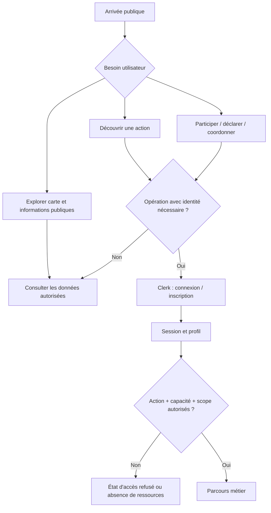
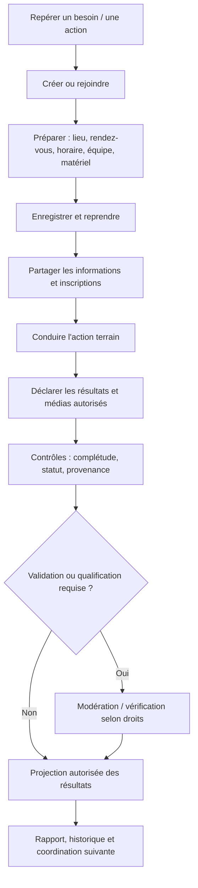
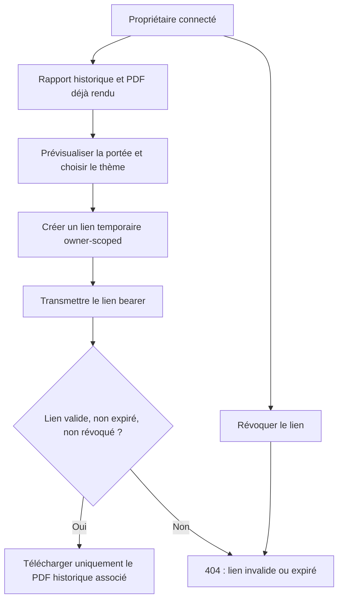
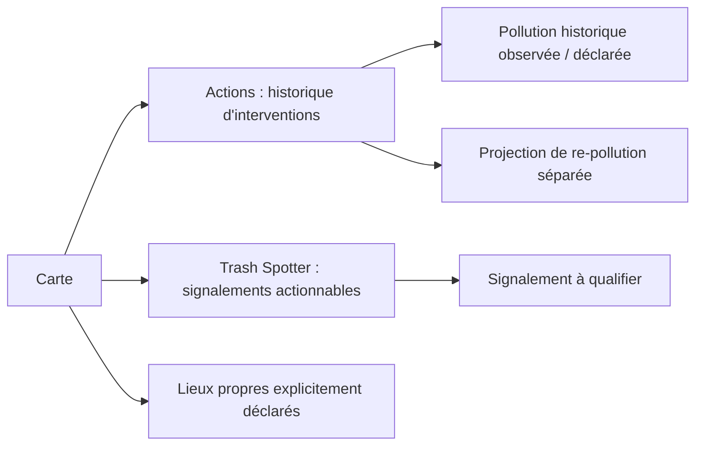
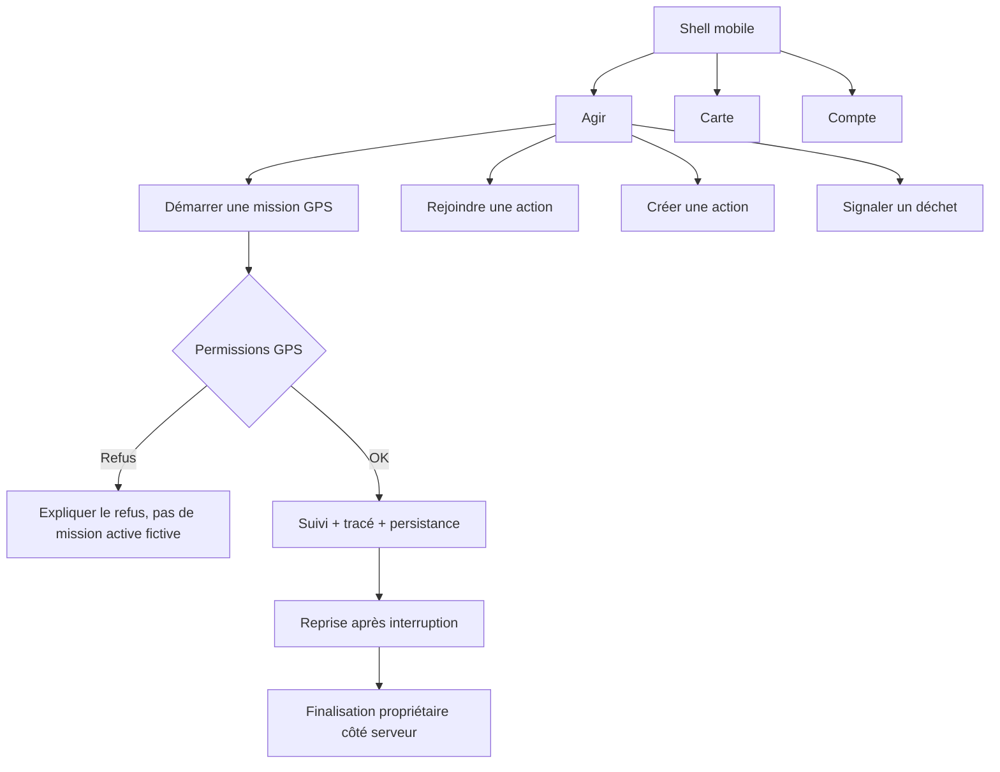

# APP-flow — Parcours applicatifs CleanMyMap

> **Type :** cartographie `CURRENT` des parcours UX web/mobile. Ce document
> traduit les contrats produit ; il ne remplace ni le registre route-first ni
> la matrice d'autorisation serveur.

## 1. Conventions et frontières

**CURRENT :** le web offre le parcours complet et le mobile propose une V1 terrain en développement. Le libellé d'un persona n'accorde aucun droit métier.

- `GRANTED_ROLE` : rôle accordé au compte.
- `ACTIVE_ROLE` : persona utilisé pour adapter l'interface et les capacités effectives.
- Relation organisationnelle ou territoriale : information métier persistée et vérifiée, jamais déduite du rôle.
- `scope` : ressource et périmètre qu'une opération peut affecter.
- Autorisation : décision **serveur** distincte de la navigation et du rendu.

La vérité des routes et de leur exposition est `documentation/pages_site/INDEX.md`. Les flèches ci-dessous décrivent des parcours logiques, pas un inventaire exhaustif de routes disponibles.

## 2. Entrée et navigation principales

**UX :** le produit montre ce qui est accessible et explique le prochain pas. Il ne considère jamais un écran masqué, un CTA désactivé ou le proxy web comme une décision d'AuthZ suffisante.

Le parcours ne promet pas les capacités encore `PLAN`, les bilans spécialisés
non disponibles ou les résultats sociaux non mesurés. Les extensions de
Rapports, Open Data et SPOGOMI restent soumises à leurs contrats spécialisés
et à leurs preuves propres.

## 3. Parcours cœur : action de dépollution

### États et sorties attendues

| Étape | État attendu | Échec / cas limite | Preuve indispensable |
|---|---|---|---|
| Préparation | Brouillon ou action existante reprenable | Fermeture d'onglet, modification concurrente | Sauvegarde réelle et absence d'écrasement |
| Inscription | Relation utilisateur/action persistée | Ressource indisponible, inscription impossible, doublon | Relation canonique, idempotence |
| Terrain | Instructions et coordination lisibles | Permissions GPS, couverture réseau, sécurité | Fallback approprié, message explicite |
| Déclaration | Mesures et informations préservées | Champ inconnu, zéro, géométrie partielle | Pas de zéro fabriqué, validation cohérente |
| Validation | Statut et visibilité cohérents | Acteur non autorisé, transition interdite | Refus effectif côté serveur |
| Restitution | Rapport attribuable et interprétable | Données partielles, snapshot périmé, export incomplet | Provenance, couverture et version méthodologique |

La liste de statuts persistés et les transitions exactes se lisent dans le code et les sources canonique Actions, non dans ce schéma de haut niveau.

### Partage d'un PDF historique (code CURRENT, état distant non attesté)

Le partage porte sur une variante `impact` ou `scientific` du PDF déjà généré, pas sur le JSON, CSV ni sur les données d'action sous-jacentes. La génération et la révocation exigent le propriétaire authentifié ; la consultation utilise un token bearer à durée limitée. Les tests de liens expirés, révoqués, erronés ou appartenant à un tiers sont des garde-fous. Le code et la migration sont publiés au SHA de référence, sans preuve ici de leur application et de leur fonctionnement en production.

## 4. Carte et signalements

Règles UX :

- Ne pas confondre la pollution constatée avant une action et son état actuel.
- Une projection ne devient jamais une observation en temps réel.
- Le vert de « lieu propre » ne signifie pas absence de donnée ou score faible.
- Montrer géométrie, confiance et origine lorsque cela change l'interprétation.
- Une fiche carte privée ou masquée ne doit jamais apparaître via un chemin de projection publique alternatif.

## 5. Parcours par persona

| Persona | Entrée utile | Suite logique | Restriction métier |
|---|---|---|---|
| Bénévole | Carte, action, formulaire | Participer, documenter, consulter historique | Opérations sur ses contributions et projections autorisées |
| Coordinateur | Action organisée, `/pilotage` | Planifier, mobiliser, suivre ses actions | Relations creator/organizer/coorganizer canoniques seulement |
| Entreprise | Partenariats, indicateurs publics, Sponsor | Étudier un engagement et des livrables | Aucune appartenance entreprise ni visibilité privée implicite |
| Élu | Cartographie, indicateurs publics | Explorer les informations du territoire si contrat | Aucun scope territorial sans attribution persistée |
| Scientifique | Méthodologie, rapports, Open Data | Étudier des données publiques/assainies | Aucun privilège sur données privées |
| Admin | `/admin` | Qualifier, modérer, superviser | Capacité et garde serveur propres aux opérations sensibles |

`/pilotage` n'est pas une vue globale attribuée au simple rôle admin. Un coordinateur sans ressource liée obtient un état vide, pas les données d'autres utilisateurs.

### Publics et responsabilités

Les publics secondaires (collectifs, associations, partenaires, scolaires et
structures de sensibilisation) peuvent entrer par les actions, les pages
`learn/ecole` ou `open-data`, mais une relation réelle à une structure ou à un
territoire doit être persistée et vérifiée. Les responsabilités restent
distinctes : citoyens et bénévoles signalent, participent et déclarent ; les
coordinateurs organisent et suivent ; les associations et entreprises sont des
structures externes reliées par contrat ; les élus n'exercent un pilotage
territorial que si un scope canonique existe ; l'équipe projet administre la
qualité et la modération.

Le portail Sponsor peut être proposé par l'UX aux parcours entreprise et élu,
mais son nom ne crée ni scope d'organisation ni scope territorial. Il ne montre
que les données que son contrat serveur autorise réellement.

## 6. Parcours mobile V1, développement actif

**Statut :** `NOT_PRODUCTION_READY`, et non une application publiquement distribuée de manière prouvée.

Le registre mobile prévoit d'autres destinations, mais seules `Agir`, `Carte` et `Compte` constituent la navigation primaire V1 décrite. Ne pas présenter les destinations planifiées comme implémentées.

### Cas de test mobile indispensables

1. Refus de permission GPS, mission active non créée artificiellement.
2. Démarrage interrompu après création technique : annulation/compensation conforme au code courant.
3. Perte de réseau et reprise sans duplication des points GPS.
4. Réouverture de mission propriétaire et refus d'accès à la mission d'autrui.
5. Finalisation via l'UPDATE autorisé ; distance/durée dérivées côté base et non injectées par le client.
6. Auth Clerk réelle, appareils physiques, background headless et distribution avant release.

## 7. État UX transversal

Tout flux sensible devrait rendre distinguables : initial, chargement, vide, données partielles, erreur, accès refusé, succès et reprise. Une « absence de données » ne doit pas être masquée par un faux zéro ou un écran silencieusement vide si le parcours attend une explication.

L'accessibilité s'applique aux libellés, clavier/focus sur web, lecteurs d'écran, contrastes, mouvement réduit, zones tactiles et Safe Area mobile. Le design system existant reste propriétaire de la présentation.

## 8. Validation et traçabilité

Pour chaque parcours modifié, rapprocher :

1. le cas d'utilisation de `parcours-utilisateurs.md` ;
2. la route exacte et son statut dans `pages_site/INDEX.md` ;
3. la garde de `authz-authn-regles.md` ;
4. le contrat de sortie Actions ou domaine concerné ;
5. les scénarios E2E positifs, négatifs et de reprise ;
6. la documentation spécialisée réellement concernée.

Les routes, transitions, labels et comportements non décrits par le code doivent rester `À VÉRIFIER`, jamais être inférés du dessin.
