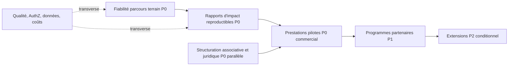

# Plan d'implémentation — CleanMyMap

> **Type :** plan `PLAN` d'exécution produit/technique. Aucune tâche n'est
> présumée exécutée sans preuve séparée ; les contrats runtime, juridiques et
> scientifiques restent propriétaires de leurs sources spécialisées.

## 1. Principe et ordre de priorité

Le projet dispose déjà d'un périmètre fonctionnel vaste. Le plan privilégie les parcours fiables, l'impact interprétable et les preuves de valeur avant l'expansion technique.



La publication du commit de référence inclut le partage de PDF historiques par lien temporaire et révocable. Cette fonctionnalité existe dans le code ; son déploiement et la migration en production ne sont **pas attestés** ici. Son chantier d'intégration fonctionnelle ne doit pas être redemandé à Codex sans défaut actuel démontré.

Le web est la surface complète. La V1 mobile est en développement actif mais **non prête pour production**. L'objectif du lot P0 n'est pas de transformer une capacité future en fonctionnalité supposée actuelle.

## 2. Jalons, livrables et conditions d'arrêt

| Lot | Priorité | Résultat attendu | Critères de clôture |
|---|---|---|---|
| I-01 | P0 | Parcours action complet et persistant | Création/reprise/participation/déclaration/finalisation vérifiées, erreurs et droits testés |
| I-02 | P0 | Restitution action fidèle et reproductible | Mesures et `NA` cohérents, provenance, génération/export sans donnée manquante silencieuse |
| I-02b | P0/P1 | Partage contrôlé du PDF historique déjà intégré au code | Expiration, révocation, owner-scoped et téléchargement bearer testés ; état migration/déploiement vérifié séparément |
| I-03 | P0 transverse | Accès et intégrité des données | AuthN/AuthZ/RLS validées aux frontières réelles, aucun accès inter-utilisateur indu |
| I-04 | P0 commercial | Preuve de valeur d'un livrable | Usage avec acteur réel documenté, sans présumer vente ou partenariat |
| I-05 | P0 parallèle | Cadre structurel et opérations | Choix juridiques, contrats et assurances traités selon décisions réellement prises |
| I-06 | P1 | Optimiser les requêtes coûteuses prouvées | Gain mesuré, parité des agrégats, aucune fuite ou troncature |
| I-07 | P1 | Prévisibilité des opérations d'export/sauvegarde | Pagination exhaustive, sauvegarde cohérente, restore inchangé |
| I-08 | P1 | Cohérence scientifique offline | Mesures manquantes non converties en observations nulles ; tests Pandas |
| I-09 | P1 | Convergence UX/UI des parcours utiles | Réutilisation des composants, accessibilité, états d'erreur et navigation |
| I-10 | P2 conditionnel | Release mobile V1 | Auth réelle, GPS/background, reprise, sécurité, validation physique et distribution prouvées |
| I-11 | P2 conditionnel | Amélioration CPU offline | Seulement après profilage et gain reproductible |
| I-12 | FUTURE | Entrepôt/analytique distribué | Un besoin, volume, coûts et règles de confidentialité démontrés avant tout choix |

L'ordre I-06 à I-08 est technique et ne remplace pas les STOP CONDITIONS et priorités globales de `roadmap-priorisee.md`.

## 3. Lots Codex bornés pour la qualité des données

### Lot A : exhaustivité des archives Actions

**Constat code :** `apps/web/scripts/export-actions-backup.mjs` charge les identifiants en chunks puis les relations ; `fetchRowsForIds` n'applique pas de pagination explicite aux résultats de chaque groupe.

**Décision :** rendre exhaustive et déterministe la lecture de chaque groupe, sans altérer le format `action-backup-contract.mjs` version 2 ni les règles de restauration.

**Travail local :** modifier seulement le chemin d'export et les tests directs/consommateurs nécessaires. Ajouter des cas dépassant 1 000 relations par lot d'identifiants, ordre stable, doublons, retour d'erreur et aucune archive « valide » en cas de lecture incomplète.

**STOP CONDITION :** l'intégralité des lignes attendues est dans le backup, les comptes cohérents et les tests exécutés passent. Pas de refonte du format de sauvegarde.

### Lot B : mesure de la charge SQL

**Chemins à diagnostiquer en priorité :**

- `apps/web/src/app/api/recycling/breakdown/route.ts` et `lib/recycling/breakdown.ts` : snapshot dérivé depuis des contrats Actions ; actuellement un `limit: 2000` est transmis au loader.
- `apps/web/src/app/api/reports/governance-monthly/route.ts` pour `quality=1` : revue mensuelle depuis le loader unifié, `limit: 2000`.
- `apps/web/src/lib/gamification/progression-ranking-batch.ts` : pages de 1 000 et groupes d'identifiants de 500, mais accumulation des résultats.

**Décision :** **diagnostic read-only d'abord**. Prouver durée, nombre de requêtes, volume transféré, capacité à représenter toute la population requise, mémoire et coût.

**STOP CONDITION :** rapport de trois chemins avec mesures ou limitations explicitement qualifiées ; identifier les corrections uniquement si parité et bénéfice sont démontrables. Aucune migration avant cette preuve.

### Lot C : agrégations PostgreSQL ciblées

**Condition d'ouverture :** lot B a montré une requête croissante et un agrégat dont l'équivalence métier peut être conservée.

**Décision :** réutiliser RPC, vues, index et snapshots existants. Déplacer les `WHERE`, `COUNT` et `GROUP BY` adaptés dans PostgreSQL. Ne pas reproduire approximativement le parsing des métadonnées scientifiques depuis `notes` si le contrat est actuellement propriétaire TypeScript.

**Preuves :** mêmes valeurs avant/après sur fixtures réalistes (incluant `NULL`, visibilité cachée, données historiques, statut, périmètre), mêmes permissions et projection API ; amélioration mesurée.

**STOP CONDITION :** gain démontré et parité maintenue, ou absence de modification si le calcul SQL serait inexact. Si une nouvelle RPC est nécessaire, migration append-only, tests RLS et revue des grants.

### Lot D : fiabilité de `maintenance/python`

**Constat code :** `maintenance/python/src/analytics.py` emploie Pandas ; `compute_advanced_kpis` convertit actuellement des valeurs non numériques ou manquantes en zéro pour certains agrégats.

**Décision :** séparer clairement absence de mesure et zéro observé, en tenant compte du statut legacy éventuel des consommateurs. Ne pas inventer de facteur scientifique et ne pas importer Python dans le runtime Next.js.

**Preuves :** DataFrames vides, `None`/NaN, zéro, dates invalides, valeurs négatives et couverture partielle ; justification documentée de tout changement de résultat.

**STOP CONDITION :** sémantique cohérente avec `SCIENTIFIC_PROTOCOL.md` et tests Python ; ou conservation explicitement justifiée d'un contrat historique non consommé.

### Lot E : benchmarking CPU offline

**Condition d'ouverture :** profilage d'un véritable traitement CPU-bound dans `maintenance/python`.

**Décision :** comparer séquentiel et `ProcessPoolExecutor`, coût de sérialisation, RAM, nombre de workers et déterminisme. Aucune parallélisation automatique des appels Supabase ou d'un serveur web.

**STOP CONDITION :** intégration seulement si un gain significatif reproductible justifie la complexité ; sinon ne rien modifier.

## 4. Priorités produit héritées et conditions d'arrêt

Les priorités produit ci-dessous sont conservées de l'ancienne roadmap parce
qu'elles décrivent des conditions de preuve, et non une liste de fonctionnalités
à construire automatiquement. Elles se rattachent aux lots I-01 à I-12 ci-dessus.

### P0 — Parcours bénévole et rapports

Le parcours terrain doit être prouvé de bout en bout sur `/actions/new` :
création, reprise, authentification tardive, changement de phase sans doublon,
résultats persistés et état final relu depuis la base. La chaîne média à vérifier
est `sélection → intent → upload → finalize → rattachement → relecture`, avec
retry, erreurs partielles et absence d'orphelins. La géométrie doit couvrir
itinéraire automatique, GPX, dessin manuel, boucle, point-à-point, fallback
estimé et export de la géométrie effectivement retenue. Les participants et
organisateurs doivent rester distincts : inscription future, présence finale,
attribution post-action et droits de modification sont des scénarios séparés.

Ces détails, repris de la roadmap désormais `HISTORY`, restent les critères
actifs du plan canonique ; ils ne créent pas un second moteur ni un second
parcours métier.

La clôture de ce P0 exige plusieurs scénarios réalistes avec persistance
vérifiée, dont un scénario mobile et un scénario d'erreur/reprise.

Le rapport d'impact doit rester un moteur unique et permettre :

```text
action admissible → scope single_action résolu côté serveur
→ aperçu → génération → historique / réexport du même snapshot
```

La génération, l'analyse, les snapshots, l'historique et les exports restent
les capacités du même moteur. Les niveaux `Concis`, `Par défaut` et `Exhaustif`
ne redeviennent des choix produit que s'ils produisent réellement des sorties
différentes ; sinon le contrat historique est conservé.

La reproductibilité doit conserver schéma, template, méthodologie, facteurs,
renderer et provenance. Les niveaux `Concis`, `Par défaut` et `Exhaustif` ne
doivent être proposés que s'ils produisent réellement des sorties différentes.
Le PDF vise plusieurs usages (bénévole, association, collectivité, partenaire,
recherche) sans masquer les proxys, la qualité, les méthodes ni les limites.

### P0 — Validation commerciale et structuration

La validation commerciale reste une hypothèse `PLAN` : une preuve nécessite un
besoin identifié, un périmètre écrit, une proposition acceptée, une prestation
livrée, le temps et les coûts, l'usage du livrable et, s'il existe, un signal de
réachat. Proposition, facturation, encaissement, soutien et financement sont
suivis séparément. Sans preuve de livrabilité ou de demande, conserver une
offre ponctuelle ou financée et ne pas construire de paywall.

La structuration associative, contractuelle et financière est parallèle au
runtime. Tant qu'aucune structure n'est effectivement constituée et qu'aucun
transfert n'est décidé, CleanMyMap reste porté par la personne physique
actuelle ; ne pas anticiper dans le site, les documents juridiques ou les
données un transfert d'actifs, de responsabilités ou de contrats.

### P1 — Territoires, communauté, messagerie et administration

Les programmes territoriaux et workflows partenaires ne s'ouvrent qu'après des
preuves P0, avec partenaire, périmètre, responsabilités, confidentialité et
provenance écrits. Une communauté déjà équipée doit d'abord être rendue lisible
et testée : ne pas recréer un réseau social, dupliquer la messagerie ou ajouter
des fils publics sans besoin démontré.

La messagerie existante (privé, communauté, territoire, action, annonces,
pièces jointes, recherche, pagination, notifications et exclusions) doit être
validée sur les accès, l'historique, les brouillons et le mobile avant toute
nouvelle capacité ; les sondages avancés restent différés. `/admin` doit
prouver la séquence refus anonyme → refus membre ordinaire → capacité admin/max
→ mutation auditée. `/dashboard` est à simplifier autour de la prochaine action
utile, tandis que `/reglages` reste correctif. Le formulaire bénévole doit
réduire la charge cognitive sans réécrire le produit : mobile first, un objectif
par écran, CTA stable, aide et erreurs contextualisées, unités explicites,
brouillon visible et distinction mesure/estimation.

Le compte, le dashboard et les profils restent un travail de recentrage sur
l'état courant, la prochaine action, les notifications et les préférences
utiles. La communauté, la messagerie et l'administration doivent d'abord être
validées sur leurs accès, leur modération, leur compréhension mobile et leurs
transitions sensibles avant toute extension fonctionnelle.

### P2 et P3 — Mobile, UX et extensions conditionnelles

Le mobile reste `CURRENT / ACTIVE DEVELOPMENT` et `NOT_PRODUCTION_READY`. Sa V1
reste courte : mission GPS, permission, carte/tracé, synchronisation, reprise,
flush et finalisation serveur. Background headless, `mission_actions`, appareils
réels et distribution sont des bloqueurs à lever ; aucune parité web/mobile,
messagerie, rapport ou gamification parallèle n'est visée.

Les abonnements, la facturation récurrente, les espaces multi-organisations et
les services professionnels avancés restent `FUTURE` : ils exigent d'abord une
preuve commerciale, juridique, économique et de sécurité explicite.

La convergence UX/UI cible les états `loading`, `empty`, `error`, `forbidden` et
`offline`, le responsive, clavier/focus, reduced motion, densité et impression,
sans refonte globale. Les campagnes multi-actions, usages institutionnels et
Open Data avancé, spécialisations `scientifique`/`entreprise`, partenariats
externes, abonnements et espaces multi-organisations restent conditionnels à un
besoin réel, une gouvernance des données, des coûts et une sécurité démontrés.

### Horizons, indicateurs et règle de décision

L'horizon de convergence donne priorité au parcours bénévole, au rapport d'une
action, aux pilotes de prestations, à la structuration, aux tests utilisateurs,
à la simplification Communauté/Dashboard et aux permissions de modération.
Les pilotes ultérieurs doivent produire des usages de rapports, des besoins
partenaires répétés, des données de complétion/rétention et un modèle économique
testé avant toute montée en échelle.

Les indicateurs suivent l'usage, la qualité des données, les rapports réellement
utilisés, la continuité communautaire, la structuration et la preuve commerciale
ou territoriale. Aucune cible numérique n'est ajoutée sans baseline observée,
owner, source et période.

Avant tout nouveau chantier : problème observé, fonctionnalité déjà présente,
source canonique, fiabilité de la donnée, coût de maintenance, surface
web/mobile/organisationnelle et contribution à la boucle cœur. La stop condition
globale reste :

```text
action réelle → données fiables → rapport exploitable
→ acteur qui l'utilise → valeur documentée → action suivante facilitée
```

## 5. Non-chantiers assumés

- **MongoDB :** pas de deuxième base métier ; PostgreSQL reste l'owner des données persistantes.
- **Spark :** pas de moteur distribué sans besoin de calcul distribué prouvé.
- **BigQuery :** envisager plus tard un entrepôt si sources externes, volumétrie, séparation analytique, coût, droit d'usage et sécurité le justifient.
- **Nouvelle abstraction générique d'agrégation :** aucune sans usages concrets multiples et absence de propriétaire existant.

## 6. Séquencement opérationnel

```text
1. Qualifier un besoin et un critère d'acceptation.
2. Lire le code CURRENT, les consommateurs, les tests et les règles scoped.
3. Fixer les invariants, cas interdits, métriques de preuve et STOP CONDITION.
4. Intégrer un lot focalisé ; éviter de lancer les autres lots en parallèle lorsqu'ils partagent une RPC, migration ou contrat.
5. Valider sur le candidat local : tests ciblés, qualité, build et DB isolée selon le risque.
6. Commit/push par Codex suivant MAIN-ONLY / MULTI-WRITER COORDONNÉ.
7. Relire la publication sur main ; comparer résultats et conditions d'arrêt.
8. Clore ; ne pas créer de nouvelle tâche pour une dette périphérique non bloquante.
```

**Répartition :** ChatGPT conçoit la correction et fournit les contrats/prompt bornés. Codex confronte au checkout, intègre, étend les tests, exécute les validations et publie suivant la gouvernance. Les rapports d'exécution Codex ne remplacent pas la revue indépendante.

## 7. Exigences minimales pour tout lot

- Au moins un scénario nouveau et pertinent protégeant l'invariant réellement modifié.
- Tests positifs, négatifs et limites proportionnés : `NULL`, zéro, donnée masquée, usager étranger, doublon, pagination, concurrent, ancien enregistrement si applicable.
- Documentation canonique mise à jour seulement en cas de changement durable.
- Aucune nouvelle table, RPC, index, dépendance ou plateforme sans preuve de nécessité.
- Aucune mutation de production implicite pour valider.
- Bilans distinguant `TEST_PRÉSENT`, `TEST_EXÉCUTÉ`, `TEST_PASSÉ`, `GATE_PASSÉ`, `MIGRATION_APPLIQUÉE` et `RUNTIME_OBSERVÉ`.
- Si le code publié satisfait le critère, ne pas générer automatiquement un prompt de correction.

## 8. Livrables de suivi et points de décision

| Livrable | Contenu minimal | Autorité |
|---|---|---|
| PRD | Besoin, objectifs, acteurs et critères de réception | `vision-et-objectifs.md`, `roadmap-priorisee.md` |
| TRD | Contraintes architecture, sécurité, données, tests | `master-architecture.md` et contrats spécialisés |
| APP-flow | Flux, états, parcours et droits UX distincts | `parcours-utilisateurs.md`, `pages_site/INDEX.md` |
| Design system | Usage des primitives et tokens existants | `design-system/README.md` et contrats spécialisés |
| Schéma back-end | Familles de tables, liens et frontière SQL | Migrations `apps/web/supabase/migrations/`, `data-governance.md` |
| Plan | Séquencement et STOP CONDITIONS | `roadmap-priorisee.md` |

**Revue de plan :** si la dernière version de `main` a déjà intégré un chantier, supprimer son étape d'intégration. Si une estimation ne repose pas sur des données de workload, elle reste hypothétique. Aucun résultat de test ni état distant ne doit être inventé.

## 9. Références

- `documentation/product/roadmap-priorisee.md`.
- `documentation/product/vision-et-objectifs.md`.
- `documentation/product/SCIENTIFIC_PROTOCOL.md`.
- `documentation/database/supabase-table-optimization-playbook.md`.
- `documentation/operations/platform-cost-governance.md`.
- `documentation/development/TESTING.md`.
- `documentation/security/authz-authn-regles.md`.
- `apps/web/scripts/export-actions-backup.mjs`.
- `apps/web/src/app/api/recycling/breakdown/route.ts`.
- `apps/web/src/app/api/reports/governance-monthly/route.ts`.
- `apps/web/src/lib/gamification/progression-ranking-batch.ts`.
- `maintenance/python/src/analytics.py`.
- `documentation/features/reports/report-pdf-themes-and-reuse.md`, `apps/web/supabase/migrations/20261018000002_report_generation_pdf_shares.sql`.
