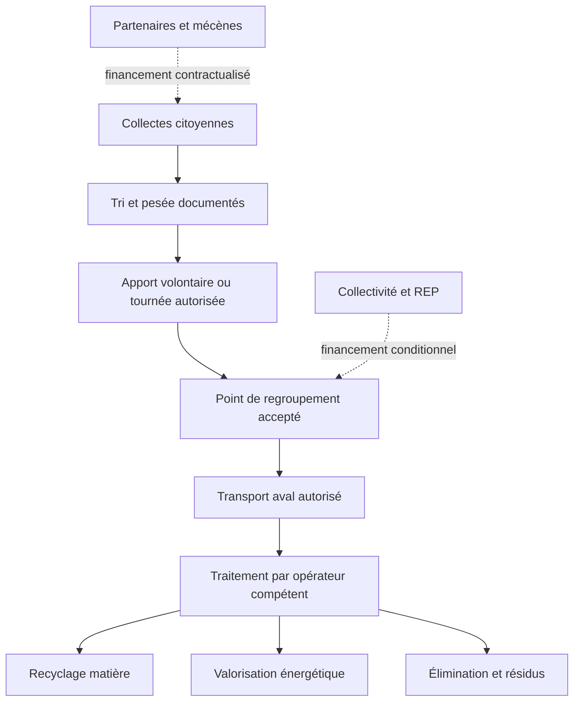

# Valorisation des mégots issus des cleanwalks parisiennes

> **Statut : PLAN / RESEARCH / NON NORMATIF.** Étude de faisabilité et dossier de décision, 27 novembre 2026.
> Périmètre : quelques dizaines de kilogrammes par an, collectés séparément lors d'actions citoyennes à Paris ; mutualisation jusqu'à 100 kg et recherche universitaire conditionnelle.
> Aucun partenariat, tarif contractuel, financement, recyclage effectué, autorisation de stockage ou résultat expérimental n'est acquis par ce document.

## 1. Objectif et arbitrage

Permettre aux associations de dépollution de remettre leurs mégots à une filière de traitement traçable, sans supporter un coût disproportionné, idéalement sans décaissement. Distinguer une filière opérationnelle de court terme d'un projet scientifique de moyen terme. Préserver la prévention du tabagisme et de l'abandon des mégots : la filière ne doit pas inciter à produire de nouveaux déchets.

Trois axes complémentaires :

1. **Traitement à coût nul ou faible** : reprise associative, intégration à un circuit municipal existant, massification autorisée et financement REP tabac.
2. **Financement du service environnemental** : partenariats, mécénat, conventions, crédits plastique proposés par le Mégothon ; pas de présomption de valeur marchande du déchet.
3. **Recherche locale** : FabLab de Sorbonne Université et laboratoires compétents, pour tester une voie de valorisation sûre et en évaluer le coût complet.

Décision proposée : commencer par une filière existante, chercher un accord écrit pour les petits volumes, puis expérimenter une tournée mutualisée si elle répond à un besoin réel. La recherche universitaire ne doit pas retarder l'évacuation des stocks associatifs. Ne pas développer de module logiciel dédié ou acquérir une installation de traitement avant validation du besoin, de la sécurité et du financement.

Ce dossier approfondit le volet mégots de [l'ambition territoriale parisienne](./ambition-territoriale-paris.md). Les données publiques sur les acteurs et relations relèvent de leurs owners existants dans l'annuaire ; ce document ne constitue ni un second registre runtime ni une nouvelle roadmap. Les méthodes de comptage et les proxys restent gouvernés par le [protocole scientifique](./SCIENTIFIC_PROTOCOL.md). Le [modèle économique](./business-model.md) et la [politique juridique](../legal/README.md) gouvernent les conventions et recettes éventuelles.

### Niveaux de preuve

| Statut | Sens dans cette étude |
| --- | --- |
| DOCUMENTED | Information publiée par un acteur ou une source identifiable, pas nécessairement auditée indépendamment |
| HISTORICAL | Preuve datée, qui ne démontre pas la disponibilité en 2026 |
| ASSUMPTION | Hypothèse de calcul ou cible proposée |
| DERIVED | Calcul reproductible à partir d'entrées explicites |
| NOT_PROVEN | Absence de confirmation suffisante ; ne pas présenter comme acquis |

Les prix historiques ne sont pas des devis actuels. Les offres publiques ne prouvent ni un marché signé ni un traitement effectif. Les sources web ont été consultées ou recherchées le 27 novembre 2026 ; certains documents PDF ont été accessibles uniquement via leur texte indexé, sans vérification visuelle complète.

## 2. Quantités, stockage et chaîne de responsabilité

### Contexte parisien et toxicité : limites des chiffres

La Ville de Paris estime en 2025 que 4 à 5 millions de mégots sont jetés chaque jour dans ses rues, pour un coût annuel d'environ 10 millions EUR. Son communiqué de presse évoque également 4 à 5 millions de mégots ramassés quotidiennement par les agents. Ces estimations ne constituent pas un bilan entrée/sortie cohérent : aucun taux de collecte de 50 % ni volume résiduel ne peut en être déduit. Le coût municipal est un coût de propreté, non un prix de recyclage. [S7]

L'ADEME indique que les mégots jetés à la poubelle suivent la filière des ordures ménagères (incinération ou stockage) ; ils ne sont pas destinés au bac de tri conventionnel. Privilégier une filière spécialisée lorsqu'elle est accessible et accepte le flux. La toxicité ne signifie pas une interdiction générale des ordures ménagères ; la classification d'un lot séparé et ses obligations spécifiques doivent être vérifiées. [S34]

Slaughter et al. (2011) ont observé une concentration létale médiane (CL50) proche d'un mégot fumé avec reste de tabac par litre pour deux espèces de poissons, dans leurs conditions expérimentales ; les filtres fumés sans tabac présentaient des CL50 différentes. Roder Green et al. (2014) estiment que la nicotine libérée par un mégot peut porter jusqu'à 1 000 L d'eau au-delà d'une concentration prédite sans effet (PNEC) de 2,4 µg/L. Ce résultat dépend du relargage, du seuil et des hypothèses de dilution ; il ne mesure pas un volume d'eau effectivement pollué dans la nature. [S35, S36]

Le repère de communication de 500 L/mégot relayé par Paris reste un proxy de risque, pas une mesure écologique universelle. Le protocole scientifique CleanMyMap conserve son facteur conventionnel et ses limites ; cette étude ne change ni le facteur runtime ni les rapports d'impact. Ne pas remplacer le proxy par 1 000 L/mégot ni additionner ces deux chiffres. [S1, S7, S36]

### 2.1. Ordres de grandeur

Pour les conversions, reprendre uniquement les facteurs versionnés du protocole scientifique CleanMyMap : 0,22 g par mégot propre (proxy sec), 0,50 g par mégot humide et 0,90 g par mégot mouillé (proxy théorique provisoire), selon la version impact-terrain-2026-butts-mass-v3 ; 600 mégots/L (cleanmymap-butts-volume-v3). Les versions antérieures, dont 700 mégots/L (v2), restent historiques. Une pesée nette effective est préférable pour un seuil contractuel. Le poids du contenant doit être déduit. Les variations d'humidité, de tassement, de papier, de tabac et d'impuretés interdisent d'assimiler ces conversions à une densité mesurée.

| Masse nette | Nombre estimé sec | Volume sec | Nombre estimé humide | Volume humide | Nombre estimé mouillé | Volume mouillé |
| ---: | ---: | ---: | ---: | ---: | ---: | ---: |
| 10 kg | 45 455 | 76 L | 20 000 | 33 L | 11 111 | 19 L |
| 20 kg | 90 909 | 152 L | 40 000 | 67 L | 22 222 | 37 L |
| 30 kg | 136 364 | 227 L | 60 000 | 100 L | 33 333 | 56 L |
| 50 kg | 227 273 | 379 L | 100 000 | 167 L | 55 556 | 93 L |
| 100 kg | 454 545 | 758 L | 200 000 | 333 L | 111 111 | 185 L |

Formules : N = 1 000 × masse_kg / masse_unitaire_g ; V_L = N / 600. Arrondis à titre de dimensionnement, pas de nouvelle règle runtime. Une consultation ALCOME de 2022 évoquait environ 1 000 L pour 100 kg (50 cendriers de 20 L) : il s'agit d'un autre repère opérationnel, non d'une contradiction à résoudre en choisissant arbitrairement une densité. Mesurer les contenants réels avant toute réservation de véhicule. [S1, S2]

À 30 kg/an, un seul groupe mettrait environ 40 mois à atteindre 100 kg ; quatre groupes à 30 kg/an atteindraient théoriquement le seuil en 10 mois. À 5, 10, 20, 25 et 50 kg/mois mutualisés, le seuil correspond respectivement à 20, 10, 5, 4 et 2 mois. Les délais réels dépendent des volumes admissibles et des capacités de stockage ; ne pas attendre le seuil si le stockage devient inadapté.

### 2.2. Séparer les opérations

Ne pas confondre collecte, remise, admission, massification, recyclage matière, valorisation énergétique et élimination. Un bordereau de collecte ne prouve pas à lui seul le traitement final. Un filtre décontaminé n'est pas automatiquement un produit commercialisable.

### 2.3. Sécurité et conformité

L'INERIS a étudié en 2017 puis 2019 la dangerosité des mégots collectés séparément : contaminants organiques (dont nicotine et HAP), métaux, résidus de combustion. Traiter ce flux comme potentiellement dangereux et faire confirmer sa classification et les obligations applicables par l'opérateur et le responsable sécurité. [S3, S4]

- Ne pas entreposer des stocks dans un domicile, un lieu public ou un atelier non autorisé ; obtenir l'accord du gestionnaire pour un emplacement adapté, sécurisé, au sec et compatible avec les exigences de prévention incendie.
- Collecter des mégots éteints, séparer les autres déchets et éviter toute manipulation, lavage, broyage, chauffage ou séchage expérimental hors protocole institutionnel validé. Ne jamais rejeter les eaux de lavage ou résidus dans l'environnement.
- Demander au destinataire ses spécifications écrites : type et volume de contenants, état des mégots, taux d'impuretés, pesée, fermeture, stockage, durée de conservation et critères de refus.
- Vérifier le régime de transport (déclaration éventuelle, classification transport et ADR le cas échéant, conditionnement, assurance, acceptation du transporteur), le régime du site et la traçabilité réglementaire applicable, notamment les bordereaux et Trackdéchets si requis. Ne pas présumer qu'un petit lot, un vélo ou un colis postal exonère de toutes les obligations.
- Éviter les dépôts anonymes dans les cendriers municipaux, déchèteries, locaux associatifs, entrepôts ou FabLab sans accord ; prévoir un exutoire de secours autorisé.
- Les responsabilités des producteurs/détenteurs, collecteurs, transporteurs et destinataires doivent être précisées avant le premier transfert. Aucun avis juridique définitif n'est donné ici.

## 3. Filières existantes et options à coût nul

| Acteur / piste | Preuve et rôle | Coût cible pour l'association | Limites et prochaine action |
| --- | --- | --- | --- |
| Cérium via World Cleanup Day France | DOCUMENTED : WCD annonce la reprise gratuite sans délai garanti | 0 EUR pour reprise, stockage éventuellement à charge | Confirmer existence opérationnelle, couverture Paris, délai, minimum, exutoire, nature du traitement et preuve de fin de vie |
| Mairie du 9e arrondissement | HISTORICAL : conseil du 22/05/2023, environ 150 kg/an envoyés à MéGO!, 200 cendriers | 0 EUR si intégration acceptée | Demander si circuit toujours actif, quel site peut admettre les mégots ramassés au sol et qui finance |
| Ville de Paris / DPE / ALCOME | DOCUMENTED : soutien aux communes et option d'enlèvement des lots massifiés | 0 EUR pour fin de vie admissible, amont potentiellement payant | Accord municipal, conditions contractuelles, point de regroupement et prestataire à confirmer |
| Recyclop / Proxy Mégot | DOCUMENTED : récupération gratuite dans un réseau local partenaire, orientation énergétique | 0 EUR si réseau accessible | Modèle documenté à Marseille ; desserte francilienne, partenariat ou relais local NOT_PROVEN |
| World Cleanup Day / Mégothon | DOCUMENTED : partenaires et points d'apport selon campagnes | Gratuité possible | Vérifier calendrier 2027, volumes acceptés, reprise hors événement, destination finale |
| CKFD Environnement | DOCUMENTED : regroupement à Gennevilliers et filière bretonne | Sur devis, négociation possible | Faire confirmer admission des lots citoyens, éventuelle reprise à coût marginal ou mécénat |
| Carton Plein Cyclo | DOCUMENTED : cyclologistique et insertion ; HISTORICAL : prestation mégots pour CKFD | Sur devis | Intégration aux tournées, desserte Gennevilliers, capacité utile et autorisation du flux |
| MéGO! | DOCUMENTED : transformation de filtres en plaques et objets | Sur devis | Demander reprise directe, prix à 10/30/50/100 kg et retrait ou dépôt |
| TchaoMegot | DOCUMENTED : offre de recyclage matière en isolant | Sur devis | Comparer même masse, volume, fréquence, minimum, transport et traitement |
| Cy-Clope | DOCUMENTED : valorisation via filières spécialisées | Sur devis | Chercher une tournée existante francilienne et tarif d'apport mutualisé |
| ÉcoMégot / Keenat | DOCUMENTED : offre de collecte et valorisation | Sur devis | Demander exutoire et part matière/énergie réellement prévue pour ce lot |
| Tree6clope | DOCUMENTED : partenaire WCD, collecte et valorisation | À négocier | Zone, petits volumes, coût et exutoire à confirmer |
| Valomégo | Piste historique issue de recherches antérieures, non revalidée | Inconnu | Identifier opérateur actuel avant toute recommandation |
| TerraCycle | Filière de recyclage citée dans l'étude INERIS 2019 | Inconnu | Aucun programme français gratuit et accessible aux associations confirmé |

Sources : [S3, S5–S14]. La gratuité pour Cérium et Proxy Mégot est une annonce de leurs dispositifs, pas une garantie d'accès à Paris. Les circuits matière et énergie ne sont pas interchangeables ; choisir selon la sécurité, la destination réelle, les coûts et les impacts comparés plutôt que sur un label seul.

### 3.1. Carton Plein + CKFD + MéGO!

En 2018, CKFD documentait une collecte des mégots de magasins Franprix à Paris confiée à Carton Plein pour les rotations urbaines. CKFD décrit aujourd'hui sur son site un entrepôt de regroupement à Gennevilliers (92) et un acheminement vers une filière bretonne de dépollution et fabrication de plaques d'acétate de cellulose. Carton Plein Cyclo présente une activité de collecte et livraison à vélo portée par une entreprise d'insertion. [S8–S10]

Ce précédent rend plausible un partenariat. Il ne démontre pas que les anciennes tournées sont encore actives, que les mégots associatifs sont acceptés ni que CKFD est l'opérateur sélectionné par ALCOME pour Paris. Gennevilliers est un hub, pas le centre de recyclage final.

Modèles à chiffrer :

- Apport direct volontaire chez CKFD, si accepté ; aucun cargo dédié.
- Intégration à une tournée existante : viser un prix marginal par arrêt ou contenant.
- Tournée interassociative dédiée : regrouper géographiquement les points, mesurer le volume et la charge utile, éviter les retours à vide et les manutentions inutiles.
- Dépôt au point municipal désigné par la Ville : le prestataire aval dépend du contrat municipal, sans imposer CKFD.
- Mécénat en nature de transport ou de traitement : valoriser séparément la contribution et les coûts réellement supportés.

Le transport à vélo constitue un levier social et local, pas une preuve de réduction nette de CO2 sans comparaison de trajets et de charge. Relever les heures d'insertion effectivement réalisées avec l'opérateur, sans extrapoler des emplois créés.

### 3.2. ALCOME et la responsabilité élargie des producteurs

ALCOME est l'éco-organisme de la REP des produits du tabac. Ses soutiens prévoient, pour les collectivités contractualisées ayant choisi cette option, une reprise à partir de 100 kg massifiés ; il sélectionne les prestataires via consultation. La Ville de Paris a publié en 2025 un plan mégots qui prévoit notamment un soutien aux nettoyages participatifs et des actions avec ALCOME. [S2, S6, S7, S15]

Questions déterminantes :

- Les mégots ramassés au sol par des bénévoles peuvent-ils rejoindre le flux de cendriers de rue de la Ville, au regard du contrat en vigueur ?
- Le seuil porte-t-il sur un point de regroupement unique et quel état/conditionnement est admissible ?
- Quel point parisien est autorisé à recevoir des lots de 5 à 30 kg ? Qui tient la pesée et les documents ?
- Le soutien financier municipal peut-il couvrir une tournée ou une reprise associative ? Existe-t-il un circuit de collecte des petits lots sans attente ?
- Quel est le prestataire aval sélectionné pour Paris et son mode de traitement (matière, énergie, élimination) ? Quelle preuve fournit-il ?
- La fin de vie est-elle effectivement sans facturation au déposant et qui supporte stockage, refus et frais accessoires ?

L'option 100 kg ne garantit pas le recyclage matière. Ne pas additionner une prise en charge ALCOME et un devis de traitement privé si ces prestations se recouvrent. L'accord de la collectivité et le contrat applicable restent requis. La consultation 2024-2025 n'atteste pas le marché 2026-2027.

## 4. Comparaison économique : 30 et 100 kg

### 4.1. Repères historiques et hypothèses

- Cyclologistique : le livre blanc 2026 des Boîtes à Vélo présente un repère de chiffre d'affaires horaire plancher de 35 à 50 EUR par livreur. Ce n'est pas un tarif Carton Plein. Hypothèse HT de simulation : 4 h × 35–50 = 140–200 EUR ; 2 h = 70–100 EUR. Temps d'arrêt, accès, charge, distance, nombre de vélos, manutention et flux spécial peuvent augmenter le devis. [S16]
- MéGO! : rapport INERIS 2019, référence de 10 EUR/kg, périmètre transport non précisé. Biotop publiait en 2019 un prix de traitement de 19 EUR/kg auquel s'ajoutait la logistique. Ce sont des repères historiques distincts, non une fourchette de marché 2026 garantie. L'INERIS signalait aussi des ordres de grandeur historiques pour l'énergie inférieurs à ceux du recyclage matière, variables selon les flux et opérateurs. [S3, S17]
- TchaoMegot : un devis communal 2025 (Beauchamp) mentionne 140 EUR HT/mois, 1 680 EUR HT/an, et 280 EUR HT par 25 L de dépassement. Offre spécifique à ce client, pas un tarif universel. Le repère de 360 EUR évoqué pour une offre associative reste non documenté (volume, durée, taxes et traitement inconnus). Ne pas supposer qu'il couvre 100 kg. [S18]
- Hypothèses budgétaires, non devis : conditionnement 30–100 EUR HT ; massification et transport aval mutualisés 80–200 EUR HT ; expédition directe conforme 150–300 EUR HT. Les minima et coûts réels des déchets dangereux peuvent être supérieurs. Pas d'envoi postal ordinaire sans acceptation écrite.
- TVA supposée 20 % sur toutes les prestations à seule fin de comparaison ; vérifier régime applicable. Une association non récupératrice raisonne en décaissement TTC. Un montant gratuit pour elle peut représenter un coût réel supporté par un tiers.

### 4.2. Simulation des prestations intégrales sans subvention

| Poste HT | Cargo + CKFD, 30 kg | Direct MéGO!, 30 kg | Cargo + CKFD, 100 kg | Direct MéGO!, 100 kg |
| --- | ---: | ---: | ---: | ---: |
| Collecte locale dédiée, 4 h | 140–200 | 0 | 140–200 | 0 |
| Conditionnement | 30–100 | 30–100 | 30–100 | 30–100 |
| Hub/aval ou expédition directe | 80–200 | 150–300 | 80–200 | 150–300 |
| Traitement, proxy 10–19 EUR/kg | 300–570 | 300–570 | 1 000–1 900 | 1 000–1 900 |
| Total HT | 550–1 070 | 480–970 | 1 250–2 400 | 1 180–2 300 |
| **Total TTC indicatif** | **660–1 284** | **576–1 164** | **1 500–2 880** | **1 416–2 760** |

Hypothèse simplificatrice : les coûts fixes sont identiques à 30 et 100 kg ; les tournées réelles et la logistique aval ne suivent pas nécessairement ce modèle. Le repère bas INERIS pourrait déjà contenir du transport : l'ajout logistique peut alors surestimer le coût. Si un devis inclut emballage, enlèvement ou traitement, supprimer ces postes de la simulation au lieu de les facturer deux fois.

Le coût central (milieu arithmétique) pour 100 kg est de 2 190 EUR TTC avec cargo et 2 088 EUR TTC en direct. Ce n'est ni une prévision de prix ni une comparaison statistique : les fourchettes se recouvrent. Pour 30 kg les coûts fixes pèsent davantage au kilogramme. Le transport dédié n'est rationnel que s'il apporte un avantage opérationnel ou social mesurable, ou s'il est financé.

### 4.3. Sensibilité TchaoMegot

Si, et seulement si, 360 EUR TTC correspond à un forfait renouvelable par volume et si la tarification est linéaire par lots entiers :

| Volume hypothétique compris | 30 kg secs (227 L) | 100 kg secs (758 L) |
| ---: | ---: | ---: |
| 25 L | 10 × 360 = 3 600 EUR | 31 × 360 = 11 160 EUR |
| 60 L | 4 × 360 = 1 440 EUR | 13 × 360 = 4 680 EUR |
| 100 L | 3 × 360 = 1 080 EUR | 8 × 360 = 2 880 EUR |
| 100 kg (hypothèse alternative) | 360 EUR | 360 EUR |

Les exemples ne décrivent aucune offre confirmée. Le repère de 0,015 EUR/mégot évoqué lors des recherches précédentes n'a pas été revalidé et n'entre pas dans le comparatif. Demander à TchaoMegot les plafonds annuels, frais d'enlèvement, cadence, durée du contrat, volume utile, tarif associatif et coût additionnel. Comparer sur les mêmes lots pesés et la même destination (matière ou énergie). Si un devis est par contenant, calculer le nombre entier de contenants requis et non un simple prorata.

### 4.4. Scénarios financés et mutualisés

| Solution | Décaissement associatif cible | Condition |
| --- | --- | --- |
| Reprise Cérium / Proxy Mégot | 0 EUR + coûts propres éventuels | Admission et desserte confirmées |
| Apport au circuit municipal existant | 0 EUR + apport éventuel | Accord écrit sur le flux et le point d'apport |
| Cargo avec fin de vie financée par ALCOME | 168–240 EUR TTC pour 4 h, hors emballage/stockage | Tournée suffisante et prise en charge aval confirmée |
| Cargo + emballage + fin de vie financée | 204–360 EUR TTC, hors stockage | Hypothèses 140–200 + 30–100 EUR HT |
| Cargo et traitement intégralement financés | 0 EUR | Financement écrit de chaque poste |
| Dépôt direct CKFD | Sur devis | Accès, traitement, emballage, responsabilités |
| Énergie locale via opérateur autorisé | Sur devis ou reprise gratuite | Évaluer preuve, proximité, traitement effectif |

Une tournée trimestrielle dédiée à 140–200 EUR HT représente 560–800 EUR HT/an, soit 672–960 TTC. Pour 2, 5, 10 ou 20 associations se partageant à parts égales, cela donne respectivement 336–480, 134,40–192, 67,20–96 et 33,60–48 EUR TTC/an par association, hors autres postes. Préférer un partage transparent selon les volumes, arrêts ou convention si les contributions diffèrent.

Calcul général : coût complet = matériel + collecte + stockage + manutention + transport aval + traitement + gestion des résidus + traçabilité + assurance/administration + temps valorisé. Décaissement net = dépenses payées par l'association − financements encaissés affectables. Ne pas assimiler temps bénévole et argent encaissé, ou subvention annoncée et trésorerie.

## 5. Financement et valorisation économique

### 5.1. Rachat des mégots bruts

Aucun débouché de rachat français au kilogramme pour les mégots bruts associatifs n'a été confirmé dans cette recherche. Une matière récupérable n'est pas une matière première gratuite : tri, décontamination, analyses, gestion des effluents, transport et pertes coûtent de l'argent. Éviter toute collecte motivée par la rémunération du déchet ou par le nombre de cigarettes fumées.

### 5.2. Crédits Plastique Mégots (CPM) du Mégothon

Le Mégothon 2026 (semaine nationale du 23 au 30 mai) a publié une offre de certificats de financement de quantités collectées pendant sa campagne. Le site identifie l'association LOPP comme éditeur dans ses CGU. Le dispositif annonce une comptabilisation, un audit et une traçabilité par blockchain, puis l'émission de certificats datés/numérotés. L'offre est destinée aux particuliers et entreprises. [S19–S21]

| Certificat annoncé | Masse | Prix affiché |
| --- | ---: | ---: |
| Découverte | 100 g | 10 EUR |
| Citoyen | 200 g | 20 EUR |
| Engagé | 500 g | 50 EUR |
| Certifié | 1 kg | 100 EUR |
| Impact | 5 kg | 500 EUR |
| Fondateur | 10 kg | 1 000 EUR |

Le tarif par masse est de 100 EUR/kg. Ce n'est pas le prix de rachat du déchet, ni un crédit carbone, ni une garantie de compensation d'une pollution, ni une preuve d'éligibilité réglementaire ou de conformité CSRD. L'achat finance une action. Le site indique que les certificats doivent correspondre aux quantités réellement collectées, avec remboursement du solde ou report proposé si les volumes sont insuffisants.

La page annonce 20 % de frais de gestion et présente 80 % comme base potentielle du mécénat. Le financement de l'édition suivante et des projets associatifs est présenté dans la FAQ. Le partage réel entre les associations, la plateforme et les frais de projet, le nombre de ventes, les certificats effectivement émis, l'identité de l'auditeur indépendant, le registre consultable, la reconduction 2027 et l'éligibilité des collectes hors campagne restent NOT_PROVEN.

| Masse admissible et entièrement financée (hypothèse) | Financement brut au tarif 2026 | 20 % frais annoncés | Solde théorique 80 % avant affectation |
| ---: | ---: | ---: | ---: |
| 10 kg | 1 000 EUR | 200 EUR | 800 EUR |
| 30 kg | 3 000 EUR | 600 EUR | 2 400 EUR |
| 50 kg | 5 000 EUR | 1 000 EUR | 4 000 EUR |
| 100 kg | 10 000 EUR | 2 000 EUR | 8 000 EUR |

Aucun de ces soldes n'est une recette garantie pour l'association qui a ramassé les mégots. Si une fraction p du solde lui est contractuellement reversée, sa recette théorique est 80 × masse_admissible_kg × fraction_vendue × p ; chacun des facteurs doit être prouvé. Par exemple 30 kg, 50 % vendus, 50 % du solde reversé = 600 EUR, avant coûts. Le modèle ne prévoit pas une vente multiple du même kilogramme.

Fiscalité : la plateforme illustre 1 000 EUR versés, 800 EUR potentiellement éligibles, réduction de 60 % sur cette base (480 EUR), soit 520 EUR après réduction sous conditions. Vérifier le statut du bénéficiaire, les contreparties, les plafonds légaux et la validité du reçu ; aucune réduction automatique ne doit être promise par CleanMyMap.

Points de vigilance scientifique : la page annonce également un prix par mégot et des équivalents de nombre et d'eau qui ne sont pas nécessairement cohérents entre eux. Par exemple 4 357 mégots/kg et 0,02 EUR/mégot donnent environ 87,14 EUR/kg, et non 100. Utiliser le prix effectivement affiché par masse, sans reprendre les équivalents d'impact comme mesures. Le certificat de collecte ne prouve ni une dépollution de l'eau mesurée, ni le recyclage matière : les règles de collecte prévoient une solution de repli si aucun point d'apport n'est disponible. La blockchain ne garantit pas la justesse des données d'entrée, l'additionnalité ou l'absence de double revendication sans contrôle de gouvernance.

Questions au Mégothon : collectes hors semaine et stocks antérieurs admis ? Qui valide les pesées ? Comment suivre chaque lot ? Quel droit de retrait ou d'audit ? Quelle part revient aux groupes locaux, selon quelles modalités et quel calendrier ? Peut-elle financer les coûts de traitement ? Quelle preuve de traitement final ? Quels résultats de ventes et reversements 2026 sont publiables ? Le registre prévient-il les doubles revendications entre partenaires et territoires ? Quels frais et conditions de remboursement ? Reconduction 2027 ?

Priorité : partenariat avec le dispositif existant si son contrat est transparent et compatible, pas de création prématurée d'un crédit concurrent.

### 5.3. Mécénat, prestations et collectivités

- Mécénat d'entreprise : financement d'un programme de collecte, logistique et restitution, avec convention et contreparties compatibles avec l'éligibilité fiscale réelle.
- Parrainage ou prestation RSE : prix et livrables définis, fiscalité et responsabilité contractuelle propres ; éviter de présenter une prestation publicitaire comme un don.
- Soutien de collectivité : matériel, point d'apport, transport ou convention de programme selon la compétence et les règles de financement public.
- Contributions en nature : créneau de tournée, contenants, espace autorisé, analyse de laboratoire ou traitement ; comptabilisation séparée de la trésorerie.
- R&D : financement affecté à l'étude scientifique, qui ne constitue pas une recette commerciale récurrente du traitement.

Exemple ASSUMPTION : partenaire 1 000 EUR/an pour 30 kg, matériel 100 EUR, logistique 150 EUR, traitement pris en charge par une filière partenaire = 750 EUR de solde de trésorerie avant frais administratifs, assurance, temps, fiscalité et autres charges. Si le traitement coûte 600 EUR TTC, le solde tombe à 150 EUR. Un excédent associatif n'est pas un profit distribuable ; affectation conforme aux statuts et conventions. Ne pas cumuler deux financements affectés à la même dépense sans accord ni compter deux fois le même impact.

CleanMyMap est un outil et un projet, pas une preuve d'association constituée ou d'intérêt général fiscal. Le porteur habilité à contracter, encaisser, assurer le dispositif et délivrer des reçus éventuels doit être identifié. Voir le modèle économique et la documentation juridique.

## 6. Recherche universitaire : FabLab Sorbonne Université

### 6.1. Opportunité et limites

Le FabLab du campus Pierre et Marie Curie propose un atelier de prototypage et un espace biologie-chimie, accessibles selon conditions aux étudiants et à d'autres porteurs de projets. Les activités d'UE référencées peuvent bénéficier de conditions de gratuité spécifiques ; vérifier machines, consommables, formation et accès pour le projet personnel/associatif. [S22–S24]

Le concours d'innovation 2026/2027, publié le 9 octobre 2026 et mis à jour le 28 octobre, porte sur le recyclage, l'upcycling et les biomatériaux. La date limite annoncée est le **30 novembre 2026** ; vérifier le formulaire et les conditions de participation immédiatement. Il est ouvert aux étudiants et personnels de Sorbonne Université, seuls ou en équipe. Une candidature ne constitue ni un financement attribué ni une autorisation de traiter des déchets dangereux. [S25]

Objectif de candidature : démontrer une voie de récupération de matière à partir de filtres, caractériser sa sécurité et comparer sa performance/coût à la filière existante ; produire un dossier expérimental reproductible, non une promesse de traiter 100 kg au FabLab. L'acétate de cellulose est un polymère dérivé de cellulose, mais le filtre usagé n'est pas un biomatériau propre ni nécessairement biodégradable. L'innovation proposée doit être évaluée sur tout son cycle de vie.

### 6.2. Ressources et partenaires scientifiques proposés

| Structure | Contribution envisagée | Preuve / limite |
| --- | --- | --- |
| FabLab, prototypage | Conception de contenants, gabarits, éprouvettes, moules, dispositifs de mesure, prototypage numérique | Atelier existant ; usinage des mégots bruts non autorisé par défaut |
| FabLab, biologie-chimie | Évaluation de faisabilité, orientation vers laboratoires, expérimentation encadrée | Laboratoire existant ; capacité analytique et admission du flux NOT_PROVEN |
| IPCM, équipe Chimie des polymères | Expertise en chimie des polymères, caractérisation et récupération d'acétate | Nathan Ferrandin-Schoffel, maître de conférences, travaille sur la dépolymérisation et valorisation de polymères ; disponibilité inconnue [S26] |
| LCMCP, Laboratoire de chimie de la matière condensée de Paris | Matériaux composites, interfaces, caractérisation | Collaboration à solliciter ; équipements et accès à confirmer |
| Institut de science des matériaux / UFR de physique | Mise en relation, mesures thermiques, mécaniques et optiques | Encadrement et plateau technique à identifier |
| Service prévention/sécurité SU et gestionnaire déchets | Autorisation, analyse de risque, traçabilité et élimination des résidus | Préalable obligatoire à la manipulation |
| Recycleur partenaire | Échantillon déjà décontaminé avec provenance, comparaison industrielle | Accord et données à demander |

La plateforme publique du FabLab ne permet pas de présumer la disponibilité de chromatographie, spectrométrie, analyse de métaux ou moyens d'essais réglementaires. Identifier les instruments et personnes habilitées au cas par cas. La première expérimentation peut porter sur un matériau propre de référence ou un échantillon déjà traité fourni par un professionnel, sans introduire de mégots bruts.

### 6.3. Voies de valorisation à comparer

| Voie | Principe | État de preuve | Points critiques / aptitude au FabLab |
| --- | --- | --- | --- |
| Plaques, composites, mobilier | Récupérer la fraction polymère, produire un matériau solide | Filière industrielle annoncée par MéGO!/CKFD et composites époxy renforcés de nanofibres issus de filtres en laboratoire (Fathi et al., 2024) [S38] ; preuve locale absente | Teneur en contaminants, liant, émissions, résistance, durabilité, fin de vie |
| Isolants thermiques et acoustiques | Exploiter une fraction fibreuse décontaminée | TchaoMegot annonce une valorisation en isolant ; panneaux acoustiques et thermiques étudiés par Ardani et al. (2026) [S39] ; performance locale à mesurer | Conductivité, absorption, feu, émissions, humidité, fibres et tenue |
| Membranes et adsorbants | Réutiliser l'acétate récupéré comme matériau de filtration | Publications de 2022, 2024 et 2025 à l'échelle laboratoire [S27–S29] | Pureté, relargage, performances et stabilité ; aucune application eau potable sans qualification |
| Matériaux de construction | Incorporation dans des composites minéraux ou produits industriels | Revue de littérature sur briques, mortiers et composites [S30] | Résistance, porosité, lixiviation, émissions, vieillissement, normes ; traitement thermique réservé à installation autorisée |
| Récupération de polymère / dépolymérisation | Séparer ou convertir la fraction polymère pour nouveaux usages | Piste scientifique à expertiser | Rendement, sélectivité, énergie, réactifs, effluents, pureté et coût |
| Valorisation énergétique spécialisée | Récupération énergétique contrôlée par opérateur | Filières existantes documentées [S3, S12] | Ne pas assimiler à un recyclage matière ; pas de combustion expérimentale au FabLab |

Les études sur membranes démontrent des résultats dans leurs conditions expérimentales, pas la sécurité de mégots collectés au sol à Paris ni la rentabilité à petite échelle.

Trois références complémentaires orientent le choix du prototype :

- D'Urso et al. (2024) : récupération d'acétate de cellulose à partir de filtres usagés et étude d'une matière d'alimentation pour impression 3D [S37]. Une preuve de concept ne signifie pas que les imprimantes partagées du FabLab sont compatibles avec des déchets bruts.
- Fathi et al. (2024) : composites époxy renforcés par des nanofibres de cellulose issues de filtres [S38]. Le liant et les étapes de récupération doivent entrer dans le bilan complet.
- Ardani et al. (2026) : panneaux composites à fonctions thermique et acoustique à partir de fibres de mégots traitées [S39]. L'étude inclut une estimation économique à l'échelle laboratoire ; ce coût n'est pas un devis français ni une preuve de rentabilité du pilote.

Le premier démonstrateur recommandé est une petite plaque composite expérimentale, comparée à un témoin et à un matériau de référence, puis caractérisée mécaniquement et thermiquement selon les moyens accessibles. L'impression 3D, les membranes et les isolants restent des alternatives, à arbitrer avec l'encadrement scientifique. L'objectif est de réduire la dépendance aux prestations payantes si une alternative sûre, conforme et compétitive est démontrée ; ne pas exclure a priori les opérateurs existants comme partenaires ou comparateurs. 
Les produits destinés au contact alimentaire, à l'eau potable, aux enfants, aux usages médicaux ou à un contact corporel prolongé sont exclus du premier pilote. Aucun procédé chimique opérationnel ou recette de dépollution n'est prescrit ici.

### 6.4. Plan scientifique à jalons, quantités maximales indicatives

| Jalon | Quantité indicative | Livrable et condition de passage |
| --- | ---: | --- |
| J0 Cadrage | 0 g de mégots bruts | Référent scientifique, validation sécurité, revue bibliographique, filière de sortie et budget ; aucun apport sans accord |
| J1 Caractérisation | jusqu'à 100 g si autorisé | Échantillonnage documenté, composition, contamination et incertitude ; laboratoire compétent |
| J2 Étude de décontamination | jusqu'à 500 g si autorisé | Protocole institutionnel, bilan matière, analyses avant/après, traitement de tous les résidus ; critères fixés avant expérience |
| J3 Prototype | jusqu'à 1 kg de matière d'entrée autorisée | Éprouvettes comparables, témoin et matériau de référence, mesures reproductibles |
| J4 Qualification exploratoire | jusqu'à 5 kg si justifié | Répétitions, performance, lixiviation/émissions, coût complet, comparaison ACV préliminaire |
| J5 Étude de pilote | 30–100 kg/an comme scénario | Site autorisé, opérateur/chercheurs, bilan économique et environnemental, débouché et financement démontrés ; pas une autorisation de traiter au FabLab |

Les quantités ne sont ni des quotas ni des autorisations. Ne passer au jalon suivant que si le responsable scientifique et sécurité accepte le protocole et les preuves. Privilégier l'échelle minimale utile ; arrêter en cas de contamination résiduelle non maîtrisée, effluent sans filière, rendement insuffisant ou absence de débouché. Les déchets d'essai et le produit non qualifié restent dans une filière appropriée.

### 6.5. Mesures physiques et environnementales

Question scientifique : une matière récupérée de mégots urbains peut-elle satisfaire les exigences d'un usage non sensible avec un coût et un impact acceptables par rapport aux alternatives ?

- Caractérisation de la fraction polymère : identification chimique et structure (FTIR ou équivalent si disponible), teneur en matière sèche, cendres/impuretés, comportement thermique (DSC/TGA via laboratoire habilité), analyse des contaminants ciblés par méthode adaptée.
- Qualité environnementale : nicotine, HAP et métaux selon expertise ; tests de lixiviation/relargage, émissions et fibres. Définir analytes, limites de quantification, blancs, répétitions et incertitudes. Un résultat sous limite de détection n'est pas une concentration nulle.
- Propriétés du matériau : masse volumique, conductivité thermique en W/(m·K), résistance thermique R = épaisseur_m / conductivité, propriétés mécaniques (contrainte F/S, module), absorption acoustique en fonction de la fréquence, tenue à l'humidité, vieillissement et comportement au feu selon l'usage.
- Pour une membrane : flux, sélectivité, stabilité, relargage et devenir de la membrane en fin de vie. Comparer avec un polymère vierge ou matériau commercial sous mêmes conditions, sans présumer conformité eau potable.
- Bilan matière sur base sèche : masse entrante = masse récupérée + autres fractions + résidus + pertes estimées ; inclure séparément les apports de liants/réactifs, solvants, eau et incertitude de fermeture. Rendement matière = masse de polymère récupéré sec / masse de mégots entrants secs.
- Bilan énergétique : somme des puissances mesurées × durée (kWh), consommations d'eau en L, réactifs, consommables, transports et déchets de traitement par kg d'entrée et par kg de matière conforme.
- Coût complet : coûts fixes amortis + travail + énergie + consommables + analyses + gestion des déchets + sécurité + transport ; diviser par la masse de matière conforme (pas la masse collectée). Un prototype gratuit grâce à l'université n'établit pas la rentabilité industrielle.

Un exemple ASSUMPTION purement économique : si 30 kg d'entrée donnent 15 kg de matière conforme et que l'ensemble du procédé coûte 600 EUR, le coût est 40 EUR/kg de produit. Même un rendement élevé ne suffit pas si le débouché n'absorbe pas le prix. Ne pas annoncer de rendement sans mesures.

Comparer au minimum trois scénarios : filière matière industrielle existante ; valorisation énergétique autorisée proche ; procédé universitaire/local. Définir unité fonctionnelle (p. ex. traitement sûr d'un kg sec de mégots), frontière de système, allocation des coproduits, distance réelle, impacts de la production évitée uniquement si substitution démontrée, et analyse de sensibilité. Une voie matière n'est pas automatiquement préférable si elle augmente les transports, effluents ou risques ; l'étude INERIS et les publications ne prouvent pas le bilan du pilote parisien.

### 6.6. Financement R&D

Le cahier des charges REP tabac annexé à l'arrêté du 23 novembre 2022 prévoit le soutien de projets de R&D sur la collecte et le recyclage en matériaux sûrs. Un document public du comité des parties prenantes d'ALCOME présente un budget prévisionnel 2026 de 1 551 kEUR sur collecte et recyclage ; unité et montant issus du document budgétaire indexé, pas une enveloppe ouverte aux étudiants ni des dépenses réellement effectuées. ALCOME publie des consultations et résultats, dont une étude sur les substances et procédés de décontamination. [S31–S33]

Proposition : demander au FabLab et à un laboratoire de porter scientifiquement le projet ; contacter ALCOME (projet@alcome.eco, adresse publique) pour identifier appels, critères, calendrier, dépenses éligibles et exigences d'indépendance. Examiner aussi concours FabLab, dispositifs étudiants et partenaires territoriaux. Une convention doit protéger l'indépendance scientifique, l'accès aux résultats et la publication des limites, sans communication promotionnelle pour le tabac. Vérifier propriété intellectuelle, autorisation de diffusion des protocoles, données et résultats, et compatibilité avec l'ouverture du projet. Aucun financement acquis.

## 7. Pilotage et rôle de CleanMyMap

### 7.1. Pilote territorial minimal

1. Inventorier les stocks et volumes annuels de groupes volontaires (Brigade Verte Paris, collectifs de cleanwalks, relais WCD/Mégothon, autres selon accord). Ne pas publier leurs engagements, adresses de stockage ou données privées sans autorisation.
2. Obtenir au moins une réponse écrite de reprise gratuite ou un devis complet pour les petits lots ; définir exutoire, admission et solution de repli avant la prochaine collecte.
3. Solliciter DPE et mairie du 9e pour une reprise mutualisée avec les infrastructures existantes, sans stocker dans un lieu non validé ; tester le point de dépôt avec un lot admissible.
4. Si besoin, tester une tournée intégrée Carton Plein/CKFD, peser et mesurer les contenants, documenter coût, délais et justificatifs. Comparer avec apport volontaire, reprise gratuite et traitement direct.
5. Évaluer le financement Mégothon et/ou une entreprise partenaire, sans promettre de revenu ; conventionner avant de communiquer sur les certificats.
6. En parallèle, candidater au FabLab et rechercher un encadrement universitaire pour une étude séparée ; ne pas y envoyer les stocks.

### 7.2. Traçabilité minimale (hors développement)

Réutiliser les données Actions, les exports et rapports existants pour quantifier les collectes. Un tableau de suivi pilote externe tenu par le porteur peut relier les justificatifs de transfert et traitement sans créer de source concurrente des mesures d'action. Pour chaque lot : identifiant stable, action(s) source(s), date et groupe, poids net mesuré/estimé, état, volume réel, contenant, point d'apport autorisé (privé si nécessaire), date de remise, acteur acceptant, preuve d'admission, masse acceptée/refusée, destination et preuve de traitement, coûts HT/TTC, financeur/affectation, éventuel certificat unique et statut. Une donnée manquante reste inconnue ; pas de zéro fabriqué.

Pour chaque lot fusionné ou fractionné, conserver provenance et masses, empêcher le double comptage des équivalents et distinguer kg ramassés, kg remis, kg acceptés, kg effectivement traités, fraction matière/énergie, résidus et kg financés. Un rapport public n'expose ni données personnelles ni emplacement sensible de stockage. Ne pas annoncer de traitement sur seule preuve de remise. Les règles d'accès et de publication existantes restent inchangées.

### 7.3. Indicateurs et critères de décision

| Indicateur | Calcul / preuve | Cible proposée |
| --- | --- | --- |
| Coût net associatif | Décaissements TTC moins financements encaissés affectés | 0 EUR si possible, sinon budget accepté |
| Coût complet/kg | Tous les coûts / kg acceptés puis traités (dénominateurs séparés) | Comparer au devis alternatif à périmètre identique |
| Taux de traçabilité | kg avec preuve de traitement / kg remis | Documenter 100 % des lots, sans inventer les preuves manquantes |
| Taux de refus | kg refusés / kg présentés | Mesurer et corriger les causes |
| Temps de stockage | Jours entre collecte et remise | Respect des limites du site autorisé |
| Impact social | Heures d'insertion réellement attestées | Mesurer avec Carton Plein si partenaire |
| Financement | Sommes signées et encaissées, dépenses affectées | Pas de double financement non déclaré |
| Traitement matière | kg réellement recyclés / kg acceptés, si disponible | Publier seulement données opérateur justifiées |
| Charge bénévole | Temps de coordination et de dépôt | Minimiser les tâches récurrentes |

Pas de nouveau module de paiement, blockchain, marketplace, collecte de dons ou table Supabase sans besoin récurrent démontré, décision produit, porteur juridique, garanties AuthN/AuthZ et contrat de données. Un lien vers un dispositif partenaire et un export existant peuvent suffire. Le premier pilote est humain et documentaire.

## 8. Interlocuteurs et demandes

Les liens ci-dessous sont publics. Aucun contact n'a été envoyé dans le cadre de cette rédaction. Les réponses, devis et coordonnées opérationnelles sont à confirmer avant engagement.

| Priorité | Interlocuteur | Demande précise |
| --- | --- | --- |
| Immédiate | [FabLab SU](https://fablab.sorbonne-universite.fr/) | Concours au 30/11, rendez-vous projet, référent et règles de sécurité |
| P1 | [World Cleanup Day](https://www.worldcleanupday.fr/megots/) | Mise en relation Cérium, offre petits volumes et traitement final |
| P1 | [Mairie du 9e](https://mairie09.paris.fr/) | Circuit MéGO! actuel, admission de lots citoyens, contact DPE |
| P1 | [DPE / nettoyages participatifs](https://www.paris.fr/pages/paris-lance-son-plan-megots-30931) | Point de regroupement autorisé, convention et soutien logistique |
| P1 | [ALCOME](https://alcome.eco/nos-soutiens/) | Éligibilité des lots citoyens, prestataire, seuil, coûts amont, nature de la fin de vie |
| P1 | [CKFD](https://www.ckfd.fr/recyclage-dechets/megot-de-cigarette) | Devis dépôt direct et avec tournées, 10/30/50/100 kg, traçabilité |
| P1 | [Carton Plein Cyclo](https://cartonplein.org/nos-services-cyclologistique/) | Capacité utile, conditions de transport, coût par arrêt et tournée existante, partenariat solidaire |
| P2 | [Recyclop](https://recyclop.fr/) | Proxy Mégot en Île-de-France, relais, reprise gratuite |
| P2 | [Mégothon](https://lemegothon.fr/financer/) | Reversements CPM, hors campagne, preuve et traitement |
| P2 | [TchaoMegot](https://tchaomegot.com/) / [MéGO!](https://www.me-go.fr/) | Devis comparables et offre associative, volume, taux de traitement |
| P2 | [IPCM](https://ipcm.fr/) | Référent scientifique pour polymères et analyses |
| P2 | [ALCOME R&D](https://alcome.eco/resultats-des-consultations-alcome/) | Projet, dispositifs ouverts, critères de candidature et financement |

Questions communes pour un devis : quantité et provenance, état, fréquence, volume et contenants, lieu d'enlèvement/dépôt, nombre d'arrêts, minimum facturé, coût de stockage, transport, traitement et résidus, HT/TTC, frais de refus et dépassement, preuve et délai de traitement, assurance, autorisations, engagement de gratuité ou remise, durée et révision du prix. Demander des prix fermes à 10, 30, 50 et 100 kg plutôt que de déduire un prix au kg d'une offre non comparable.

### Proposition de message aux structures de traitement

> Nous étudions une filière mutualisée pour les mégots ramassés lors de cleanwalks à Paris, de l'ordre de quelques dizaines de kilogrammes par an, avec plusieurs groupes potentiels. Acceptez-vous des lots de mégots ramassés au sol, à quelles conditions de stockage et conditionnement, et pouvez-vous proposer une reprise gratuite, un dépôt direct ou un tarif associatif intégrant la fin de vie ? Nous souhaitons connaître le coût complet, la destination effective du flux et les justificatifs associés. Une expérimentation avec les circuits existants est préférable à une nouvelle tournée dédiée.

## 9. Risques, décisions et conditions d'arrêt

| Risque | Réponse |
| --- | --- |
| Gratuité annoncée mais reprise impossible | Obtenir réponse écrite et exutoire alternatif ; ne pas laisser s'accumuler un stock |
| Seuil 100 kg inaccessible | Apport à un hub existant si accepté, mutualisation, offre petits volumes |
| Dépenses cachées | Devis tout compris, distinguer HT/TTC, conditions de refus et temps bénévole |
| Pollution déplacée par décontamination | Encadrement scientifique et gestion des résidus, analyses de relargage |
| Communication abusive des CPM | Pas de compensation, crédit reconnu ou impact physique non démontré ; contrôle du double comptage |
| Conflit d'intérêts / promotion du tabac | Transparence des financeurs, indépendance des recherches et prévention |
| Surdéveloppement logiciel | Aucun nouveau runtime avant besoins démontrés et contrat métier validé |
| Stockage/transport non conforme | Refus de mise en service sans site et opérateur autorisés |
| Matériau local non compétitif | Arrêter l'industrialisation si sécurité, débouché, coût ou comparaison environnementale échouent |

**STOP CONDITION du pilote opérationnel (future)** : au moins un circuit acceptant réellement les mégots associatifs est identifié et contractualisé ou confirmé par écrit, les coûts complets et leur payeur sont connus, un lot test est remis et son traitement attesté, les groupes disposent d'un protocole de stockage et d'un exutoire de secours, et le modèle de financement ne dépend pas d'une recette spéculative.

**STOP CONDITION de la recherche (future)** : sécurité et encadrement validés, données expérimentales reproductibles et limites documentées, bilan matière/énergie/coûts établi, comparaison avec filières existantes, décision explicite de poursuivre ou arrêter. Ne pas qualifier le projet de filière industrielle tant que ces preuves manquent.

**État au 27 novembre 2026** : documentation et hypothèses consolidées ; aucun accord, devis récent complet, essai, certificat acquis, recette ou déploiement logiciel prouvé par cette étude.

## 10. Sources et références

Liens externes publics, datation de publication lorsque connue. Les informations de sites opérateurs sont des déclarations de ces acteurs ; les études historiques et publications scientifiques n'attestent pas la situation du pilote.

| ID | Source |
| --- | --- |
| S1 | [Protocole scientifique CleanMyMap](./SCIENTIFIC_PROTOCOL.md), facteurs versionnés, à ne pas redéfinir dans ce dossier |
| S2 | [ALCOME, soutiens aux collectivités](https://alcome.eco/nos-soutiens/) ; [FAQ](https://alcome.eco/faq-3/) ; [consultation collecte 100 kg, 2022](https://alcome.eco/wp-content/uploads/2022/06/20220525-Alcome-Consultation-collecte-100kg-megots.pdf) |
| S3 | [INERIS, étude des filières de recyclage, 28/02/2019](https://www.ineris.fr/fr/etude-filieres-recyclage-megots-cigarettes) ; [rapport DRC-18-177385-09634B, section 4.1.1 et tableau 1](https://alcome.eco/wp-content/uploads/2020/08/INERIS-DRC-18-177385-09634B.pdf) |
| S4 | [INERIS, étude collecte et traitement, 12/09/2017](https://www.ineris.fr/fr/etude-filieres-collecte-traitement-megots-cigarettes) ; [guide de classement en dangerosité](https://www.ineris.fr/fr/classification-reglementaire-dechets-guide-application-classement-dangerosite-dechets) |
| S5 | [World Cleanup Day France, mégots et partenaires](https://www.worldcleanupday.fr/megots/) ; [FAQ](https://www.worldcleanupday.fr/foire-aux-questions/) |
| S6 | [Mairie du 9e, conseil du 22/05/2023](https://mairie09.paris.fr/pages/retour-sur-le-conseil-du-9e-arrondissement-seance-du-lundi-22-mai-2023-23897) |
| S7 | [Ville de Paris, plan mégots 2025](https://www.paris.fr/pages/paris-lance-son-plan-megots-30931) ; [communiqué](https://pressev2.paris.fr/communiques/9853) |
| S8 | [CKFD, collecte et recyclage des mégots](https://www.ckfd.fr/recyclage-dechets/megot-de-cigarette) |
| S9 | [CKFD, partenariat Franprix et Carton Plein, 2018](https://www.ckfd.fr/blog/franprix-propose-desormais-aux-parisiens-une-solution-pratique-pour-recycler-utilement-leurs-megots) |
| S10 | [Carton Plein, cyclologistique](https://cartonplein.org/nos-services-cyclologistique/) |
| S11 | [MéGO!](https://www.me-go.fr/) ; [TchaoMegot](https://tchaomegot.com/recyclage/) |
| S12 | [Recyclop, Proxy Mégot](https://recyclop.fr/) |
| S13 | [Cy-Clope](https://www.cy-clope.com/valorisation-des-megots/) ; [ÉcoMégot](https://ecomegot.com/collecte-megots/) |
| S14 | [Mégothon, FAQ](https://lemegothon.fr/faq/) et [WCD, partenaires et bilans](https://www.worldcleanupday.fr/megots/) |
| S15 | [ALCOME, référencement enlèvement/traitement 2024-2025](https://alcome.eco/appel-a-referencement-enlevement-et-traitement-des-megots-massifies-a-100-kg-minimum-periode-2024-2025/) ; [projets associatifs](https://alcome.eco/monmegotouilfaut/) |
| S16 | [Les Boîtes à Vélo, Réussir en cyclologistique, livre blanc 2026, recommandations de tarification](https://lesboitesavelo.org/wp-content/uploads/2026/03/Reussir-en-cyclologistique_livre-blanc_VF2026.pdf) |
| S17 | [Biotop, collecte et recyclage des mégots, 2019](https://reseau-biotop.com/1/collecte-recyclage-megots/) |
| S18 | [Devis TchaoMegot commune de Beauchamp, 2025](https://uploads.consultvox.co/files/GQ750FJ7Z/89549ea/Devis_Abonnement-D-2025-9965-COMMUNE_DE_BEAUCHAMP.pdf), tarif local historique, texte indexé |
| S19 | [Mégothon 2026, offre CPM](https://lemegothon.fr/financer/) |
| S20 | [Mégothon, FAQ 2026](https://lemegothon.fr/faq/) |
| S21 | [Mégothon, CGU](https://lemegothon.fr/cgu/) ; [collectif](https://lemegothon.fr/qui-sommes-nous/) |
| S22 | [Sorbonne Université, FabLab](https://www.sorbonne-universite.fr/formation-et-vie-etudiante/preparer-son-projet-professionnel/entreprendre-et-intraprendre/le-fablab) |
| S23 | [FabLab, espace biologie-chimie](https://fablab.sorbonne-universite.fr/propos-du-fablab/espace-biologie-chimie) |
| S24 | [FabLab, étudiants SU](https://fablab.sorbonne-universite.fr/les-services-proposes/le-fablab-pour-les-etudiants-su) ; [informations pratiques](https://fablab.sorbonne-universite.fr/propos-du-fablab/informations-pratiques) |
| S25 | [FabLab, concours innovation 2026/2027](https://fablab.sorbonne-universite.fr/actualites-fablab/concours-dinnovation-2026/2027-recycler-upcycler-reinventer-avec-les-biomateriaux), publication 09/10/2026, mise à jour 28/10/2026 |
| S26 | [IPCM, Nathan Ferrandin-Schoffel, équipe Chimie des polymères](https://ipcm.fr/bienvenue-a-nathan-ferrandin-schoffel-qui-rejoint-lequipe-ecp/) |
| S27 | [Preparation of a cellulose acetate membrane using cigarette butt recycling, Scientific Reports, 2022](https://www.nature.com/articles/s41598-022-24432-x) |
| S28 | [Recovery of cellulose acetate bioplastic from cigarette butts: realization of a sustainable sorbent for water remediation, 2024](https://www.sciencedirect.com/science/article/pii/S0048969724028249) |
| S29 | [Eco-friendly recovery of cellulose acetate from combusted cigarette filters and reuse for membrane fabrication, 2025](https://pubmed.ncbi.nlm.nih.gov/40472398/) |
| S30 | [Application of the incorporation of cigarette butts into building materials: a review](https://pubmed.ncbi.nlm.nih.gov/42397536/) |
| S31 | [Arrêté du 23 novembre 2022, cahiers des charges REP tabac](https://www.legifrance.gouv.fr/loda/id/JORFTEXT000046690986/) |
| S32 | [ALCOME, avis du comité des parties prenantes et budget 2026](https://alcome.eco/wp-content/uploads/2025/10/250718-Publication-des-avis-du-comite-des-parties-prenantes.pdf) |
| S33 | [ALCOME, résultats des consultations R&D](https://alcome.eco/resultats-des-consultations-alcome/) ; [consultations](https://alcome.eco/consultations/) |
| S34 | [ADEME, Que faire de mon mégot de cigarette ?](https://quefairedemesdechets.ademe.fr/dechet/megot-de-cigarette/) |
| S35 | [Slaughter et al. (2011), Toxicity of cigarette butts, and their chemical components, to marine and freshwater fish, Tobacco Control](https://doi.org/10.1136/tc.2010.040170) |
| S36 | [Roder Green, Putschew et Nehls (2014), Littered cigarette butts as a source of nicotine in urban waters, Journal of Hydrology](https://doi.org/10.1016/j.jhydrol.2014.05.046) |
| S37 | [D'Urso et al. (2024), A preliminary study on 3D printing feedstock derived from cellulose recovered from cigarette butts, Cellulose 31, 5097-5114](https://doi.org/10.1007/s10570-024-05886-w) |
| S38 | [Fathi et al. (2024), Innovative upcycling cigarette filters into high-performance cellulose nanofiber-epoxy composites, International Journal of Biological Macromolecules 281, 136561](https://doi.org/10.1016/j.ijbiomac.2024.136561) |
| S39 | [Ardani et al. (2026), Bio-composite Panels from upcycling cigarette butts: Acoustic and thermal characterization, Sustainable Materials and Technologies 47, e01867](https://doi.org/10.1016/j.susmat.2026.e01867) |

Pour le contexte interne : [ambition territoriale](./ambition-territoriale-paris.md), [modèle économique](./business-model.md), [protocole scientifique](./SCIENTIFIC_PROTOCOL.md), [prospects dépollution France](../operations/partnerships/prospects-depollution-france.md). Les données publiques d'annuaire restent sous leurs owners dans `apps/web/src/lib/partners/` (notamment `public-structure-context.megots.sources.ts` et `paris-cleanwalk-network.megots.data.ts`). Ne pas intégrer automatiquement cette étude dans le runtime ou les fiches publiques.
