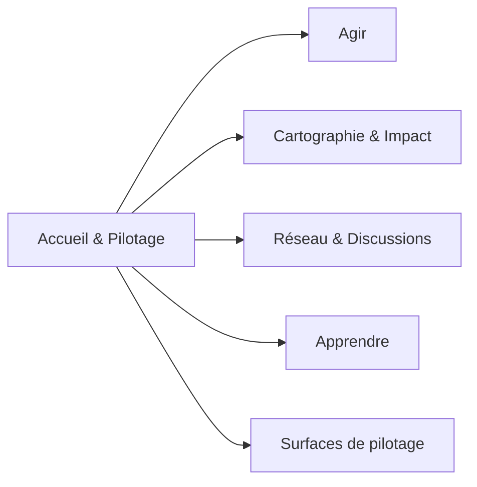

# Vision et objectifs

CleanMyMap structure l'action locale de dépollution en connectant citoyens, collectifs, associations, collectivités, entreprises et acteurs de supervision. Le projet vise à réunir dans un même produit la préparation des collectes, la coordination des bénévoles, la cartographie, la documentation des résultats et leur réutilisation.

## Présentation générale

**CleanMyMap.fr** est une plateforme environnementale et citoyenne open source en développement. Elle s'adresse aux bénévoles, organisateurs, collectifs et associations, ainsi qu'aux collectivités, entreprises engagées dans une démarche RSE et acteurs de la recherche. Sa vocation est de faciliter l'organisation et la valorisation des collectes de déchets, sans obliger chaque acteur à reconstruire ses outils de coordination et de suivi.

Aujourd'hui, les informations utiles à une cleanwalk peuvent être réparties entre cartes, messageries privées, formulaires, fichiers Excel, photographies et comptes rendus. CleanMyMap cherche à relier les étapes **repérer → préparer → mobiliser → agir → documenter → partager**, tout en distinguant ce que la plateforme permet déjà de ce qui reste en développement.

Le site web constitue la surface fonctionnelle complète. Une application mobile native, destinée prioritairement aux bénévoles sur le terrain, est en développement actif et n'est pas encore prête pour une diffusion en production.

## Positionnement du projet

CleanMyMap se positionne à l'intersection de plusieurs champs complémentaires :

- **transition écologique** : prévention et réduction des déchets abandonnés, sensibilisation, organisation d'actions de dépollution et amélioration de la connaissance environnementale ;
- **civic-tech** : outils numériques au service de l'action citoyenne, de la coordination locale et de la coopération entre acteurs d'un territoire ;
- **innovation numérique** : plateforme web et mobile, cartographie interactive, traitement et restitution de données, outils de coordination et composants open source ;
- **innovation sociale** : création de liens entre des personnes et structures d'horizons divers, continuité de l'engagement bénévole et meilleure accessibilité des actions collectives ;
- **activité physique et engagement collectif** : valorisation de la marche et de la collecte sur le terrain, sans assimilation de cette activité à une performance sportive obligatoire ;
- **économie sociale et solidaire (ESS)** : cible de structuration cohérente avec la finalité d'intérêt collectif du projet, via la constitution envisagée d'une association loi 1901 ;
- **science participative**, lorsque les protocoles, observations et données produits permettent une contribution structurée à la connaissance.

Ces qualifications décrivent le positionnement et l'ambition de CleanMyMap. Elles ne constituent pas, à elles seules, une reconnaissance administrative, un agrément, une certification ou une qualification juridique acquise.

### Qualifications et statuts

| Qualification ou statut | Situation |
| --- | --- |
| Projet environnemental | `CURRENT` |
| Projet numérique / civic-tech | `CURRENT` |
| Projet open source | `CURRENT` |
| Innovation numérique | `CURRENT` comme positionnement du projet |
| Innovation sociale | `POSITIONNEMENT` à démontrer selon les critères du dispositif concerné |
| Activité physique et lien social | `OBJECTIF PRODUIT` ; effets sociaux non mesurés |
| Science participative | `CONDITIONNEL` selon les protocoles et usages concernés |
| Association loi 1901 | `TARGET` tant que l'association n'est pas constituée |
| Économie sociale et solidaire (ESS) | `TARGET` via la future structure associative ; ne pas la présenter comme acquise avant constitution |
| Agrément ESUS | `NON ACQUIS` ; option future à évaluer si les critères sont remplis |
| SCIC | `OPTION D'ÉVOLUTION` ; ne constitue pas la structure actuelle |

## Le parcours d'une action

### Avant : préparer et coordonner

Les organisateurs disposent d'une fiche d'action reprenable : lieu et rendez-vous, date et horaires, parcours cartographié ou itinéraire recommandé, prévisions météo, inscriptions et invitations, accessibilité, consignes de sécurité, matériel à apporter ou fourni, checklist et informations logistiques. La préparation intègre un moteur de qualification des formalités administratives locales et un suivi de leur état. Ces aides ne remplacent ni une autorisation administrative ni la vérification des obligations par l'organisateur ; elles ne signifient pas qu'un formulaire officiel est automatiquement transmis.

### Pendant : agir et suivre le terrain

Le web donne accès à la cartographie et aux informations des actions. La **V1 mobile native**, développée dans le même produit avec Expo / React Native, comprend des parcours pour rejoindre, créer ou signaler une action, ainsi qu'une activité GPS avec carte, tracé, reprise après interruption de connexion et contacts d'urgence. Le fonctionnement en arrière-plan, la validation sur appareils réels et la distribution restent à stabiliser avant toute présentation de l'application comme disponible publiquement.

### Après : enregistrer et partager les résultats

Une action peut conserver les résultats de collecte disponibles : masse et catégories de déchets, mégots, participants, durée, géométrie et photographies selon les champs effectivement renseignés. Le projet distingue les observations et déclarations des **indicateurs dérivés et proxys**. Un score de pollution historique ou une projection de re-pollution ne vaut pas mesure actuelle du lieu ; des équivalences d'eau, d'émissions ou de surface ne prouvent pas un impact physique réellement évité.

Le module Rapports fournit des analyses et des exports CSV/PDF avec sélection de période et modules optionnels. À terme, les usages visés incluent le bilan individuel d'un bénévole, l'historique d'une association, la synthèse d'une commune et un reporting RSE d'entreprise. Ces formats spécialisés ne doivent pas tous être présentés comme des modèles prêts à l'emploi : leur disponibilité dépend de leurs contrats de données, de périmètre et d'autorisation.

Références : [création d'action](../pages_site/routes/02-agir/actions-new/actions-new-README.md), [rapports](../pages_site/routes/03-cartographie-impact/reports/reports-README.md), [protocole scientifique](./SCIENTIFIC_PROTOCOL.md) et [mobile](../../apps/mobile/README.md).

## Coordination et continuité de l'engagement

CleanMyMap cherche à réduire la dispersion des échanges sur WhatsApp, Facebook et Discord grâce à une messagerie intégrée. Elle distingue la **communauté globale**, les échanges **territoriaux et limitrophes**, les messages privés et la **discussion propre à chaque action publiée éligible**.

Ces espaces ne sont pas tous librement accessibles sans compte. La lecture et l'écriture des discussions d'action dépendent notamment de la relation d'organisation ou d'une inscription / participation confirmée suivant la phase. Une demande en attente ne confère pas le droit d'écrire ; les brouillons ne créent pas de salon public libre. La continuité du fil d'une action permet de conserver le contexte avant et après une intervention.

La dimension communautaire vise aussi la rencontre entre personnes d'horizons différents, l'accueil des nouveaux bénévoles et la participation de personnes isolées ou en situation de précarité, y compris celles que leur situation administrative peut éloigner des réseaux classiques. Cet objectif d'inclusion ne signifie ni qu'un impact social a déjà été démontré, ni qu'une information sur le statut administratif des personnes doive être collectée.

Références : [messagerie](../pages_site/routes/04-reseau-discussions/messagerie/messagerie-README.md), [parcours utilisateurs](./parcours-utilisateurs.md) et [dimension communautaire](./dimension-communautaire.md).

## SPOGOMI : collecte et compétition sportive

La page publique [`/spogomi`](https://cleanmymap.fr/spogomi) présente le mouvement, les formats **Casual** et **World Cup**, les références internationales et les événements explicitement publiés sur CleanMyMap. L'intégration événementielle comporte des contrats dédiés aux inscriptions, équipes, mesures, arbitrages, résultats, classements et exports.

Le résultat collectif validé d'une compétition est rapproché d'**une seule action environnementale canonique CleanMyMap**. Les points sportifs et classements SPOGOMI restent indépendants de la progression et de la gamification citoyenne CleanMyMap. Les règles sportives dépendent du règlement applicable à l'édition et ne sont pas inventées à partir de modèles génériques.

Le domaine est `CURRENT PARTIEL` : les capacités applicatives documentées ne constituent pas une validation opérationnelle externe. **Aucun partenariat officiel, mandat de représentation ou règlement international homologué ne doit être revendiqué sans preuve indépendante.** Le projet peut présenter le travail d'intégration et les événements effectivement organisés avec sa plateforme, non un statut institutionnel supposé.

Référence : [contrat SPOGOMI](../features/spogomi.md).

## Ouverture des données, apprentissage et sciences participatives

Le produit propose des ressources pédagogiques, des quiz et des contenus sur les déchets, le tri, le recyclage et les bonnes pratiques environnementales. Il associe ces ressources à des informations territoriales susceptibles d'aider à préparer et prioriser des actions.

La rubrique Open Data présente une **projection JSON publique** des actions approuvées et cartographiées. Sa réutilisation doit rester limitée aux données effectivement publiques, aux droits des sources tierces et aux exigences de confidentialité. Des usages plus riches par les chercheurs, associations et collectivités sont une ambition à développer sous réserve de protocoles et de contrôles de qualité adaptés ; aucune API scientifique exhaustive ni validation de science participative n'est implicite.

Référence : [Open Data](../pages_site/routes/04-reseau-discussions/open-data/open-data-README.md).

## Architecture produit actuelle



Fallback statique :

```md

```

Les cinq blocs décrivent la navigation web. Le mobile est une application distincte du même monorepo et partage les identités et contrats métier nécessaires ; ce n'est ni une copie intégrale du site ni un deuxième projet indépendant.

## Objectifs produit

- Accélérer les actions concrètes de terrain et simplifier leur préparation.
- Rendre l'impact lisible, sourcé, exportable et reproductible dans les limites des données disponibles.
- Conserver un réseau local actif, ouvert à des publics variés et utile à la coordination.
- Donner des repères pédagogiques simples aux nouveaux venus.
- Relier les activités terrain web et mobile sans créer de sources de vérité concurrentes.
- Faciliter la réutilisation responsable des données publiques.

## Problème central

Le problème principal est la dissociation entre la réalité visible des déchets dans l'espace public et la capacité des acteurs locaux à agir vite, de manière coordonnée et mesurable.

Trois freins dominants structurent ce besoin :

- dispersion de l'information ;
- faible continuité de mobilisation ;
- difficulté de priorisation locale.

## Impact visé

L'objectif n'est pas seulement de signaler des déchets, mais de soutenir une boucle complète :

- repérage d'un besoin et préparation de l'intervention ;
- mobilisation et coordination collective ;
- action de terrain ;
- déclaration, vérification et valorisation des résultats ;
- lecture de l'impact avec limites méthodologiques ;
- production de livrables réutilisables.

## Bénéfices attendus

### Capacités documentées actuellement

- socle applicatif web pour la collecte, la carte et le suivi ;
- parcours orientés par les rôles et leurs permissions effectives ;
- discussions globales, territoriales et par action sous contrôle d'accès ;
- exports et rapports utilisables dans les périmètres documentés ;
- application mobile fonctionnellement développée, non validée pour la production ;
- intégration événementielle SPOGOMI partielle, avec validation externe encore ouverte.

### Effets potentiels non démontrés

- meilleure continuité des actions locales et de la participation ;
- réduction de la dispersion des outils ;
- meilleure priorisation territoriale ;
- meilleure exploitabilité institutionnelle et scientifique des données ;
- création de lien social, inclusion et bénéfices liés à l'activité physique.

## Origine du projet

CleanMyMap a été initié dans le cadre du Diplôme universitaire Engagement de Sorbonne Université. Le porteur indique une genèse en **2025** et un accompagnement par **Pépite Sorbonne Université** au titre du **Statut national étudiant-entrepreneur**. Ces deux précisions déclaratives doivent être étayées par une pièce institutionnelle avant d'être utilisées comme preuves d'un soutien officiel dans un dossier externe. Le cadre universitaire du projet ne signifie pas que Sorbonne Université édite ou garantit la plateforme.

Le code source propre au projet est publié sous licence `AGPL-3.0-only`, sous réserve des règles distinctes applicables aux données, contenus tiers et à la marque. Voir [README racine](../../README.md) et [documentation juridique](../legal/README.md).
