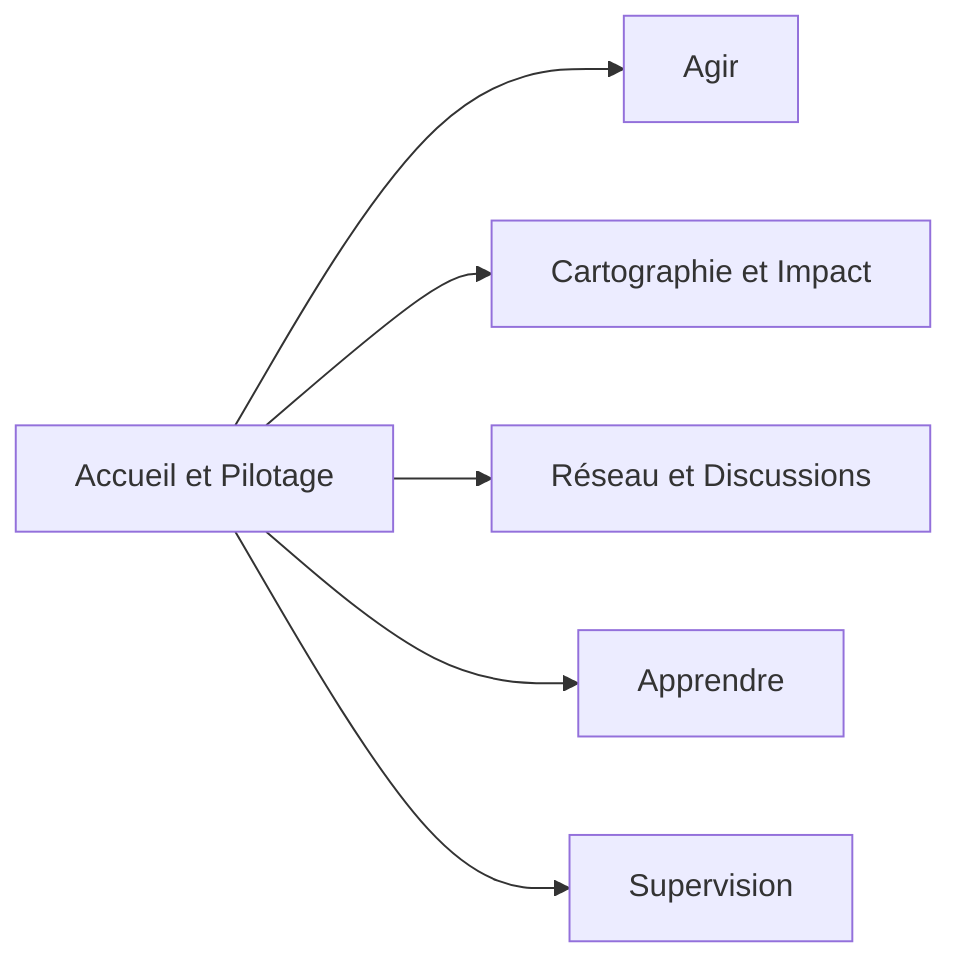

# PRD — CleanMyMap

> **Type :** source `CURRENT` du problème, du positionnement, des publics et
> des exigences produit. Les contrats de domaine, les routes et les preuves
> runtime restent propriétaires de leurs sources spécialisées.

## 1. Problème et proposition de valeur

Les initiatives locales de collecte de déchets utilisent souvent des outils dispersés : cartes, échanges privés, formulaires, fichiers et comptes rendus. CleanMyMap cherche à relier la séquence **repérer → préparer → mobiliser → agir → documenter → partager** dans une plateforme citoyenne open source.

**Proposition de valeur :** permettre à un acteur de créer ou rejoindre une action de dépollution, d'en documenter les résultats avec une provenance identifiable et d'obtenir des restitutions utiles à la continuité de l'engagement, à la coordination et aux partenaires.

Le produit conjugue transition écologique, civic-tech et sensibilisation. L'inclusion sociale, les bénéfices d'activité physique et l'économie sociale et solidaire relèvent actuellement d'objectifs ou de trajectoires, et non de résultats sociaux ou de statuts juridiques démontrés.

Le projet se situe aussi à l'intersection de l'innovation numérique, de la
continuité de l'engagement collectif, de l'activité physique de terrain et de
la science participative conditionnelle. Ces qualificatifs décrivent un
positionnement, pas un agrément, une certification, un statut juridique ou un
résultat déjà mesuré.

| Qualification | Statut documentaire |
|---|---|
| Projet environnemental, numérique, civic-tech et open source | `CURRENT` |
| Innovation sociale et activité physique / lien social | `OBJECTIF / POSITIONNEMENT`, effets non mesurés |
| Science participative | `CONDITIONNEL`, selon protocole et usage |
| Association loi 1901 et ESS | `TARGET`, tant que la structure n'est pas constituée |
| Agrément ESUS / SCIC | `NON ACQUIS / OPTION`, aucune structure actuelle présumée |

## 2. Utilisateurs et besoins

| Public | Besoin principal | Frontière à respecter |
|---|---|---|
| Citoyen / bénévole | Repérer, participer, signaler et déclarer une action | Distinguer sa propre contribution des données publiques |
| Coordinateur / organisateur | Préparer une action, mobiliser, gérer la logistique et restituer | Accès borné aux actions organisées ou coorganisées |
| Association / collectif | Coordonner plusieurs initiatives et communiquer des résultats | Une relation à la structure n'est pas déduite du libellé de rôle |
| Représentant d'entreprise | Étudier un partenariat et lire des indicateurs autorisés | Pas de scope entreprise implicite |
| Élu / décideur public | Consulter des projections et organiser la coopération territoriale | Pas de scope territorial ou pouvoir administratif implicite |
| Scientifique | Accéder aux méthodologies et données publiques ou assainies | Aucune donnée privée par le seul persona scientifique |
| Admin / modérateur | Qualifier, modérer et superviser les données | AuthN/AuthZ explicite, audit des mutations sensibles |

**Principe :** un persona UX, un rôle attribué, le rôle actif et la relation à une organisation sont quatre notions distinctes.

## 3. Périmètre et statut vérifié dans la documentation

### CURRENT, sous réserve des contrats runtime

- Application web Next.js : surface fonctionnelle complète du produit.
- Actions de collecte : préparation, création, participation, suivi, carte, déclaration et restitution selon chaque route et permission.
- Carte : différenciation entre interventions historiques, signalements Trash Spotter et lieux explicitement propres.
- Documents d'impact, exports, snapshots et indicateurs : des capacités existent, mais tous les bilans spécialisés ne sont pas disponibles.
- Partage de PDF historiques : le code CURRENT prévoit des liens révocables à durée limitée vers un artefact PDF déjà rendu, sans communiquer le rapport brut JSON/CSV ni des accès privés aux actions. La migration de partage est versionnée, son application distante n'est pas établie par la seule lecture Git.
- Parcours de coordination, réseau, gamification et administration : superficies fonctionnelles présentes, dont certaines nécessitent encore une validation opérationnelle complète.
- Mobile Expo : développement actif, avec suivi GPS et parcours terrain, **non prêt pour production**.

La continuité d'engagement comprend une communauté globale, des échanges
territoriaux, des messages privés et des discussions rattachées aux actions
éligibles. Une demande en attente ou un brouillon ne crée pas un droit de
lecture ou d'écriture dans un salon ; les détails relèvent du contrat
Messagerie.

SPOGOMI est `CURRENT PARTIEL` : la page publique et les contrats d'intégration
peuvent présenter les formats, événements et résultats effectivement gérés,
mais ne démontrent aucun partenariat officiel, mandat de représentation ou
règlement international homologué. L'Open Data est une projection publique
bornée aux données effectivement approuvées et diffusables ; aucune API
scientifique exhaustive ni validation de science participative n'est implicite.

### PLAN / FUTURE

- Compléter la validation terrain de bout en bout et garantir la reproductibilité des rapports.
- Tester les premières prestations et programmes territoriaux avec des partenaires réels.
- Structurer juridiquement et financièrement le projet, sans supposer l'association déjà constituée.
- Finaliser les validations mobile sur appareils physiques, background et distribution.
- Étendre les usages institutionnels et scientifiques seulement sur besoin et droit démontrés.

### Non-objectifs immédiats

- Remplacer la plateforme PostgreSQL/Supabase par MongoDB, Spark ou BigQuery.
- Dupliquer le site web en intégralité dans l'application mobile V1.
- Présenter une estimation pédagogique comme une mesure physique réellement évitée.
- Multiplier les fonctionnalités sociales sans valider le parcours cœur.
- Accorder des capacités métier sur la seule base d'un persona ou d'un intitulé de rôle.

## 4. Exigences fonctionnelles prioritaires

| ID | Exigence | Critère de réception observable | Priorité |
|---|---|---|---|
| PRD-01 | Une action peut être préparée, sauvegardée, retrouvée et finalisée | Les données persistent, les états reprennent sans perte et les mutations interdites restent refusées | P0 |
| PRD-02 | Participation et organisation sont rattachées à la bonne ressource et au bon acteur | Un acteur ne peut agir sur une action étrangère hors relation canonique | P0 |
| PRD-03 | Les résultats de terrain conservent leur valeur et leur provenance | `null` ou `NA` n'est pas assimilé à zéro ; les proxys sont étiquetés | P0 |
| PRD-04 | Un rapport exploitable peut être produit et réutilisé depuis une action admissible | Restitution cohérente avec la source, génération reproductible et export contrôlé | P0 |
| PRD-04b | Un PDF historique peut être partagé puis révoqué par son propriétaire | Le lien expiré ou révoqué ne livre plus le fichier ; seul le PDF rendu choisi est communiqué | P0/P1 |
| PRD-05 | La carte distingue les natures et temporalités de données | Action historique ≠ signalement courant ≠ lieu propre ; géométrie et confiance explicites | P0/P1 |
| PRD-06 | Les parcours publics, connectés et administratifs respectent les droits | Projection minimale, refus d'accès et absence d'IDOR vérifiés | P0 transversal |
| PRD-07 | Le coordinateur visualise seulement ses actions liées | `/pilotage` vide sans relation ; aucun repli global automatique | P1 |
| PRD-08 | Les workflows mobile terrain résistent aux interruptions | Reprise GPS/offline, finalisation propriétaire et test physique avant release | P2 conditionnel |
| PRD-09 | Un partenaire peut comprendre la valeur d'une restitution | Prototype/livrable évalué avec partenaire réel, sans allégation commerciale inventée | P0 commercial |

## 5. Données d'impact et intégrité scientifique

- Statuts de preuve : `OBSERVED`, `DERIVED`, `DECLARED`, `ASSUMPTION`, `PROXY`, `NA`.
- Les masses, mégots, participants et durées sont des observations ou déclarations **uniquement si renseignés**. Une donnée absente reste inconnue ; zéro est réservé à un zéro explicite.
- Eau, CO2e et surface opérationnelle sont des **proxys** avec méthodologie versionnée. La documentation scientifique actuelle fournit les facteurs par défaut, mais ceux-ci ne doivent pas être figés ni redéfinis dans ce PRD.
- Le score de pollution d'une action renseigne une lecture historique ; une projection de re-pollution n'est pas une observation en temps réel.
- La couverture des mesures, la provenance des géométries et les éventuelles données partielles doivent être visibles dans la restitution appropriée.

## 6. Expérience attendue

- **Première utilisation :** comprendre la finalité, consulter les possibilités publiques, puis se connecter si une opération exige une identité.
- **Action :** parcours guidé avec sauvegarde, prévisualisation, validation et retour explicite sur les erreurs.
- **Terrain :** accès direct à la carte, informations logistiques, contact d'urgence et reprise en cas d'interruption.
- **Après action :** déclaration de mesures, qualification, possibilité de rectification selon les droits et rapport.
- **Récurrence :** historique, indicateurs interprétables et accès à une prochaine action.

Avant l'action, la préparation peut regrouper lieu, rendez-vous, horaires,
itinéraire, météo, inscriptions, accessibilité, sécurité, matériel et
formalités. Ces aides ne remplacent pas une autorisation administrative. Sur
le terrain, la V1 mobile vise rejoindre, créer ou signaler une action, le GPS,
la carte, le tracé, la reprise et les contacts d'urgence ; le background,
l'appareil réel et la distribution restent à valider. Après l'action, la
restitution distingue les observations, déclarations, proxys et limites de
méthode ; elle ne présente pas une équivalence d'eau, de CO2e ou de surface
comme un impact physique évité.

Les écrans exacts, libellés, états disponibles et règles de visibilité relèvent des fiches route-first `documentation/pages_site/` et du code courant.

## 7. Objectifs et indicateurs de succès

Aucun seuil chiffré nouveau n'est fixé sans base d'observation. Instrumenter ou suivre, selon les contrats existants :

- **Adoption :** visiteurs engagés, comptes actifs, consultations d'actions.
- **Activation :** créations, inscriptions, actions finalisées, temps nécessaire pour conclure le parcours.
- **Qualité :** taux de dossiers complets, couverture des mesures, cas `NA`, anomalies détectées et corrigées.
- **Restitution :** rapports générés, erreurs de génération, taux de réutilisation ou téléchargement autorisé.
- **Fiabilité :** échecs de sauvegarde, erreurs d'autorisation, perte de données, reprise après interruption.
- **Coût :** transferts Supabase, exécutions Vercel, latence et mémoire des calculs utilisés.
- **Partenariats :** pilotes réellement menés, retours de partenaires, livrables acceptés, prestations effectivement facturées le cas échéant.

Chaque indicateur exige un propriétaire, une source, une définition, une fenêtre temporelle et un statut de preuve avant publication.

## 8. Dépendances et décision de lancement

Le parcours et les rapports P0 précèdent l'extension des offres et des territoires. Le backend commun, les permissions et les contrats scientifiques doivent être stabilisés avant de multiplier les consommateurs web/mobile/partenaires.

Une fonctionnalité n'est terminée que si ses cas positif, négatif et limite sont testés, ses permissions vérifiées, son comportement UI explicite et sa source canonique mise à jour. Ne pas transformer une CI verte en preuve de succès sur terrain ou en production.

La navigation web s'organise autour de cinq familles : Accueil & Pilotage,
Agir, Cartographie & Impact, Réseau & Discussions et Apprendre, auxquelles
s'ajoutent les surfaces de supervision. Le mobile est une application distincte
du même monorepo qui partage les contrats nécessaires ; il ne constitue ni une
copie intégrale du web ni un second modèle métier.



La boucle d'impact visée est :

```text
besoin visible → préparation → mobilisation → action
→ déclaration / vérification → restitution réutilisable
```

Les effets attendus (continuité de participation, réduction de la dispersion,
priorisation territoriale, usages institutionnels ou scientifiques, lien social
et activité physique) restent à démontrer par des observations adaptées. Aucun
indicateur produit ne doit transformer cette ambition en résultat établi.

L'origine universitaire, la genèse déclarée en 2025, l'accompagnement Pépite
et le portage étudiant-entrepreneur peuvent être conservés comme contexte
déclaratif, mais ne valent pas preuve d'un soutien institutionnel. Le code du
projet est publié sous `AGPL-3.0-only`, sous réserve des règles applicables aux
données, contenus tiers et à la marque.

## 9. Sources canoniques

- `documentation/product/vision-et-objectifs.md` : mission et positionnement.
- `documentation/product/roadmap-priorisee.md` : priorité et STOP CONDITIONS.
- `documentation/product/parcours-utilisateurs.md` : personas et parcours.
- `documentation/product/SCIENTIFIC_PROTOCOL.md` et `methodologie-carte-actions.md` : indicateurs et carte.
- `documentation/security/authz-authn-regles.md` : droits effectifs.
- `documentation/pages_site/INDEX.md` : routes et surfaces CURRENT.
- `documentation/features/reports/report-pdf-themes-and-reuse.md` : thèmes Impact et Scientifique, partage et réutilisation PDF.
