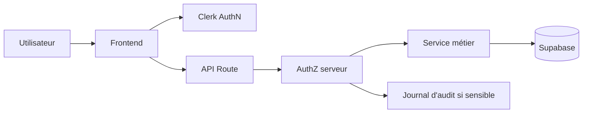

# AuthN, AuthZ, secrets et frontières API (`CURRENT`)

> **Statut documentaire : `CURRENT`.** Source canonique de l'état runtime actuel.
> La matrice de capacités cible est
> séparée dans [`authorization-capabilities.md`](./authorization-capabilities.md)
> et ne doit pas être lue comme une permission déjà déployée.

Référence durable pour l'authentification, les permissions, les dérogations administratives et les frontières d'accès.

Le modèle de capacités et de périmètres cible est défini dans :

```txt
documentation/security/authorization-capabilities.md
```

Ce document conserve les contrats techniques AuthN/AuthZ et les règles propres aux surfaces existantes. En cas de divergence pendant la migration, le code et les tests actuels décrivent le comportement réellement implémenté ; la matrice de capacités décrit la direction à atteindre.

## Principes

```txt
AuthN = qui est l'utilisateur ?
AuthZ = que peut-il faire dans ce contexte ?
Capability = quelle opération métier demande-t-il ?
Scope = dans quel périmètre peut-il l'exercer ?
Ownership = cette ressource lui appartient-elle ?
Override = agit-il explicitement comme modérateur ?
Audit = l'opération sensible est-elle traçable ?
```

Une session valide ne donne jamais implicitement tous les droits.

La décision serveur cible suit :

```txt
identité
+ capacité
+ rôle compatible
+ scope / ownership
+ état métier
+ projection de données autorisée
```

### Règle IDOR pour les ressources adressées par identifiant

Toute route sensible qui reçoit un `resourceId`, un identifiant d'action, de
message, de participant, de profil, de signalement, de rapport ou de fichier
doit résoudre la cible côté serveur et ne jamais traiter cet identifiant comme
une preuve d'accès. La décision doit vérifier, dans cet ordre logique :

1. l'identité issue de la session serveur ;
2. la capacité de l'opération ;
3. le scope applicable ;
4. l'ownership ou la relation canonique avec la ressource ;
5. l'état métier autorisant l'opération ;
6. la projection minimale nécessaire à la réponse.

La requête ou la mutation doit rester contrainte par ces relations côté
serveur, y compris lorsqu'un identifiant est remplacé manuellement par celui
d'un autre utilisateur. Un accès public est une exception explicitement
projetée, limitée aux données publiques et séparée des lectures privées. Une
identité `service_role` peut exécuter une opération technique serveur après
autorisation du handler, mais ne remplace jamais l'identité, la capacité ou
l'ownership de l'utilisateur HTTP.

## Architecture



## Identité principale

Clerk est le fournisseur d'identité principal du web.

Les profils Supabase servent aux jointures et aux règles métier.

Préserver la distinction entre :

```txt
Role
SessionRole
Parcours
Capability
Scope
```

Ne pas créer une seconde identité canonique indépendante sans ADR.

Le vocabulaire du rôle privilégié est unifié : **IMU = super-admin = rôle
interne `max`**. `max` est la valeur technique canonique, `IMU` le libellé
produit, et `super-admin` (ainsi que `super_admin` et `superadmin`) un alias
entrant normalisé vers `max`. Aucun de ces termes ne représente un niveau de
permission différent. Les alias historiques `owner`, `godmode` et `creator`
restent limités à la compatibilité d'entrée.

`service_role` est une identité technique serveur. Ce n'est jamais un rôle utilisateur ni une preuve d'autorisation HTTP.

### Frontière Clerk native mobile

Les parcours métier natifs de `apps/mobile` utilisent les frontières bornées
`/api/mobile/account` et `/api/mobile/actions`, ainsi que la passerelle dédiée
aux mutations Actions/Signalements.
Ils transmettent le token de session Clerk en
`Authorization: Bearer`, puis le handler vérifie ce JWT avec
`clerkClient().authenticateRequest(request, { acceptsToken: "session_token" })`
avant toute lecture ou mutation. Cette voie est distincte de `auth()` dans les
routes web : un header Bearer présent ne constitue jamais, à lui seul, une
preuve d'identité. Une session absente, expirée, mal formée ou appartenant à un
autre utilisateur est refusée avant l'accès au service métier.

Après AuthN, la frontière réutilise les services et gardes AuthZ canoniques :
ownership de l'utilisateur, rôle actif, relation organisateur/coorganisateur,
état de publication et audit. Elle ne crée pas de second fournisseur
d'identité, ne place aucun token dans l'URL et n'expose jamais `service_role` au
client mobile. Les mutations de signalement écrivent uniquement
`trash_spotter_spots` ; les médias passent par les intents, quotas et
permissions du service Signalement. Une réponse locale partielle ne vaut pas
confirmation métier.

La projection `/api/mobile/account` reste privée et owner-scoped. Elle réutilise
`getCurrentUserIdentity`, l'historique de participation, la progression et les
tables de préférences canoniques ; ses mutations de profil synchronisent Clerk
et le profil Supabase. Le changement de parcours actif passe exclusivement par
`POST /api/account/active-profile`, vérifie `getSwitchableProfiles` et n'écrit
jamais `GRANTED_ROLE`. La demande de suppression reste le workflow RGPD
canonique de `/contact` : l'application mobile ne prétend pas supprimer le
compte immédiatement.

### Séparation obligatoire du rôle attribué, du rôle actif et du profil UX

L'identité courante doit exposer le contrat suivant :

```ts
role: GrantedRole          // GRANTED_ROLE : attribution réellement obtenue
activeRole: ActiveRole     // ACTIVE_ROLE : rôle qui pilote les capacités
activeProfile: AppProfile  // alias UX/legacy, sans permission autonome
```

`role` reste l'attribution obtenue et ne peut pas être modifié par le menu.
Les capacités effectives des gardes, de `EffectiveAccess` et des APIs sensibles
sont calculées depuis `activeRole`, qui doit toujours être autorisé par
`role`. `activeProfile` est un alias de compatibilité UX/legacy ; il sert à la
navigation, aux CTA, aux libellés et aux priorités de parcours, mais ne donne
jamais de permission indépendante.

### Règle durable des capabilities runtime

Une capability runtime existe uniquement parce qu'un garde ou un service la
consomme réellement. Une fonctionnalité, un CTA, un nom de format d'export ou
une intention future ne suffit pas à ajouter une propriété à `EffectiveAccess`.
Les contrôles propres à une opération restent dans leur handler ou service
canonique : par exemple `requireAdminAccess` pour les imports et exports
administratifs, `requireAuthenticatedAccess` et le quota serveur pour le
livrable « dossier élus », et `canAccessPilotage` suivi du scope organisé pour
`/pilotage`. Les capacités futures relèvent de
`authorization-capabilities.md` dans ses sections `PLAN / TARGET`, pas du
contrat runtime courant.

### Quatre notions canoniques

Les contrats de sécurité et les parcours produit utilisent quatre notions
distinctes :

```txt
GRANTED_ROLE
= rôle obtenu par le compte

ACTIVE_ROLE
= persona métier actif utilisé pour les capacités effectives

organisation / structure
= entité externe à laquelle l'utilisateur peut éventuellement être relié

parcours UX
= navigation, CTA, libellés et priorités d'interface
```

`coordinateur` décrit une personne ou une fonction qui organise des actions,
pas une association. `entreprise` décrit le parcours d'un représentant, pas
une appartenance organisationnelle prouvée. `elu` décrit le décideur public,
pas une collectivité ni un propriétaire de territoire. `scientifique` décrit
actuellement principalement un parcours d'analyse. Une association, une
entreprise, une collectivité ou un territoire ne devient un scope autorisable
qu'au travers de sa relation canonique persistée et vérifiée côté serveur.

Pour les actions, cette distinction est obligatoire :

```txt
action_organizers
= relation organisateur/coorganisateur métier persistée et canonique

GRANTED_ROLE = rôle canonique Clerk publicMetadata.role
= attribution de rôle ; jamais une relation avec une action

ACTIVE_ROLE
= capability globale explicitement prévue par le domaine ; jamais une
  relation organisateur synthétique

acteur technique d'import
= identité d'exécution et de traçabilité de l'ingestion ; jamais un
  organisateur métier par défaut

creator
= droit de créateur uniquement lorsqu'il est explicitement prévu par le
  contrat de la capacité ; il ne remplace pas action_organizers
```

Une décision d'ownership ou d'AuthZ Actions ne doit donc consommer que la
relation `action_organizers`, ou une capability globale calculée depuis
`ACTIVE_ROLE`. Une allowlist, une configuration, un acteur `service_role`, un
acteur d'import ou un fallback créateur ne doit pas être converti en
`organizerIds`. Les helpers de compatibilité peuvent servir à une migration ou
à une projection non sensible identifiée, mais jamais à une garde d'accès.

Un parcours UX ne donne jamais de droit serveur supplémentaire : un CTA, un
libellé ou une route proposée par la navigation ne remplace ni la capacité,
ni le scope, ni l'ownership ou la relation requise par le handler.

Le rôle actif est résolu après le rôle attribué :

```txt
role = résolution Clerk de publicMetadata.role uniquement, avec la contrainte
owner ID exacte pour max
activeRole = activeRole persisté si valide pour role, sinon role
activeProfile = alias de lecture de activeRole
```

Une valeur persistée ne peut être retenue que si elle appartient à
`getSwitchableProfiles(role)`. Toute absence, valeur inconnue ou combinaison
incompatible utilise `activeRole = role`, puis `activeProfile = activeRole`.
Ce fallback protège à la fois les anciens comptes et les métadonnées
partiellement migrées.

La matrice de sélection est asymétrique et ne constitue pas une hiérarchie de
droits :

| GRANTED_ROLE | ACTIVE_ROLE sélectionnables |
|---|---|
| rôle ouvert | rôles ouverts |
| `elu` | rôles ouverts + `elu` |
| `admin` | rôles ouverts + `admin` |
| `max` | rôles ouverts + `elu` + `admin` + `max` |

`elu` et `admin` restent des rôles distincts : tant que `ACTIVE_ROLE=elu`, le
compte ne reçoit aucune capacité admin globale. Une bascule vers
`ACTIVE_ROLE=admin` n'est possible que pour `GRANTED_ROLE=admin` ou
`GRANTED_ROLE=max` et ne modifie jamais `GRANTED_ROLE`.

La mutation UX canonique est `POST /api/account/active-profile`. Elle doit
valider la session, résoudre le `role` côté serveur, vérifier la cible avec
`getSwitchableProfiles(role)`, écrire uniquement `activeRole` dans Clerk et
déclencher la synchronisation canonique vers Supabase. L'ancien champ
`activeProfile` peut être accepté comme entrée de compatibilité puis normalisé
vers `activeRole`. La route ne doit jamais accepter ou réécrire `role` depuis
le payload client.

`POST /api/account/profile-role` est une route historique retirée du parcours
UX. Elle ne doit plus servir de sélecteur de persona ; les sessions
authentifiées reçoivent `410` et doivent migrer vers la route dédiée.

Invariants de non-régression :

- aucun `benevole → admin` ou `admin → max` automatique ;
- `elu → admin` est refusé ; `admin → elu` est refusé ;
- aucun refresh ou onboarding ne rétrograde silencieusement `admin` ou `max` ;
- `role=max` est conservé lorsque `activeRole=benevole` ;
- `role=admin` est conservé lorsque `activeRole=scientifique` ;
- `activeProfile` ne constitue jamais une preuve de permission ;
- `admin` et `elu` proviennent uniquement de `publicMetadata.role` Clerk ;
- `max` exige `publicMetadata.role=max` et l'égalité exacte avec
  `CLERK_IMU_OWNER_USER_ID`, sinon il est refusé ;
- les métadonnées privées, `profile`, `unsafeMetadata`, alias, emails,
  allowlists et projections Supabase n'attribuent aucun rôle privilégié.

## Index des modules

- [Surfaces, rôles et accès](./authz-authn-surfaces.md)
- [Actions et discussions](./authz-authn-actions.md)
- [Données privées, missions GPS et RLS](./authz-authn-donnees.md)
- [Secrets, API et validation](./authz-authn-api.md)

La matrice de capacités futures reste PLAN / TARGET et ne donne pas de droits runtime.
